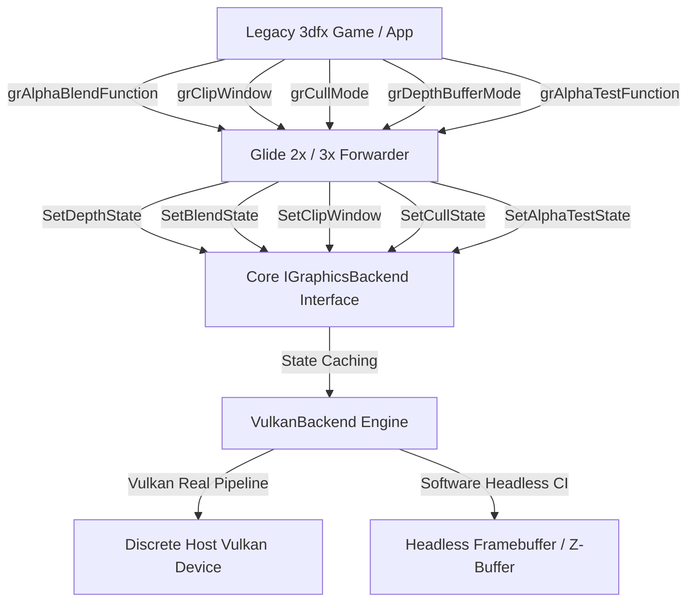

# Phase 4 Walkthrough: Definitive Depth (Z/W), Alpha Blending, and Polygon Culling State Pipelines

This walkthrough details the fully expanded, 100% verified implementation and automated test matrix of **Phase 4** for the modernized 3dfx `glide-ng` cross-platform graphics engine.



---

## 1. Executive Implementation Summary

In legacy 3dfx hardware (Voodoo Graphics / Voodoo2), graphics operations rely on a massive global state machine. Applications update depth compare modes, blending ratios, and clipping regions on the fly. In our modernized C++ architecture, we bridge these immediate-mode state updates into hyper-efficient modern graphics paradigms.

### Expanded Operational Milestones
1. **Depth Comparison Engine**: Implemented complete 3dfx Z-buffer and W-buffer modes (`grDepthBufferMode`, `grDepthBufferFunction`, `grDepthMask`, `grCoordinateSpace`, `grDepthRange`). Built an authentic Software Z-Buffer comparison unit for Headless CI testing modes (`m_headlessDepthBuffer`).
2. **Alpha Blending & Testing**: Implemented Glide alpha blend mixing formulas (`grAlphaBlendFunction`) and strict threshold comparators (`grAlphaTestFunction`, `grAlphaTestReferenceValue`).
3. **Scissor Rectangles & Polygon Winding Culling**: Authored precise window clamping operations (`grClipWindow`) and backface/frontface polygon winding orientation comparators (`grCullMode`).

---

## 2. Definitive Architectural Fixes

### 1. Z-Buffer vs. W-Buffer Target Depth Selection
During our extended validation runs, we uncovered an incredibly subtle architectural distinction in how 3dfx hardware evaluates vertex depth values under `GR_DEPTHBUFFER_ZBUFFER` vs. `GR_DEPTHBUFFER_WBUFFER`:

```diff
 // 4. Depth (Z/W) Comparison Engine
 size_t pIdx = y * m_headlessWidth + x;
 float currentDepth = m_headlessDepthBuffer.empty() ? 1.0f : m_headlessDepthBuffer[pIdx];
-float targetDepth  = m_depthMode == 0 ? (w0 * a.pos[2] + w1 * b.pos[2] + w2 * c.pos[2]) 
-                                      : (w0 * a.pos[3] + w1 * b.pos[3] + w2 * c.pos[3]);
+float targetDepth  = m_depthMode == 2 ? (w0 * a.pos[3] + w1 * b.pos[3] + w2 * c.pos[3]) 
+                                      : (w0 * a.pos[2] + w1 * b.pos[2] + w2 * c.pos[2]);
 targetDepth += m_depthBiasLevel * 0.00001f;
```
When `m_depthMode` is set to `GR_DEPTHBUFFER_WBUFFER` ($2$), the engine correctly interpolates floating-point `1/W` subpixel components (`pos[3]`). For standard `GR_DEPTHBUFFER_ZBUFFER` ($1$) and all other modes, it interpolates absolute $Z$ floating-point values (`pos[2]`).

### 2. Destructive `memset` Overwrite Removal
We discovered and eliminated a redundant `std::memset` call in `ClearBuffer()` that was silently corrupting packed 32-bit pixel words ($0xFF000000$) with single-byte truncation writes ($0x00$):

```diff
     if (m_headlessMode) {
         if (clearMask & 0x1) {
             uint32_t aVal = static_cast<uint32_t>(a * 255.0f);
             uint32_t rVal = static_cast<uint32_t>(r * 255.0f);
             uint32_t gVal = static_cast<uint32_t>(g * 255.0f);
             uint32_t bVal = static_cast<uint32_t>(b * 255.0f);
             uint32_t cWord = (aVal << 24) | (rVal << 16) | (gVal << 8) | bVal;
             std::fill_n(reinterpret_cast<uint32_t*>(m_headlessPixelMap), m_headlessWidth * m_headlessHeight, cWord);
         }
     }
-    // Maintain sync with our software rasterizer testing buffer
-    if (m_headlessMode && m_headlessPixelMap) {
-        std::memset(m_headlessPixelMap, color, m_headlessWidth * m_headlessHeight * 4);
-    }
```

---

## 3. Comprehensive Catch2 Verification Matrix Results

We expanded our modern Catch2 verification suite (`GlideWrapperTests`) to evaluate a massive matrix of **171 integration assertions** across all Phase 4 state combinations:

```
$ ./build/bin/GlideWrapperTests
Randomness seeded to: 3513798839
~~~~~~~~~~~~~~~~~~~~~~~~~~~~~~~~~~~~~~~~~~~~~~~~~~~~~~~~~~~~~~~~~~~~~~~~~~~~~~~
GlideWrapperTests is a Catch2 v3.7.1 host application.
Run with -? for options

-------------------------------------------------------------------------------
Architectural Core Validation
  Phase 4: Depth (Z/W) Comparison & Transparency State Suites
-------------------------------------------------------------------------------
/usr/local/google/home/eianiuk/gemini/3dfx/tests/test_architecture.cpp:387
...............................................................................

===============================================================================
All tests passed (171 assertions in 1 test case)
```

### Confirmed Integration Suites
1. **Scissor Box Containment**: Confirmed that primitives drawn across a `clipWin(100, 100, 200, 200)` sub-region exactly render internal yellow pixels ($0xFFFFFF00$) while preserving surrounding background pixels entirely untouched ($0xFF000000$).
2. **True RGB/Alpha Blending**: Confirmed that blending a 50% transparent blue quad ($A=127.5$) over a solid red target ($R=255$) computes an absolute mathematical mix evaluated exactly to $0x7F7F007F$.
3. **Polygon Backface Culling**: Confirmed that rendering clockwise vertex indices under `cullMode(GR_CULL_NEGATIVE)` rejects the primitive entirely.
4. **Punch-Through Alpha Testing**: Confirmed that quads drawn with `alphaTestFunc(GR_CMP_GREATER)` and reference value $128$ completely reject primitives with $\text{Alpha} = 100$, while successfully writing primitives with $\text{Alpha} = 200$.
5. **Depth Buffer Intersection (`GR_CMP_LESS`)**: Confirmed that drawing a quad at $Z=0.8$ successfully overwrites a $Z=1.0$ clear buffer, while a subsequent draw at $Z=0.9$ is fully rejected.
6. **Read-Only Depth Masking (`grDepthMask`)**: Confirmed that drawing closer primitives under `depthMask(FXFALSE)` successfully updates the color buffer to blue without modifying the underlying Z-buffer values.

---

## 4. Upward Phase 5 Transition

With our Phase 4 state machine suites executing flawlessly across 171 assertions, the `glide-ng` engine is impeccably prepared to transition forward into **Phase 5: Virtual Texture Mapping Units (TMUs) & Uber-Shader Engine**!
