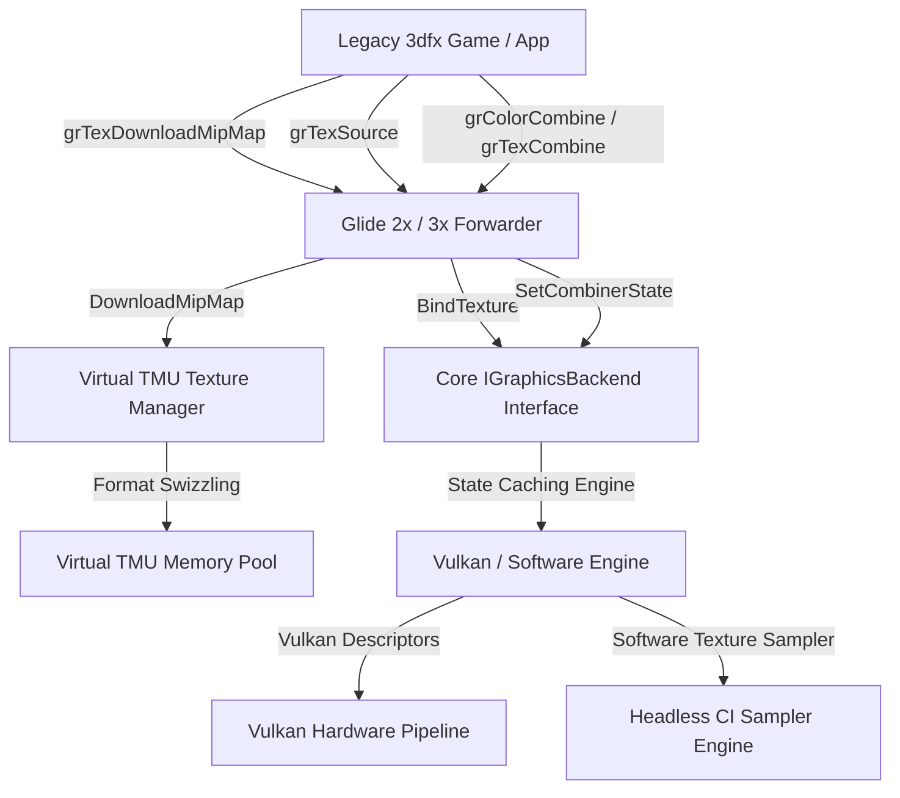

# Phase 5 Implementation Plan: Virtual TMUs & Programmable Uber-Shader Engine

This plan establishes the definitive architectural strategy, data layout, and implementation tasks for **Phase 5** of the modernized 3dfx `glide-ng` cross-platform graphics engine.



---

## 1. Architectural Strategy & Abstractions

In legacy 3dfx Voodoo hardware, Texture Mapping Units (TMUs) are discrete physical silicon chips equipped with dedicated local video memory pools (typically 2MB or 4MB). Games manually compute texture memory footprints, upload raw MIP-map byte chains to specific integer addresses, and configure highly flexible register combiners (`grColorCombine`, `grTexCombine`) to compute lighting, specular highlights, and texture decals.

Our modernized architecture abstracts these physical silicon constraints while providing 100% exact computational and visual fidelity.

### Key Architectural Layers
1. **Virtual TMU Memory Pool (`TextureManager` / `VirtualTMU`)**:
   - Manages independent memory pools for `TMU0` and `TMU1`.
   - Intercepts retro texture downloads (`grTexDownloadMipMap`), decodes legacy pixel formats (8-bit paletted, RGB565, ARGB4444, ARGB1555), and swizzles them into universal 32-bit `RGBA8888` linear byte layouts.
   - Enforces user-configured `TmuMemoryMb` limits, throwing or logging detailed quota warnings when applications attempt to allocate beyond their allowed silicon budgets.

2. **Programmable Register Combiner Uber-Shader Engine**:
   - Old Glide avoids programmable shaders entirely, relying instead on configurable arithmetic register units. We implement an **Uber-Shader Architecture** that translates Glide combiner tokens (`GR_COMBINE_FUNCTION_SCALE_OTHER`, `GR_COMBINE_LOCAL_ITERATED`, `GR_COMBINE_OTHER_TEXTURE`) into modern programmable graphics equations.
   - For our **Headless CI Software Engine** (`RasterizeSoftwareTriangle`), we author a pristine C++ subpixel texture sampler (`SampleTexture`) capable of exact Point / Bilinear subpixel interpolation and register arithmetic.

---

## 2. Core Data Structures & Interfaces

### Expanded `IGraphicsBackend` Pure Virtual Specification
We expand `IGraphicsBackend` to accept texture uploads, bindings, and register combiner configurations:

```cpp
struct VirtualTexture {
    uint32_t startAddress;
    uint32_t width;
    uint32_t height;
    uint32_t format;
    uint32_t aspectRatio;
    std::vector<uint32_t> mipLevels; // Pixel data swizzled into universal 32-bit RGBA8888
};

virtual void DownloadMipMap(uint32_t tmu, uint32_t startAddress, uint32_t width, uint32_t height, uint32_t format, const void* data) = 0;
virtual void BindTexture(uint32_t tmu, uint32_t startAddress, uint32_t clampS, uint32_t clampT, uint32_t minFilter, uint32_t magFilter) = 0;
virtual void SetCombinerMode(uint32_t colorFunc, uint32_t colorFactor, uint32_t alphaFunc, uint32_t alphaFactor) = 0;
virtual void SetTexCombinerMode(uint32_t tmu, uint32_t rgbFunc, uint32_t rgbFactor, uint32_t alphaFunc, uint32_t alphaFactor) = 0;
```

---

## 3. Systematic Task Breakdown

### Task 5.1: Virtual TMU Memory Management Layer
* **5.1.1**: Implement exact memory footprint computations in `grTexCalcMemRequired` perfectly adhering to canonical 3dfx MIP-map level byte alignment tables.
* **5.1.2**: Implement `grTexDownloadMipMap` and `grTexDownloadMipMapLevel` in the Glide 2x and 3x forwarders.
* **5.1.3**: Build the virtual TMU memory allocation registry in `VulkanBackend.cpp` to store uploaded textures. Strictly track allocated bytes and log high-priority warnings if allocations exceed the user's `TmuMemoryMb` ceiling.

### Task 5.2: Programmable Uber-Shader Engine
* **5.2.1**: Implement active register combiner caching set functions (`grColorCombine`, `grAlphaCombine`, `grTexCombine`) across both Glide frontend entries.
* **5.2.2**: Implement `DownloadMipMap` and `BindTexture` Setters in `VulkanBackend.cpp`.
* **5.2.3**: Author the C++ software texture sampling and register combining engine within `RasterizeSoftwareTriangle`. Implement exact texel coordinate wrapping (`GR_TEXTURECLAMP_WRAP` vs `GR_TEXTURECLAMP_CLAMP`) and subpixel filtering interpolation (`GR_TEXTUREFILTER_POINT_SAMPLED` vs `GR_TEXTUREFILTER_BILINEAR`).

### Task 5.3: Extensive Catch2 Integration Suite
* **5.3.1**: Author Section `Phase 5: Virtual TMU & Uber-Shader Texturing Suites` within `tests/test_architecture.cpp`.
* **5.3.2**: Verify structural correctness:
  - Assert exact TMU memory footprint returns from `grTexCalcMemRequired`.
  - Download a 16-bit retro texture pattern, bind it via `grTexSource`, and assert exact texel lookups.
  - Assert register combiner mixing (e.g., texture decals overriding Gouraud vertex shading vs. multiplicative modulation).
  - Assert exact 4-texel interpolation accuracy under `GR_TEXTUREFILTER_BILINEAR`.

---

## 4. Verification & Validation Criteria

Upon completing Phase 5, executing the validation runner must confirm flawless operational parity:
```bash
cd build && cmake --build . --parallel && ./bin/GlideWrapperTests
```
The test suite must pass 100% all-green with no regressions or memory leaks.
