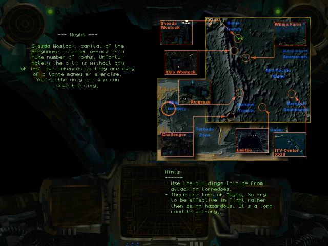
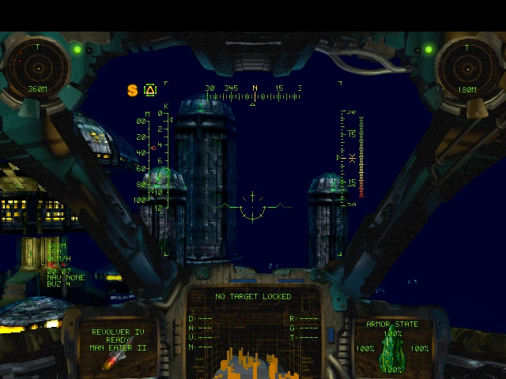
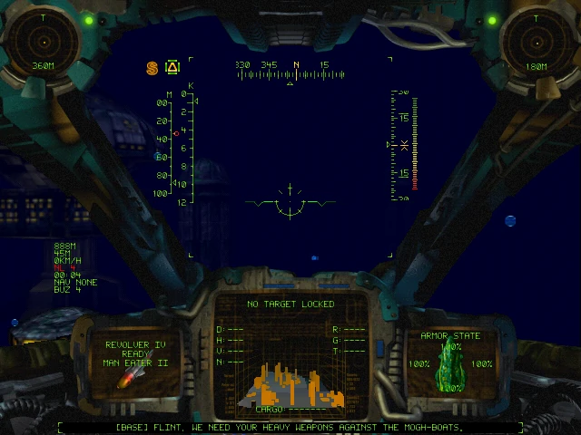
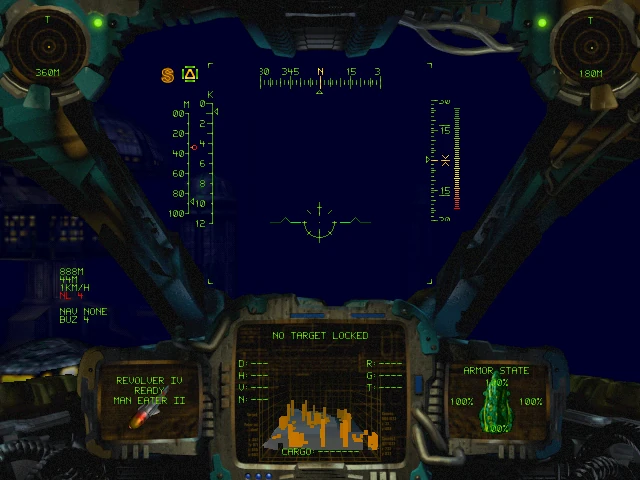
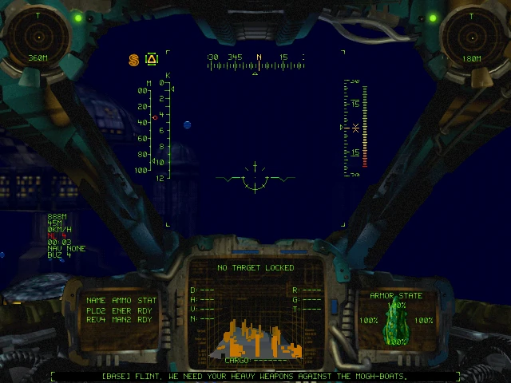
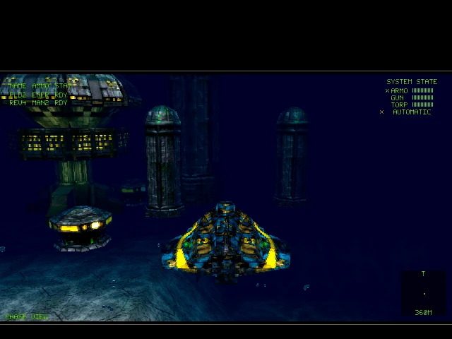
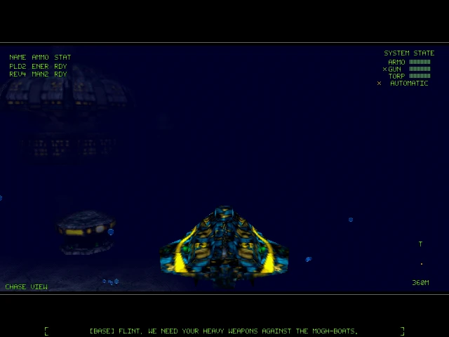
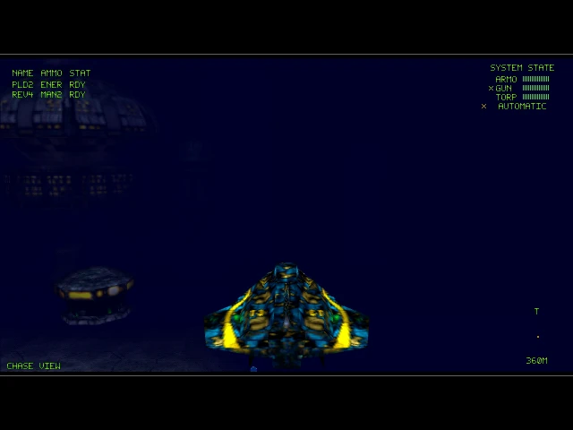

# Archimedean Dynasty (1996 / 1997 3dfx Patch — DOS)

| Field | Value |
| :--- | :--- |
| **Category** | Commercial Game |
| **Year** | 1996 (October 1997 3dfx Patch) |
| **Platform(s)** | `DOS/32 (GLIDE2X.OVL via DOSBox Glide pass-through)` |
| **Glide API & Version** | Glide 2.x (`2.48` on Voodoo Graphics / `2.56` on Voodoo2; targets `2.42+`) |
| **Recommended Card Profile** | `VoodooGraphics` (default, SST-1) · `Voodoo2` (optional) |
| **Verified Backends** | Vulkan · OpenGL ES · Software (AVX2 / AVX-512 / Scalar) |
| **Preset File(s)** | [`glide-ng.ini`](./glide-ng.ini) (Voodoo1 SST-1) · [`glide-ng.hq.ini`](./glide-ng.hq.ini) (4× MSAA + Linear) · [`glide-ng.voodoo2.ini`](./glide-ng.voodoo2.ini) (Voodoo2) · [`glide-ng.software.ini`](./glide-ng.software.ini) (CPU Software) |
| **Status** | Verified |

---

## Overview

Massive Development and Blue Byte's 1996 underwater combat simulator *Archimedean Dynasty* (known as *Schleichfahrt* in Germany) received an official **October 1997 3dfx Glide 2.x patch** (`v1.120`, targeting Glide `2.42+`). In 3dfx mode (`AD3DFX.EXE` → `FIGHT3.EXE`), the combat engine upgrades from `640×400` 256-color software rendering (`AD2.EXE` / `FIGHT2.EXE`) to **native `640×480×16`** with perspective-corrected Gouraud shading, bilinear texture filtering, full transparency, `GR_FOG_WITH_TABLE` exponential dark-blue underwater fog (`#000028`), and `4×4` hardware dithering.

Technically, `FIGHT3.EXE` is one of the most demanding DOS Glide 2.x LFB and depth-buffer workloads in the catalog, exercising four advanced SST-1 hardware techniques in every cockpit frame:

* **Aux/Depth LFB Masking (`GR_BUFFER_AUXBUFFER` / `GR_LFB_SRC_FMT_ZA16`):** Clips 3D submarine terrain and stations behind the diagonal 2D cockpit struts by writing a 16-bit depth mask (`0x0000` inside struts, `0xFFFF` outside) directly into the auxiliary W-buffer via `grLfbLock`.
* **Bias-Compare Depth Mode (`GR_DEPTHBUFFER_WBUFFER_COMPARE_TO_BIAS`):** Combines the `ZA16` depth mask with `GR_CMP_NOTEQUAL` against a fixed depth bias (`grDepthBiasLevel`) so visible ocean geometry renders and populates unbiased depth while cockpit mask pixels remain untouched.
* **Nested Re-Entrant LFB Write Locks:** Acquires overlapping `grLfbLock(WRITE_ONLY, BACKBUFFER)` regions when painting the dynamic cockpit HUD (compass, depth/pitch ladders, torpedo indicator, 3D sonar heightmap, and armor hologram) over the rendered 3D scene.
* **Direct Front-Buffer Briefing Rendering:** Draws the animated tactical mission briefing screen (`GR_BUFFER_FRONTBUFFER`) directly into the front buffer via `grLfbLock` writes without issuing `grBufferSwap`, including typewriter scrolling text and blinking map target reticles.

---

## Editions, Patches & Executables

*Archimedean Dynasty* is a **DOS-only** release; no native Windows executable exists on the retail disc. Install the v1.0 CD release, apply the official **v1.120 software update (`AD2.EXE`)**, and apply the **October 1997 3dfx patch (`AD_3Dfx.exe`)**.

| Executable / Patch | Renderer | Works with `glide-ng`? | Technical Notes |
| :--- | :--- | :---: | :--- |
| **`AD3DFX.EXE`** *(Oct 1997 3dfx patch launcher)* | DOS/32 (`DESKTOP3.EXE` → `FIGHT3.EXE`) | **Yes (Recommended)** | Official 3dfx launcher (`SPLASH.EXE` → `DESKTOP3.EXE` 2D VGA hub → `FIGHT3.EXE` Glide `640×480×16` combat engine). Loads `GLIDE2X.OVL` dynamically; replace the bundled SST-1 `GLIDE2X.OVL` with `glide-ng`'s clean-room HLE pass-through `glide2x.ovl`. |
| **`FIGHT3.EXE solo`** *(3dfx combat engine)* | Glide 2.x (`GLIDE2X.OVL`) | **Yes (Direct Launch)** | Direct entry point for `DAT\SAVE\FIGHTIN.DES` (instant action mission, e.g. *Moghs — Svesda Wostock*) without stepping through `SPLASH.EXE` / `DESKTOP3.EXE`. Requires the `solo` argument. |
| **`AD2.EXE` / `FIGHT2.EXE`** *(v1.120 DOS Software)* | DOS/32 8-bit Software (`640×400` VGA/VESA) | No (Software comparison) | Patched software combat engine. Renders letterboxed `640×400` inside `640×480` with brighter palette-based depth cueing and pixelated textures; does not use Glide. |
| **`AD.EXE` / `FIGHT.EXE`** *(Retail v1.0 DOS Software)* | DOS/32 8-bit Software (`320×200` / `640×400`) | No (Software only) | Original unpatched CD release. Retains no 3dfx support. |

> **Preserve `AD.bin` / `AD.cue` for CD Audio:** The retail disc includes 5 tracks (data + 4 Redbook audio tracks). Mounting `AD.cue` (rather than a stripped `.iso`) preserves in-game CD music. Keep the game's original SST-1 `GLIDE2X.OVL` backed up (e.g. `GLIDE2X.SST1.OVL`) if testing against DOSBox-X's low-level software Voodoo emulator.

---

## Recommended DOSBox Configurations

Keep the DOSBox configuration minimal — only non-default overrides are shown below.

> **Set `[dosbox] memsize = 32`:**
> Blue Byte's 3dfx patch `README.TXT` specifies 16 MB minimum RAM and recommends **32 MB** (`memsize = 32`) to keep high-resolution textures enabled (`LORES_TEXTURE=1` is only needed on sub-16 MB systems).

The launch commands below assume `glide-ng`'s `libglide2x.so` is installed system-wide (if running directly from a local build directory instead of a system package, prepend `LD_LIBRARY_PATH=/path/to/glide-ng/lib`; see [Building & Installing](../../../user-guide/building-and-installing.md)). Copy the clean-room DOSBox HLE pass-through `glide2x.ovl` (`build/dos/glide2x.ovl`) into `C:\BLUEBYTE\AD\` or onto DOS `PATH` (replacing or shadowing the stock SST-1 `GLIDE2X.OVL`).

### Option A: Patched DOSBox-SVN (Glide Pass-Through → `glide-ng`) *(Recommended)*

```ini
# dosbox-svn.conf (minimal overrides)
[dosbox]
memsize = 32

[sdl]
# Avoids SDL_UpdateRects crashes under sdl12-compat -> sdl2-compat on modern Linux
output = opengl

[cpu]
cycles = max

[glide]
glide = true
```

```bash
GLIDE_NG_CONFIG=/path/to/glide-ng.ini \
  dosbox -conf dosbox-svn.conf \
  -c "imgmount D /path/to/AD.cue -t iso" \
  -c "mount C /path/to/C_DRIVE" \
  -c "C:" \
  -c "cd BLUEBYTE\\AD" \
  -c "AD3DFX.EXE"
```

### Option B: DOSBox-X (Glide Pass-Through → `glide-ng`)

```ini
# dosbox-x-pass.conf (minimal overrides)
[dosbox]
memsize = 32

[cpu]
cycles = max

[voodoo]
glide = true
lfb = full
```

```bash
GLIDE_NG_CONFIG=/path/to/glide-ng.ini \
  dosbox-x -conf dosbox-x-pass.conf -nopromptfolder \
  -c "imgmount D /path/to/AD.cue -t iso" \
  -c "mount C /path/to/C_DRIVE" \
  -c "C:" \
  -c "cd BLUEBYTE\\AD" \
  -c "AD3DFX.EXE"
```

### Option C: Best Visuals (`glide-ng.hq.ini`, `4× MSAA` + Linear + `no_dither_sub`)

Launch with [`glide-ng.hq.ini`](./glide-ng.hq.ini) (`msaa = 4`, `presentation_filter = linear`, `no_dither_sub = true`) on hardware Vulkan or OpenGL ES GPUs:

```bash
GLIDE_NG_CONFIG=/path/to/glide-ng.hq.ini \
  dosbox -conf dosbox-svn.conf \
  -c "imgmount D /path/to/AD.cue -t iso" \
  -c "mount C /path/to/C_DRIVE" \
  -c "C:" \
  -c "cd BLUEBYTE\\AD" \
  -c "AD3DFX.EXE"
```

*(On CPU-only hosts, substitute [`glide-ng.software.ini`](./glide-ng.software.ini); `aa = ssaa` can be enabled for `2×2` supersampled edges.)*

### Reference Comparison: DOSBox-X Software Voodoo (No `glide-ng`)

To compare output directly against DOSBox-X's built-in register-level SST-1 software emulator, swap back the **original 1997 SST-1 `GLIDE2X.OVL`** (`348,791` bytes, shipped with the 3dfx patch) and run:

```ini
# dosbox-x-sw.conf
[dosbox]
memsize = 32

[cpu]
cycles = max

[voodoo]
voodoo_card = software
glide = false
```

Both DOSBox-X's SST-1 emulator and all three `glide-ng` backends produce matching dark-blue underwater fog density (`#000028`), identical diagonal cockpit depth-mask clipping, and crisp HUD overlays.

---

## Visual Progression Gallery

All captures below depict the *Moghs* (*Svesda Wostock*) instant action mission launched via `FIGHT2.EXE solo` (DOS Software) and `FIGHT3.EXE solo` (3dfx Glide 2.x, `640×480×16`):

| | |
| :---: | :---: |
| <br>**1. 3dfx Mission Briefing Map (`FIGHT3.EXE`, `glide-ng` Vulkan)**<br>Painted straight into `GR_BUFFER_FRONTBUFFER` via LFB writes without calling `grBufferSwap`, showing the typewriter briefing, map callouts, and blinking green target reticle. | <br>**2. DOS 8-bit Software Cockpit (`FIGHT2.EXE`, `640×400`)**<br>Unfiltered 256-color software renderer letterboxed inside `640×480`. Palette-based depth cueing makes distant *Svesda Wostock* towers much brighter than the authentic 3dfx fog curve. |
| <br>**3. Authentic SST-1 Reference (`FIGHT3.EXE`, DOSBox-X Software Voodoo)**<br>Low-level hardware-register SST-1 emulation (cropped to `640×480`). Establishes the authentic dark-blue `#000028` exponential underwater fog and cockpit strut clipping mask. | <br>**4. `glide-ng` Vulkan `1×` Cockpit ([`glide-ng.ini`](./glide-ng.ini))**<br>Matches authentic SST-1 reference across cockpit strut masking (`ZA16` + `COMPARE_TO_BIAS`), bilinear-filtered towers, bubbles, compass, ladders, torpedo readout, and 3D orange sonar heightmap. |
| <br>**5. `glide-ng` Vulkan `4× MSAA` HQ Cockpit ([`glide-ng.hq.ini`](./glide-ng.hq.ini))**<br>Best visuals: two-pass stencil bit-masked `COMPARE_TO_BIAS` cleanly preserves diagonal cockpit struts under `4×` hardware MSAA while removing `4×4` dither banding (`no_dither_sub = true`). | <br>**6. `glide-ng` OpenGL ES 3.2 Cockpit (`backend = opengl_es`)**<br>Full parity with Vulkan and authentic SST-1 reference across `ZA16` aux-buffer uploads, nested LFB HUD overlays, and underwater fog table gradients. |
| <br>**7. `glide-ng` CPU Software Cockpit ([`glide-ng.software.ini`](./glide-ng.software.ini))**<br>Multi-threaded AVX2/AVX-512 CPU rasterizer matches the hardware backends with zero warnings and accurate `W`-buffer occlusion. | <br>**8. DOS 8-bit Software Chase View (`FIGHT2.EXE`, `KP_0`)**<br>External *Succubus* hull and underwater base towers without bilinear filtering; brighter palette-mapped distance lighting than the 3dfx build. |
| <br>**9. Authentic SST-1 Chase View (DOSBox-X Software Voodoo, `KP_0`)**<br>Confirms the dark-blue exponential fog envelope (`grFogColorValue(0x2800)` in `RGBA` = `#000028`) wrapping the outer *Svesda Wostock* dome and seafloor. | <br>**10. `glide-ng` Vulkan `4× MSAA` Chase View (`KP_0`, [`glide-ng.hq.ini`](./glide-ng.hq.ini))**<br>Matches SST-1 fog density and bilinear hull shading while smoothing the submarine silhouette and floor geometry. |

---

## Visual Quality & Performance Tuning

### Why 3dfx Underwater Visibility Is Darker Than DOS Software
* Comparing captures `#2` (`FIGHT2.EXE` software) against `#3` (authentic DOSBox-X SST-1 software Voodoo emulator) and `#4–#7` (`glide-ng`) confirms that the deeper blue atmospheric fog (`#000028`) is **authentic October 1997 3dfx patch behavior** — not a wrapper bug. `FIGHT3.EXE` intentionally drives `grFogMode(GR_FOG_WITH_TABLE)` with a dense `RGBA` fog color (`0x2800` → `#000028`) and omits the ambient lighting lift used by the 8-bit palette LUT.
* For greater contrast in brightly lit rooms, cycle the built-in 3dfx gamma correction hotkey **`Shift+F3`** inside `FIGHT3.EXE`, or uncomment `gamma = 1.4` inside [`glide-ng.ini`](./glide-ng.ini).

### Flavour Comparison: 3dfx Glide vs. DOS Software
* **`FIGHT3.EXE` (`glide-ng` + [`glide-ng.hq.ini`](./glide-ng.hq.ini)) wins overall**: true full-height `640×480×16` (vs. letterboxed `640×400`), 16-bit bilinear texture filtering, perspective-corrected Gouraud lighting, smooth translucent bubbles/explosions, `4× MSAA` silhouette edges, and atmospheric dark-blue depth fog without palette banding.
* **`FIGHT2.EXE` (DOS Software)** stays slightly more readable at long range due to its gentler palette depth cueing, but lacks bilinear filtering, true high-color gradients, and full `640×480` vertical resolution.

### Anti-Aliasing & Filtering
* **`4× MSAA` works cleanly with the cockpit mask:** Unlike depth-only hacks that break MSAA, `glide-ng` translates `GR_BUFFER_AUXBUFFER` (`ZA16`) uploads and `GR_DEPTHBUFFER_WBUFFER_COMPARE_TO_BIAS` through a two-pass stencil bit mask inside the active MSAA render pass on both Vulkan and OpenGL ES, keeping the diagonal cockpit struts razor-sharp under `msaa = 4`.
* **In-game `Shift+F1` / `Shift+F2`:** `FIGHT3.EXE` defaults to bilinear filtering **ON** and `4×4` dithering **ON**. Combine [`glide-ng.hq.ini`](./glide-ng.hq.ini)'s `no_dither_sub = true` (or cycle `Shift+F2` to `Off`) for clean 24-bit fog gradients without speckle bands.
* **Fast mission briefing loads:** `glide-ng` caches CPU readback snapshots across back-to-back `ReadLFB` / `WriteLFB` typewriter frames on `GR_BUFFER_FRONTBUFFER`, avoiding hundreds of full-frame GPU stalls during mission briefings (`<50 ms` frame latency).

---

## Quirks, Known Issues & Controls

### Installation & Engine Notes
* **Direct combat launch requires `solo`:** Running `FIGHT3.EXE` with no argument aborts with `ERROR: please run ad.exe to play ARCHIMEDEAN DYNASTY`. Start normally through **`AD3DFX.EXE`**, or pass **`FIGHT3.EXE solo`** to jump directly into the active `DAT\SAVE\FIGHTIN.DES` mission.
* **Wait for the briefing typewriter before pressing a key:** On the tactical briefing map (`MOGHS`), `FIGHT3.EXE` ignores keyboard input until the scrolling text concludes with `PRESS ANY KEY TO START`.
* **Original `GLIDE2X.OVL` vs. pass-through:** The `VRUSH\` directory inside the 3dfx patch is not required under `glide-ng`. Back up the original SST-1 `GLIDE2X.OVL` and drop `glide-ng`'s `build/dos/glide2x.ovl` into `C:\BLUEBYTE\AD\` when using DOSBox Glide pass-through.
* **No `LORES_TEXTURE=1` needed:** Leave `LORES_TEXTURE` unset with `memsize = 32` so all submarine hulls and underwater stations load at full texture resolution.
* **Startup splash:** Uncomment `no_splash = true` in `glide-ng.ini` (or pass `FX_GLIDE_NO_SPLASH=1`) to skip the one-shot startup splash on `grSstWinOpen()`.

### Useful Controls
* `Arrow keys` / Mouse — Pitch & Turn · `+` / `-` (or `1`–`9`) — Throttle · `Ctrl` / `Space` — Primary cannon / Fire torpedo · `Tab` — Target nearest / cycle · `F1` — Cockpit view · `Numpad 0` (`KP_0`) — Chase view · **`Shift+F1`** — Toggle bilinear texture filtering · **`Shift+F2`** — Cycle dithering (`Off` / `2×2` / `4×4`) · **`Shift+F3`** — Cycle 3dfx gamma correction (unsupported on Voodoo Rush) · `P` — Pause · `Esc` — Abort / Quit mission
