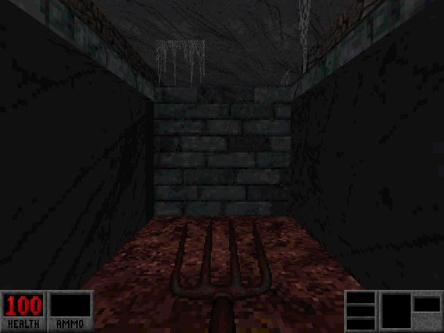

# Blood (1997 — 3dfx DOS)

| Field | Value |
| :--- | :--- |
| **Category** | Commercial Game |
| **Year** | 1997 (3dfx Voodoo Beta patch: March 1998) |
| **Platform(s)** | `DOS/32 (GLIDE2X.OVL via DOSBox Glide pass-through)` |
| **Glide API & Version** | Glide 2.x (`2.48` on Voodoo Graphics / `2.56` on Voodoo2) |
| **Recommended Card Profile** | `VoodooGraphics` (authentic SST-1, default) · `Voodoo2` |
| **Verified Backends** | Vulkan · OpenGL ES · Software (AVX2 / AVX-512 / Scalar) |
| **Preset File(s)** | [`glide-ng.ini`](./glide-ng.ini) (Authentic SST-1, `1×`) · [`glide-ng.software.ini`](./glide-ng.software.ini) (CPU Software) |
| **Status** | Verified |

---

## Overview

Monolith Productions' 1997 dark gothic first-person shooter *Blood* runs on the DOS Build Engine (`BLOOD.EXE`) and received an official 3dfx Glide 2.x beta patch (`3DFX.EXE`, Build Engine 3dfx v1.0i / Blood 1.20 3dfx Beta) in March 1998. Under Glide 2.x, the renderer upgrades walls, sprites, weapons, and HUD graphics to **`640×480`** (with `BUILD_640X480=1`) with hardware bilinear texture filtering and perspective-corrected mapping while retaining the Build Engine's dark gothic atmosphere.

Technically, `3DFX.EXE` is a demanding DOS Glide 2.x workload: it allocates **52 MB** of DPMI memory before dynamically loading `GLIDE2X.OVL` (requiring the full 130-symbol Glide 2.4x export table including `_GUENCODERLE16@16`, `_GUENDIANSWAPBYTES@4`, `_GUENDIANSWAPWORDS@4`, and `_GUTEXCREATECOLORMIPMAP@0`), emits hundreds of `grTexDownloadTable()` palette swaps per frame for Build shade tables, skips `grBufferClear()` during in-game rendering, and submits every horizontal floor and ceiling span as a single **1-pixel-tall right triangle** relying on authentic 3dfx Y-down top-left edge fill inclusion.

---

## Editions, Patches & Executables

No native Windows 3dfx edition exists. Run `3DFX.EXE` inside DOSBox-SVN or DOSBox-X with `glide-ng`'s `libglide2x.so` and clean-room `build/dos/glide2x.ovl`:

| Executable / Patch | Renderer | Works with `glide-ng`? | Technical Notes |
| :--- | :--- | :---: | :--- |
| **`3DFX.EXE`** *(Blood 1.20 / Plasma Pack 3dfx Beta, Mar 1998)* | Glide 2.x (`GLIDE2X.OVL`) | **Yes (Recommended)** | Official 3dfx Build Engine v1.0i executable. Requires `memsize = 63` and `glide-ng`'s clean-room GPL-3.0 `build/dos/glide2x.ovl` (legacy third-party `PASS/glide2x.ovl` omits 4 required `gu*` symbols). Launch with `BUILD_640X480=1` and `BUILD_GAMMA=1`. |
| **`BLOOD.EXE`** *(Stock DOS Release)* | DOS VGA / VESA 2.0 Software | No (No 3dfx) | Pure 256-color software renderer (`320×200` VGA and `640×480` VESA 2.0). Does not load `GLIDE2X.OVL` or use Glide. |

---

## Recommended DOSBox Configurations

Keep the DOSBox configuration minimal — only non-default overrides are shown below.

> **Set `[dosbox] memsize = 63`:**
> `3DFX.EXE` allocates **52 MB** of DPMI memory at startup before dynamically loading `GLIDE2X.OVL` via DOS/4GW's `LINEXE_LOADMODULE`. Under DOSBox's default `memsize = 16` or `32`, DPMI runs out of memory during DLL load and aborts with `Fatal error: unable to load DLL.`.

The launch commands below assume `glide-ng`'s `libglide2x.so` is installed system-wide (if running directly from a local build directory instead of a system package, prepend `LD_LIBRARY_PATH=/path/to/glide-ng/lib`; see [Building & Installing](../../../user-guide/building-and-installing.md)). Place `glide-ng`'s clean-room **`build/dos/glide2x.ovl`** (built automatically when Open Watcom v2 is installed) either inside `BLOOD\` or on DOS `PATH`.

### Option A: Patched DOSBox-SVN (Glide Pass-Through → `glide-ng`) *(Recommended)*

```ini
# dosbox-svn.conf (minimal overrides)
[sdl]
# Avoids SDL_UpdateRects SIGSEGV under sdl12-compat -> sdl2-compat -> SDL3 on modern Linux
output = opengl

[dosbox]
memsize = 63

[cpu]
core = auto
cycles = max

[glide]
glide = true
lfb = full
splash = false
```

```bash
GLIDE_NG_CONFIG=/path/to/glide-ng.ini \
  dosbox -conf dosbox-svn.conf \
  -c "mount C /path/to/Blood" \
  -c "mount D /path/to/glide-ng/build/dos" \
  -c "imgmount E /path/to/Blood/BLOODCD1.cue -t iso" \
  -c "SET PATH=D:\;%PATH%" \
  -c "SET BUILD_640X480=1" \
  -c "SET BUILD_GAMMA=1" \
  -c "C:" \
  -c "cd \BLOOD" \
  -c "3DFX.EXE -quick"
```

### Option B: DOSBox-X (Glide Pass-Through → `glide-ng`)

```ini
# dosbox-x-pass.conf (minimal overrides)
[dosbox]
memsize = 63

[cpu]
cycles = max

[voodoo]
glide = true
lfb = full
```

```bash
GLIDE_NG_CONFIG=/path/to/glide-ng.ini \
  dosbox-x -conf dosbox-x-pass.conf -nopromptfolder \
  -c "mount C /path/to/Blood" \
  -c "mount D /path/to/glide-ng/build/dos" \
  -c "imgmount E /path/to/Blood/BLOODCD1.cue -t iso" \
  -c "SET PATH=D:\;%PATH%" \
  -c "SET BUILD_640X480=1" \
  -c "SET BUILD_GAMMA=1" \
  -c "C:" \
  -c "cd \BLOOD" \
  -c "3DFX.EXE -quick"
```

### Option C: CPU-Only Software Backend (`glide-ng.software.ini`)

Because `3DFX.EXE` invokes `grTexDownloadTable()` hundreds of times per frame for Build Engine shade tables, use [`glide-ng.software.ini`](./glide-ng.software.ini) (`GLIDE_NG_BACKEND=software`) on systems without a hardware Vulkan or OpenGL ES GPU:

```bash
GLIDE_NG_CONFIG=/path/to/glide-ng.software.ini \
  dosbox -conf dosbox-svn.conf ...
```

---

## Visual Progression Gallery

Captures below compare the `BLOOD.EXE` `640×480` VESA software renderer against `3DFX.EXE` (`SET BUILD_640X480=1`, `SET BUILD_GAMMA=1`) across `glide-ng`'s Vulkan and OpenGL ES backends in Episode 1 (*Cradle to Grave*):

| | |
| :---: | :---: |
| <br>**1. Title & Main Menu (`3DFX.EXE` + `BUILD_GAMMA=1`, Vulkan)**<br>Authentic dark gothic contrast matching the software palette (mean title luminance ~39 vs. ~40 in `BLOOD.EXE`) with crisp `presentation_filter = nearest` typography. | <br>**2. Episode 1 Starting Grave — DOS Software (`BLOOD.EXE`, `640×480` VESA)**<br>256-color software renderer baseline with blocky nearest-neighbor texels on walls, ceiling skybox, sprites, and pitchfork weapon. |
| <br>**3. Episode 1 Starting Grave — `glide-ng` Vulkan (`3DFX.EXE`, `640×480`)**<br>Same dark mood and lighting via `BUILD_GAMMA=1`, upgraded with smooth 3dfx bilinear filtering across walls, stone, floor strips, sprites, and HUD. | <br>**4. Episode 1 Morgue Tomb — `glide-ng` OpenGL ES (`3DFX.EXE`, `640×480`)**<br>Solid gap-free 1-pixel Build Engine floor and ceiling scanline strips under top-down OpenGL ES offscreen FBO rasterization (100% parity with Vulkan and Software). |

---

## Visual Quality & Performance Tuning

### Software vs. 3dfx Glide Comparison

| Aspect | DOS Software (`BLOOD.EXE`, `640×480` VESA) | 3dfx Glide (`3DFX.EXE` + `glide-ng`, `640×480`) |
| :--- | :--- | :--- |
| **Texture Filtering** | Point-sampled (nearest-neighbor) texels on walls, floors, ceilings, and sprites | Smooth 3dfx bilinear filtering across walls, floors, ceilings, weapons, and sprites |
| **Lighting & Color Mood** | Dark gothic 256-color software palette (mean title luminance ~40) | Matches Software mood with `SET BUILD_GAMMA=1` (mean title luminance ~39); without `BUILD_GAMMA=1`, `3DFX.EXE` bakes a bright 1997 CRT curve (mean ~104, identical to SST-1 hardware emulation) |
| **Floor / Ceiling Geometry** | Column/span software Build Engine renderer | 1-pixel-tall right-triangle scanline strips with per-depth `grTexDownloadTable` palette swaps |
| **UI & HUD Crispness** | Native `640×480` pixel-aligned HUD | Sharp bilinear HUD and menu text (`presentation_filter = nearest`) |

**Verdict**: `3DFX.EXE` with `SET BUILD_640X480=1` and `SET BUILD_GAMMA=1` combines the authentic dark gothic mood of DOS Software `BLOOD.EXE` with smooth 3dfx bilinear filtering and crisp `640×480` presentation across all three `glide-ng` backends.

### Resolution, Anti-Aliasing & Gamma
* **`SET BUILD_640X480=1` (Resolution):** Upgrades `3DFX.EXE` from its default `512×384` Voodoo mode to native **`640×480`**.
* **`SET BUILD_GAMMA=1` (Authentic Gamma):** Disables `3DFX.EXE`'s aggressive built-in 1997 CRT brightness curve so colors and dark gothic lighting match the original DOS software renderer instead of blowing out highlights.
* **Keep `msaa = 1` (Do NOT enable `4× MSAA`):** `3DFX.EXE` never calls `grBufferClear()` during in-game rendering and draws every horizontal floor and ceiling span as a single 1-pixel-tall right triangle (`(x1, y+0.5)`, `(x0, y+1.5)`, `(x0, y+0.5)`). Under `1×` rendering (and real SST-1 hardware), the top-left fill rule covers 100% of every scanline row. Under `4× MSAA`, the diagonal hypotenuse covers only a subset of the 4 rotated-grid subsamples per pixel, leaving un-overwritten subsamples from prior menu or fire frames ghosted across the viewport. Both catalog presets intentionally enforce `msaa = 1`.

---

## Quirks, Known Issues & Controls

### Installation & Engine Notes
* **Hardware profile:** `3DFX.EXE` inspects `grSstQueryHardware()` and requires a Voodoo Graphics-compatible `GR_SSTTYPE_VOODOO` board (`VoodooGraphics` `2.48` is recommended; `Voodoo2` `2.56` also passes).
* **Startup switches & banner:** Pass `-quick` to skip intro logos and `-nodemo` to hold on the gargoyle title backdrop instead of launching attract-mode demos. At the red `BLOOD RELEASE 1.20 ... 3DFX Voodoo BETA` startup banner (`Press a key to enter Blood...`), press `Enter` or any key to enter the game.
* **Optional on-disk `.3df` texture cache:** By default, `3DFX.EXE` checks `TX3DFX\TX*.3DF` via `gu3dfGetInfo()` and converts missing Build `TILES*.ART` textures on the fly in memory. Setting `SET BUILD_CONVTEXTURES=1` writes converted `.3df` textures to `BLOOD\TX3DFX\` for reuse across sessions.
* **Startup splash:** `glide-ng` plays its procedural startup splash once automatically on `grSstWinOpen()`. Uncomment `no_splash = true` in `glide-ng.ini` (or pass `FX_GLIDE_NO_SPLASH=1`) to skip straight to the game banner.

### Useful Controls
* `Arrow keys` (`Up` / `Down` / `Left` / `Right`) — Move / Turn · `A` or `/` — Jump · `Space` — Open / Use · `Ctrl` — Primary Fire · `X` — Alt Fire · `Esc` — Menu / Pause
