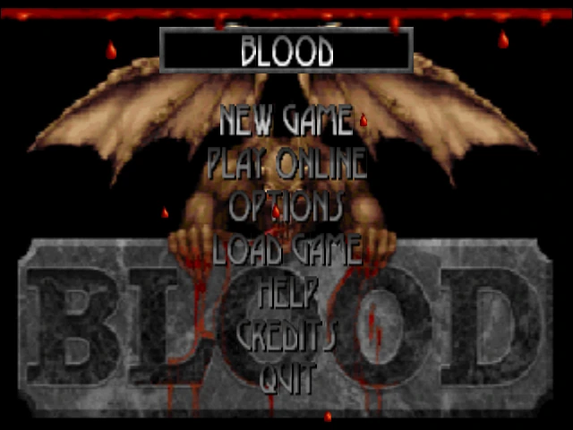
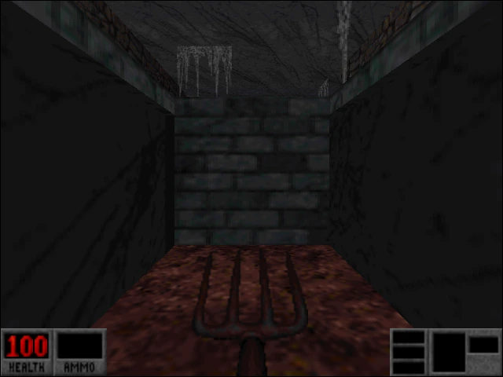
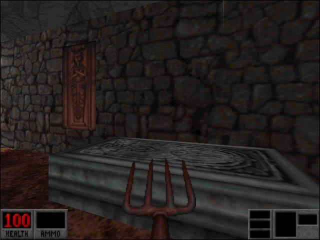

# Blood (1997)

| Field | Value |
| :--- | :--- |
| **Title** | *Blood* (3dfx Voodoo Patch) |
| **Developer / Publisher** | Monolith Productions / GT Interactive |
| **Release Year** | 1997 (3dfx Voodoo Beta `3DFX.EXE`, Mar 1998) |
| **Platform** | DOS/32 (`3DFX.EXE`, DOS/4GW — Glide 2.x pass-through via `GLIDE2X.OVL`) |
| **Glide API** | Glide 2.x (`2.48` SST-1 / `2.56` Voodoo2) |
| **Recommended Profile** | `VoodooGraphics` (`api_version = 2.48`) |
| **Backends Verified** | Vulkan (Pass) · OpenGL ES (Pass) · Software (Pass) |
| **Presets** | [`glide-ng.ini`](./glide-ng.ini) · [`glide-ng.software.ini`](./glide-ng.software.ini) |

---

## 1. Overview & Supported Editions

*Blood* is a DOS-only Build Engine first-person shooter. The retail CD installs the DOS software renderer (`BLOOD.EXE`, supporting VGA `320×200` and VESA 2.0 `640×480`), and Monolith's official 3dfx patch (`3DFX.EXE`, Build Engine 3dfx v1.0i / Blood 1.20 3dfx Beta) adds Glide 2.x hardware acceleration with bilinear filtering and perspective-corrected walls, sprites, and scanline floors/ceilings.

No native Windows 3dfx edition exists; run `3DFX.EXE` inside DOSBox-SVN (Glide pass-through) or DOSBox-X with `glide-ng`'s `libglide2x.so` and `build/dos/glide2x.ovl`.

---

## 2. Installation & Launch Setup

### DOSBox Memory & Environment Requirements

`3DFX.EXE` allocates **52 MB** of DPMI memory at startup before dynamically loading `GLIDE2X.OVL` via DOS/4GW's `LINEXE_LOADMODULE`. Under DOSBox's default `memsize = 16` or `32`, DPMI exhausts memory during DLL load and aborts with `Fatal error: unable to load DLL.`.

Always configure **`memsize = 63`** and set the two official Build Engine 3dfx environment variables:

- **`SET BUILD_640X480=1`**: Upgrades `3DFX.EXE` from its default `512×384` Voodoo mode to native **`640×480`**.
- **`SET BUILD_GAMMA=1`**: Disables `3DFX.EXE`'s aggressive built-in 1997 CRT brightness curve so colors and dark gothic lighting match the original DOS software renderer (`BLOOD.EXE`) instead of blowing out highlights.

### Clean-Room `GLIDE2X.OVL`

`3DFX.EXE` links against 3dfx's Glide 2.4x loader table (130 symbols, including `_GUENCODERLE16@16`, `_GUENDIANSWAPBYTES@4`, `_GUENDIANSWAPWORDS@4`, and `_GUTEXCREATECOLORMIPMAP@0`, which are omitted by the legacy third-party DOSBox `PASS/glide2x.ovl`). Place `glide-ng`'s clean-room GPL-3.0 `build/dos/glide2x.ovl` (built automatically when Open Watcom v2 is installed) on DOS `PATH` or inside the `BLOOD\` directory.

### Example `dosbox-svn.conf`

```ini
[sdl]
output=opengl

[dosbox]
memsize=63

[cpu]
core=auto
cycles=max

[glide]
glide=true
lfb=full
splash=false

[autoexec]
mount c /path/to/Blood
mount d /path/to/glide-ng/build/dos
imgmount e /path/to/Blood/BLOODCD1.cue -t iso
SET PATH=D:\;%PATH%
SET BUILD_640X480=1
SET BUILD_GAMMA=1
c:
cd \BLOOD
3DFX.EXE -quick
```

Copy [`glide-ng.ini`](./glide-ng.ini) into the DOSBox working directory (or pass `GLIDE_NG_CONFIG=/path/to/glide-ng.ini`) and launch DOSBox with `LD_LIBRARY_PATH=/path/to/glide-ng/build/lib`.

> **Tip**: Pass `-quick` to skip the intro logos, and `-nodemo` to hold on the gargoyle title backdrop instead of launching attract-mode demos. At the red `BLOOD RELEASE 1.20 ... 3DFX Voodoo BETA` startup banner (`Press a key to enter Blood...`), press `Enter` or any key to enter the game.

---

## 3. Software vs. 3dfx Glide Visual Comparison

| Aspect | DOS Software (`BLOOD.EXE`, `640×480` VESA) | 3dfx Glide (`3DFX.EXE` + `glide-ng`, `640×480`) |
| :--- | :--- | :--- |
| **Texture Filtering** | Point-sampled (nearest-neighbor) texels on walls, floors, ceilings, and sprites | Smooth 3dfx bilinear filtering across walls, floors, ceilings, weapons, and sprites |
| **Lighting & Color Mood** | Dark gothic 256-color software palette (mean title luminance ~40) | Matches Software mood with `SET BUILD_GAMMA=1` (mean title luminance ~39); without `BUILD_GAMMA=1`, `3DFX.EXE` bakes a bright 1997 CRT curve (mean ~104, identical to hardware SST-1 emulation) |
| **Floor / Ceiling Geometry** | Column/span software Build Engine renderer | 1-pixel-tall right-triangle scanline strips with per-depth `grTexDownloadTable` palette swaps |
| **UI & HUD Crispness** | Native `640×480` pixel-aligned HUD | Sharp bilinear HUD and menu text (`presentation_filter = nearest`) |

**Verdict**: `3DFX.EXE` with `SET BUILD_640X480=1` and `SET BUILD_GAMMA=1` combines the authentic dark gothic mood of DOS Software `BLOOD.EXE` with smooth 3dfx bilinear filtering and crisp `640×480` presentation across all three `glide-ng` backends.

---

## 4. Known Quirks & Technical Notes

1. **Keep `msaa = 1` (Do Not Enable 4× MSAA)**:
   Blood's 3dfx Build Engine never calls `grBufferClear()` during in-game rendering and draws every horizontal floor and ceiling span as a single 1-pixel-tall right triangle (`(x1, y+0.5)`, `(x0, y+1.5)`, `(x0, y+0.5)`). Under 1× rendering (and real SST-1 hardware), the top-left fill rule covers 100% of every scanline row. Under 4× MSAA, the diagonal hypotenuse covers only a subset of the 4 rotated-grid subsamples per pixel, leaving un-overwritten subsamples from prior menu/fire frames ghosted across the viewport. Both presets enforce `msaa = 1`.
2. **Hardware Profile**:
   `3DFX.EXE` inspects `grSstQueryHardware()` and requires a Voodoo Graphics-compatible `GR_SSTTYPE_VOODOO` board (`VoodooGraphics` `2.48` is recommended; `Voodoo2` `2.56` also passes).
3. **Optional On-Disk `.3df` Cache**:
   By default `3DFX.EXE` checks `TX3DFX\TX*.3DF` via `gu3dfGetInfo()` and converts missing Build `TILES*.ART` textures on the fly in memory. Setting `SET BUILD_CONVTEXTURES=1` writes converted `.3df` textures to `BLOOD\TX3DFX\` for reuse across sessions.
4. **CPU-Only Hosts**:
   Because Blood calls `grTexDownloadTable()` hundreds of times per frame for Build Engine shade tables, use [`glide-ng.software.ini`](./glide-ng.software.ini) (`GLIDE_NG_BACKEND=software`) on systems without a hardware Vulkan/OpenGL ES GPU.

---

## 5. Visual Gallery

| Title & Main Menu (`3DFX.EXE` + `BUILD_GAMMA=1`, Vulkan) | Episode 1 *Cradle to Grave* — DOS Software (`BLOOD.EXE`, `640×480`) |
| :---: | :---: |
|  |  |

| Episode 1 *Cradle to Grave* — `glide-ng` Vulkan (`640×480`) | Episode 1 Morgue Tomb — `glide-ng` OpenGL ES (`640×480`) |
| :---: | :---: |
|  |  |

---

## 6. Default Controls

| Action | Key |
| :--- | :--- |
| Move Forward / Turn | `Up` / `Left` / `Right` |
| Jump | `A` or `/` |
| Open / Use | `Space` |
| Primary / Alt Fire | `Ctrl` / `X` |
| Menu / Pause | `Esc` |
