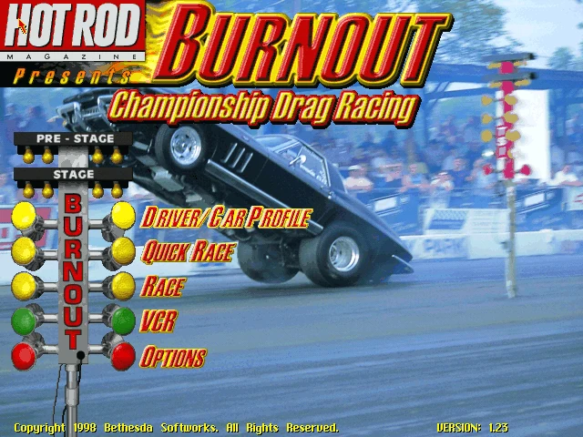
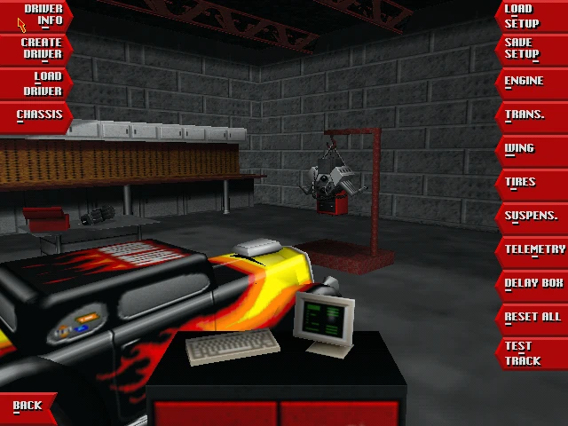
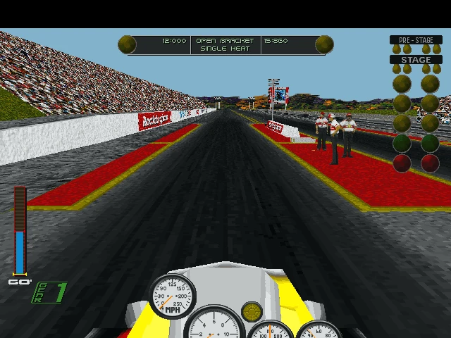
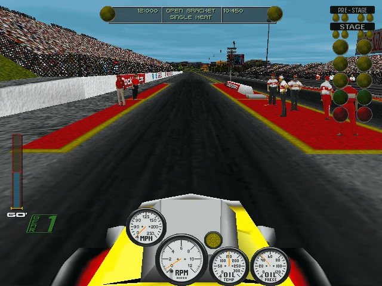
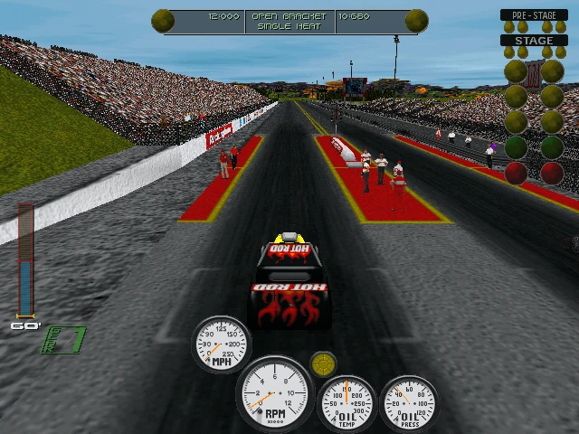
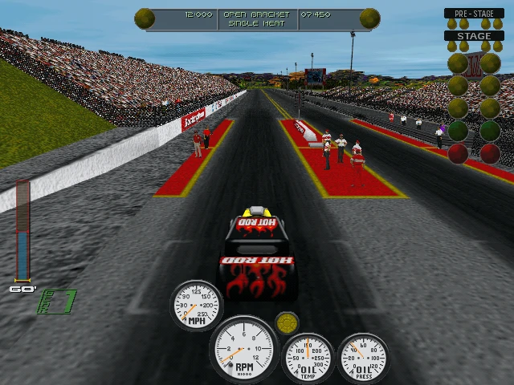

# Burnout: Championship Drag Racing (1998 — 3dfx DOS)

| Field | Value |
| :--- | :--- |
| **Category** | Commercial Game |
| **Year** | 1998 |
| **Platform(s)** | `DOS/32 (GLIDE2X.OVL via DOSBox Glide pass-through)` |
| **Glide API & Version** | Glide 2.x (`2.56` on Voodoo2 / `2.48` on Voodoo Graphics) |
| **Recommended Card Profile** | `Voodoo2` (default) · `VoodooGraphics` (authentic SST-1) |
| **Verified Backends** | Vulkan · OpenGL ES · Software (AVX2 / AVX-512 / Scalar) |
| **Preset File(s)** | [`glide-ng.ini`](./glide-ng.ini) (Voodoo2) · [`glide-ng.hq.ini`](./glide-ng.hq.ini) (4× MSAA + Linear) · [`glide-ng.voodoo1.ini`](./glide-ng.voodoo1.ini) (SST-1) · [`glide-ng.software.ini`](./glide-ng.software.ini) (CPU Software) |
| **Frame Pacing** | `50 FPS` (internal engine cap) |
| **Status** | Verified |

---

## Overview

Bethesda Softworks' 1998 drag-racing simulator *Burnout: Championship Drag Racing* (built on the DOS/4GW **XnGine** engine shared with *Redguard*) ships both a software renderer (`XNGINE\BURNOUT.EXE`) and a dedicated 3dfx Glide 2.x renderer (`FXVER\BURNOUT.EXE`) that dynamically loads `GLIDE2X.OVL` at **`640×480×16`**.

Under Glide 2.x, Rockingham Dragway and the 3D engine-hoist garage swap the flat sky, blocky unfiltered asphalt, and letterboxed viewport of the software renderer for smooth bilinear-filtered road rubber, cloud-textured blue skies, alpha-cutout wire chain-link trackside fences, sharper pit crew sprites, and translucent analog gauges (`~940` avg / `~2,056` peak triangles/frame, zero mid-race LFB write stalls).

---

## Editions, Patches & Executables

| Executable / Patch | Renderer | Works with `glide-ng`? | Technical Notes |
| :--- | :--- | :---: | :--- |
| **`BURNOUT.EXE` (v1.23 Glide Patch `#5`, `burn123h.exe`)** | Glide 2.x (`GLIDE2X.OVL`) | **Yes (Recommended)** | Official July 1998 update patching both the 3dfx executable (`1,019,712` B) and updated garage/screen assets (`TRACKS/GARAGE.*`, `MISC/*SMOK*.BSI`). Compatible directly with `glide-ng`'s clean-room `build/dos/glide2x.ovl`. |
| **`FXVER\BURNOUT.EXE` (Retail v1.00)** | Glide 2.x (`GLIDE2X.OVL`) | **Yes** | Unpatched CD-ROM 3dfx executable (`939` KB). Upgrading to **v1.23** is recommended for engine/smoke fixes. |
| **`XNGINE\BURNOUT.EXE` / v1.23 Software Patch (`burn123s.exe`)** | DOS CPU Software (`XnGine`) | No (No 3dfx) | Non-accelerated fallback (`1,191,412` B patched). Unfiltered textures, pixelated stands, solid blue skybox, and narrow vertical aperture. |

---

## Recommended DOSBox Configurations

Keep the DOSBox configuration minimal — only non-default overrides are shown below.

> **Mount `C:` with `-freesize 512` and `[dosbox] memsize = 32`:**
> Ensure the CD image (or extracted ISO) is mounted as `D:` **and** place a `BURNOUT.CFG` containing `D:\` inside the game folder so `BURNOUT.EXE` skips the `CD NOT FOUND. CONTINUE?` prompt.

Place `glide-ng`'s clean-room HLE pass-through `GLIDE2X.OVL` (`build/dos/glide2x.ovl`) directly next to `BURNOUT.EXE`.

### Option A: Patched DOSBox-SVN (Glide Pass-Through → `glide-ng`) *(Recommended)*

```ini
# dosbox-svn.conf (minimal overrides)
[dosbox]
memsize = 32

[sdl]
# Avoids SDL_UpdateRects SIGSEGV under sdl12-compat on modern Linux
output = opengl

[cpu]
cycles = max

[glide]
glide = true
```

```bash
GLIDE_NG_CONFIG=/path/to/glide-ng.ini \
  dosbox -conf dosbox-svn.conf \
  -c "mount C /path/to/burnout/game -freesize 512" \
  -c "imgmount D /path/to/BURNOUT.iso -t iso" \
  -c "C:" \
  -c "BURNOUT.EXE"
```

### Option B: DOSBox-X (Glide Pass-Through → `glide-ng`)

```ini
# dosbox-x-pass.conf (minimal overrides)
[dosbox]
memsize = 32

[cpu]
cycles = max

[voodoo]
glide = true
lfb = full
```

```bash
GLIDE_NG_CONFIG=/path/to/glide-ng.ini \
  dosbox-x -conf dosbox-x-pass.conf -nopromptfolder \
  -c "mount C /path/to/burnout/game -freesize 512" \
  -c "imgmount D /path/to/BURNOUT.iso -t iso" \
  -c "C:" \
  -c "BURNOUT.EXE"
```

### Option C: Best Visuals (`glide-ng.hq.ini` — `4× MSAA` + `no_dither_sub`)

```bash
GLIDE_NG_CONFIG=/path/to/glide-ng.hq.ini \
  dosbox -conf dosbox-svn.conf \
  -c "mount C /path/to/burnout/game -freesize 512" \
  -c "imgmount D /path/to/BURNOUT.iso -t iso" \
  -c "C:" \
  -c "BURNOUT.EXE"
```

*(On CPU-only hosts, substitute [`glide-ng.software.ini`](./glide-ng.software.ini) with `GLIDE_NG_SW_AA=ssaa` to smooth the long alpha-tested chain-link fences along the grandstands.)*

### Reference Comparison: DOSBox-X Software Voodoo (No `glide-ng`)

```ini
# dosbox-x-sw.conf
[dosbox]
memsize = 32

[cpu]
cycles = max

[voodoo]
voodoo_card = software
glide = false
```

Replace the pass-through `GLIDE2X.OVL` with a real SST-1 **Glide 2.42** `GLIDE2X.OVL`.

---

## Visual Progression Gallery

All captures below are native `640×480` frames of *Burnout: Championship Drag Racing* (`v1.23`) under patched DOSBox-SVN at Rockingham Dragway:

| | |
| :---: | :---: |
| <br>**1. Main Menu (`640×480` · Glide 2.x)**<br>Rotating *HOT ROD Magazine* dragster photography behind the iconic Christmas tree menu (`DRIVER/CAR PROFILE`, `QUICK RACE`, `RACE`, `VCR`, `OPTIONS`). | <br>**2. 3D Garage (`DRIVER/CAR PROFILE` · Glide 2.x)**<br>Flamed black hot-rod coupe inside the live textured garage with suspended V8 engine hoist and telemetry terminal. |
| <br>**3. Native `XnGine` Software (`BURNSOFT.EXE`, Cockpit POV)**<br>Blocky unfiltered asphalt and retaining walls, flat solid teal sky backdrop, coarse grandstand crowds, and letterboxed top bar. | <br>**4. 3dfx Glide Cockpit (`BURNOUT.EXE`, CPU Software `1×`)**<br>Same left lane with full-height viewport, cloud-textured sky, bilinear-filtered rubber track, transparent chain-link mesh fence, and cleaner crew sprites. |
| <br>**5. 3dfx Glide Chase View (`OpenGL ES`, `1×`)**<br>Rear chase camera over the `HOT ROD` coupe staging box before advancing past the trackside officials and concrete retaining wall. | <br>**6. 3dfx Glide Best Visuals (`Vulkan 4× MSAA`, [`glide-ng.hq.ini`](./glide-ng.hq.ini))**<br>Hardware `4× MSAA` + `no_dither_sub` smooths angled retaining-wall edges, hood blower lines, lighting poles, and alpha-cutout wire fences cleanly. |

---

## Visual Quality & Performance Tuning

### Anti-Aliasing & Texture Filtering
* **Vulkan / OpenGL ES:** [`glide-ng.hq.ini`](./glide-ng.hq.ini) enables **`msaa = 4`**, **`presentation_filter = linear`**, and **`no_dither_sub = true`** for smooth concrete barriers, car hoods, light-pole silhouettes, and sky gradients.
* **Software `2×2 SSAA`:** On `glide-ng`'s CPU Software backend, `aa = ssaa` (per-subsample alpha-test) yields noticeable extra clarity across the diagonal **alpha-cutout diamond chain-link fence** spanning both grandstands.
* **Gamma (`1.0` default):** Bright daytime sky and asphalt contrast match native output without forcing a higher RAMDAC LUT.

### Performance Notes
* **Internal `50 FPS` cap:** `BURNOUT.EXE` paces track rendering internally to **`50 FPS`** (`~20.0 ms/frame`) even with `vsync = false` and `max_fps = 0`. Both Vulkan and OpenGL ES hold locked `50 FPS` with sub-millisecond wrapper CPU overhead (`< 0.7 ms/frame`).
* **Lightweight geometry:** `~944` average / `~2,056` peak triangles/frame with zero LFB lock stalls during track racing. On CPU-only hosts running `software` AVX2 (`1×`), wrapper rasterization averages **`~4.2 ms/frame`**.

---

## Quirks, Known Issues & Controls

### Installation & Engine Notes
* **Bypassing the `CD NOT FOUND` prompt (`BURNOUT.CFG`):** When copying files off the CD without running `INSTALL.EXE`, create `BURNOUT.CFG` containing the mounted CD drive path (`D:\` followed by NUL) alongside `BURNOUT.EXE` and mount the ISO image as `D:`. Note that raw `MODE2/2352` `.bin`/`.cue` images should use plain `2048`-byte ISO track extraction if an older DOSBox-SVN `imgmount` build cannot read the track header.
* **Sound configuration (Miles Sound System):** Run `SETSOUND.BAT` (inside `SNDDRV\`) once inside DOSBox to generate `DIG.INI` / `MDI.INI` for Sound Blaster 16 (`IO 220h`, `IRQ 7`, `DMA 1/5`).
* **Startup splash:** Uncomment `no_splash = true` in `glide-ng.ini` (or pass `FX_GLIDE_NO_SPLASH=1`) to skip the one-shot startup splash on launch.

### Useful Controls

| Key | Action |
| :--- | :--- |
| **`Space`** | Skip opening intro videos (`HOTINTRO.SMK` / `OPENING.SMK`) |
| **Arrow keys + `Enter`** | Navigate Christmas tree main menu (`Down → Enter` enters `QUICK RACE`) |
| **`Esc`** | Exit dialog / quit prompt |
| **`F1`–`F6` / `C`** | Toggle view / crowd detail (`F2` toggles trackside people) |
| **`Up` / `Down`** | Throttle / Brake (rebindable under `OPTIONS → CONTROL SETUP`) |
| **`Left` / `Right`** | Steer |
| **`A` / `Z`** *(or manual config)* | Shift up / down |
