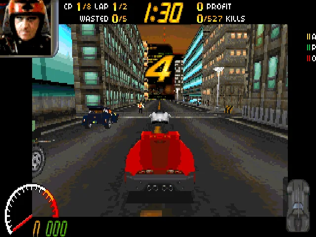
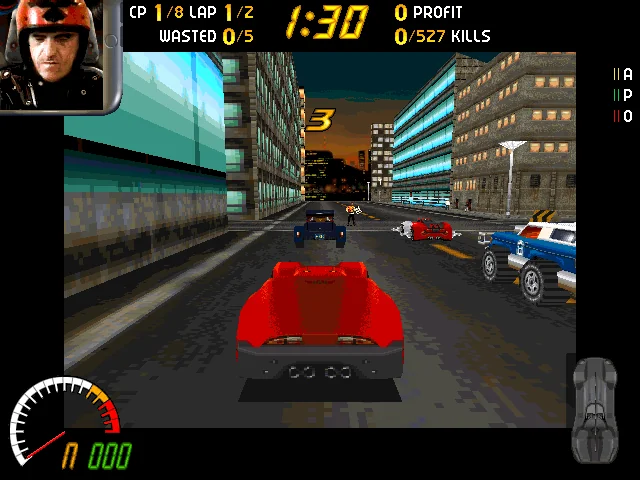
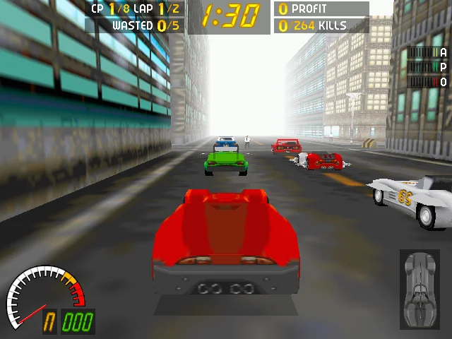
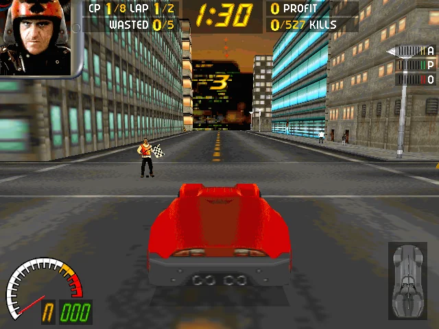
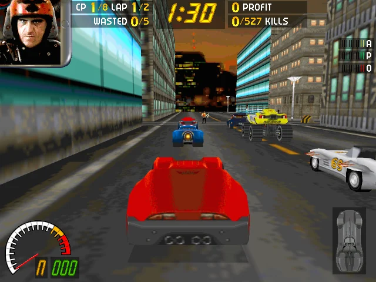
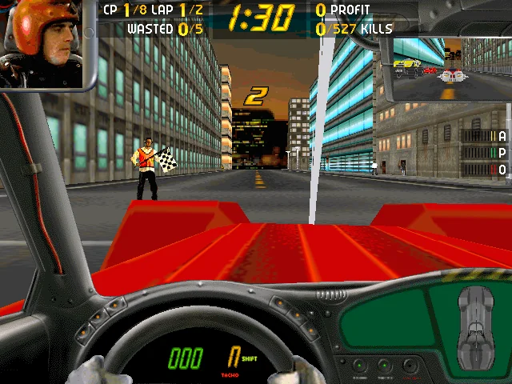
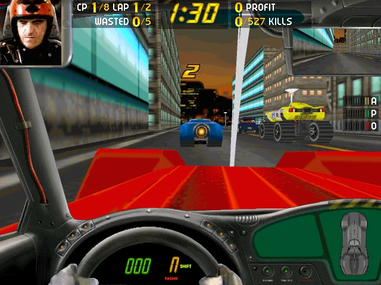

# Carmageddon (1997 — 3dfx Voodoo / Voodoo2 DOS Patches)

| Field | Value |
| :--- | :--- |
| **Category** | Commercial Game |
| **Year** | 1997 (Voodoo2 patch: June 1998) |
| **Platform(s)** | `DOS/32 (GLIDE2X.OVL via DOSBox Glide pass-through)` |
| **Glide API & Version** | Glide 2.x (`2.56` on Voodoo2 / `2.48` on Voodoo Graphics) |
| **Recommended Card Profile** | `Voodoo2` (default, for `Voodo2C.exe` / `voodo2S.exe`) · `VoodooGraphics` (authentic SST-1, for `CARMAV.EXE`) |
| **Verified Backends** | Vulkan · OpenGL ES · Software (AVX2 / AVX-512 / Scalar) |
| **Preset File(s)** | [`glide-ng.ini`](./glide-ng.ini) (Voodoo2) · [`glide-ng.hq.ini`](./glide-ng.hq.ini) (4× MSAA + Linear) · [`glide-ng.voodoo1.ini`](./glide-ng.voodoo1.ini) (SST-1) · [`glide-ng.software.ini`](./glide-ng.software.ini) (CPU Software) |
| **Status** | Verified |

---

## Overview

Stainless Software's 1997 vehicular combat classic *Carmageddon* received DOS-only 3dfx Glide 2.x patches that upgrade the BRender software engine to full-screen 640×480 hardware-accelerated perspective rendering with bilinear texture filtering, W-buffer depth sorting, 8-bit palettized (`GR_TEXFMT_P_8`) textures, and alpha-blended skies/HUD overlays.

Because the engine composites menus, cockpit dashboards, Pratcam, speedometers, and the `Tab` map (with a live 3D miniscreen inset) via `GR_LFB_WRITE_ONLY` linear framebuffer writes alongside 3D geometry, *Carmageddon* is a flagship test for `glide-ng`'s chronological LFB staging, 8-bit palette streaming, and DOSBox `GLIDE2X.OVL` pass-through pipeline.

---

## Editions, Patches & Executables

Full releases (especially *Carmageddon Max Pack* and CD installs with community patches applied) commonly contain up to **four** executables in the game directory:

| Executable | Renderer / Patch | Recommended? | Target Edition & Technical Notes |
| :--- | :--- | :---: | :--- |
| **`Voodo2C.exe`** *(Jun 1998)* | Stainless unofficial Voodoo2 alpha patch | **Yes (Base / Max Pack)** | Best executable for *Carmageddon* and *Max Pack* on `glide-ng`'s default `Voodoo2` profile. Uses explicit `grLfbLock` / `grLfbUnlock` bracketing on Voodoo2/Rush and adds `VOODOO.TXT` `mipmap` support. Requires the Final Beta 3dfx patch `DATA/` files (already included in *Max Pack*). |
| **`voodo2S.exe`** *(Jun 1998)* | Stainless unofficial Voodoo2 alpha patch | **Yes (Splat Pack)** | Same Voodoo2 Glide 2.x patch built specifically for the *Splat Pack* expansion. |
| **`CARMAV.EXE`** *(Oct 1997)* | Official "Final Beta" Voodoo1 / Rush patch (`CARV24ROW.ZIP`) | **Alternative (SST-1)** | Original Glide 2.x patch targeting Voodoo Graphics (SST-1) and Voodoo Rush. In Voodoo Graphics mode it holds a single persistent `grLfbLock` across the entire session; `glide-ng` flushes persistent locks chronologically before `grBufferClear()` and `grBufferSwap()`, so `CARMAV.EXE` runs cleanly on both `VoodooGraphics` ([`glide-ng.voodoo1.ini`](./glide-ng.voodoo1.ini)) and `Voodoo2` profiles (passing `-vrush` switches it to explicit lock/unlock). |
| **`CARMA.EXE`** | Pure DOS Software (`320×200` / `-hires` `640×480` VESA) | No (No 3dfx) | Pure software renderer — does not use Glide or load `glide-ng`. |

> **Patch Order for Base CD Installs (Non-Max Pack):**
> 1. Perform a DOS installation of *Carmageddon* (or *Splat Pack*).
> 2. Extract the official **Final Beta 3dfx patch** (`CARV24ROW.ZIP` — `CARMAV.EXE` + `DATA/` files including `DATA/RACES/VOODOO.TXT`) into the game root, preserving subdirectories.
> 3. Copy **`Voodo2C.exe`** (base / Max Pack) or **`voodo2S.exe`** (Splat Pack) into the game root.

---

## Recommended DOSBox Configurations

Keep the DOSBox configuration minimal — only non-default overrides are shown below.

> **Important — Always set `[dosbox] memsize = 32` (or `64`):**
> DOSBox defaults to `memsize = 16` (16 MB RAM), which triggers *Carmageddon*'s low-memory **"Austere Mode"** (`PDDoWeLeadAnAustereExistance`). In Austere Mode the game silently activates `DATA/PEDSUBS.TXT` (cloning all 33 pedestrian types into a single white-shirt sprite and halving pedestrian counts from `527` → `264`), disables Pratcam, skips the Select Grid Position screen, simplifies car models, and drops draw distance into thick close-in white fog. Raising `memsize` to `32` or `64` restores full visual fidelity immediately.

The launch commands below assume `glide-ng`'s `libglide2x.so` is installed system-wide (if running directly from a local build directory instead of a system package, prepend `LD_LIBRARY_PATH=/path/to/glide-ng/lib`; see [Building & Installing](../../../user-guide/building-and-installing.md)). Place the DOSBox HLE pass-through `GLIDE2X.OVL` either in the game directory or on DOS `PATH`.

### Option A: Patched DOSBox-SVN (Glide Pass-Through → `glide-ng`) *(Recommended)*

```ini
# dosbox-svn.conf (minimal overrides)
[dosbox]
memsize = 32

[sdl]
# Avoids SDL_UpdateRects SIGSEGV under sdl12-compat -> sdl2-compat -> SDL3 on modern Linux
output = opengl

[cpu]
cycles = max

[glide]
glide = true
```

```bash
GLIDE_NG_CONFIG=/path/to/glide-ng.ini \
  dosbox -conf dosbox-svn.conf \
  -c "imgmount D /path/to/carmageddon.cue -t iso" \
  -c "mount C /path/to/Carma" \
  -c "C:" \
  -c "cd CARMA" \
  -c "Voodo2C.exe"
```

*(If your pass-through `GLIDE2X.OVL` lives in a separate DOS directory rather than `CARMA\`, add it to `PATH`, e.g. `-c "SET PATH=C:\GLIDE;%PATH%"`.)*

### Option B: DOSBox-X (Glide Pass-Through → `glide-ng`)

```ini
# dosbox-x-pass.conf (minimal overrides)
[dosbox]
memsize = 32

[cpu]
cycles = max

[voodoo]
glide = true
lfb = full
```

```bash
GLIDE_NG_CONFIG=/path/to/glide-ng.ini \
  dosbox-x -conf dosbox-x-pass.conf -nopromptfolder \
  -c "imgmount D /path/to/carmageddon.cue -t iso" \
  -c "mount C /path/to/Carma" \
  -c "C:" \
  -c "cd CARMA" \
  -c "Voodo2C.exe"
```

### Reference Comparison: DOSBox-X Software Voodoo (No `glide-ng`)

If comparing against DOSBox-X's built-in low-level SST-1 software emulator:

```ini
# dosbox-x-sw.conf
[dosbox]
memsize = 32

[cpu]
cycles = max

[voodoo]
voodoo_card = software
glide = false
```

Software Voodoo emulates **Voodoo Graphics (SST-1)** and requires a real **SST-1** `GLIDE2X.OVL` — specifically **Glide 2.42 (SST-1)** (or `2.30`), *not* Voodoo2 (`2.5x`), *not* `2.43+`/`2.48`, and *not* the HLE pass-through OVL. Both `CARMAV.EXE` and `Voodo2C.exe` work on `2.42 (SST-1)`.

---

## Visual Progression Gallery

All captures below are taken on the Maim Street starting grid (`640×480`, `glide-ng` via patched DOSBox-SVN, `0` kills):

| Step | Before | After |
| :--- | :---: | :---: |
| **1. Software `320×200` → Software `-hires` (`640×480`)**<br>Higher pixel count & crisp `64X48X8` HUD/Pratcam, but textures remain unfiltered nearest-neighbor and viewport stays letterboxed (`ScreenSize 2`). |  |  |
| **2. Software `-hires` → 3dfx Low-Mem (`memsize = 16`)**<br>3dfx unlocks full-screen `640×480` bilinear filtering, **but** DOSBox's default 16 MB RAM triggers Austere Mode (no Pratcam, `264` cloned pedestrians, thick white fog hiding the skyline). |  |  |
| **3. 3dfx Low-Mem (`16 MB`) → 3dfx Full Detail (`memsize = 32`, `1×`)**<br>Raising `memsize = 32` disables Austere Mode: restores the orange dusk city skyline, Max Damage Pratcam, starting flag marshal, and all `527` varied pedestrians. |  |  |
| **4. 3dfx Full Detail (`1×`) → 3dfx Full Detail + AA**<br>Enforcing anti-aliasing (`msaa = 4` on Vulkan/GLES via [`glide-ng.hq.ini`](./glide-ng.hq.ini), or `GLIDE_NG_SW_AA=ssaa` on Software) smooths 3D fenders, rooflines, and distant cars while keeping the 2D HUD razor-sharp. |  |  |
| **5. Cockpit View (`C` key): `1×` → `+ AA`**<br>Notice how anti-aliasing cleans up the angled white center roof blade across the windshield, red hood creases, buildings, and live 3D rear-view mirror without blurring the 2D dashboard or Pratcam. |  |  |

---

## Visual Quality & Performance Tuning

### Anti-Aliasing & Smoothing
* *Carmageddon* has no built-in anti-aliasing option, and forcing AA on `glide-ng` noticeably improves 3D geometry with zero HUD/LFB artifacts:
  * **Vulkan / OpenGL ES:** Use [`glide-ng.hq.ini`](./glide-ng.hq.ini) (`msaa = 4`, `presentation_filter = linear`, `no_dither_sub = true`).
  * **Software backend:** Add `GLIDE_NG_SW_AA=ssaa` (or uncomment `aa = ssaa` in [`glide-ng.software.ini`](./glide-ng.software.ini)) for 2×2 supersampling, optionally with `GLIDE_NG_PRESENTATION_FILTER=linear`.

### The `-hires` Flag & In-Game Detail Switches
* **`-hires` does NOT enable higher-resolution textures in 3dfx mode.** It only switches pure DOS Software mode (`CARMA.EXE` / `-novoodoo`) from `320×200` (`DATA/32X20X8`) to `640×480` SVGA (`DATA/64X48X8`). 3dfx Glide mode already runs at `640×480` with `DATA/64X48X8`, so `-hires` is a no-op under `CARMAV.EXE` / `Voodo2C.exe`.
* To maximize 3dfx visual quality from the command line, combine `[dosbox] memsize = 32` with **`-yon 1.0 -simple 0`** (maximum draw distance and unsimplified car meshes). World texture scaling (`double` / `quadruple`) and per-texture filtering (`nobilinear`) are applied automatically via `DATA/RACES/VOODOO.TXT` from the Final Beta 3dfx patch.

### Speed & Backend Selection
Measured on full-detail Maim Street (`memsize = 32`, `YonFactor = 1.0`, `CarSimplificationLevel = 0`, ~1,310 triangles + ~633 KB LFB HUD/Pratcam writes per frame, uncapped):
* **GPU hosts (`vulkan` / `opengl_es`):** Easily CPU-bound by DOSBox's x86 emulation of BRender (~40–52 FPS on fast desktop/laptop CPUs, even with `msaa = 4`).
* **CPU-only hosts (`software`, AVX2/AVX-512):** Runs **2.35× faster** than DOSBox-X's built-in Software Voodoo at `1×` (**32.9 FPS avg** vs. **~14.0 FPS** on DOSBox-X SW Voodoo; `glide-ng` itself uses only ~5.25 ms/frame while DOSBox guest CPU takes ~24.5 ms/frame), and still **1.86× faster** with `2×2` SSAA enabled (**26.1 FPS avg**).

---

## Quirks, Known Issues & Controls

### Engine Notes & Quirks
* **Chronological persistent LFB writes (`CARMAV.EXE`):** In Voodoo Graphics mode, `CARMAV.EXE` (or `Voodo2C.exe -vgraphics`) locks `GR_BUFFER_BACKBUFFER` once at startup and writes the 2D `Tab` map before issuing a depth-only `grBufferClear` and drawing the 3D miniscreen inset. `glide-ng` flushes active persistent write locks before `grBufferClear()`, `grLfbReadRegion()`, and `grBufferSwap()`, so both `Voodo2C.exe` and `CARMAV.EXE` render the map inset, cockpit rear-view mirror, and Pratcam cleanly across Vulkan, OpenGL ES, and Software.
* **Startup splash:** `glide-ng` plays its procedural startup splash once automatically on `grSstWinOpen()`. Uncomment `no_splash = true` in `glide-ng.ini` (or pass `FX_GLIDE_NO_SPLASH=1`) to jump straight to the intro.
* **Useful CLI Switches** (supported by `CARMAV.EXE`, `Voodo2C.exe`, and `voodo2S.exe`):
  * `-yon <0..1>` — Draw distance multiplier (`-yon 1.0` for maximum visibility).
  * `-simple <0..3>` — Car mesh simplification level (`-simple 0` for full detail).
  * `-nocutscenes` — Skip intro FMV cutscenes for faster startup.
  * `-vgraphics` — Force Voodoo Graphics mode (persistent LFB lock).
  * `-vrush` — Force Voodoo Rush / Voodoo2 mode (explicit `grLfbLock` / `grLfbUnlock`).
  * `-nosound` — Disable DOS sound hardware probing if debugging audio/IRQ issues.
  * `-novoodoo` — Fall back to DOS software renderer (can be paired with `-hires`).

### Useful Controls
* `Arrow keys` — Drive / Steer · `Space` — Handbrake · `Enter` — Repair car · `Backspace` — Recover car · `C` — Cockpit / External camera toggle · `P` — Pratcam toggle · `Tab` — Map (with live 3D inset) · `Esc` — Menu / Quit
