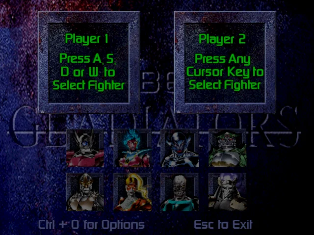
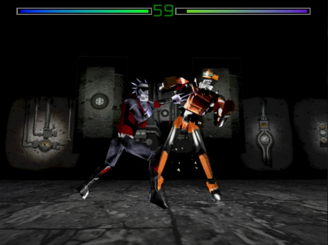

# CyberGladiators (1996 — Win32 3dfx Glide 2.11)

| Field | Value |
| :--- | :--- |
| **Category** | Commercial Game |
| **Year** | 1996 |
| **Platform(s)** | `Win32 / Wine (glide.dll)` |
| **Glide API & Version** | **Glide 2.11** (`glide.dll` — pre-2.3 SST-1 ABI) |
| **Recommended Card Profile** | `VoodooGraphics` (`SST-1`: 4 MB FB, 1× 2 MB TMU, API `2.11`) |
| **Verified Backends** | Vulkan · OpenGL 3.3 Core (WGL) · Software (AVX2 / AVX-512 / Scalar) |
| **Preset File(s)** | [`glide-ng.ini`](./glide-ng.ini) (Authentic SST-1) · [`glide-ng.hq.ini`](./glide-ng.hq.ini) (4× MSAA + Linear) · [`glide-ng.software.ini`](./glide-ng.software.ini) (CPU Software) |
| **Status** | Verified |

---

## Overview

Sierra On-Line / Dynamix's 1996 3D arena fighter *CyberGladiators* was one of the earliest Windows 95 commercial games to ship native 3dfx Voodoo Graphics acceleration, dynamically loading **`GLIDE.DLL`** (Glide 2.11) via `LoadLibrary` and resolving 27 `__stdcall` pre-2.3 SST-1 symbols (`grSstOpen`, `grSstPassthruMode`, `guTexAllocateMemory`, `guDrawTriangleWithClip`, `grGammaCorrectionValue`, etc.).

Under `glide-ng`'s dedicated **`glide.dll`** frontend:
- Both the **character select UI** (~40–46 triangles/frame) and **3D fighting arenas** (~900–1,200 triangles/frame) render natively at `640×480` with bilinear-filtered `ARGB_1555` textures, smooth Gouraud-lit metallic fighter armor, translucent attack motion trails, and flying hit sparks at a locked **60.0 FPS**.
- `grSstPassthruMode(GR_PASSTHRU_SHOW_VGA / GR_PASSTHRU_SHOW_SST1)` cleanly hands the shared Win32 window to DirectDraw / `MCIAVI` during the opening `SPLASH4.AVI` intro movie and reclaims the Vulkan/WGL/GDI surface automatically when 3D rendering begins.
- Authentic **2 MB TMU0 VRAM budget enforcement** in `guTexAllocateMemory` satisfies *CyberGladiators*' startup texture LRU pool probe (15 × `256×256` `ARGB_1555` textures followed by `128×128` allocations until `GR_NULL_MIPMAP_HANDLE` is returned).
- On modern Wine setups where *CyberGladiators*' built-in DirectDraw 2D software renderer crashes inside `wined3d` (`Out of adapter memory`), dropping in `glide.dll` bypasses the DirectDraw 3D path completely and makes the game cleanly playable out of the box.

---

## Editions, Patches & Executables

| Executable | Renderer | Works with `glide-ng`? | Technical Notes |
| :--- | :--- | :---: | :--- |
| **`CYBER.EXE`** *(Community `GetTickCount` Timer Patch)* | Glide 2.11 (`GLIDE.DLL`) | **Yes (Recommended)** | Applies an 8-byte patch (at `0x403b15` & `0x403b24`) redirecting two calls to the game's 1996 `QueryPerformanceCounter` helper (`0x403ade`) to `GetTickCount` (`0x446b28`), fixing excessive game/animation speed on modern high-frequency CPUs. |
| **`CYBER_ORIG.EXE`** *(Original 1996 CD Executable)* | Glide 2.11 (`GLIDE.DLL`) | **Yes (Fast Timing)** | Works identically with `glide.dll`, but its unpatched `QueryPerformanceCounter` timer runs too fast on modern CPUs. Use the `GetTickCount`-patched `CYBER.EXE` (or enable `vsync = true` + `max_fps = 60`). |
| **`CYBER.EXE`** *(Without `glide.dll`)* | DirectDraw 2 Software | **No (WineD3D Crash)** | Requires a 16-bit High Color desktop and crashes under modern Wine's `wined3d` with `Out of adapter memory`. Use `glide.dll` instead. |

---

## Recommended Launch Configurations (Wine32 / Windows)

Copy `glide-ng`'s 32-bit **`glide.dll`** (from `build_release/win32/bin/glide.dll` or `build_win32/bin/glide.dll`) and your chosen preset (`glide-ng.ini`) into the game's install directory (`SIERRA/CYBER/` alongside `CYBER.EXE`).

> **Use an `800×600` (or larger) Wine Virtual Desktop — Not `640×480`:**
> `CYBER.EXE` opens an overlapped Win32 window with a ~22 px title bar around its `640×480` client area. Inside `/desktop=CG,640x480`, the title bar pushes the bottom ~22 px of the canvas off-screen (clipping the `"Ctrl + O for Options / Esc to Exit"` bar). Running `/desktop=CG,800x600` displays the full unclipped `640×480` canvas cleanly.

### Option A: Authentic Voodoo Graphics (`glide-ng.ini` — Vulkan or OpenGL 3.3 Core) *(Recommended)*

```bash
WINEARCH=win32 WINEPREFIX=/path/to/wineprefix \
WINEDLLOVERRIDES="glide=n" \
  wine explorer /desktop=CG,800x600 ./CYBER.EXE
```

To use the Win32 WGL OpenGL 3.3 Core backend instead of Vulkan without editing `glide-ng.ini`:

```bash
WINEARCH=win32 WINEPREFIX=/path/to/wineprefix \
WINEDLLOVERRIDES="glide=n" GLIDE_NG_BACKEND=opengl_es \
  wine explorer /desktop=CG,800x600 ./CYBER.EXE
```

### Option B: Best Visuals (`glide-ng.hq.ini` + In-Game `Motion: smooth`)

Copy [`glide-ng.hq.ini`](./glide-ng.hq.ini) as `glide-ng.ini` (or pass `GLIDE_NG_CONFIG=glide-ng.hq.ini`):
- Enables **`msaa = 4`** (4× hardware MSAA on Vulkan / OpenGL 3.3 Core WGL) to eliminate polygonal jagged edges on fighter spikes, blades, and limbs.
- Enables **`presentation_filter = linear`** and **`no_dither_sub = true`** for smooth 24-bit metallic shading without 16-bit dither banding.
- At the Character Select screen, press **`Ctrl + O`** → set **`Motion: smooth`** for smoother fighter animation interpolation.
- **Gamma**: `CYBER.EXE` natively calls `grGammaCorrectionValue(1.6)` at startup, so no INI gamma override is required. If you want a brighter arena, pause during a match (**`Space`**) and press **`\`** to step hardware gamma live (`1.6` → `1.7` → ...).

> **32-Bit Wine + Mesa `llvmpipe` Note:**
> On hosts without a 32-bit hardware Vulkan ICD, `glide-ng` automatically shrinks its 32-bit Vulkan staging/vertex buffers and skips speculative pipeline pre-warming on CPU adapters (`llvmpipe`) to stay within Wine32's virtual address limit. On very high core-count CPUs (24–64+ cores), if you still encounter 32-bit memory pressure under `llvmpipe`, install your GPU's 32-bit Vulkan ICD, set `LP_NUM_THREADS=4`, or use **Option C (CPU Software `2×2 SSAA`)**.

### Option C: CPU Software Rasterizer (`glide-ng.software.ini` — Zero-GPU / `2×2 SSAA`)

Copy [`glide-ng.software.ini`](./glide-ng.software.ini) as `glide-ng.ini` (and uncomment `aa = ssaa` for `2×2` supersampled anti-aliasing):

```bash
WINEARCH=win32 WINEPREFIX=/path/to/wineprefix \
WINEDLLOVERRIDES="glide=n" GLIDE_NG_BACKEND=software GLIDE_NG_SW_AA=ssaa \
  wine explorer /desktop=CG,800x600 ./CYBER.EXE
```

Renders the full 3D arena with `2×2 SSAA` at a locked **60.0 FPS** on modern AVX2/AVX-512 CPUs with zero GPU or Vulkan ICD required.

### Playing Fullscreen (`GLIDE_NG_FULLSCREEN` vs. `gamescope` vs. Direct Wine)

`CYBER.EXE` has **no** command-line fullscreen flag and explicitly disables `Alt + Enter` when Glide (`GLIDE.DLL`) is active (on real 1996 Voodoo1 hardware, the pass-through card always took over the monitor at `640×480` while Windows kept a fixed `640×480` window). Running inside `wine explorer /desktop=...` therefore stays windowed by default.

Three ways to play fullscreen on Linux:
- **Built-in `glide-ng` borderless fullscreen (`[display] fullscreen = true` or `GLIDE_NG_FULLSCREEN=1`) — no `gamescope` required:** Strips `CYBER.EXE`'s Win32 titlebar, expands its `HWND` to fill the monitor or Wine virtual desktop, and scales `640×480` with aspect-preserving 4:3 black pillarboxes (even inside `/desktop=CG,640x480` this removes the 22 px titlebar so the bottom `Ctrl+O / Esc` bar is unclipped):
  ```bash
  WINEARCH=win32 WINEPREFIX=/path/to/wineprefix \
  WINEDLLOVERRIDES="glide=n" GLIDE_NG_FULLSCREEN=1 GLIDE_NG_PRESENTATION_FILTER=linear \
    wine explorer /desktop=CG,1920x1080 ./CYBER.EXE
  ```
- **With `gamescope` (recommended on Wayland / HiDPI / multi-monitor Linux):** Exposes a native `640×480` nested display to Wine/DirectDraw and upscales with `linear`, `fsr` (AMD FSR 1.0), `nis`, `pixel`, or `integer` scaling:
  ```bash
  WINEARCH=win32 WINEPREFIX=/path/to/wineprefix \
  WINEDLLOVERRIDES="glide=n" GLIDE_NG_FULLSCREEN=1 \
    gamescope -w 640 -h 480 -W 1920 -H 1080 -r 60 -S fit -F linear --force-windows-fullscreen -f -- \
      wine ./CYBER.EXE
  ```
- **Direct Wine (`wine ./CYBER.EXE`, no `explorer` or `gamescope`):** On X11 hosts whose monitor advertises a `640×480` RandR mode, `CYBER.EXE` switches into `640×480` fullscreen via `ChangeDisplaySettings` automatically. *(On Wayland, HiDPI panels, or remote/Cloudtop sessions without a `640×480` mode, `ChangeDisplaySettings` fails and `CYBER.EXE` crashes on startup—use `GLIDE_NG_FULLSCREEN=1` + `explorer /desktop=...` or `gamescope` instead.)*

---

## Visual Progression Gallery

All four captures below are unscaled, borderless `640×479` client-area frames from *CyberGladiators* running under Wine32 + `glide.dll` (Glide 2.11).

| Character Select (`640×480` · Glide 2.11 / SST-1) | 3D Arena — Authentic Voodoo1 (`1×`, Vulkan) |
| :---: | :---: |
|  |  |
| *Even the 2D roster UI renders via `glide.dll` (~40 tris/frame, bilinear `ARGB_1555`). Full unclipped `Ctrl+O` / `Esc` footer under `/desktop=CG,800x600`.* | *Authentic `1×` SST-1 baseline (`~1,000` tris/frame, `1.5 ms` render time, 60.0 FPS). Notice staircase aliasing along fighter spikes, blade arm, and shins.* |

| 3D Arena — Enhanced (`4× MSAA` + `no_dither_sub`, OpenGL 3.3 Core) | 3D Arena — CPU Software (`2×2 SSAA`, AVX2/AVX-512) |
| :---: | :---: |
|  |  |
| *Exact same combat frame (`58` on clock) with `msaa = 4`: smooth metallic silhouettes, spikes, and limbs with crisp HUD bars and zero texture bleed.* | *Pure CPU Software backend with `2×2 SSAA` (`4.5 ms/frame`, locked 60.0 FPS): pixel-consistent lighting, hit sparks, and smooth anti-aliased edges.* |

---

## Controls & In-Game Hotkeys

| Action | Player 1 | Player 2 |
| :--- | :--- | :--- |
| **Move / Select Fighter** | `A` / `D` / `W` / `S` | Cursor Keys (`←` / `→` / `↑` / `↓`) |
| **Confirm / Start Match / Pause** | `Space` *(press twice for 1P vs. CPU)* | `Enter` |
| **Speed Punch / Power Punch** | `K` / `I` | `Numpad 5` / `Numpad 8` |
| **Speed Kick / Power Kick** | `L` / `J` | `Numpad 6` / `Numpad 4` |
| **Options Menu (`Motion: smooth`, Arena, Time)** | `Ctrl + O` *(on Character Select)* | — |
| **Adjust 3dfx Hardware Gamma Live** | `Space` *(pause)* then `\` | — |
| **Quit Game** | `Esc` or `Alt + F4` | — |
