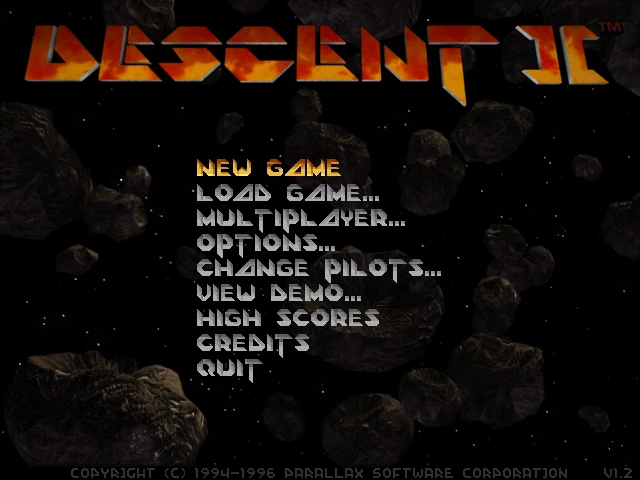
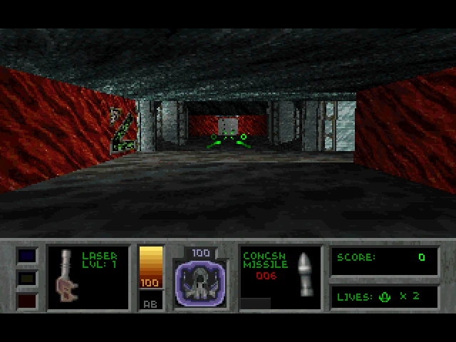
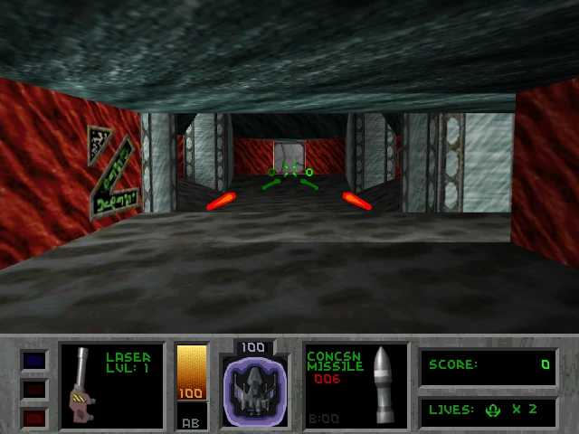
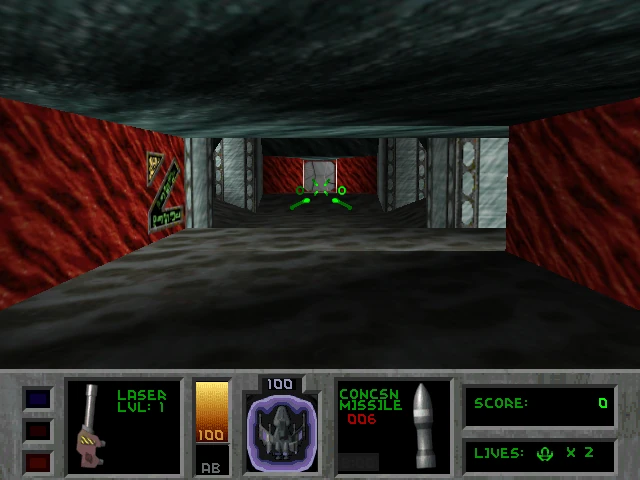
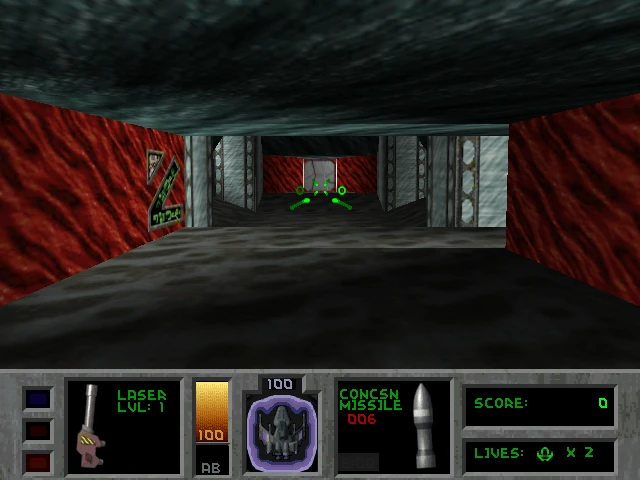
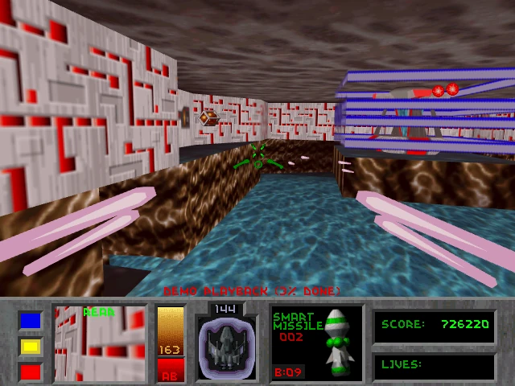
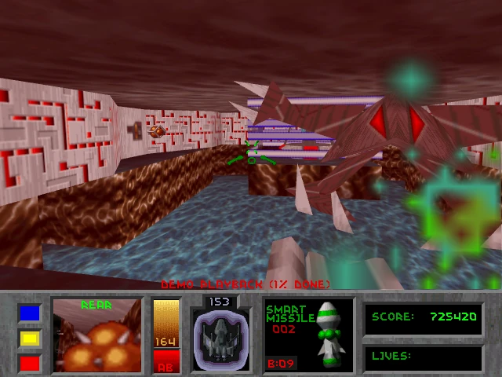
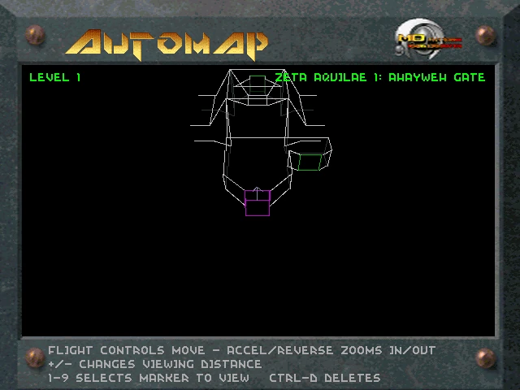

# Descent II (1996 — 3dfx DOS)

| Field | Value |
| :--- | :--- |
| **Category** | Commercial Game |
| **Year** | 1996 *(`D2_3DFX.EXE` Release 6 patch: March 1998)* |
| **Platform(s)** | `DOS/32 (GLIDE2X.OVL via DOSBox Glide pass-through)` |
| **Glide API & Version** | Glide 2.x (`2.56` on Voodoo2 / `2.48` on Voodoo Graphics; requires `2.31+`) |
| **Recommended Card Profile** | `Voodoo2` (default) · `VoodooGraphics` (`SST-1`, also verified) |
| **Verified Backends** | Vulkan · OpenGL ES · Software (AVX2 / AVX-512 / Scalar) |
| **Preset File(s)** | [`glide-ng.ini`](./glide-ng.ini) (Voodoo2) · [`glide-ng.hq.ini`](./glide-ng.hq.ini) (`4× MSAA`) · [`glide-ng.voodoo1.ini`](./glide-ng.voodoo1.ini) (Voodoo1) · [`glide-ng.software.ini`](./glide-ng.software.ini) (CPU Software) |
| **Status** | Verified |

---

## Overview

Parallax Software / Interplay's *Descent II* (`1996`) expands the six-degree-of-freedom subterranean combat formula with larger alien mine complexes, Thief/Guide-Bot companions, afterburners, rear-view monitor gauges, dynamic flickering lights, scripted bosses, and Red Book CD audio.

Two distinct 3dfx DOS executables exist — **pick the dynamic `GLIDE2X.OVL` build for `glide-ng`:**
- **`D2_3DFX.EXE`** (`1,374,737` B, Release 6, March 4, 1998 — *3Dfx Interactive Unsupported Patch by Andy Hanson*) — **dynamically loads `GLIDE2X.OVL`** (`DOS/4GW`), upgrading retail **`DESCENT2.EXE` (`320×200`)** to full **`640×480×16`** perspective-correct bilinear-filtered Glide rendering with alpha-blended plasma bursts, FMV LFB video playback, live rear-view HUD monitors, and a rotatable 3D wireframe automap.
- **`D2VOODOO.EXE`** (`1,707,221` B, January 28, 1997) — CauseWay v3.14 build **statically linked** against `sst1Init`. It talks directly to PCI/MMIO hardware and therefore **cannot** load a `GLIDE2X.OVL` pass-through wrapper.

---

## Editions, Patches & Executables

| Executable / Package | Renderer | Works with `glide-ng`? | Technical Notes |
| :--- | :--- | :---: | :--- |
| **`D2_3DFX.EXE` (`1,374,737` B)** *(3dfx Unsupported Patch **Release 6**, Mar 1998)* | **Glide 2.x (`GLIDE2X.OVL`)** | **Yes (Recommended)** | Requires retail **`v1.2`** first (**`D2PTCH12.EXE`**). Copy `D2_3DFX.EXE`, the bundled **`DOS4GW.EXE`** (`265,396` B), and `glide-ng`'s clean-room **`GLIDE2X.OVL`** (`build_release/dos/glide2x.ovl`, `12,790` B) into the game directory. |
| **`D2VOODOO.EXE` (`1,707,221` B)** *(Jan 1997 Voodoo Graphics patch)* | Statically linked SST-1 Glide (`CauseWay` v3.14) | No | Contains embedded `sst1Init` register code. Requires register-level Voodoo emulation (`voodoo_card = software` in DOSBox-X or PCem / 86Box). |
| **`DESCENT2.EXE` (`1,507,821` B)** *(Retail DOS `v1.2`)* | DOS VGA / VESA software (`320×200` / `640×480`) | Software baseline | Patched from v1.1 (`1,484,297` B → `1,507,821` B) by `D2PTCH12.EXE`. Useful as a direct software comparison (`glide = false`). |
| **`SETUP.EXE` (`802,783` B)** | DOS installer / sound configurator | Setup tool | Stages audio drivers (`DESCENT.CFG`) and data files (`Medium` 48 MB install keeps `.PIG`/`.HAM`/`.HOG`/`.S11`/`.S22` local). |

---

## Recommended DOSBox Configurations

Keep the DOSBox configuration minimal — only non-default overrides are shown below.

> **Important Configuration Notes:**
> 1. **Patch retail to `v1.2` first:** Run **`D2PTCH12.EXE`** before overlaying **`D2_3DFX.EXE`** (`README.TXT` updates to `60,170` B, `DESCENT2.EXE` updates to `1,507,821` B).
> 2. **Remove any old `GLIDE2X.OVL` and install `glide-ng`'s overlay:** Copy **`build_release/dos/glide2x.ovl`** (plus the patch's **`DOS4GW.EXE`**, `265,396` B) directly next to **`D2_3DFX.EXE`**.
> 3. **Disclaimer banner on launch:** `D2_3DFX.EXE` displays a green text disclaimer on startup (*"3Dfx Unsupported Patch — PRESS ESC TO CONTINUE"*). Press **`Esc`** (not `Enter`) to proceed into `INTRO-H.MVL` and the main menu.
> 4. **Mount the `.cue`/`.bin` CD image for FMVs & CD audio:** Mounting `DESCENT_II.cue` with `-t iso` keeps intro/briefing `.MVL` playback and Red Book music active.
> 5. **Memory (`memsize`):** `D2_3DFX.TXT` recommends 32 MB RAM (`memsize = 31` / `32` with `ems = false`, `xms = true`).

### Option A: Patched DOSBox-SVN (Glide Pass-Through → `glide-ng`) *(Recommended)*

```ini
# dosbox-svn.conf (minimal overrides)
[sdl]
# Avoids SDL_UpdateRects SIGSEGV under sdl12-compat on modern Linux
output = opengl

[dosbox]
memsize = 31

[dos]
ems = false
xms = true

[cpu]
cycles = max

[glide]
glide = true
```

```bash
GLIDE_NG_CONFIG=/path/to/glide-ng.ini \
  dosbox -conf dosbox-svn.conf \
  -c "mount C /path/to/descent2/game" \
  -c "imgmount D /path/to/descent2/DESCENT_II.cue -t iso" \
  -c "C:" \
  -c "D2_3DFX.EXE"
```

### Option B: DOSBox-X (Glide Pass-Through → `glide-ng`)

```ini
# dosbox-x-pass.conf (minimal overrides)
[dosbox]
memsize = 31

[dos]
ems = false
xms = true

[cpu]
cycles = max

[voodoo]
glide = true
lfb = full
```

```bash
GLIDE_NG_CONFIG=/path/to/glide-ng.ini \
  dosbox-x -conf dosbox-x-pass.conf -nopromptfolder \
  -c "mount C /path/to/descent2/game" \
  -c "imgmount D /path/to/descent2/DESCENT_II.cue -t iso" \
  -c "C:" \
  -c "D2_3DFX.EXE"
```

### Option C: CPU Software Fallback (`glide-ng.software.ini`)

```bash
GLIDE_NG_CONFIG=/path/to/glide-ng.software.ini \
  dosbox -conf dosbox-svn.conf \
  -c "mount C /path/to/descent2/game" \
  -c "imgmount D /path/to/descent2/DESCENT_II.cue -t iso" \
  -c "C:" \
  -c "D2_3DFX.EXE"
```

### Reference Comparison: DOSBox-X Software Voodoo (No `glide-ng`)

```ini
# dosbox-x-sw.conf
[dosbox]
memsize = 31

[dos]
ems = false
xms = true

[cpu]
cycles = max

[voodoo]
voodoo_card = software
glide = false
```

Launch **`D2VOODOO.EXE`** (`1,707,221` B, static CauseWay SST-1 build) under `voodoo_card = software` to compare directly against register-level Voodoo emulation.

---

## Visual Progression Gallery

Captures below show **`D2_3DFX.EXE`** (`640×480×16` Glide 2.x) and native DOS VGA **`DESCENT2.EXE`** (`320×200`, nearest-scaled to `640×480`) under patched DOSBox-SVN:

| | |
| :---: | :---: |
| <br>**1. Main Menu (`Vulkan`, `640×480`)**<br>Asteroid-field title screen with glowing gold `NEW GAME` cursor — streamed straight into **`GR_BUFFER_FRONTBUFFER`** via `glide-ng`'s RAMDAC scanout flush timer without `grBufferSwap`. | <br>**2. Native DOS VGA Baseline (`DESCENT2.EXE`, `320×200`)**<br>Built-in software renderer (`glide = false`): blocky nearest-neighbor cave walls, low-res glyph edges, and horizontal letterboxing in status-bar mode. |
| <br>**3. Level 1: Ahayweh Gate (`Vulkan 4× MSAA`, `640×480`)**<br>Starting shaft in *Zeta Aquilae* firing dual lasers: smooth bilinear-filtered cavern rock, metallic wall seams, glowing green corridor markings, `100` shield readout, and `AB` afterburner bar. | <br>**4. Level 1: Ahayweh Gate (`OpenGL ES 3.2`, `640×480`)**<br>Pixel-accurate parity with Vulkan across crimson rock shaders, metal bulkhead lighting, green reticle glow, and sharp lower HUD gauges. |
| <br>**5. Level 1: Ahayweh Gate (`CPU Software AVX2`, `640×480`)**<br>Pure-CPU Glide 2.x rasterizer reproducing the exact lighting, colors, gamma (`1.1`), textures, and HUD readout without requiring a host GPU driver. | <br>**6. `DESCENT2.DEM` — Reactor Chamber (`Vulkan 4× MSAA`)**<br>Quad plasma bolts flying toward a shielded reactor core: layered forcefield rings, `REAR` live-rendered picture-in-picture mirror, smooth water floor textures, and crisp `144` shield counter. |
| <br>**7. `DESCENT2.DEM` — Close-Quarters Combat (`Vulkan 4× MSAA`)**<br>Active firefight displaying translucent blast spheres, incoming fireball visible inside the live **`REAR`** camera box, enemy robot geometry, and crisp `153` shield digits. | <br>**8. 3D Wireframe Automap (`Tab`, `Vulkan`, `640×480`)**<br>Rotatable 3D mine vector map (`LEVEL 1 — ZETA AQUILAE 1: AHAYWEH GATE`) showing shaded white/grey tunnels, green room marker, purple entrance frame, and player heading arrow. |

---

## Visual Quality & Performance Tuning

* **`max_fps = 60` (Mandatory!):** The original **`D2_3DFX.TXT`** explicitly warns: *"If you run faster than 60Hz you will get some odd timing behaviour in the game."* All four catalog presets set **`max_fps = 60`** (`vsync = true` on GPU backends).
* **`glide-ng.hq.ini` (`4× MSAA`, `no_dither_sub = true`) is recommended:** Anti-aliases jagged mine edges, metallic struts, laser bolts, and robot wings cleanly across `640×480` with zero HUD clipping.
* **`Voodoo2` (`2.56`) or `VoodooGraphics` (`2.48`):** Both profiles work cleanly and emit zero Glide version warnings.
* **Native gamma (`1.1`):** `D2_3DFX.EXE` applies `grGammaCorrectionValue(1.1)` on initialization; leave `[display] gamma` unset in `glide-ng.ini` so the title controls contrast natively.

---

## Quirks, Known Issues & Controls

### Rendering & Engine Notes
* **Direct `GR_BUFFER_FRONTBUFFER` menus & briefings:** Like authentic SST-1/Voodoo2 software that draws directly to the live front buffer, `D2_3DFX.EXE` writes main menus, cursor highlights, and typewriter briefings into **`GR_BUFFER_FRONTBUFFER`** *without* calling `grBufferSwap()`. `glide-ng` detects un-swapped front-buffer mutations via a trailing-edge RAMDAC scanout timer across **Vulkan**, **OpenGL ES**, and **Software** so menus and briefings remain responsive and tear-free.
* **Cockpit view disabled in 3dfx patch:** Pressing **`F3`** toggles between the bottom status bar and minimal HUD overlay; full enclosed cockpit mode is unavailable in the official patch (`COCKPIT NOT AVAILABLE IN 3DFX VERSION.`).
* **Subtle teal/cyan edge on plasma/explosion sprites:** Some `RGB_565` cutout explosions use hardware chromakey alongside bilinear texture filtering. Because authentic 3dfx TMUs filter adjacent texels *before* comparing against `grChromakeyValue`, a faint 1-pixel cyan/teal halo can appear around blurred glow billboards across all three backends (matching real Voodoo hardware).
* **Subnormal vertex `oow` sanitization:** `D2_3DFX.EXE` leaves uninitialized stack integers (subnormal floats `< FLT_MIN`) in `GrVertex.oow` on flat-shaded HUD clear quads and `Tab` automap wireframes while leaving `grAlphaCombine(..., TEXTURE)` armed. `glide-ng` sanitizes subnormal `oow` inputs so GPU FTZ/DAZ hardware never discards wireframe tunnel lines or clips HUD shield counter digits.
* **Mouse sensitivity & savegame thumbnails (`D2_3DFX.TXT`):** Mouse steering feels less sensitive in the original patch (`-joy` / keyboard flight works normally), and saving a game omits the miniature screenshot preview.
* **Startup splash:** Uncomment `no_splash = true` in `glide-ng.ini` (or pass `FX_GLIDE_NO_SPLASH=1` / `GLIDE_NG_NO_SPLASH=1`) to skip the one-shot startup splash animation.

### Useful Controls

| Key | Action |
| :--- | :--- |
| **`Esc` *(at launch prompt)*** | Dismiss the green 3dfx unsupported-patch disclaimer |
| **`A` / `Z`** | Accelerate / reverse |
| **`S`** | Engage **Afterburner** |
| **`↑` / `↓` / `←` / `→`** | Pitch down / pitch up / turn left / turn right |
| **`Q` / `E`** | Bank left / bank right |
| **`Ctrl` / `Space`** | Fire primary weapon / fire secondary missile |
| **`H` / `R`** | Toggle headlight / rear-view camera monitor |
| **`Shift+F4` / `F4`** | Release / direct the Guide-Bot |
| **`Tab`** | Toggle 3D wireframe automap |
| **`F3`** | Cycle HUD mode (status bar / minimal gauges) |
| **`F2` / `Esc`** | In-game options / pause / quit |
