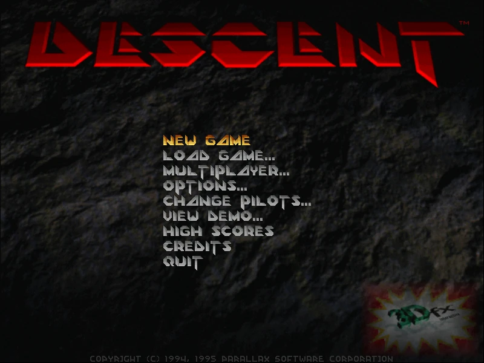
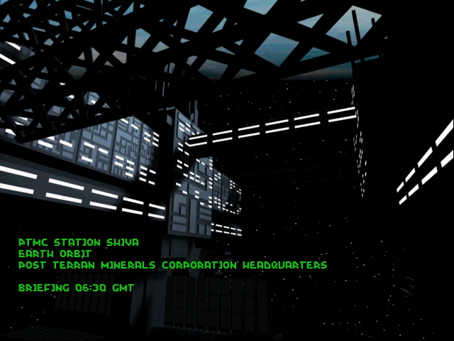
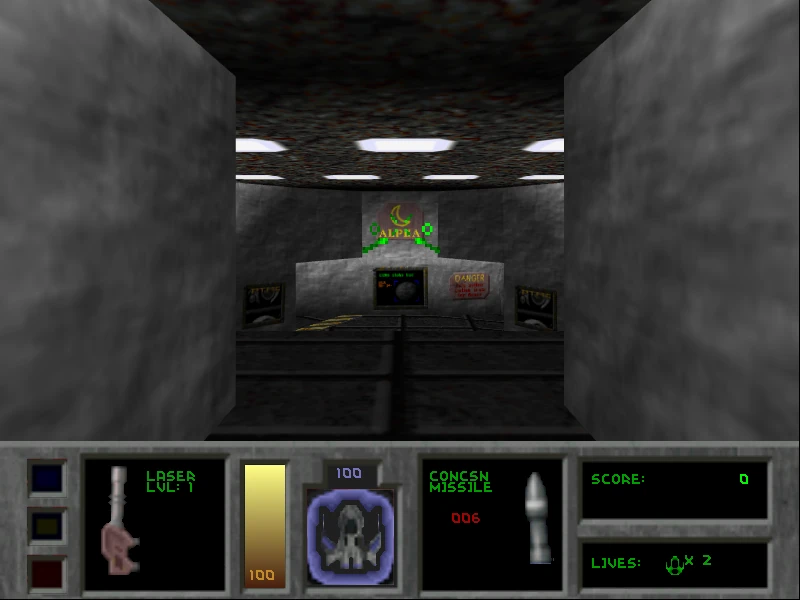
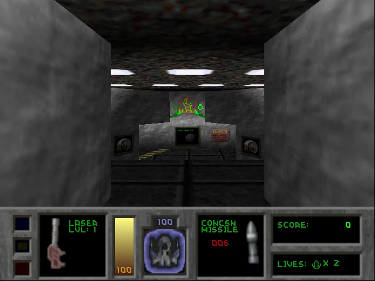
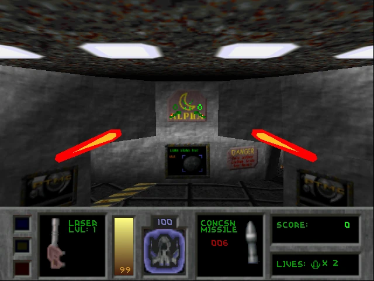
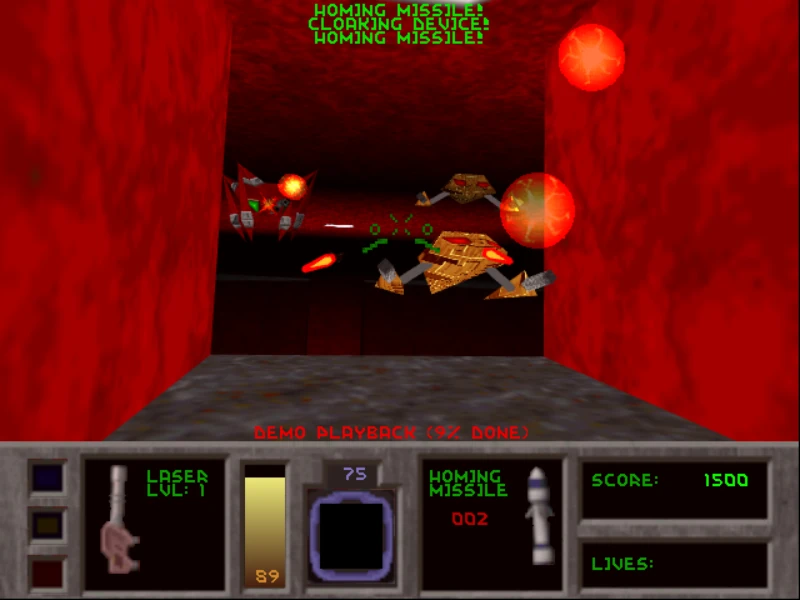
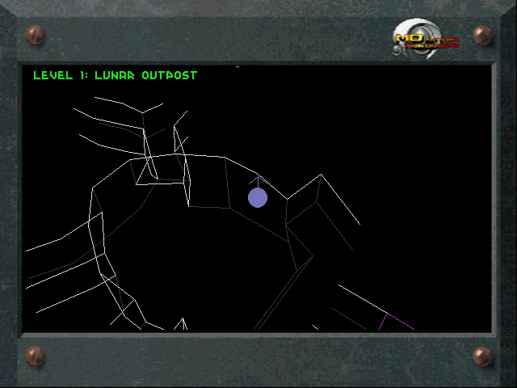

# Descent (1995 — `D1_3Dfx` Win32 3dfx Glide 2.x)

| Field | Value |
| :--- | :--- |
| **Category** | Commercial Game |
| **Year** | 1995 *(`D1_3Dfx` Beta 01 port: August 1998)* |
| **Platform(s)** | `Win32 / Wine (glide2x.dll)` |
| **Glide API & Version** | **Glide 2.x (`glide2x.dll`, Voodoo2 `2.56` / Voodoo1 `2.48`; requires `2.43+`)** |
| **Recommended Card Profile** | `Voodoo2` (`2.56`, default) · `VoodooGraphics` (`2.48`, also verified) |
| **Verified Backends** | Vulkan · OpenGL 3.3 Core (WGL) · Software (AVX2 / AVX-512 / Scalar) |
| **Preset File(s)** | [`glide-ng.ini`](./glide-ng.ini) (`1×`, Vulkan) · [`glide-ng.hq.ini`](./glide-ng.hq.ini) (`4× MSAA` + Linear) · [`glide-ng.voodoo1.ini`](./glide-ng.voodoo1.ini) (Voodoo1 SST-1) · [`glide-ng.software.ini`](./glide-ng.software.ini) (CPU Software) |
| **Status** | Verified |

---

## Overview

Parallax Software / Interplay's landmark 1995 six-degree-of-freedom tunnel shooter *Descent* originally shipped as a 256-color DOS software game (`DESCENTR.EXE`, `320×200`). Following the 1997 *Descent* source release, Stefan Wiegand, Heiko Herrmann, and the Descent Network Team published **`D1_3Dfx` Beta 01** (August 29, 1998) — a native **Win32 Glide 2.x (`glide2x.dll`)** conversion running on Windows 95/98/NT 4.0 and requiring Glide `2.43` or later.

Unlike the DOS original, **`D1_3DFX.EXE`** unlocks bilinear-filtered **`640×480`** (`VideoMode=0`) and **`800×600`** (`VideoMode=1`, even on Voodoo Graphics SST-1 profiles!), hi-res `640×480` title and briefing screens (licensed from Outrage Entertainment), translucent glowing explosions/plasma fireballs (`Translucency=1`), perspective-correct mine lighting, and two bonus anarchy missions (`JOLT` and `INSANITY`). Through **`glide-ng`**, it runs smoothly with full backend parity across **Vulkan**, **OpenGL 3.3 Core (WGL)**, and **CPU Software AVX2** — without requiring Wine `renderer=no3d`.

---

## Editions, Patches & Executables

| Binary / Package | Graphics API | Works with `glide-ng`? | Technical Notes |
| :--- | :--- | :---: | :--- |
| **`D1_3DFX.EXE` (`479,232` B)** *(`D1_3Dfx` V1.0 Beta 01, `d13dfxb1.exe`)* | **Glide 2.x (`glide2x.dll`)** | **Yes (Recommended)** | Native Win32 PE executable importing `glide2x.dll`. Requires commercial *Descent* first patched to `v1.4a`/`v1.5`, then upgraded with **`D13DINST.EXE`**, which rebuilds `DESCENT.HOG` (`6,856,183` → `9,934,912` B) with hi-res `640×480` startup/briefing art and installs `JOLT.{HOG,MSN}` and `INSANITY.{HOG,MSN}`. |
| **`DESCENTR.EXE` (`1,132,633` B)** *(DOS retail v1.5)* | DOS VGA 8-bit (`320×200`) | No *(Software baseline)* | Original DOS/4GW executable upgraded via official `v1.0 → v1.5` patch (`PATCH.EXE`, `6/6` files). Run in DOSBox with `glide = false` for comparison. |
| **`DESCENT.EXE` (`v1.0` retail)** | DOS VGA 8-bit (`320×200`) | No | Unpatched DOS release; apply Interplay's `v1.0 → v1.5` patch (`PATCH.EXE`) inside DOSBox *before* running `D13DINST.EXE`. |

---

## Patching & Launch Configurations (Wine32 / Windows)

### 1. Retail Staging Order

1. Install the commercial DOS **v1.0** game files into your `DESCENT/` directory (e.g., via `INSTALL.EXE` or mounted `Descent I.iso`).
2. Inside DOSBox, apply the official Interplay/Parallax **`v1.0 → v1.5`** updater (**`PATCH.EXE`**; updates `6/6` files including `DESCENTR.EXE` and `README.TXT`).
3. Run the **`D1_3Dfx` Beta 01** installer (**`d13dfxb1.exe`** / **`D13DINST.EXE`**) under Wine32 targeting the `DESCENT/` folder. Confirm `DESCENT.HOG` expands to **`9,934,912` B** and **`D1_3DFX.EXE`** (`479,232` B) is present.
4. Copy (or symlink) **`glide-ng`'s** Win32 **`glide2x.dll`** right next to **`D1_3DFX.EXE`**.

### 2. One-Time Wine Prefix Setup

```bash
WINEARCH=win32 WINEPREFIX=/path/to/prefix wineboot -u
WINEARCH=win32 WINEPREFIX=/path/to/prefix wine reg add \
  'HKCU\Software\Wine' /v Version /t REG_SZ /d win98 /f
```

### Option A: Standard `640×480` (`glide-ng.ini` — Voodoo2 Vulkan)

```bash
WINEARCH=win32 WINEPREFIX=/path/to/prefix \
WINEDLLOVERRIDES="glide2x=n" \
GLIDE_NG_CONFIG=/path/to/glide-ng.ini \
  wine explorer /desktop=D1,640x480 D1_3DFX.EXE
```

> **Audio-less / Headless Tip:** As noted in the original `D1_3DFX.TXT`, pass **`-nosound`** on systems without a sound card to prevent mid-level audio freezes. On CPU-only Vulkan hosts (`llvmpipe`), add `LP_NUM_THREADS=4` to conserve 32-bit Wine address space.

### Option B: Enhanced `800×600` (`glide-ng.hq.ini` — Vulkan `4× MSAA`) *(Recommended)*

Set **`VideoMode=1`** inside **`D1_3Dfx.cfg`** (or select `800x600` inside the **main menu** `Options` screen — see quirk below), then match the Wine virtual desktop dimensions:

```bash
WINEARCH=win32 WINEPREFIX=/path/to/prefix \
WINEDLLOVERRIDES="glide2x=n" \
GLIDE_NG_CONFIG=/path/to/glide-ng.hq.ini \
  wine explorer /desktop=D1,800x600 D1_3DFX.EXE
```

### Option C: Voodoo Graphics / SST-1 (`glide-ng.voodoo1.ini`)

```bash
WINEARCH=win32 WINEPREFIX=/path/to/prefix \
WINEDLLOVERRIDES="glide2x=n" \
GLIDE_NG_CONFIG=/path/to/glide-ng.voodoo1.ini \
  wine explorer /desktop=D1,640x480 D1_3DFX.EXE
```

### Option D: OpenGL 3.3 Core (WGL)

Unlike DirectDraw-hybrid launchers that require `renderer=no3d`, **`D1_3DFX.EXE`** renders exclusively through `glide2x.dll` and opens a clean **`OpenGL 3.3 Core` (WGL)** context under Wine out of the box:

```bash
WINEARCH=win32 WINEPREFIX=/path/to/prefix \
WINEDLLOVERRIDES="glide2x=n" \
GLIDE_NG_BACKEND=opengl_es \
  wine explorer /desktop=D1,640x480 D1_3DFX.EXE
```

### Option E: CPU Software Fallback (`glide-ng.software.ini`)

```bash
WINEARCH=win32 WINEPREFIX=/path/to/prefix \
WINEDLLOVERRIDES="glide2x=n" \
GLIDE_NG_CONFIG=/path/to/glide-ng.software.ini \
  wine explorer /desktop=D1,640x480 D1_3DFX.EXE
```

---

## Visual Progression Gallery

Captures below show **`D1_3DFX.EXE`** running under Wine32 at native `640×480` (`VideoMode=0`) and `800×600` (`VideoMode=1`):

| | |
| :---: | :---: |
| <br>**1. Main Menu (`Vulkan 4× MSAA`, `800×600`)**<br>Hi-res *Descent* title screen featuring the beveled rock backdrop, crisp vector title font, and corner `3Dfx` Interactive emblem (`VideoMode=1`). | <br>**2. Mission Briefing (`Vulkan`, `640×480`)**<br>Hi-res orbital backdrop installed into `DESCENT.HOG` (`9,934,912` B) by `D13DINST.EXE` with sharp green CRT briefing text (*PTMC Station Shiva*). |
| <br>**3. Level 1: Lunar Outpost (`Vulkan 4× MSAA`, `800×600`)**<br>Starting shaft facing the `ALPHA` bulkhead with bilinear-filtered grey walls, ceiling light panels, anti-aliased bevels, crisp green crosshair, and status bar. | <br>**4. Level 1: Lunar Outpost (`OpenGL 3.3 Core WGL`, `640×480`)**<br>Matches Vulkan across tunnel shading, `PTMC` posters, lighting, weapon HUD icons, shield/energy gauges, and reticle alignment (default Wine WGL, no `renderer=no3d` needed). |
| <br>**5. Level 1: Lunar Outpost (`CPU Software AVX2`, `640×480`)**<br>Pure-CPU Glide 2.x rasterizer showing matching wall shading, `DANGER` sign, `ALPHA` archway lighting, and HUD gauges without any host GPU driver. | <br>**6. Dual Lasers — Level 1 (`Vulkan`, `640×480`)**<br>Advancing down the entry tunnel while firing twin yellow/red Laser Level 1 bolts toward the `ALPHA` moon alcove. |
| <br>**7. `DESCENT.DEM` Combat (`Vulkan 4× MSAA`, `800×600`)**<br>Red lava-lit corridor demonstrating smooth `Translucency=1` glowing plasma fireballs over textured robot drones while flying cloaked (shield ship panel intentionally blanked during cloak). | <br>**8. 3D Wireframe Automap (`Tab`, `CPU Software AVX2`, `640×480`)**<br>Depth-shaded rotatable 3D mine schematic for `LEVEL 1: LUNAR OUTPOST`, displaying the player marker circle, heading vector, explored corridors, and exit doorway. |

---

## Visual Quality & Performance Tuning

* **`800×600` + `4× MSAA` (`glide-ng.hq.ini`):** With `VideoMode=1` in `D1_3Dfx.cfg`, `msaa = 4`, `presentation_filter = linear`, and `no_dither_sub = true`, crisp mine walls, angled tunnel bevels, and robot meshes look dramatically cleaner than `320×200` DOS VGA (`DESCENTR.EXE`) without disturbing the sharp status bar.
* **Frame rate cap (`max_fps = 60`):** `D1_3Dfx.cfg` ships with `VSync=1`. Keeping `vsync = true` and `max_fps = 60` keeps rotation, ship recoil, and weapon cadence predictable.
* **`D1_3Dfx.cfg` quick switches:**
  * `Translucency=1` — enables alpha-blended explosions, laser halos, and powerups (`0` reverts to opaque/stippled cutouts).
  * `VideoMode=0` (`640×480`) / `VideoMode=1` (`800×600`) — supported on both `Voodoo2` (`2.56`) and `VoodooGraphics` (`2.48`).
  * `ShowFramerate=1` — toggles the built-in FPS counter.
  * `GammaLevel=4` — in-game brightness index (`D1_3DFX.EXE` sets hardware gamma directly via Glide; leave `[display] gamma` unset in `glide-ng.ini`).

---

## Quirks, Known Issues & Controls

### Beta 01 Port Notes (`D1_3DFX.TXT`)
* **Unsupported features in `D1_3Dfx` Beta 01:** No full cockpit frame overlay (status bar and borderless HUD only), **no mouse input**, and no modem/serial multiplayer (`LAN` / UDP remains available via original options).
* **Change video modes only from the main menu:** Switching `640×480 ↔ 800×600` while paused mid-level is flagged as buggy in `D1_3DFX.TXT`. Switch only at the main menu (or edit `VideoMode` directly in `D1_3Dfx.cfg` before launch).
* **Music bug note:** `D13DINST.EXE` automatically patches Interplay's `v1.0 → v1.5` music playback bug for both `D1_3DFX.EXE` and the original DOS executable.
* **`-nosound` flag:** `D1_3DFX.EXE` boots cleanly both with and without `-nosound` under Wine; if running on a host without an active audio backend, pass **`-nosound`** so long levels cannot hang waiting on a mixer handle.
* **Subnormal `oow` wireframe safety:** Uninitialized `GrVertex.oow` values on Glide line/HUD primitives are sanitized by `glide-ng` (`< FLT_MIN` flushed to default `1.0f`) so the `Tab` 3D wireframe automap renders cleanly on Vulkan, OpenGL ES/WGL, and Software.

### Useful Controls

| Key | Action |
| :--- | :--- |
| **`A` / `Z`** | Accelerate / reverse |
| **`↑` / `↓` / `←` / `→`** | Pitch down / pitch up / turn left / turn right |
| **`Q` / `E`** | Bank left / bank right |
| **`Ctrl` / `Space`** | Fire primary weapon / fire secondary missile |
| **`B`** | Drop flare |
| **`Tab`** | Toggle 3D wireframe automap |
| **`F3`** | Cycle HUD mode (status bar / minimal gauges) |
| **`1`–`5` / `6`–`0`** | Select primary / secondary weapon |
| **`F2` / `Esc`** | In-game options / pause / abort menu |
