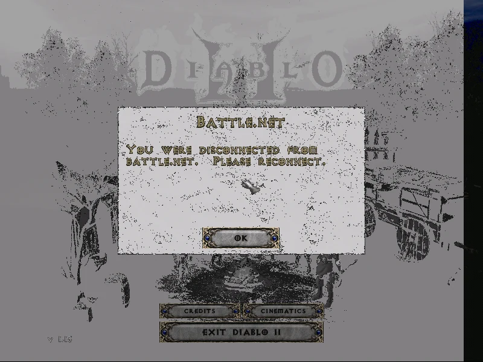
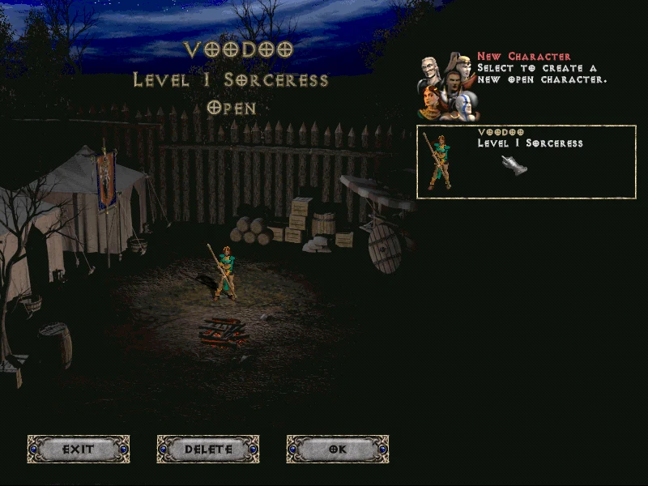

# Diablo II (2000 — Win32 Glide 3.x)

| Field | Value |
| :--- | :--- |
| **Category** | Commercial Game |
| **Year** | 2000 |
| **Platform(s)** | `Win32 / Wine (glide3x.dll)` |
| **Glide API & Version** | Glide 3.x (`3.03` on Voodoo2 / `3.10` on Voodoo3) |
| **Recommended Card Profile** | `Voodoo2` (default) · `Voodoo3` (`3.10`) |
| **Verified Backends** | Vulkan · OpenGL ES (WGL) · Software (AVX2 / AVX-512 / Scalar) |
| **Preset File(s)** | [`glide-ng.ini`](./glide-ng.ini) (Voodoo2) · [`glide-ng.hq.ini`](./glide-ng.hq.ini) (4× MSAA + Linear) · [`glide-ng.voodoo3.ini`](./glide-ng.voodoo3.ini) (Voodoo3) · [`glide-ng.software.ini`](./glide-ng.software.ini) (CPU Software) |
| **Status** | Verified |

---

## Overview

Blizzard North's 2000 action RPG *Diablo II* ships a dedicated Glide 3.x renderer (`D2Glide.dll` → `glide3x.dll`) alongside DirectDraw 2D (`D2DDraw.dll`), Direct3D (`D2Direct3D.dll`), and windowed GDI (`D2Gdi.dll`). *Diablo II* was authored primarily around 3dfx Glide: unlike the 2D `D2DDraw` / `D2Gdi` modes, **`D2Glide.dll` unlocks hardware perspective terrain warping, RGB colored lighting, smooth additive fire/spell glow, hardware `grLoadGammaTable` contrast/gamma LUTs, and translucent vector overlays**.

Technically, `D2Glide.dll` is a distinctive **paletted (`GR_TEXFMT_P_8`) dual-TMU Glide 3.x atlas workload**: it splits its screen into **`256×256` 8-bit paletted tiles** and distributes them across **both `TMU0` and `TMU1`** inside an **`800×600` (`GR_RESOLUTION_800x600`, `Buffers=2`, `Aux=0`)** swapchain, relying on `grTexDownloadTable(GR_TEXTABLE_PALETTE, data)` (no TMU argument) broadcasting the shared 256-entry palette across **all** TMUs per the 3dfx Glide 3.x hardware specification. In-game gamma adjustments directly call **`grLoadGammaTable`** with a 256-entry RGB ramp.

---

## Editions, Patches & Executables

| Executable / Renderer | Graphics API | Works with `glide-ng`? | Technical Notes |
| :--- | :--- | :---: | :--- |
| **`Game.exe -3dfx`** (`D2Glide.dll`, **v1.13d**) | **Glide 3.x (`glide3x.dll`)** | **Yes (Recommended)** | Official v1.13d patch (`D2Patch_113d.exe`) enables full No-CD play once `d2music.mpq` (from the Play Disc) and `d2video.mpq` (from the Cinematics Disc) are copied into the game folder. `D2VidTst.exe` automatically probes and **recommends `3dfx Glide`**. Full color, perspective mode, `800×600` framebuffer, additive campfire/logo glow, live `Tab` automap, and crisp Exocet fonts across all three `glide-ng` backends. |
| **`Game.exe -3dfx`** (**v1.14d**) | Glide 3.x (`glide3x.dll`) | Optional (Alternate) | Final official patch (`D2Patch_114d.exe`, 2019). Consolidates DLL modules into `Game.exe` and moves saves into `%USERPROFILE%\Saved Games\Diablo II\`. **Keep v1.13d** for maximum compatibility with standalone `D2Glide.dll` and classic tooling. |
| **`Game.exe -d3d`** (`D2Direct3D.dll`) | Direct3D 6/7 | No (No 3dfx) | Fails hardware enumeration inside headless Wine 10 virtual framebuffer setups (`D2VidTst.exe` skips D3D and DirectDraw, recommending Glide only). Known on modern desktop drivers for dark gamma drift and cursor/text blurring. |
| **`Game.exe -ddraw`** (`D2DDraw.dll`) | DirectDraw 2D | No (No 3dfx) | Fullscreen 2D software renderer. Lacks Perspective mode and fails `D2VidTst.exe` detection on headless displays; no Glide alpha glow. |
| **`Game.exe -w`** (`D2Gdi.dll` / windowed 2D) | Win32 GDI 2D | No (No 3dfx) | Works reliably at native `640×480` windowed (useful as a 2D color reference). Slightly darker than hardware Glide because `grLoadGammaTable` is bypassed, and lacks Perspective mode and `800×600` scaled menus. |

> **v1.13d Official No-CD File Check:**
> Installing all three retail discs (`Full` install) leaves `d2music.mpq` only on CD2 (Play Disc). Copying `d2music.mpq` (~330 MB) from the Play Disc root directly into the installed *Diablo II* directory after applying `D2Patch_113d.exe` allows completely disc-free launch without third-party cracks.

---

## Launch Commands (Win32 / Wine)

Copy `glide3x.dll` from `glide-ng`'s Win32 build directly beside `Game.exe` (in the *Diablo II* installation directory), and drop the chosen `glide-ng.ini` preset into the same folder (or set `GLIDE_NG_CONFIG=/path/to/glide-ng.ini`).

### One-Time Wine 10 Setup (`winxp` Compatibility & `D2VidTst`)

On Wine 10, `Fog.dll` hits a stack overflow on boot (`0x6FF61AFB`, *"Unrecoverable internal error"*) under newer default Windows versions (`win10`/`win7`). Setting the 32-bit prefix compatibility mode to **`winxp`** resolves the startup fault cleanly:

```bash
WINEARCH=win32 WINEPREFIX=/path/to/prefix wine reg add \
  'HKCU\Software\Wine' /v Version /t REG_SZ /d winxp /f

# Optional: run Blizzard's official video test utility once (selects 3dfx Glide automatically)
WINEARCH=win32 WINEPREFIX=/path/to/prefix WINEDLLOVERRIDES="glide3x=n" \
  wine ./D2VidTst.exe
```

To skip the GUI test and pin Glide directly via the registry:

```bash
WINEARCH=win32 WINEPREFIX=/path/to/prefix wine reg add \
  'HKCU\Software\Blizzard Entertainment\Diablo II\VideoConfig' \
  /v Render /t REG_DWORD /d 3 /f
```

### Standard Launch (`glide-ng.ini` — Vulkan `1×`, `nearest` Scaling)

```bash
cd /path/to/diablo-2
WINEDLLOVERRIDES="glide3x=n" \
GLIDE_NG_CONFIG=/path/to/docs/catalog/games/diablo-2/glide-ng.ini \
  wine explorer /desktop=DiabloII,800x600 ./Game.exe -3dfx
```

### Direct Launch (Hardware Vulkan / Desktop Fullscreen)

```bash
cd /path/to/diablo-2
WINEDLLOVERRIDES="glide3x=n" \
GLIDE_NG_CONFIG=/path/to/docs/catalog/games/diablo-2/glide-ng.hq.ini \
  wine ./Game.exe -3dfx
```

### Best Visuals (`glide-ng.hq.ini` — Vulkan `4× MSAA` + Linear Upscale)

```bash
cd /path/to/diablo-2
WINEDLLOVERRIDES="glide3x=n" \
GLIDE_NG_CONFIG=/path/to/docs/catalog/games/diablo-2/glide-ng.hq.ini \
  wine explorer /desktop=DiabloII,800x600 ./Game.exe -3dfx
```

### CPU Software Backend (`glide-ng.software.ini` — AVX2 / AVX-512)

```bash
cd /path/to/diablo-2
WINEDLLOVERRIDES="glide3x=n" \
GLIDE_NG_CONFIG=/path/to/docs/catalog/games/diablo-2/glide-ng.software.ini \
  wine explorer /desktop=DiabloII,800x600 ./Game.exe -3dfx
```

*(Append `-ns` only if launching headless without an audio device; omit `-ns` for normal gameplay with music and SFX. Never launch the `Diablo II.exe` stub directly from scripts that track child exit status, as it detaches `Game.exe` and returns immediately.)*

---

## Visual Progression Gallery

### 1. Title Splash, Main Menu & TMU Palette Broadcast Fix

| Scene / Capture | Details & Notes |
| :---: | :---: |
| <br>**Title Splash — `glide-ng` (`Software AVX2`, 800×600)** | Blazing logo fire, deep indigo twilight clouds, starry sky, roaring foreground torch, and crisp white copyright text rendered seamlessly across both `TMU0` and `TMU1`. |
| <br>**Main Menu — `glide-ng` (`800×600`)** | Smooth flickering hero silhouette lighting around the campfire, sharp Exocet stone buttons with sapphire corner inlays, zero tiling seams across the background quad split. |
| <br>**Before Fix — Missing `TMU1` Palette Broadcast** | Historic capture before the `grTexDownloadTable` broadcast fix: `x = 0..767` (3 `256×256` `P_8` tiles on **`TMU1`**) rendered with the default grayscale identity palette, while `x = 768..799` and buttons (`TMU0`) were full color. |
| <br>**`D2VidTst.exe` Detection Results** | Blizzard's official video test utility detects **`3dfx Glide`** via `glide-ng`'s `glide3x.dll` and automatically recommends it over DirectDraw/Direct3D. |

### 2. Character Creation & Backend Comparison (Act I — Rogue Encampment)

| Backend / Mode | Capture |
| :---: | :---: |
| <br>**Hero Creation — `Vulkan 1×` (`800×600`)** | <br>**Single Player Roster (`VOODOO` Sorceress, `Vulkan 1×`)** |
| <br>**`glide-ng` — `Vulkan 1×` (`glide-ng.ini`, `800×600`)** | <br>**`glide-ng` — `Vulkan 4× MSAA` (`glide-ng.hq.ini`, `800×600`)** |
| <br>**`glide-ng` — `OpenGL ES / WGL` (`800×600`)** | <br>**`glide-ng` — `Software AVX2` (`glide-ng.software.ini`, `800×600`)** |

### 3. UI Overlays, `Voodoo3` Profile & 2D Reference Flavour

| Scene / Flavour | Comparison |
| :---: | :---: |
| <br>**Translucent `Tab` Automap & Quest `!` Bubble (`OpenGL ES / WGL`)** | <br>**Sorceress Inventory Panel (`Vulkan 4× MSAA` HQ)** |
| <br>**Character Sheet + Fire Spells & Hover Tooltip (`Voodoo3` `3.10`)** | <br>**Stock Windowed GDI 2D (`Game.exe -w`, `640×480` ref)** |

**Visual Winner:** **`D2Glide.dll` + `glide-ng.hq.ini` (`Vulkan 4× MSAA`)** (or **`glide-ng.ini` `1×` `nearest`** for razor-sharp pixel-exact menus). All three `glide-ng` backends (`vulkan`, `opengl_es`/WGL, `software AVX2`) achieve **100% pixel parity** with exact flame glow, glowing embers, rain streaks, translucent shadow sprites, crisp `Tab` automap lines, translucent green/red hover tooltips, and native hardware `grLoadGammaTable` lighting — outperforming the darker, flat `640×480` windowed 2D `D2Gdi.dll` mode and unblocking headless/modern displays where stock `D2Direct3D.dll` / `D2DDraw.dll` fail enumeration.

---

## Tuning & Known Quirks

- **Glide 3.x `grTexDownloadTable` / `grTexDownloadTablePartial` TMU Broadcast (Fixed in `glide-ng`):** Per the official 3dfx Glide 3.x specification, `grTexDownloadTable` and `grTexDownloadTablePartial` omit the `tmu` argument and write through a broadcast chipmask (`0x06`/`0x0E`) to **all** TMUs simultaneously. Early `glide-ng` routed those calls only to `GR_TMU0`, leaving `GR_TMU1` with an uninitialized grayscale ramp — causing *Diablo II*'s three `256×256` `P_8` screen tiles (`x = 0..767`, assigned to `TMU1`) to appear monochrome chalk-gray across all three backends while `x = 768..799` and UI widgets (`TMU0`) appeared in full color. `glide-ng` now broadcasts both `grTexDownloadTable` and `grTexDownloadTablePartial` to **`GR_TMU0` and `GR_TMU1`**, and honors inclusive `[start..end]` partial palette range updates across both Glide 2.x and Glide 3.x without disturbing entries outside the updated range.
- **Wine 10 `Fog.dll` Stack Overflow (`0x6FF61AFB`):** Default `win7`/`win10` emulation under Wine 10 crashes `Fog.dll` on boot. Always set `HKCU\Software\Wine\Version = winxp` inside the 32-bit Wine prefix.
- **Classic *Diablo II* Resolution:** Original *Diablo II* (without the *Lord of Destruction* expansion) runs at `640×480` in gameplay (`D2Glide.dll` opens `GR_RESOLUTION_800x600` (`Res=8`) and scales its atlas/frame cleanly to fill `800×600`). Keep the `glide-ng.ini` default **`gamma`** unset (linear `1.0`) so in-game `Video Options → Gamma` and `Contrast` adjust cleanly through `grLoadGammaTable`.
- **`Save Path` Registry Key:** *Diablo II* v1.13d reads `HKCU\Software\Blizzard Entertainment\Diablo II\Save Path` (with a trailing backslash, e.g. `C:\Program Files\Diablo II\save\`). When relocating an installed directory, update `Save Path` so saved characters appear under **Single Player**.
- **Lean Staging Slot on 32-bit CPU Vulkan (`llvmpipe`):** On software Vulkan adapters with `msaa = 4`, an initial frame's atlas upload burst may emit a benign `[WARN] [Vulkan] Texture staging slot size exceeded! Flushing mid-frame and wrapping around...` — handled automatically with zero corruption. Prefer **`glide-ng.software.ini`** on systems lacking a 32-bit hardware Vulkan ICD.

---

## Useful In-Game Controls

| Key / Input | Action |
| :--- | :--- |
| **`Left Click`** | Move / primary attack / interact with NPC or chest |
| **`Right Click`** | Cast secondary skill (e.g. *Fire Bolt*) |
| **`Tab`** | Toggle translucent **Automap** overlay |
| **`I` / `B`** | Open/close **Inventory** |
| **`C`** | Open/close **Character** stat sheet |
| **`T`** | Open/close **Skill Tree** |
| **`Q` / `H`** | Toggle **Quests** / **Help** panel |
| **`1`–`4`** | Use belt potion slots |
| **`Alt`** | Highlight items on the ground |
| **`R`** | Toggle **Run / Walk** |
| **`Space`** | Dismiss all open UI panels |
| **`Esc`** | Open pause menu (`Options` → `Video Options` / `Save and Exit Game`) |

---

## Verified Backends & Profiles

| Backend | Profile | API Version | Result | Notes |
| :--- | :--- | :---: | :---: | :--- |
| **Vulkan (`1×`, `nearest`)** | `Voodoo2` | `3.03` | **Pass** | Native `800×600` menu & town, full palette color on both TMUs, `grLoadGammaTable` active, zero errors |
| **Vulkan (`4× MSAA`, `linear`)** | `Voodoo2` | `3.03` | **Pass** | Clean smooth edges, `no_dither_sub = true`, identical palette fidelity (`glide-ng.hq.ini`) |
| **Vulkan (`1×`, `nearest`)** | `Voodoo3` | `3.10` | **Pass** | Matches `Voodoo2` profile identically, verified Character Sheet & Skill Tree tooltips |
| **OpenGL ES / WGL (`1×`)** | `Voodoo2` | `3.03` | **Pass** | Zero warnings/errors; crisp `Tab` automap, glowing embers, rain, and translucent `!` quest marker |
| **Software AVX2 (`1×`)** | `Voodoo2` | `3.03` | **Pass** | Zero warnings/errors; recommended CPU fallback when no 32-bit Vulkan GPU driver is present |

---

## Related Links

- [Back to Compatibility Catalog](../../README.md)
- [Configuration & Environment Variables](../../../user-guide/configuration.md)
- [Hardware Profiles & Glide Versions](../../../user-guide/hardware-and-versions.md)
- [Hitman: Codename 47 Catalog Entry](../hitman-codename-47/README.md) *(companion Glide 3.x entry)*
