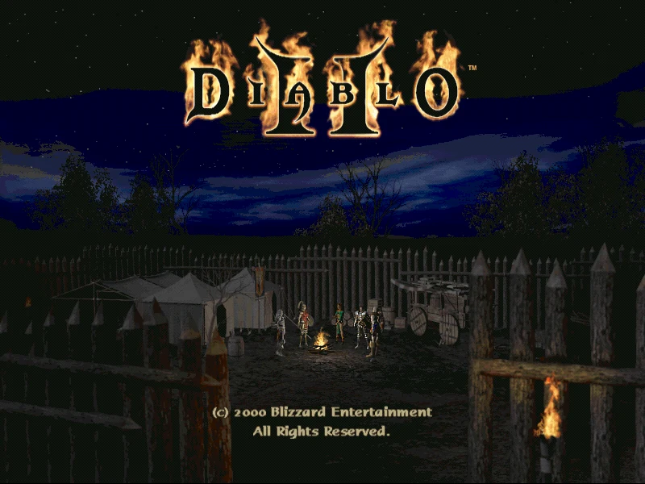
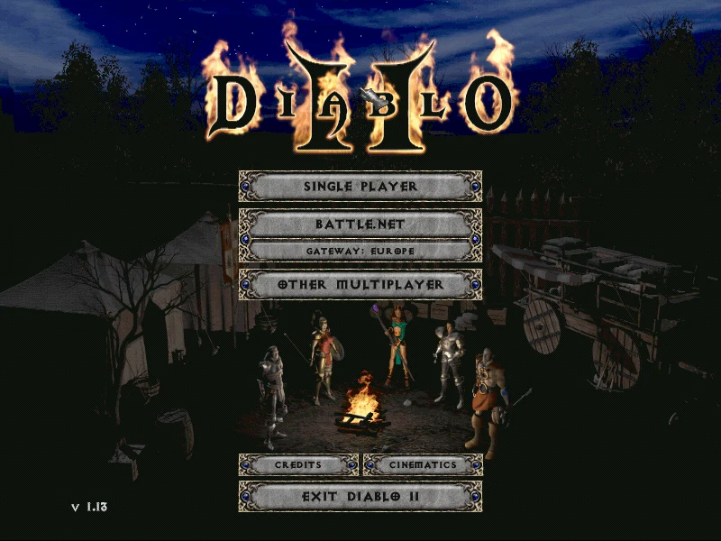
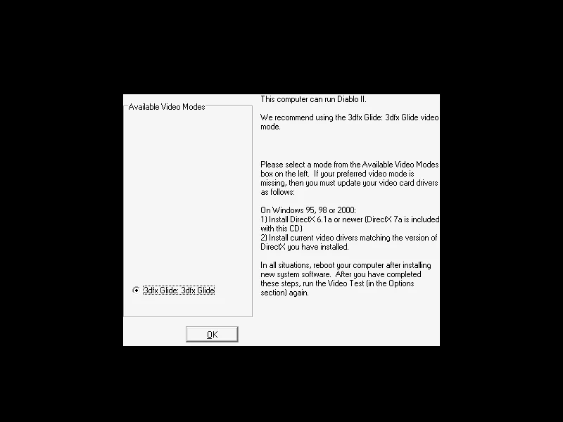
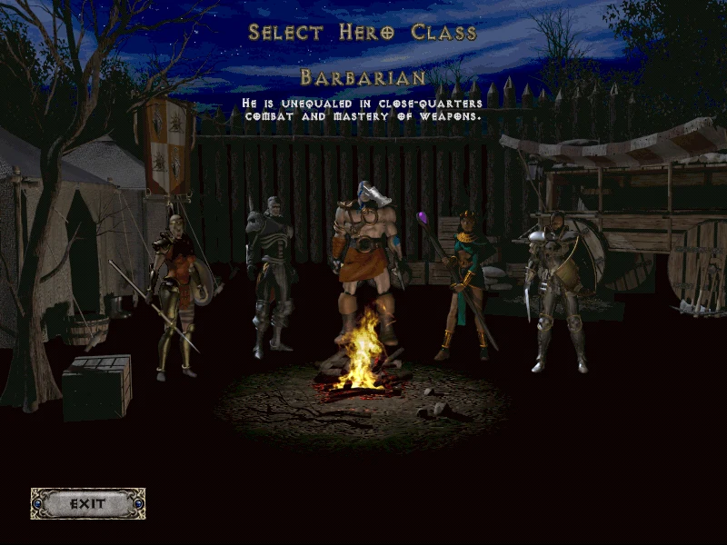
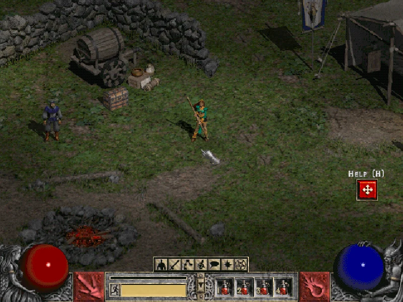
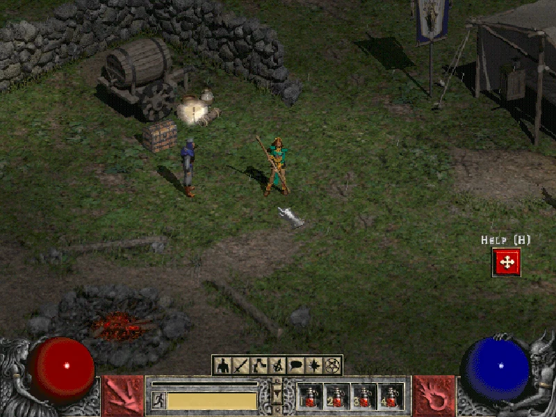
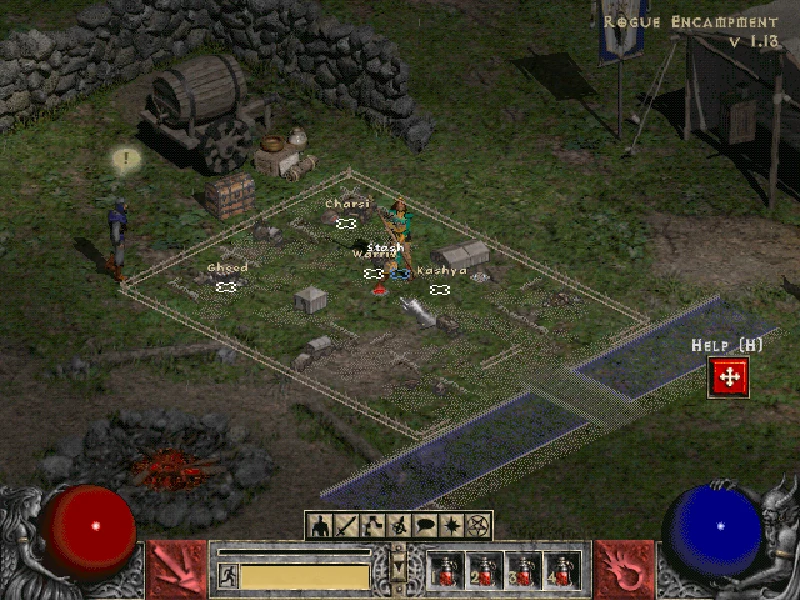
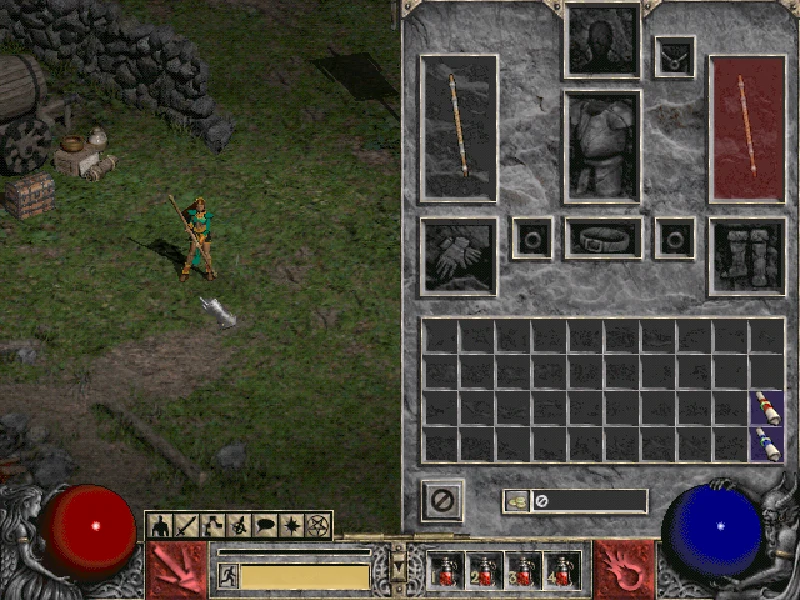
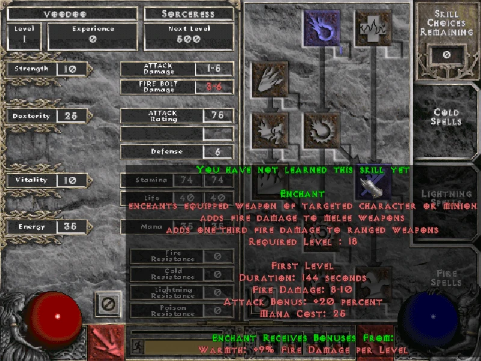
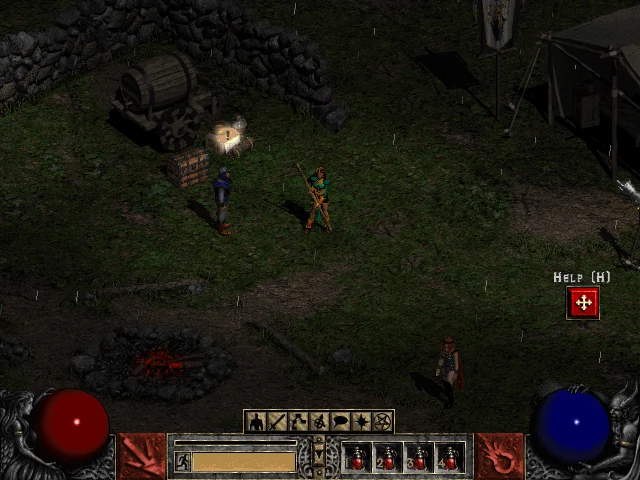

# Diablo II (2000 — Win32 3dfx Glide 3.x)

| Field | Value |
| :--- | :--- |
| **Category** | Commercial Game |
| **Year** | 2000 |
| **Platform(s)** | `Win32 / Wine (glide3x.dll)` |
| **Glide API & Version** | **Glide 3.x** (`3.03` on Voodoo2 / `3.10` on Voodoo3) |
| **Recommended Card Profile** | `Voodoo2` (default) · `Voodoo3` (`3.10`) |
| **Verified Backends** | Vulkan · OpenGL 3.3 Core (WGL) · Software (AVX2 / AVX-512 / Scalar) |
| **Preset File(s)** | [`glide-ng.ini`](./glide-ng.ini) (Voodoo2) · [`glide-ng.hq.ini`](./glide-ng.hq.ini) (4× MSAA + Linear) · [`glide-ng.voodoo3.ini`](./glide-ng.voodoo3.ini) (Voodoo3) · [`glide-ng.software.ini`](./glide-ng.software.ini) (CPU Software) |
| **Status** | Verified |

---

## Overview

Blizzard North's 2000 action RPG *Diablo II* ships a dedicated Glide 3.x renderer (`D2Glide.dll` → `glide3x.dll`) alongside DirectDraw 2D (`D2DDraw.dll`), Direct3D (`D2Direct3D.dll`), and windowed GDI (`D2Gdi.dll`). *Diablo II* was built primarily around 3dfx Glide: unlike the 2D `D2DDraw` / `D2Gdi` modes, **`D2Glide.dll` enables hardware perspective terrain warping, RGB colored lighting, smooth additive fire and spell glow, hardware `grLoadGammaTable` contrast/gamma curves, and translucent vector automap overlays**.

Technically, `D2Glide.dll` is a paletted (`GR_TEXFMT_P_8`) dual-TMU Glide 3.x atlas workload that distributes `256×256` 8-bit paletted screen tiles across both `TMU0` and `TMU1` inside an `800×600` (`Buffers=2`, `Aux=0`) framebuffer, uploading the shared 256-entry palette via `grTexDownloadTable(GR_TEXTABLE_PALETTE, data)` and driving contrast/gamma via `grLoadGammaTable`.

---

## Editions, Patches & Executables

| Executable / Renderer | Graphics API | Works with `glide-ng`? | Technical Notes |
| :--- | :--- | :---: | :--- |
| **`Game.exe -3dfx`** (`D2Glide.dll`, **v1.13d**) | **Glide 3.x (`glide3x.dll`)** | **Yes (Recommended)** | Official v1.13d patch (`D2Patch_113d.exe`) enables disc-free play once `d2music.mpq` (from the Play Disc) and `d2video.mpq` (from the Cinematics Disc) are copied into the game directory. `D2VidTst.exe` probes and recommends **`3dfx Glide`** automatically. |
| **`Game.exe -3dfx`** (**v1.14d**) | Glide 3.x (`glide3x.dll`) | Optional (Alternate) | Final official patch (`D2Patch_114d.exe`). Consolidates DLL modules into `Game.exe` and stores saves under `%USERPROFILE%\Saved Games\Diablo II\`. Use **v1.13d** for standalone `D2Glide.dll` and classic tooling. |
| **`Game.exe -d3d`** (`D2Direct3D.dll`) | Direct3D 6/7 | No *(Comparison)* | Fails enumeration under headless Wine 10 framebuffer setups (`D2VidTst.exe` selects Glide only). Known on modern desktop drivers for dark gamma drift and cursor/text blurring. |
| **`Game.exe -ddraw`** (`D2DDraw.dll`) | DirectDraw 2D | No *(Comparison)* | Fullscreen 2D software renderer. Lacks Perspective mode and Glide alpha glow. |
| **`Game.exe -w`** (`D2Gdi.dll`) | Win32 GDI 2D | No *(Comparison baseline)* | Runs windowed at native `640×480` (useful as a 2D color reference). Slightly darker than Glide (`grLoadGammaTable` is bypassed) and lacks Perspective mode. |

> **v1.13d Official No-CD Setup:** After a Full retail install and applying `D2Patch_113d.exe`, copy `d2music.mpq` (~330 MB) from the Play Disc root (CD2) directly into the *Diablo II* install directory for disc-free play without third-party cracks.

---

## Recommended Launch Configurations (Wine32 / Windows)

Copy `glide-ng`'s 32-bit **`glide3x.dll`** directly alongside `Game.exe` in the *Diablo II* install directory, then place the chosen `glide-ng.ini` preset alongside it (or pass `GLIDE_NG_CONFIG=/path/to/glide-ng.ini`).

> **One-Time Wine 10 Setup (`winxp` Mode):**
> Under Wine 10, `Fog.dll` fails on boot (`0x6FF61AFB`, *"Unrecoverable internal error"*) with default `win7`/`win10` emulation. Set the 32-bit Wine prefix compatibility mode to **`winxp`**:
> ```bash
> WINEARCH=win32 WINEPREFIX=/path/to/prefix wine reg add \
>   'HKCU\Software\Wine' /v Version /t REG_SZ /d winxp /f
> # Optional: run Blizzard's official video test utility (selects 3dfx Glide)
> WINEARCH=win32 WINEPREFIX=/path/to/prefix WINEDLLOVERRIDES="glide3x=n" \
>   wine ./D2VidTst.exe
> ```
> To pin Glide directly via the registry without running `D2VidTst.exe`:
> ```bash
> WINEARCH=win32 WINEPREFIX=/path/to/prefix wine reg add \
>   'HKCU\Software\Blizzard Entertainment\Diablo II\VideoConfig' \
>   /v Render /t REG_DWORD /d 3 /f
> ```

### Option A: Standard Glide 3.x (`glide-ng.ini` — Vulkan `1×`, `nearest` Scaling)

```bash
WINEARCH=win32 WINEPREFIX=/path/to/prefix \
WINEDLLOVERRIDES="glide3x=n" \
GLIDE_NG_CONFIG=/path/to/glide-ng.ini \
  wine explorer /desktop=DiabloII,800x600 ./Game.exe -3dfx
```

For direct launch on a desktop supporting native hardware Vulkan, omit `explorer /desktop=...` (`wine ./Game.exe -3dfx`). To switch to the Win32 WGL OpenGL 3.3 Core backend without editing the preset, pass `GLIDE_NG_BACKEND=opengl_es`. To test the authentic `Voodoo3` (`3.10`) profile, substitute [`glide-ng.voodoo3.ini`](./glide-ng.voodoo3.ini).

### Option B: Best Visuals (`glide-ng.hq.ini` — Vulkan `4× MSAA` + Linear) *(Recommended)*

```bash
WINEARCH=win32 WINEPREFIX=/path/to/prefix \
WINEDLLOVERRIDES="glide3x=n" \
GLIDE_NG_CONFIG=/path/to/glide-ng.hq.ini \
  wine explorer /desktop=DiabloII,800x600 ./Game.exe -3dfx
```

### Option C: CPU Software Rasterizer (`glide-ng.software.ini` — AVX2 / AVX-512)

```bash
WINEARCH=win32 WINEPREFIX=/path/to/prefix \
WINEDLLOVERRIDES="glide3x=n" \
GLIDE_NG_CONFIG=/path/to/glide-ng.software.ini \
  wine explorer /desktop=DiabloII,800x600 ./Game.exe -3dfx
```

*(Append `-ns` only on headless setups lacking an audio device; keep audio enabled for normal gameplay. Launch `Game.exe` directly rather than the `Diablo II.exe` stub when wrapping in scripts, as the stub detaches immediately.)*

---

## Visual Progression Gallery

Captures below depict *Diablo II* (v1.13d) title screens, `D2VidTst.exe`, character creation, Act I (*Rogue Encampment*), UI overlays, and the native 2D GDI reference (`800×600` Glide 3.x vs. `640×480` windowed GDI):

| | |
| :---: | :---: |
| <br>**1. Title Splash (`glide-ng` Software AVX2, `800×600`)**<br>Animated logo fire, indigo twilight clouds, starry sky, foreground torch, and crisp white text across both `TMU0` and `TMU1`. | <br>**2. Main Menu (`glide-ng`, `800×600`)**<br>Flickering hero silhouette lighting around the campfire and crisp Exocet stone buttons with sapphire corner inlays. |
| <br>**3. `D2VidTst.exe` Detection Results**<br>Blizzard's official video test utility detects **`3dfx Glide`** via `glide-ng`'s `glide3x.dll` and recommends it automatically. | <br>**4. Character Creation (`glide-ng` Vulkan `1×`, `800×600`)**<br>Full dynamic lighting over all playable classes gathered around the animated campfire. |
| <br>**5. Rogue Encampment — Vulkan `1×` ([`glide-ng.ini`](./glide-ng.ini))**<br>Native dual-TMU palette output with warm torch/ember glow, rainfall streaks, translucent shadow sprites, and sharp fonts. | <br>**6. Rogue Encampment — Vulkan `4× MSAA` ([`glide-ng.hq.ini`](./glide-ng.hq.ini))**<br>Smooth `linear` scaling with `no_dither_sub = true` preserving warm firelight and clean 24-bit gamma gradients. |
| <br>**7. Rogue Encampment — OpenGL 3.3 Core (WGL)**<br>Identical palette fidelity, flame brightness, and HUD proportions matching the Vulkan backend. | <br>**8. Rogue Encampment — CPU Software ([`glide-ng.software.ini`](./glide-ng.software.ini))**<br>Multi-threaded AVX2/AVX-512 CPU rasterizer matches the GPU backends cleanly for systems without a 32-bit Vulkan ICD. |
| <br>**9. Translucent `Tab` Automap Overlay (OpenGL / WGL)**<br>Crisp vector automap lines and `!` quest marker overlaid across the live 3D courtyard scene. | <br>**10. Inventory Panel (Vulkan `4× MSAA` HQ)**<br>Sharp item grid, equipped icons, and transparent borders composited over the town courtyard. |
| <br>**11. Character Sheet & Skill Tree (`Voodoo3` `3.10`)**<br>Verified under [`glide-ng.voodoo3.ini`](./glide-ng.voodoo3.ini) with crisp hover tooltips and glowing stat text. | <br>**12. Reference: Windowed GDI 2D (`Game.exe -w`, `640×480`)**<br>Stock 2D software mode; noticeably darker (no `grLoadGammaTable`) and lacks Perspective terrain warping. |

---

## Visual Quality & Performance Tuning

### Flavour Comparison: Glide 3.x (`D2Glide.dll`) vs. 2D GDI (`D2Gdi.dll`)
* **`D2Glide.dll` (`glide-ng` + [`glide-ng.hq.ini`](./glide-ng.hq.ini)) is the clear winner:** unlocks Perspective mode, smooth additive campfire and spell lighting, translucent vector `Tab` automap, and native `grLoadGammaTable` hardware brightness/contrast control across `Vulkan`, `OpenGL / WGL`, and `Software AVX2`.
* Prefer [`glide-ng.ini`](./glide-ng.ini) (`msaa = 1`, `presentation_filter = nearest`) for pixel-exact menu typography, or [`glide-ng.hq.ini`](./glide-ng.hq.ini) (`msaa = 4`, `presentation_filter = linear`) for softer upscaling.

### Resolution, Gamma & Card Profiles
* **Classic resolution:** Original *Diablo II* (without the *Lord of Destruction* expansion) renders at `640×480` scaled inside Glide's `800×600` (`Res=8`) swapchain.
* **Gamma & contrast:** Leave `[glide] gamma` unset in `glide-ng.ini` so the in-game **Video Options → Gamma / Contrast** sliders control the hardware LUT via `grLoadGammaTable`.
* **`Voodoo2` (`3.03`) vs. `Voodoo3` (`3.10`):** Both profiles produce identical output across titles, towns, automap overlays, and skill trees.

---

## Quirks, Known Issues & Controls

### Installation & Engine Notes
* **Wine 10 `Fog.dll` crash (`0x6FF61AFB`):** Always set `HKCU\Software\Wine\Version = winxp` inside the 32-bit prefix to avoid the startup stack overflow.
* **`Save Path` registry key:** *Diablo II* v1.13d reads `HKCU\Software\Blizzard Entertainment\Diablo II\Save Path` (with a trailing backslash, e.g. `C:\Program Files\Diablo II\save\`). Update this value after moving the install folder so characters appear under **Single Player**.
* **Software Vulkan (`llvmpipe`) warning note:** On hosts lacking a 32-bit hardware Vulkan ICD, select [`glide-ng.software.ini`](./glide-ng.software.ini) for smooth CPU rendering or set `LP_NUM_THREADS=4`.
* **Startup splash:** Uncomment `no_splash = true` in `glide-ng.ini` (or pass `FX_GLIDE_NO_SPLASH=1`) to skip the one-shot startup splash animation.

### Useful Controls

| Key / Input | Action |
| :--- | :--- |
| **`Left Click`** | Move / primary attack / interact with NPC or chest |
| **`Right Click`** | Cast secondary skill |
| **`Tab`** | Toggle translucent **Automap** overlay |
| **`I` / `B`** | Open / close **Inventory** |
| **`C`** | Open / close **Character** stat sheet |
| **`T`** | Open / close **Skill Tree** |
| **`Q` / `H`** | Toggle **Quests** / **Help** panel |
| **`1`–`4`** | Use belt potion slots |
| **`Alt`** | Highlight items on the ground |
| **`R`** | Toggle **Run / Walk** |
| **`Space`** | Dismiss all open UI panels |
| **`Esc`** | Open pause menu (`Options` → `Video Options` / `Save and Exit Game`) |
