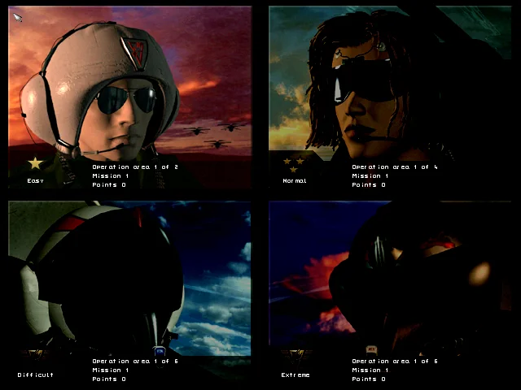
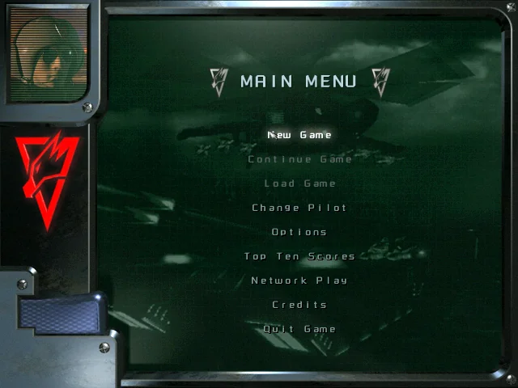
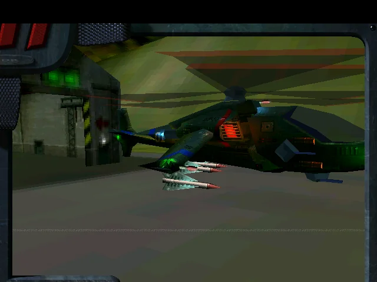
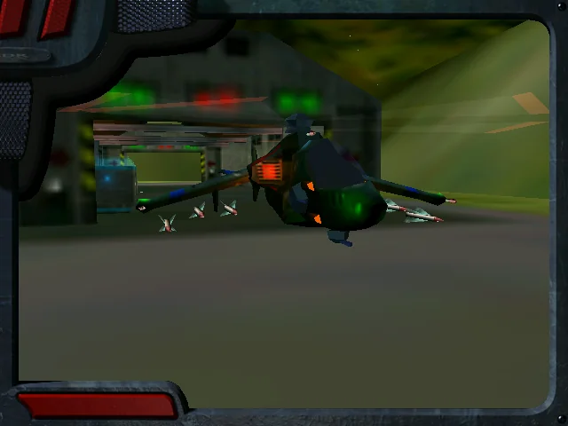
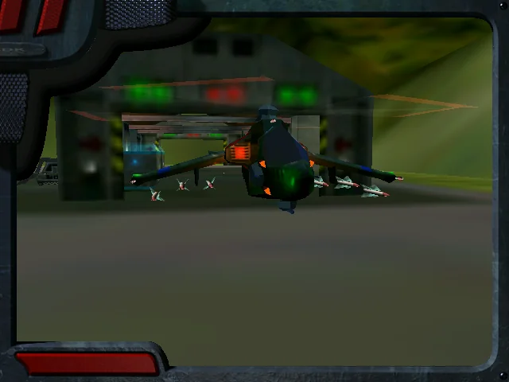
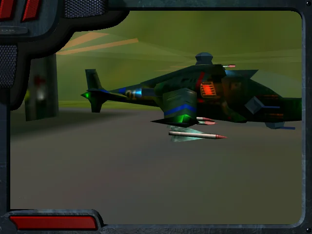

# Extreme Assault (1997 — 3dfx DOS)

| Field | Value |
| :--- | :--- |
| **Category** | Commercial Game |
| **Year** | 1997 |
| **Platform(s)** | `DOS/32 (GLIDE2X.OVL via DOSBox Glide pass-through)` |
| **Glide API & Version** | Glide 2.x (`2.56` on Voodoo2 / `2.48` on Voodoo Graphics) |
| **Recommended Card Profile** | `Voodoo2` (default) · `VoodooGraphics` (authentic SST-1) |
| **Verified Backends** | Vulkan · OpenGL ES · Software (AVX2 / AVX-512 / Scalar) |
| **Preset File(s)** | [`glide-ng.ini`](./glide-ng.ini) (Voodoo2) · [`glide-ng.hq.ini`](./glide-ng.hq.ini) (4× MSAA + Linear) · [`glide-ng.voodoo1.ini`](./glide-ng.voodoo1.ini) (SST-1) · [`glide-ng.software.ini`](./glide-ng.software.ini) (CPU Software) |
| **Frame Pacing** | `30 FPS` (internal simulation tick) |
| **Status** | Verified |

---

## Overview

Blue Byte's 1997 arcade helicopter-and-tank shooter *Extreme Assault* ships both a high-resolution DOS software executable (`XA.EXE`) and a native 3dfx Glide 2.x executable (`XA_3DFX.EXE`) that loads **`GLIDE2X.OVL`** dynamically at **`640×480×16`**.

Both versions composite the textured 3D mission viewport inside a brushed-steel HUD cockpit bezel written via 16-bit LFB (`RGB565`), while the 3dfx executable upgrades the blocky unfiltered terrain, flat hangar walls, and sharp light masks of `XA.EXE` with smooth bilinear-filtered `128×128` RGB565 textures, translucent spinning helicopter rotor discs, colored hangar beacons, thruster afterburners, and dynamic weapon flares (`~962` avg / `~1,053` peak triangles/frame).

---

## Editions, Patches & Executables

| Executable / Patch | Renderer | Works with `glide-ng`? | Technical Notes |
| :--- | :--- | :---: | :--- |
| **`XA_3DFX.EXE` (Retail `v1.1` / Patched `v1.23`)** | Glide 2.x (`GLIDE2X.OVL`) | **Yes (Recommended)** | Native DOS/4GW 3dfx executable (`1,353,744` B on English CD-ROM release). Official sequential updates (`XA_E120.EXE` → `XA_A121.EXE` → `XA_A122.EXE` → `xa_a123.exe` Voodoo2 patch) are compatible as long as the bundled `GLIDE2X.OVL` is replaced with `glide-ng`'s clean-room `build/dos/glide2x.ovl`. |
| **`XA.EXE` (Retail Software)** | DOS CPU Software (`VESA 2.0`) | No (No 3dfx) | Non-accelerated fallback (`1,355,376` B). Unfiltered chunky terrain, walls, and hangar lights. |

---

## Recommended DOSBox Configurations

Keep the DOSBox configuration minimal — only non-default overrides are shown below.

> **Mount the CD-ROM CUE/BIN image (`-t iso`) with `-freesize 512` and `[dosbox] memsize = 32`:**
> *Extreme Assault* verifies CD audio tracks on `D:` before unlocking `New Game` / campaign missions. Mount the full `.cue` sheet (not a stripped data-only image) as `D:`.

Replace the game directory's `GLIDE2X.OVL` with `glide-ng`'s clean-room HLE pass-through **`build/dos/glide2x.ovl`**.

### Option A: Patched DOSBox-SVN (Glide Pass-Through → `glide-ng`) *(Recommended)*

```ini
# dosbox-svn.conf (minimal overrides)
[dosbox]
memsize = 32

[sdl]
# Avoids SDL_UpdateRects SIGSEGV under sdl12-compat on modern Linux
output = opengl

[cpu]
cycles = max

[glide]
glide = true
```

```bash
GLIDE_NG_CONFIG=/path/to/glide-ng.ini \
  dosbox -conf dosbox-svn.conf \
  -c "mount C /path/to/extreme_assault/install -freesize 512" \
  -c "imgmount D /path/to/Extreme_Assault.cue -t iso" \
  -c "C:" \
  -c "XA_3DFX.EXE"
```

### Option B: DOSBox-X (Glide Pass-Through → `glide-ng`)

```ini
# dosbox-x-pass.conf (minimal overrides)
[dosbox]
memsize = 32

[cpu]
cycles = max

[voodoo]
glide = true
lfb = full
```

```bash
GLIDE_NG_CONFIG=/path/to/glide-ng.ini \
  dosbox-x -conf dosbox-x-pass.conf -nopromptfolder \
  -c "mount C /path/to/extreme_assault/install -freesize 512" \
  -c "imgmount D /path/to/Extreme_Assault.cue -t iso" \
  -c "C:" \
  -c "XA_3DFX.EXE"
```

### Option C: Best Visuals (`glide-ng.hq.ini` — `4× MSAA` + `no_dither_sub`)

```bash
GLIDE_NG_CONFIG=/path/to/glide-ng.hq.ini \
  dosbox -conf dosbox-svn.conf \
  -c "mount C /path/to/extreme_assault/install -freesize 512" \
  -c "imgmount D /path/to/Extreme_Assault.cue -t iso" \
  -c "C:" \
  -c "XA_3DFX.EXE"
```

*(On CPU-only hosts, substitute [`glide-ng.software.ini`](./glide-ng.software.ini) with `GLIDE_NG_SW_AA=ssaa` for `2×2` supersampled anti-aliasing along helicopter fuselage and rotor-blade edges.)*

### Reference Comparison: DOSBox-X Software Voodoo (No `glide-ng`)

```ini
# dosbox-x-sw.conf
[dosbox]
memsize = 32

[cpu]
cycles = max

[voodoo]
voodoo_card = software
glide = false
```

Restore the disc's original SST-1 `GLIDE2X.OVL` when running against DOSBox-X's register-level software Voodoo emulator.

---

## Visual Progression Gallery

All captures below are native `640×480` frames of *Extreme Assault* under patched DOSBox-SVN (Mission 1 launch sequence):

| | |
| :---: | :---: |
| <br>**1. Pilot & Difficulty Select (`640×480` · Glide 2.x)**<br>Opening 4-quadrant campaign/difficulty screen drawn via full-frame 16-bit LFB writes (`Easy`, `Normal`, `Difficult`, `Extreme`). | <br>**2. Main Menu (`640×480` · Glide 2.x)**<br>Green-tinted tactical monitor UI framing the gunship hangar backdrop and interactive menu bar. |
| <br>**3. Native DOS Software (`XA.EXE`, `640×480`)**<br>Unfiltered blocky apron floor tiles, stair-stepped rotor disc cutouts, and sharp unblended green hillside slopes. | <br>**4. 3dfx Glide (`XA_3DFX.EXE`, Vulkan `1×`)**<br>Smooth bilinear-filtered hangar walls, tarmac, beacon glow, hillsides, translucent swirling rotor blades, and full steel bezel with red meter bar. |
| <br>**5. 3dfx Glide Front Angle (`OpenGL ES`, `1×`)**<br>Identical front-on hover inside the hangar apron showing shaded nose plating, intake vents, missiles, and twin green/red approach lights. | <br>**6. 3dfx Glide Best Visuals (`Vulkan 4× MSAA`, [`glide-ng.hq.ini`](./glide-ng.hq.ini))**<br>Hardware `4× MSAA` + `no_dither_sub` smoothing helicopter tail edges, pylon missile fins, engine afterburner exhaust, and hillside gradients during liftoff. |

---

## Visual Quality & Performance Tuning

### Anti-Aliasing & Texture Filtering
* **Vulkan / OpenGL ES:** [`glide-ng.hq.ini`](./glide-ng.hq.ini) enables **`msaa = 4`**, **`presentation_filter = linear`**, and **`no_dither_sub = true`** to clean up sloped missile silhouettes, hangar bay frame struts, smooth tinted lighting bands on tarmac ramps and hillsides, and soften occasional 1-pixel horizon dots along native CPU-clipped LOD terrain T-junction seams (also present on authentic 3dfx hardware and software Voodoo emulation).
* **Software `2×2 SSAA`:** On `glide-ng`'s CPU Software backend, `aa = ssaa` smooths thin diagonal weapon pylons, rotor struts, and frame contours while keeping the `RGB565` LFB bezel sharp.
* **Gamma (`1.0` default):** Hangar interiors, cockpit monitors, and glowing red/green beacons match reference SST-1 contrast out of the box.

### Performance Notes
* **Heavy per-frame bezel LFB uploads:** *Extreme Assault* locks the `640×480` backbuffer each frame to composite the steel cockpit bezel along with additive (`ONE, ONE`) and multiplicative (`ZERO, PREFOG_COLOR`) HUD overlays. Vulkan and OpenGL ES composite these LFB overlays directly on GPU without full-frame readbacks, keeping wrapper LFB overhead around **`~2 ms/frame`**.
* **Lightweight 3D geometry:** `~962` average / `~1,053` peak triangles/frame. All backends stay locked to the game's internal **`30 FPS`** simulation tick even with VSync and wrapper caps disabled; on CPU-only hosts under `software` AVX2 (`1×`), wrapper rasterization averages **`~2.0 ms/frame`**.

---

## Quirks, Known Issues & Controls

### Installation & Engine Notes
* **Sound setup (`SETSOUND.BAT`):** Run `SETSOUND.BAT` once inside DOSBox to generate `DIG.INI` for Sound Blaster 16 (`IO 220h`, `IRQ 7`, `DMA 1`, 16-bit stereo). Music defaults to `MIDI` inside `INIT.CFG` (`MUSIC=MIDI`); switch to CD audio if preferred when mounting the `.cue`/`.bin` image.
* **Official `v1.20`–`v1.23` patches:** If updating the retail install (`v1.1`) with the official Blue Byte updates (`XA_E120.EXE` → `XA_A121.EXE` → `XA_A122.EXE` → `xa_a123.exe`), back up and restore `glide-ng`'s `build/dos/glide2x.ovl` afterward because the Voodoo2 patch overwrites `GLIDE2X.OVL`.
* **Configuration overrides (`INIT.CFG`):** Confirm `DETAILFOG=1`, `DETAILTRANS=1`, `DETAILSIGHT=2`, and `DETAILOBJECT=2` in `INIT.CFG` for maximum visual distance and translucent effects.
* **Startup splash:** Uncomment `no_splash = true` in `glide-ng.ini` (or pass `FX_GLIDE_NO_SPLASH=1`) to skip the one-shot startup splash on launch.

### Useful Controls

| Key | Action |
| :--- | :--- |
| **`A` / `Z`** | Throttle forward / reverse (`INIT.CFG` keyboard layout) |
| **Arrow keys** | Pitch / bank / steer gunship |
| **`Space`** | Smart bomb |
| **`T`** | Freeze bomb |
| **`Tab`** | Cycle target enemy |
| **`0`** | Toggle internal / external camera |
| **`9`** | Virtual cockpit view |
| **`3`** | Toggle HUD display |
| **`R`** | Radar zoom |
| **`+` / `-` / `*`** | Camera zoom in / out / reset |
| **`Esc`** | Pause / quit to menu |
