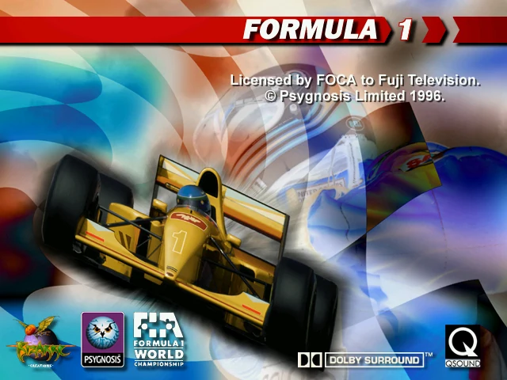
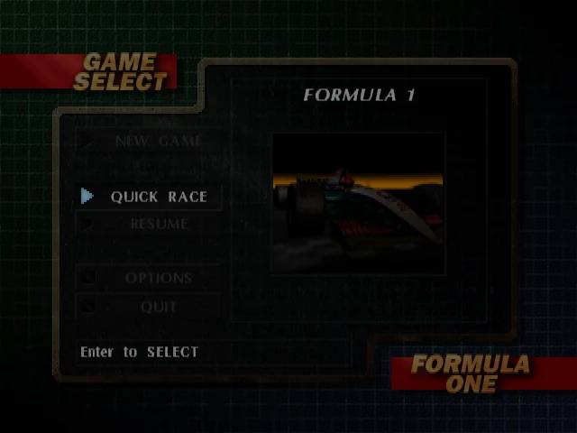
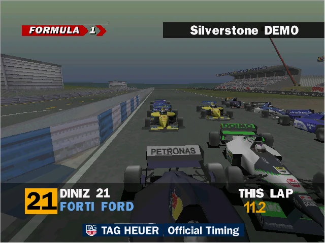
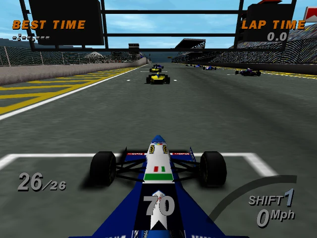
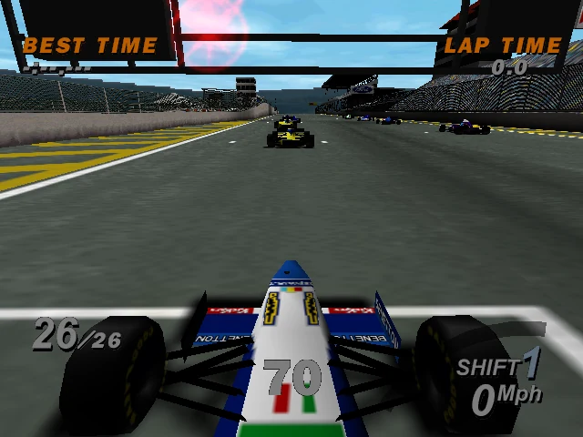
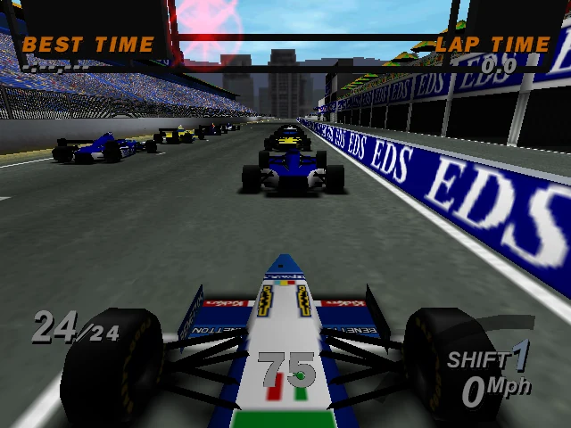

# Formula 1 (1997 — Win32 3dfx Glide 2.x)

| Field | Value |
| :--- | :--- |
| **Category** | Commercial Game |
| **Year** | 1997 |
| **Platform(s)** | `Win32 / Wine (glide2x.dll)` |
| **Glide API & Version** | **Glide 2.x (`glide2x.dll`, Voodoo2 `2.56` / Voodoo1 `2.48`)** |
| **Recommended Card Profile** | `Voodoo2` (`2.56`, default) · `VoodooGraphics` (`2.48`) |
| **Verified Backends** | Vulkan · OpenGL 3.3 Core (WGL) · Software (AVX2 / AVX-512 / Scalar) |
| **Preset File(s)** | [`glide-ng.ini`](./glide-ng.ini) (`1×`, Vulkan) · [`glide-ng.hq.ini`](./glide-ng.hq.ini) (`4× MSAA` + Linear) · [`glide-ng.voodoo1.ini`](./glide-ng.voodoo1.ini) (Voodoo1 SST-1) · [`glide-ng.software.ini`](./glide-ng.software.ini) (CPU Software) |
| **Status** | Verified |

---

## Overview

*Formula 1* (Bizarre Creations / Psygnosis, 1997 PC port of the classic 1996 PlayStation championship racer) brings the full **1995 FIA Formula One World Championship** — all 17 circuits, 26 cars, dual game modes (*Arcade* and *Grand Prix*), and Murray Walker / Jonathan Palmer commentary — with dedicated **3dfx Glide 2.x (`f1win.exe`)**, **Rendition Vérité (`f1red.exe`)**, and **Microsoft Direct3D (`f1d3d.exe`)** executables bundled straight out of the Wise CD installer.

Through `glide-ng`, **`f1win.exe`** turns flat nearest-neighbor Direct3D polygons into crisp **bilinear-filtered asphalt, pitwall banners, catch-fencing, Benetton / Williams / Ferrari car liveries, smooth blue painted skyboxes, distance atmospheric table fog, and translucent red starting-light halos**, while keeping sharp animated frontend menus and real-time in-game HUD overlays (`BEST TIME`, `LAP TIME`, tachometer, position counter).

---

## Editions, Patches & Executables

| Binary | Graphics API | Works with `glide-ng`? | Technical Notes |
| :--- | :--- | :---: | :--- |
| **`f1win.exe`** *(retail `714,240 B` / Cyrix patch `714,752 B`)* | **Glide 2.x (`glide2x.dll`)** | **Yes (Recommended)** | Native **`640×480`** 3dfx executable installed when checking **`3Dfx Voodoo Chipset`** during `SETUP.EXE`. Uses `ARGB_1555` (`format=11`) textures, bilinear filtering, table fog, alpha-blended lenses/flares, and authentic `s12.4` fixed-point window vertices. |
| **`f1d3d.exe`** *(`804,352 B`)* | Direct3D (DirectX 3) | No *(Comparison baseline)* | Bundled Direct3D executable; under software/RGB emulation renders nearest-neighbor blocky texels, banded flat skies, missing skybox clouds, and solid un-blended banners. |
| **`f1red.exe`** *(`727,552 B`)* | Rendition Vérité (`verite.dll`) | No | Proprietary Speedy3D/RRedline build for Rendition hardware. |

> **Official Cyrix / 3dfx Patch (`Formula1_Cyrix_3dfx.EXE`):** Extracts updated June 1997 **`F1win.exe`** (`714,752 B`) and **`F1d3d.exe`** (`804,352 B`). Both retail and patched `f1win.exe` builds work cleanly with `glide-ng`.

---

## Recommended Launch Configurations (Wine32 / Windows)

Run the disc's Wise installer (**`D:\SETUP.EXE`**) inside a 32-bit prefix to populate the required **`Frontend/`**, **`ingame/`** (including the 17 track folders and **`lang.txt`** set to `ENG`), **`extra/`**, and **`hiscore/`** subdirectories. Do **not** run `SETUP.EXE /X` flat-extraction directly, because `f1win.exe` reads data from those exact relative subfolders. Replace the bundled 1997 `glide2x.dll` in the installation folder with `glide-ng`'s Win32 **`glide2x.dll`**.

### One-Time Wine Prefix & CD Setup

```bash
WINEARCH=win32 WINEPREFIX=/path/to/prefix wineboot -u
WINEARCH=win32 WINEPREFIX=/path/to/prefix wine reg add \
  'HKCU\Software\Wine' /v Version /t REG_SZ /d win98 /f

ln -sfn /path/to/cd_drive /path/to/prefix/dosdevices/d:
WINEARCH=win32 WINEPREFIX=/path/to/prefix wine reg add \
  'HKLM\Software\Wine\Drives' /v 'd:' /t REG_SZ /d cdrom /f
```

Create `.windows-label` containing **`F13DFX`** inside `cd_drive/`.

> **DirectShow MPEG-1 Intro Bypass (`quartz=d`):** On systems lacking a 32-bit `quartz.dll` MPEG-1 video decoder, *Formula 1*'s startup `PlayMovie("D:\\movies\\intro.mpg")` call reports **`FATAL ERROR: Formula 1 CD NOT Found`**. Setting `WINEDLLOVERRIDES="glide2x=n;quartz=d"` cleanly skips the opening MPEG movie and launches straight into the 3dfx title screen.

### Option A: Standard Glide 2.x (`glide-ng.ini` — Vulkan `1×`)

```bash
WINEARCH=win32 WINEPREFIX=/path/to/prefix \
WINEDLLOVERRIDES="glide2x=n;quartz=d" \
GLIDE_NG_CONFIG=/path/to/glide-ng.ini \
  wine explorer /desktop=Formula1,640x480 ./f1win.exe
```

Add `GLIDE_NG_BACKEND=opengl_es` to use the Win32 WGL OpenGL 3.3 Core backend without editing the preset. Pass [`glide-ng.voodoo1.ini`](./glide-ng.voodoo1.ini) for a period-accurate single-TMU Voodoo Graphics (`2.48`) profile.

### Option B: Best Visuals (`glide-ng.hq.ini` — Vulkan `4× MSAA` + Linear) *(Recommended)*

```bash
WINEARCH=win32 WINEPREFIX=/path/to/prefix \
WINEDLLOVERRIDES="glide2x=n;quartz=d" \
GLIDE_NG_CONFIG=/path/to/glide-ng.hq.ini \
  wine explorer /desktop=Formula1,640x480 ./f1win.exe
```

### Option C: CPU Software Rasterizer (`glide-ng.software.ini` — AVX2 / AVX-512)

```bash
WINEARCH=win32 WINEPREFIX=/path/to/prefix \
WINEDLLOVERRIDES="glide2x=n;quartz=d" \
GLIDE_NG_CONFIG=/path/to/glide-ng.software.ini \
  wine explorer /desktop=Formula1,640x480 ./f1win.exe
```

---

## Visual Progression Gallery

All in-game frames captured at native **`640×480`**:

| | |
| :---: | :---: |
| <br>**1. Title Splash (`640×480`, `f1win.exe`)**<br>Opening 16-bit LFB splash artwork with gold Formula 1 car, Dolby Surround, Bizarre Creations, and Psygnosis emblems. | <br>**2. Game Select Frontend (`640×480`, Vulkan `4× MSAA`)**<br>Spinning 3D F1 car box, animated checkered background grid, clean button glyphs (`NEW GAME`, `QUICK RACE`, `RESUME`, `OPTIONS`, `QUIT`), and status bar. |
| <br>**3. Native Direct3D Baseline (`f1d3d.exe`, Silverstone Demo)**<br>Blocky nearest-neighbor barriers and track surfaces, banded grey gradient sky without clouds, jagged edge stair-stepping, and hard cutout transparency. | <br>**4. 3dfx Glide 2.x — Vulkan `4× MSAA` HQ ([`glide-ng.hq.ini`](./glide-ng.hq.ini))**<br>Best overall visuals: Interlagos (Brazil) starting grid with smooth bilinear asphalt, crisp yellow-grey rumble strips, `4× MSAA` suspension wishbones, painted blue clouds, and razor-sharp HUD typography. |
| <br>**5. 3dfx Glide 2.x — OpenGL 3.3 Core / WGL `1×`**<br>Identical bilinear textures, cloud skybox, table-fog horizon, packed grandstand mesh fencing, Benetton livery, and full HUD overlay matching Vulkan. | <br>**6. 3dfx Glide 2.x — CPU Software AVX2 `1×` ([`glide-ng.software.ini`](./glide-ng.software.ini))**<br>Full visual parity on Interlagos (Quick Race pitwall view with glowing red translucent starting-light halo flare, atmospheric skyline fog, and glossy *EDS* barrier). |

---

## Visual Quality & Performance Tuning

### Flavour Comparison: 3dfx Glide (`f1win.exe`) vs. Direct3D (`f1d3d.exe`)
* **3dfx Glide (`f1win.exe`) clearly outperforms `f1d3d.exe`.** Direct3D shows coarse nearest-neighbor road/barrier texels, stark horizontal sky banding, missing skybox clouds, and harsh black backgrounds across frontend menus (`GAME SELECT` renders with the subtle tinted checkered grid in `f1win.exe`). Glide delivers smooth bilinear texture filtering, table-fog horizon fading, additive red starting-light halos, and delicate alpha-tested wire catch-fencing.
* **Use [`glide-ng.hq.ini`](./glide-ng.hq.ini) (`4× MSAA` + linear filtering)** for the cleanest track kerbs, suspension wishbones, overhead timing gantry, and grandstand fence wires.
* **Optional menu brightness (`gamma = 1.7`):** `f1win.exe` draws its animated frontend cards with translucent `50%` vertex alpha (`128.0f`), producing a moody dark aesthetic under linear `gamma = 1.0`. Setting `gamma = 1.7` inside `[glide]` matches a classic 1997 Voodoo Graphics (`SST-1`) DAC ramp for brighter menus without blowing out daytime circuits.

---

## Quirks, Known Issues & Controls

### Installation & Compatibility Notes
* **Subdirectory tree required:** Always run the official **`SETUP.EXE`** installer (check `3Dfx Voodoo Chipset`, and optionally `Microsoft Direct 3D` for `f1d3d.exe`) so `Frontend/`, `ingame/` (including `lang.txt` and all 17 track folders), `extra/`, and `hiscore/` preserve their relative folder structure.
* **Intro MPEG playback:** Setting `WINEDLLOVERRIDES="glide2x=n;quartz=d"` bypasses `intro.mpg` cleanly on Wine installations lacking a 32-bit GStreamer MPEG-1 plugin (preventing the spurious *"Formula 1 CD NOT Found"* error box).
* **Mixed-mode CD audio:** The retail disc stores music tracks alongside Track 1 (`MODE2/2352`). Leaving the full `.cue`/`.bin` mounted enables soundtrack playback inside menus.
* **Frontend attract demo:** Staying idle on `GAME SELECT` for ~15 seconds launches an automatic rotating AI race demo (*Silverstone*, etc.).

### Useful Controls

| Key / Input | Action |
| :--- | :--- |
| **`Return`** | Advance splash / select menu item / skip waving checkered-flag preview |
| **`Up` / `Down` Arrows** | Navigate menus |
| **`A` / `Z`** *(or `Up`/`Down` configurable)* | Accelerate / Brake |
| **`Left` / `Right` Arrows** *(or `,`/`.`)* | Steer left / right |
| **`Space` / `C`** | Cycle camera angle *(cockpit, nosecone, chase, TV)* |
| **`Esc`** | Pause / open in-race options menu (`Screen`, `Display`, `Sound`, `Control`, `Abandon Race`) |
