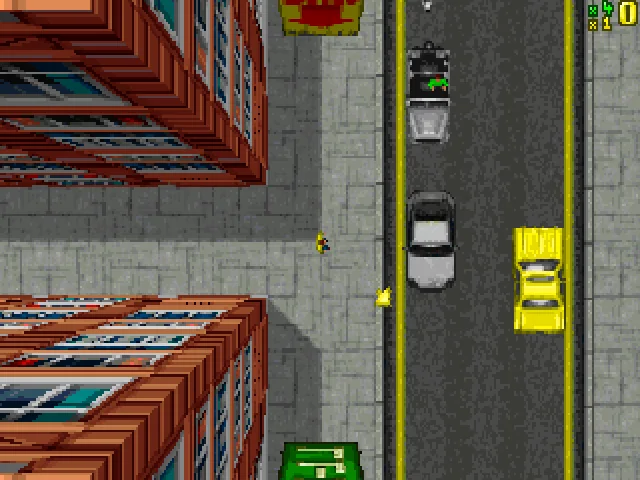
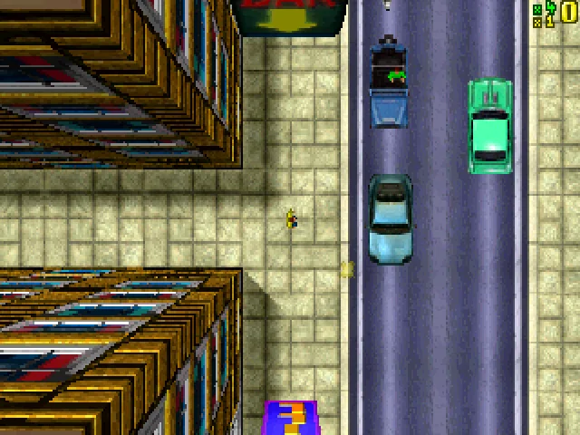
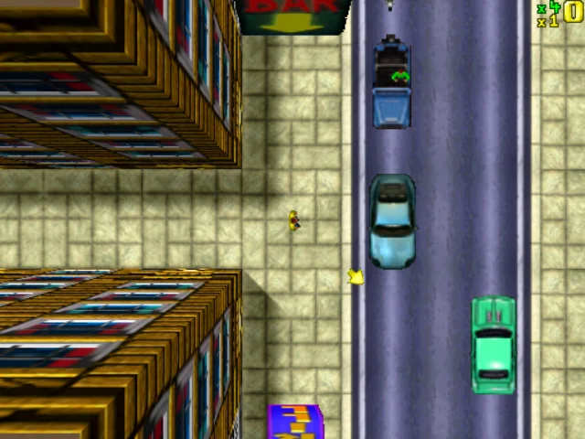
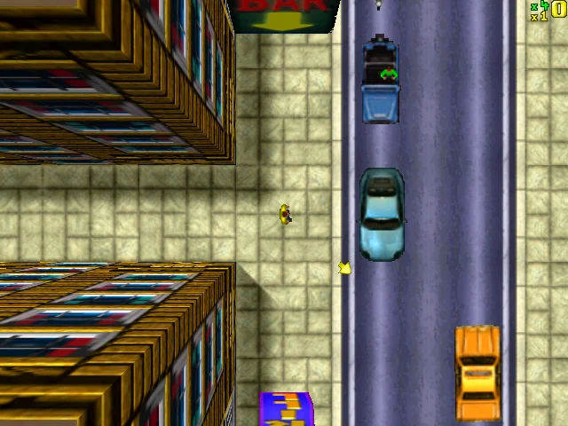
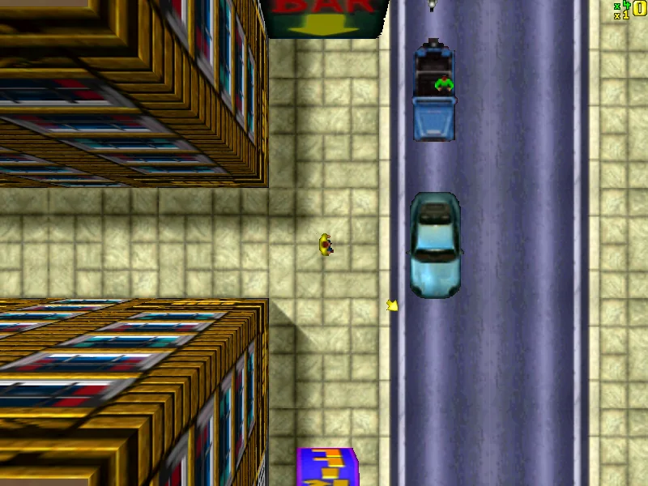

# Grand Theft Auto (1997 — 3dfx DOS)

| Field | Value |
| :--- | :--- |
| **Category** | Commercial Game |
| **Year** | 1997 |
| **Platform(s)** | `DOS/32 (GLIDE2X.OVL via DOSBox Glide pass-through)` |
| **Glide API & Version** | Glide 2.x (`2.56` on Voodoo2 / `2.48` on Voodoo Graphics; requires `2.42+`) |
| **Recommended Card Profile** | `Voodoo2` (default) · `VoodooGraphics` (authentic SST-1) |
| **Verified Backends** | Vulkan · OpenGL ES · Software (AVX2 / AVX-512 / Scalar) |
| **Preset File(s)** | [`glide-ng.ini`](./glide-ng.ini) (Voodoo2) · [`glide-ng.hq.ini`](./glide-ng.hq.ini) (4× MSAA + Linear) · [`glide-ng.voodoo1.ini`](./glide-ng.voodoo1.ini) (SST-1) · [`glide-ng.software.ini`](./glide-ng.software.ini) (CPU Software) |
| **Frame Pacing** | `~24 FPS` (in-game `F8` limiter; uncapped runs fast-forward) |
| **Status** | Verified |

---

## Overview

DMA Design's 1997 open-world classic *Grand Theft Auto* ships a dedicated DOS 3dfx executable (`GTAFX.EXE`) alongside its 8-bit (`GTA8.EXE`) and 24-bit (`GTA24.EXE`) software renderers. Under Glide 2.x, the top-down city engine gains bilinear-filtered 16-bit (`GR_TEXFMT_ARGB_1555`) textures, smooth perspective-projected building walls, alpha-blended shadows and transparencies, and live in-game resolution switching up to **`800×600×16`** via **`F11`**.

Technically, `GTAFX.EXE` is a clean, lightweight Glide 2.x workload: single-TMU (`TMU0`), single-LOD textures (no mipmaps), painter's-algorithm sorted 3D quads with no depth buffer (`Aux=0`), no fog, no dithering (`GR_DITHER_DISABLE`), ~315–330 triangles/frame, and a small per-frame `GR_LFB_WRITE_ONLY` pass (~24–37.5 KB/frame) for the 2D HUD, pager, and `F11` resolution menu.

---

## Editions, Patches & Executables

| Executable / Patch | Renderer | Works with `glide-ng`? | Technical Notes |
| :--- | :--- | :---: | :--- |
| **`GTAFX.EXE`** *(Stock DOS 3dfx)* | Glide 2.x (`GLIDE2X.OVL`) | **Yes (Recommended)** | Ships on the original CD in `GTADOS\`. Launches at `512×384×16` by default and natively switches live between **`512×384×16`**, **`640×480×16`**, and **`800×600×16`** via **`F11`**. Runs cleanly on both `Voodoo2` and `VoodooGraphics` profiles without patching. |
| **`GTAFX.EXE` + Banshee / Rush Patch** *(Community binary patch)* | Glide 2.x (`GLIDE2X.OVL`) | **Optional (Convenience Only)** | Binary patch (`patch2.dat` for base *GTA*; `patch.dat` for *GTA: London 1969*). Provides **no visual improvement** over stock `GTAFX.EXE` + `F11`. Disassembly confirms it makes only two changes: (1) NOPs the `512×384` resolution check (`0x1aa6d2`) so the game boots directly into `640×480×16` and removes `512×384×16` from `F11` (unblocking 3dfx Rush/Banshee cards that lacked `512×384`), and (2) patches the CD length check (`0x0b2651` / `0x0b265b`) to act as a No-CD bypass. |
| **`GTA24.EXE`** | DOS 24-bit Software (`style*.g24`) | No (No 3dfx) | High-color software renderer (`320×200` default, VESA modes via `F11`; pass `-nounivbe` if SciTech UniVBE fails). Does not use Glide. |
| **`GTA8.EXE`** | DOS 8-bit Software (`style*.g8`) | No (No 3dfx) | 256-color palettized DOS VGA renderer (`320×200`). Does not use Glide. |
| **`GRAND THEFT AUTO.EXE`** *(Windows 95, `GTAWIN\`)* | DirectDraw 2D Software (`ddraw.dll` / `wing32.dll`) | **No (No 3dfx support)** | The Windows 95 executable is **2D DirectDraw software-only** — it does not import `glide2x.dll` or Direct3D. *(Stray `3DFX` strings inside the binary are unused remnants from the shared DOS codebase.)* Use the DOS `GTAFX.EXE` build for 3dfx Glide acceleration. |

---

## Recommended DOSBox Configurations

Keep the DOSBox configuration minimal — only non-default overrides are shown below.

> **Set `[dosbox] memsize = 32`:**
> GTA's `README.TXT` explicitly recommends **32 MB RAM** for the 3dfx build (`GTAFX.EXE`). DOSBox defaults to `16` MB, so bump `memsize` to `32`.

The launch commands below assume `glide-ng`'s `libglide2x.so` is installed system-wide (if running directly from a local build directory instead of a system package, prepend `LD_LIBRARY_PATH=/path/to/glide-ng/lib`; see [Building & Installing](../../../user-guide/building-and-installing.md)). Place the DOSBox HLE pass-through `GLIDE2X.OVL` either in `GTADOS\` or on DOS `PATH`.

### Option A: Patched DOSBox-SVN (Glide Pass-Through → `glide-ng`) *(Recommended)*

```ini
# dosbox-svn.conf (minimal overrides)
[dosbox]
memsize = 32

[sdl]
# Avoids SDL_UpdateRects SIGSEGV under sdl12-compat -> sdl2-compat -> SDL3 on modern Linux
output = opengl

[cpu]
cycles = max

[glide]
glide = true
```

```bash
GLIDE_NG_CONFIG=/path/to/glide-ng.ini \
  dosbox -conf dosbox-svn.conf \
  -c "imgmount D /path/to/gta.cue -t iso" \
  -c "mount C /path/to/GTA" \
  -c "C:" \
  -c "cd GTADOS" \
  -c "GTAFX.EXE"
```

*(If your pass-through `GLIDE2X.OVL` lives in a separate DOS directory rather than `GTADOS\`, add it to `PATH`, e.g. `-c "SET PATH=C:\GLIDE;%PATH%"`.)*

### Option B: DOSBox-X (Glide Pass-Through → `glide-ng`)

```ini
# dosbox-x-pass.conf (minimal overrides)
[dosbox]
memsize = 32

[cpu]
cycles = max

[voodoo]
glide = true
lfb = full
```

```bash
GLIDE_NG_CONFIG=/path/to/glide-ng.ini \
  dosbox-x -conf dosbox-x-pass.conf -nopromptfolder \
  -c "imgmount D /path/to/gta.cue -t iso" \
  -c "mount C /path/to/GTA" \
  -c "C:" \
  -c "cd GTADOS" \
  -c "GTAFX.EXE"
```

### Option C: Best Visuals (`glide-ng.hq.ini` + `F11` → `800×600×16`)

Launch with [`glide-ng.hq.ini`](./glide-ng.hq.ini) (`msaa = 4`, `presentation_filter = linear`, `no_dither_sub = true`) on either DOSBox-SVN (Option A) or DOSBox-X (Option B), then once in-game press **`F11`** and select **`800×600×16`**:

```bash
GLIDE_NG_CONFIG=/path/to/glide-ng.hq.ini \
  dosbox -conf dosbox-svn.conf \
  -c "imgmount D /path/to/gta.cue -t iso" \
  -c "mount C /path/to/GTA" \
  -c "C:" \
  -c "cd GTADOS" \
  -c "GTAFX.EXE"
```

*(Confirm **Options → Transparency Effects** is **On** — enabled by default. On CPU-only hosts, substitute [`glide-ng.software.ini`](./glide-ng.software.ini) with `GLIDE_NG_SW_AA=ssaa GLIDE_NG_PRESENTATION_FILTER=linear`.)*

### Reference Comparison: DOSBox-X Software Voodoo (No `glide-ng`)

If comparing against DOSBox-X's built-in low-level SST-1 software emulator:

```ini
# dosbox-x-sw.conf
[dosbox]
memsize = 32

[cpu]
cycles = max

[voodoo]
voodoo_card = software
glide = false
```

Software Voodoo emulates **Voodoo Graphics (SST-1)** and requires a real **SST-1** `GLIDE2X.OVL` — specifically **Glide 2.42 (SST-1)** (GTA requires Glide `2.42+`, so `2.30` is too old, while `2.43+`/`2.48`, Voodoo2 `2.5x`, and the HLE pass-through OVL do not work with Software Voodoo). Because `GTAFX.EXE` opens without a depth buffer (`Aux=0`), double-buffered `800×600×16` (`1.92 MB`) fits in SST-1's 2 MB framebuffer and renders accurately — though slowly (~13 FPS at `800×600`).

---

## Visual Progression Gallery

All captures below are taken on the Liberty City (Southwest Park) starting street via patched DOSBox-SVN (`320×200` DOS software scaled nearest-neighbor to `640×480` 4:3; 3dfx modes captured from the live DOSBox-SVN window at `512×384` → `640×480`, native `640×480`, and native `800×600`), progressing left-to-right, top-to-bottom from 8-bit software up to `800×600` Best Visuals:

| | |
| :---: | :---: |
| <br>**1. DOS 8-bit Software (`GTA8.EXE`, `320×200`)**<br>256-color palette (`style*.g8`): muted grey sidewalks, red-brown quantized bricks, monochrome silver car, flat shadows, and blocky nearest-neighbor pixels. | <br>**2. DOS 24-bit Software (`GTA24.EXE`, `320×200`)**<br>True high-color artwork (`style*.g24`) restores warm bricks, sandstone tiles, metallic cyan car shading, and soft shadows, but remains coarse and unfiltered. |
| <br>**3. 3dfx Default (`GTAFX.EXE`, `512×384`, [`glide-ng.ini`](./glide-ng.ini))**<br>Stock 3dfx launch mode adds bilinear texture filtering, smooth translucent shadows, and crisp perspective walls; large HUD (`x4 x1 0`). | <br>**4. 3dfx `640×480` (`GTAFX.EXE` via `F11` / Banshee default)**<br>`1.56×` more pixels than `512×384` with identical camera framing — sharper brick/window detail and a more compact HUD. |
| <br>**5. 3dfx `800×600` Standard (`GTAFX.EXE` via `F11`, `1×`)**<br>Maximum native resolution (`2.44×` pixels of `512×384`) with the cleanest view and smallest HUD; slanted perspective building edges and rotated geometry remain `1×` aliased. | <br>**6. 3dfx `800×600` Best Visuals (`F11` + [`glide-ng.hq.ini`](./glide-ng.hq.ini))**<br>`4×` hardware MSAA + linear presentation filter smooths slanted perspective building walls and rotated geometry edges cleanly (with zero sprite-border artifacts) while keeping the 2D HUD razor-sharp. |

---

## Visual Quality & Performance Tuning

### Resolution Switching (`F11`) — Why `800×600×16` Is Best
* Stock `GTAFX.EXE` boots into `512×384×16` for historical Voodoo1 fillrate reasons, but natively supports **`640×480×16`** and **`800×600×16`** live via **`F11`**.
* GTA keeps the **exact same world camera framing** across all three resolutions while scaling pixel density up to **`2.44×`** (`512×384` → `800×600`) and shrinking the top-right HUD for a cleaner street view.

### Anti-Aliasing, Filtering & Gamma
* *Grand Theft Auto* has no built-in anti-aliasing option, and enabling AA on `glide-ng` cleans up slanted perspective building walls and rotated geometry edges without blurring the 2D LFB HUD:
  * **Vulkan / OpenGL ES:** Use [`glide-ng.hq.ini`](./glide-ng.hq.ini) (`msaa = 4`, `presentation_filter = linear`, `no_dither_sub = true`). Note that `msaa = 4` anti-aliases triangle geometry edges; `glide-ng`'s `centroid` fragment interpolation ensures rotated alpha-tested sprites (mission arrows, vehicles, pedestrians) stay free of UV-extrapolation border fringes.
  * **Software backend:** Add `GLIDE_NG_SW_AA=ssaa` (or uncomment `aa = ssaa` in [`glide-ng.software.ini`](./glide-ng.software.ini)) for true `2×2` supersampling — because SSAA evaluates alpha-test per subsample, it additionally smooths alpha-tested sprite cutouts (such as the curved `BAR` sign and yellow mission arrow) while still running at **~131 FPS** uncapped at `800×600`.
* **No mipmaps / no trilinear benefit:** `GTAFX.EXE` uploads exclusively single-LOD `GR_TEXFMT_ARGB_1555` textures (`Levels=1`), so `force_trilinear` has no visual effect and is intentionally omitted from `glide-ng.hq.ini`.
* **Gamma (`1.0` default):** Unlike darker 1996–1997 SST-1 titles (*Tomb Raider*, *Demo Room*), GTA's palette and lighting match authentic DOSBox-X Software Voodoo output at linear `gamma = 1.0`; raising gamma to `1.7` washes out sunlit sidewalks and car highlights.
* **In-game `Transparency Effects`:** Ensure **Options → Transparency Effects** is **On** (default).

### Frame Rate Limiter (`F8`) & Backend Performance
* **Keep `F8` Frame Rate Limiter ON for normal game speed:** GTA ties its simulation tick rate 1:1 to rendered frames. By default, the in-game Frame Rate Limiter (`F8`) locks rendering to **~23–24 FPS** (`~42.8 ms/frame`) for authentic gameplay pacing. Pressing **`F8`** disables the limiter (`Frame Rate Limiter OFF`) and runs gameplay, traffic, and timers in fast-forward at whatever FPS the host reaches. *(Tip: if you intentionally want slightly snappier 30 FPS play, press `F8` and set `[display] max_fps = 30` in `glide-ng.ini` to cap speed cleanly instead of running uncapped.)*
* **GPU hosts (`vulkan` / `opengl_es`):** Easily hold GTA's native cadence at `800×600×16` with `msaa = 4` and massive headroom to spare.
* **CPU-only hosts (`software`, AVX2/AVX-512) vs. DOSBox-X SW Voodoo:** Measured uncapped (`F8` OFF, `vsync = false`, `max_fps = 0`) on Liberty City's starting street, `glide-ng`'s Software AVX2 backend runs **~10×–14× faster** than DOSBox-X's built-in Software Voodoo:
  * `512×384`: **~210 FPS** (`glide-ng` Software `1×`)
  * `640×480`: **~190 FPS** (`glide-ng` Software `1×`) vs. **~20 FPS** (DOSBox-X SW Voodoo)
  * `800×600`: **~181 FPS** (`glide-ng` Software `1×`) and **~131 FPS** (`2×2 SSAA`) vs. **~13 FPS** (DOSBox-X SW Voodoo, which drops below GTA's native 24 FPS target)

---

## Quirks, Known Issues & Controls

### Installation & Engine Notes
* **DOSBox-SVN lacks `XCOPY` (affects CD installer):** GTA's DOS installer (`INSTALL.BAT` → `K.EXE`) shells out to `xcopy /s` to populate `GTADATA\` and `GTADOS\`. Because DOSBox-SVN does not implement `XCOPY`, the installer finishes silently with an empty `GTADOS\` directory. Install using **DOSBox-X** (which includes `XCOPY`) or copy the `GTADATA\` and `GTADOS\` directories directly from the CD image into your mounted `C:` folder.
* **Startup splash:** `glide-ng` plays its procedural startup splash once automatically on `grSstWinOpen()`. Uncomment `no_splash = true` in `glide-ng.ini` (or pass `FX_GLIDE_NO_SPLASH=1`) to skip straight to the intro.
* **Banshee / Rush patch unnecessary on `glide-ng`:** Because `glide-ng` supports `512×384`, `640×480`, and `800×600` natively on all card profiles (`VoodooGraphics`, `Voodoo2`, etc.), stock unpatched `GTAFX.EXE` works out of the box without needing the Banshee patch.

### Useful Controls
* `Arrow keys` — Move / Drive / Steer · `Enter` — Enter / Exit vehicle · `Ctrl` — Fire / Attack · `Space` — Jump / Handbrake · `Tab` — Horn / Siren · `Z` / `X` — Previous / Next weapon · `F6` — Pause · `F7` — Repeat pager message · `F8` — Toggle Frame Rate Limiter ON/OFF · `F9` — Show current district name · `F11` — Switch Glide resolution (`512×384` / `640×480` / `800×600`) · `Esc` — Quit / Menu
