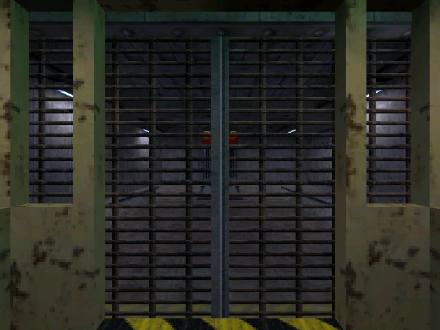
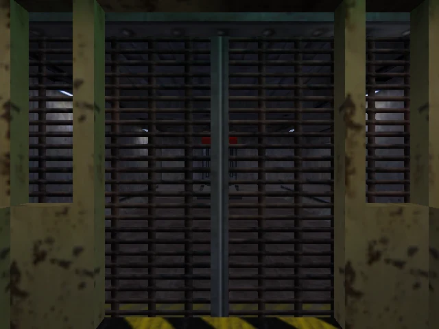
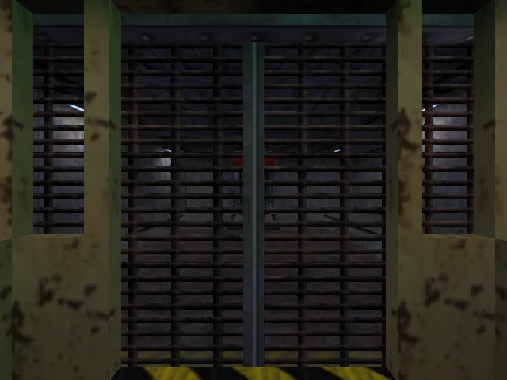
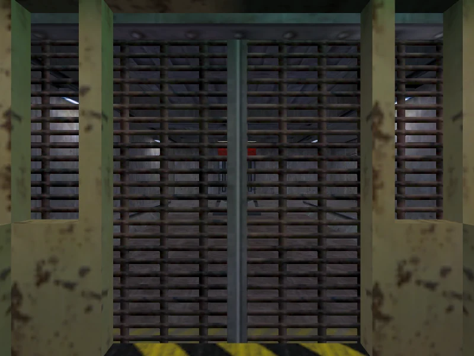
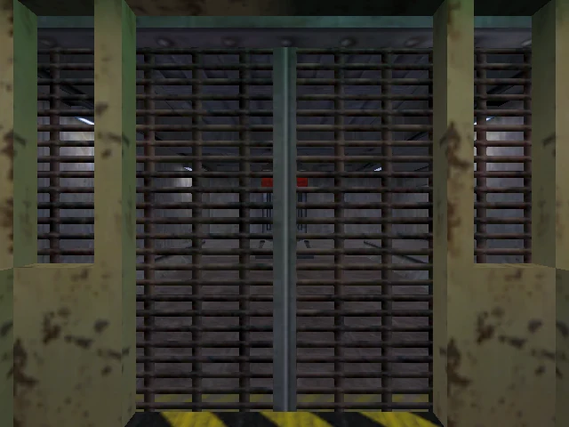
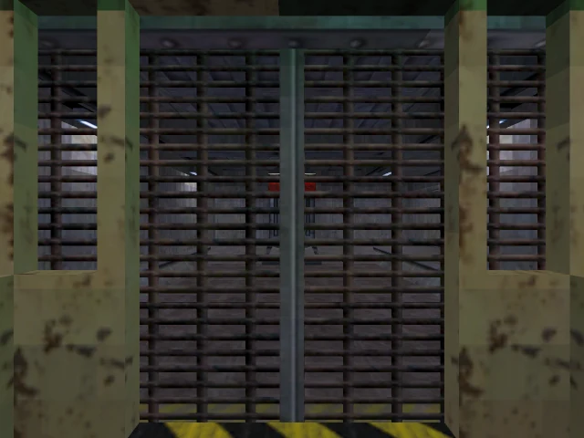
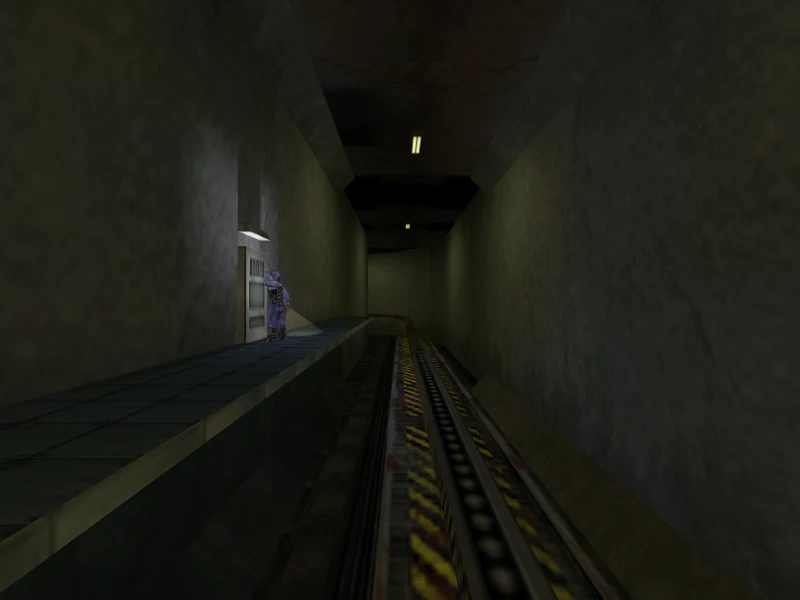
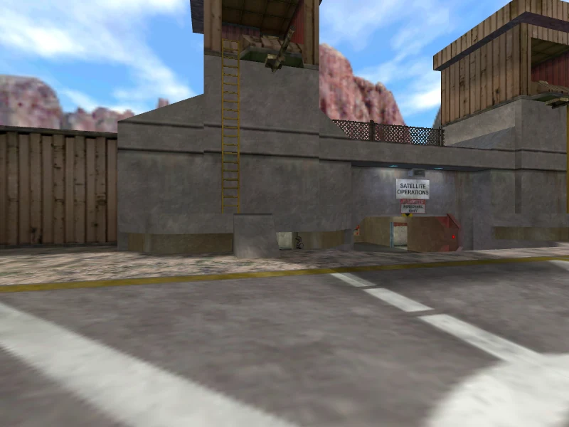

# Half-Life (1998 — Win32 3dfx MiniGL → Glide 2.x)

| Field | Value |
| :--- | :--- |
| **Category** | Commercial Game |
| **Year** | 1998 *(v1.1.1.0 patch: Jun 2002)* |
| **Platform(s)** | `Win32 / Wine (hw.dll + gldrv/3dfxgl.dll → glide2x.dll)` |
| **Glide API & Version** | **Glide 2.x via 3dfx MiniGL (`gldrv/3dfxgl.dll` → `glide2x.dll`, Voodoo2 `2.56`)** |
| **Recommended Card Profile** | `Voodoo2` (`2.56`, dual-TMU **`GL_SGIS_multitexture`**, up to `1600×1200`) · `VoodooGraphics` (`2.48`, single-TMU fallback) |
| **Verified Backends** | Vulkan · OpenGL 3.3 Core (WGL) · Software (AVX2 / AVX-512 / Scalar) |
| **Preset File(s)** | [`glide-ng.ini`](./glide-ng.ini) (`1×`, Voodoo2, **`gamma = 1.3`**) · [`glide-ng.hq.ini`](./glide-ng.hq.ini) (`4× MSAA` + Linear, recommended) · [`glide-ng.voodoo1.ini`](./glide-ng.voodoo1.ini) (Voodoo1 `2.48`) · [`glide-ng.software.ini`](./glide-ng.software.ini) (CPU Software `2×2 SSAA`) |
| **Status** | Verified |

---

## Overview

Valve's *Half-Life* (`GoldSrc` engine, retail **v1.1.1.0**) renders hardware-accelerated 3D through **`hw.dll`** paired with a selectable OpenGL driver mapped inside **`gldrv/drvmap.txt`**: either the system OpenGL ICD (**`Default`** / `opengl32.dll`) or the bundled 3dfx Voodoo2 **MiniGL (`gldrv/3dfxgl.dll` → `glide2x.dll`)**. Because *Half-Life* loads **`3dfxgl.dll` by its own distinct path** inside `gldrv/` (rather than replacing `opengl32.dll`), **all three `glide-ng` backends — Vulkan, OpenGL 3.3 Core (WGL), and CPU Software AVX2 (`2×2 SSAA`) — operate side by side with full visual parity.**

The **`1998` `gldrv/3dfxgl.dll` MiniGL (`137,728 B`)** explicitly targets **Voodoo2 (`"3Dfx Interactive Voodoo^2(tm)"`)** with **`GL_SGIS_multitexture`** single-pass lightmapping, **`GL_EXT_shared_texture_palette`**, colored lightmaps, volumetric dynamic sprites, alpha-masked grates and ladders, and **6-face canyon skyboxes** (all verified at **`640×480`** and **`800×600` `4× MSAA`**).

---

## Editions, Patches & Executables

| Binary / Renderer | Graphics API | Works with `glide-ng`? | Technical Notes |
| :--- | :--- | :---: | :--- |
| **`hl.exe -gl` + `gldrv/3dfxgl.dll`** (`v1.1.1.0`) | **OpenGL 1.1 → Glide 2.x (`glide2x.dll`)** | **Yes (Recommended)** | Stock 3dfx MiniGL driver (`EngineGLDriver="gldrv\3dfxgl.dll"`). Supports `640×480` and **`800×600` `4× MSAA`**, **single-pass dual-TMU lightmaps**, alpha-masked grates/railings, volumetric flashlights, and crisp skyboxes across Vulkan, OpenGL 3.3 Core (WGL), and CPU Software (`2×2 SSAA`). |
| **`hl.exe -gl` (`Default` / `opengl32.dll`)** | Host OpenGL 1.1 | No *(Comparison baseline)* | Native OpenGL baseline (`MESA_EXTENSION_MAX_YEAR=1999`). Matches **`3dfxgl.dll`** at linear **`gamma = 1.0`**. |
| **`hl.exe -soft` (`sw.dll`)** | CPU Software (`16-bit`) | No *(Comparison baseline)* | Unfiltered point-sampled software renderer. Lower visual fidelity with blocky wall/floor lightmaps and pixelated transparent grating. |
| **`hl.exe -d3d`** | Direct3D 6 HAL | No *(Comparison baseline)* | Legacy Direct3D 6 fallback; may render blank under software WineD3D environments (`llvmpipe`). Use **`-gl`** (`3dfxgl.dll`). |

> **Official Patch (`v1.1.1.0`):** Patch retail `v1.0.0.5` installations using the official **`hl1110.exe`** (`v1.1.1.0`, June 2002) installer before launching inside Wine. Ensure **`gldrv/drvmap.txt`** includes the line `gldrv/3dfxgl.dll 3Dfx Mini Driver`.

---

## Recommended Launch Configurations (Wine32 / Windows)

Place `glide-ng`'s Win32 **`glide2x.dll`** directly inside the **`Half-Life/`** folder next to **`hl.exe`**, verify **`gldrv/3dfxgl.dll`** is present and selected under **`HKCU\Software\Valve\Half-Life\Settings\EngineGLDriver = "gldrv\3dfxgl.dll"`** (`Configuration → Video → Video Modes → OpenGL → 3Dfx Mini Driver`).

### Option A: Best Visuals — Vulkan `4× MSAA` `800×600` (`glide-ng.hq.ini`) *(Recommended)*

```bash
WINEARCH=win32 WINEPREFIX=/path/to/prefix \
WINEDLLOVERRIDES="glide2x=n" \
GLIDE_NG_CONFIG=/path/to/glide-ng.hq.ini \
  wine explorer /desktop=HalfLife,800x600 hl.exe \
    -gl -width 800 -height 600 -bpp 16 -console
```

On CPU-only Vulkan hosts (`llvmpipe`), add `LP_NUM_THREADS=4`.

### Option B: Native Vulkan `1×` `640×480` (`glide-ng.ini`)

```bash
WINEARCH=win32 WINEPREFIX=/path/to/prefix \
WINEDLLOVERRIDES="glide2x=n" \
GLIDE_NG_CONFIG=/path/to/glide-ng.ini \
  wine explorer /desktop=HalfLife,640x480 hl.exe \
    -gl -width 640 -height 480 -bpp 16 -console
```

### Option C: OpenGL 3.3 Core (WGL)

```bash
WINEARCH=win32 WINEPREFIX=/path/to/prefix \
WINEDLLOVERRIDES="glide2x=n" \
GLIDE_NG_CONFIG=/path/to/glide-ng.ini GLIDE_NG_BACKEND=opengl_es \
  wine explorer /desktop=HalfLife,640x480 hl.exe \
    -gl -width 640 -height 480 -bpp 16 -console
```

### Option D: CPU Software Rasterizer (`glide-ng.software.ini` — `2×2 SSAA`)

```bash
WINEARCH=win32 WINEPREFIX=/path/to/prefix \
WINEDLLOVERRIDES="glide2x=n" \
GLIDE_NG_CONFIG=/path/to/glide-ng.software.ini \
  wine explorer /desktop=HalfLife,640x480 hl.exe \
    -gl -width 640 -height 480 -bpp 16 -console
```

---

## Visual Progression Gallery

All captures below are from **retail *Half-Life* `v1.1.1.0`** (`t0a0` *Hazard Course*, `c0a0` *Black Mesa Inbound*, and `crossfire` *Satellite Operations*) rendered in Wine32:

| | |
| :---: | :---: |
| <br>**1. Native CPU Software (`-soft` · `640×480`)**<br>Point-sampled pixels and dithered grating edges (`t0a0` Hazard Course entry). | <br>**2. Native OpenGL Baseline (`Default` `opengl32.dll` · `640×480`)**<br>Host bilinear filtering and colored lightmaps at linear brightness (`gamma = 1.0`). |
| <br>**3. 3dfx MiniGL — Vulkan `1×` (`gamma = 1.0`)**<br>Direct linear-gamma match against native host OpenGL via `gldrv/3dfxgl.dll` → `glide2x.dll` (`Voodoo2`, `2.56`). | <br>**4. 3dfx MiniGL — Vulkan `4× MSAA` `800×600` (`glide-ng.hq.ini`, `gamma = 1.3`)**<br>Warm authentic 3dfx gamma revealing subtle concrete weathering, alpha-masked bars, hazard stripe edge detail, and interior hologram chamber. |
| <br>**5. 3dfx MiniGL — OpenGL 3.3 Core (`WGL`, `gamma = 1.3`)**<br>Full 3-layer parity (`hl.exe` → `gldrv/3dfxgl.dll` → `glide2x.dll` → system `opengl32.dll` 3.3 Core). | <br>**6. 3dfx MiniGL — CPU Software AVX2 (`2×2 SSAA`, `gamma = 1.3`)**<br>Zero-GPU software rasterizer matching Vulkan and OpenGL 3.3 Core lightmaps, alpha-masked grating, and warm brightness pixel-for-pixel. |
| <br>**7. *Black Mesa Inbound* (`c0a0` · `800×600` `4× MSAA`)**<br>The opening transit tunnel: smooth additive flashlight cone, ceiling strip fixtures, Barney security guard model, and hazard track ties. | <br>**8. *Crossfire* (`crossfire` · `800×600` `4× MSAA`)**<br>Outdoor desert canyon skybox, seamless cloud horizons, crisp alpha-masked catwalk fence and yellow ladder, concrete signage, and crisp shadows. |

---

## Visual Quality & Performance Tuning

* **Gamma (`1.3` default):** *Half-Life* shares the slightly darker GoldSrc/Quake II lightmap lighting curve; **`gamma = 1.3`** matches the intended 3dfx CRT presentation without washing out concrete highlights or skybox blues. Adjust further using the in-game **`gamma`** / **`brightness`** console cvars or `SSTV2_GAMMA`.
* **Resolution selection:** Passing **`-width 800 -height 600`** (`Voodoo2` profile) gives substantially sharper gratings, text signage, and HUD scaling than `640×480`, and pairs cleanly with **`msaa = 4`**.
* **Single-TMU fallback (`glide-ng.voodoo1.ini`):** Selecting `VoodooGraphics` (`2.48`) runs the same `3dfxgl.dll` in authentic single-TMU two-pass SST-1 lightmapping mode at **`640×480`**.

---

## Quirks, Known Issues & Controls

### Installation & Engine Notes
* **Driver registry & `drvmap.txt`:** `hl.exe -gl` reads **`HKCU\Software\Valve\Half-Life\Settings\EngineGLDriver`**. Keep **`gldrv/drvmap.txt`** listing both `Default Default` and `gldrv/3dfxgl.dll 3Dfx Mini Driver` so switching between the 3dfx MiniGL and native OpenGL works directly from the in-game Video menu or registry.
* **Native OpenGL comparison (`Default`):** On modern Mesa/NVIDIA drivers, set **`MESA_EXTENSION_MAX_YEAR=1999`** (or `__GL_ExtensionStringVersion=17700`) so the legacy `GL_EXTENSIONS` string does not overflow `hw.dll`'s fixed stack buffer.
* **CD audio tracks:** Pass **`-nocdaudio`** if running without the CD image mounted containing the original Red Book audio tracks.

### Useful Controls

| Action | Key |
| :--- | :--- |
| **Move / Strafe** | `W/A/S/D` or `Arrow Keys` |
| **Fire / Secondary Attack** | `Mouse 1` / `Mouse 2` |
| **Use / Interact** | `E` |
| **Jump / Crouch** | `Space` / `Ctrl` |
| **Flashlight** | `F` |
| **Toggle Console (`map c0a0`, `map crossfire`)** | `` ` `` *(Backtick / Tilde, requires `-console`)* |
| **Pause / Video Menu** | `Esc` |
