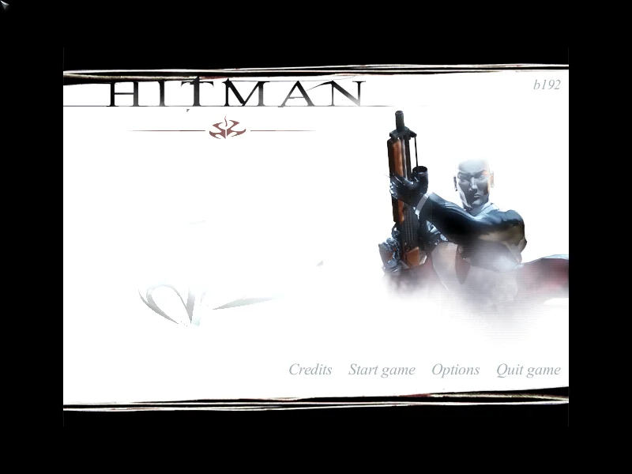
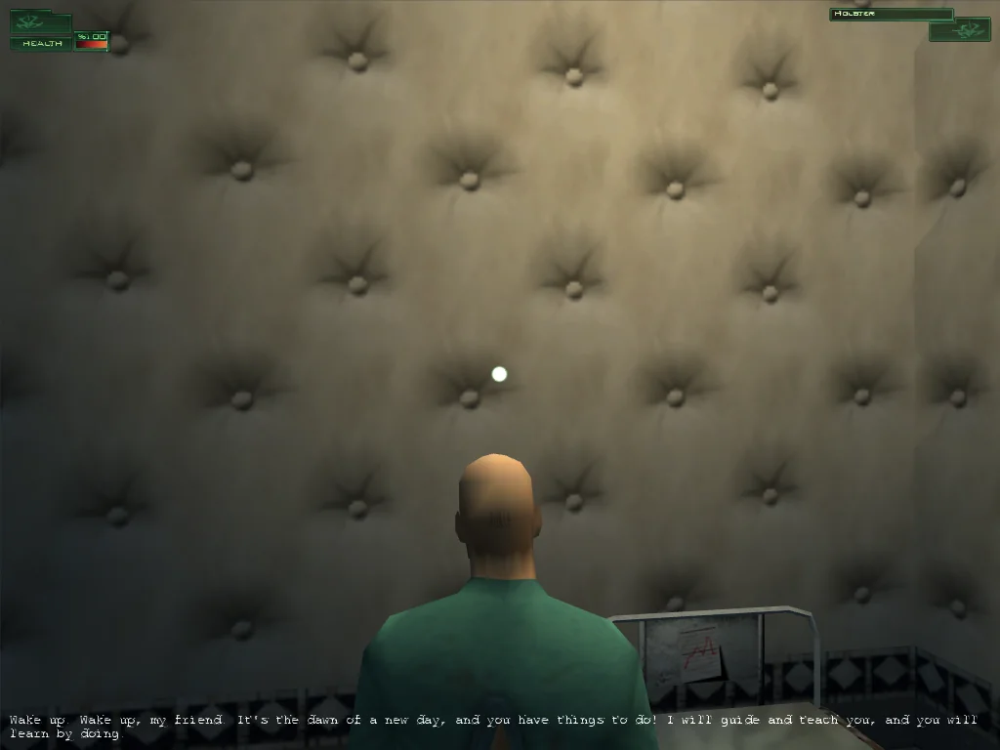
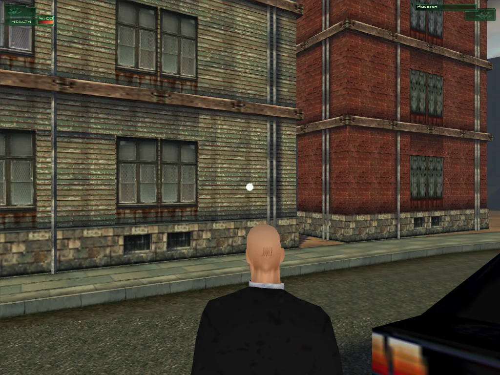

# Hitman: Codename 47 (2000)

| Field | Value |
| :--- | :--- |
| **Title** | *Hitman: Codename 47* |
| **Developer / Publisher** | IO Interactive / Eidos Interactive |
| **Release Year** | 2000 (Win32 retail / digital releases) |
| **Platform** | Win32 / Wine (`Hitman.exe` + `Render3DFX.dll` — Glide 3.x via `glide3x.dll`) |
| **Glide API** | **Glide 3.x** (`glide3x.dll`, `GR_CLIP_COORDS`, `GR_COLORFORMAT_RGBA`) |
| **Recommended Profile** | `Voodoo5` (`api_version = 3.10`) or `Voodoo3` (`api_version = 3.10`) |
| **Backends Verified** | Vulkan (Pass) · OpenGL ES (Pass) · Software (Pass) |
| **Presets** | [`glide-ng.ini`](./glide-ng.ini) · [`glide-ng.hq.ini`](./glide-ng.hq.ini) · [`glide-ng.voodoo3.ini`](./glide-ng.voodoo3.ini) · [`glide-ng.software.ini`](./glide-ng.software.ini) |

---

## 1. Overview & Renderer Flavour Comparison

*Hitman: Codename 47* is a Windows-only third-person stealth action game powered by IO Interactive's Glacier engine (no DOS edition exists). The game ships three pluggable rendering drivers configured in `Hitman.ini`:

- **3dfx Glide 3.x (`Render3DFX.dll`)**: Uses Glide 3.x homogeneous clip-space coordinates (`GR_CLIP_COORDS`) with simultaneous `GR_PARAM_W`, `GR_PARAM_Q`, and `GR_PARAM_Q0` vertex parameters, `GR_COLORFORMAT_RGBA`, W-buffer depth testing, and `guFogGenerateExp2` exponential-squared table fog. Supports native `640×480`, `800×600`, and `1024×768` resolutions.
- **Direct3D 7 (`RenderD3D.dll`)**: Hardware Direct3D 7 renderer supporting higher arbitrary resolutions. Under Wine, digital releases that bundle `DDrawCompat` (`ddraw.dll`) may fail to initialize unless bypassed with `WINEDLLOVERRIDES="ddraw=b"`.
- **OpenGL (`RenderOpenGL.dll`)**: Native OpenGL 1.x renderer with matching geometry, textures, reflections, and HUD, using linear OpenGL distance fog.

### Visual Comparison & Verdict

At `800×600` (1×), **Glide 3.x**, **Direct3D**, and **OpenGL** produce matching geometry, lighting, textures, skyboxes, reflections, and translucent HUD overlays. Glide 3.x's `guFogGenerateExp2` fog curve is slightly denser at mid-to-far range, smoothly veiling distant buildings before the far clip plane.

**Best Visuals Winner**: **Glide 3.x (`Render3DFX.dll`) with [`glide-ng.hq.ini`](./glide-ng.hq.ini)** (`Resolution 1024x768`, `msaa = 4`, `presentation_filter = linear`) provides the cleanest presentation. Neither stock `RenderD3D.dll` nor stock `RenderOpenGL.dll` exposes in-game MSAA, whereas `glide-ng` applies clean `4× MSAA` across every polygon edge with full Vulkan, OpenGL ES/WGL, and Software backend parity.

---

## 2. Installation & Launch Setup (Win32 / Wine)

### Switching to the 3dfx Glide 3.x Renderer

1. Install *Hitman: Codename 47* into a game directory (retail CD or digital release).
2. **Replace any bundled third-party `glide3x.dll`** (for example, digital releases that ship `nGlide` alongside `nglide_config.exe` / `glide.dll` / `glide2x.dll`) with `glide-ng`'s Win32 **`build/win32/bin/glide3x.dll`**.
3. Edit `Hitman.ini` in the game directory to enable `Render3DFX.dll` and select a Glide-supported resolution (`800x600` or `1024x768`):

```ini
Include Setup\Locale.zip
DrawDll Render3DFX.dll
//DrawDll RenderD3D.dll
//DrawDll RenderOpenGL.dll
SoundDll Sound.dll
ScriptDll GSC.dll
LocaleDLL Locale.dll
Resolution 1024x768
```

4. Copy [`glide-ng.ini`](./glide-ng.ini) (or [`glide-ng.hq.ini`](./glide-ng.hq.ini)) next to `Hitman.exe`.

### Launch Command (Wine32)

```bash
WINEARCH=win32 \
WINEDLLOVERRIDES="glide3x=n" \
wine explorer /desktop=Hitman47,1024x768 ./Hitman.exe
```

- **Match the Wine desktop size to `Hitman.ini`**: Use `800x600` with `Resolution 800x600`, or `1024x768` with `Resolution 1024x768` and [`glide-ng.hq.ini`](./glide-ng.hq.ini).
- **CPU-only Vulkan hosts**: Cap `LP_NUM_THREADS=4` to preserve 32-bit Wine virtual address space under Mesa `llvmpipe`, or use [`glide-ng.software.ini`](./glide-ng.software.ini).

---

## 3. Quirks & Controls

- **Glide 3.x Resolution Cap (`1024×768`)**: `Render3DFX.dll` maps `Hitman.ini`'s `Resolution` setting to Glide 3.x modes up to `GR_RESOLUTION_1024x768`. Requesting `1280x960` or higher in `Hitman.ini` is clamped to `1024×768` by `Render3DFX.dll` itself.
- **Homogeneous Clip Coordinates & RGBA Color Format**: `Render3DFX.dll` renders all 3D menus and levels in `GR_CLIP_COORDS` mode with `GR_COLORFORMAT_RGBA` (`grSstWinOpen`), using `[0.0..1.0]` normalized float vertex colors and independent `GR_PARAM_W` (clip projection) and `GR_PARAM_Q` (table fog/W-buffer) streams. `glide-ng` handles homogeneous 3D frustum clipping, viewport projection, and `GR_COLORFORMAT_RGBA` color unpacking natively across Vulkan, OpenGL ES/WGL, and Software backends.
- **Voodoo3 vs. Voodoo5 Profiles**: Both `Voodoo5` (64 MB, `2048×2048` max texture) and `Voodoo3` (16 MB, `256×256` max texture) pass with identical visuals; `Voodoo5` is the default preset for generous texture headroom.
- **Direct3D Under Wine**: When testing `DrawDll RenderD3D.dll` for comparison on digital releases that bundle `DDrawCompat`, pass `WINEDLLOVERRIDES="ddraw=b"` so Wine's built-in DirectDraw/Direct3D 7 implementation is used.
- **Default Controls** (configurable in-game under **Options → Controls** or in `Hitman.cfg`):
  - **`S` / `X`**: Walk Forward / Backward (`W` runs forward by default)
  - **`Z` / `C`**: Strafe Left / Right (`A` / `D` turn left / right)
  - **`Q` / `E`**: Lean Left / Right
  - **`Space`**: Context Action (open doors, pick up items)
  - **`F1` / `F2` / `M`**: Laptop / Mission Status / Map
  - **`Esc`**: Pause / Main Menu

---

## 4. Verification Gallery

| Main Menu (`800×600`, Glide 3.x Vulkan) | Asylum Training (`1024×768`, Glide 3.x Vulkan HQ `4× MSAA`) |
| :---: | :---: |
|  |  |

| Kowloon Start (`1024×768`, Glide 3.x Vulkan HQ `4× MSAA`) | Kowloon Street & Fog (`1024×768`, Glide 3.x Vulkan HQ `4× MSAA`) |
| :---: | :---: |
|  |  |

| Kowloon Street (`800×600`, Direct3D `RenderD3D.dll`) | Kowloon Street (`800×600`, OpenGL `RenderOpenGL.dll`) |
| :---: | :---: |
|  |  |
