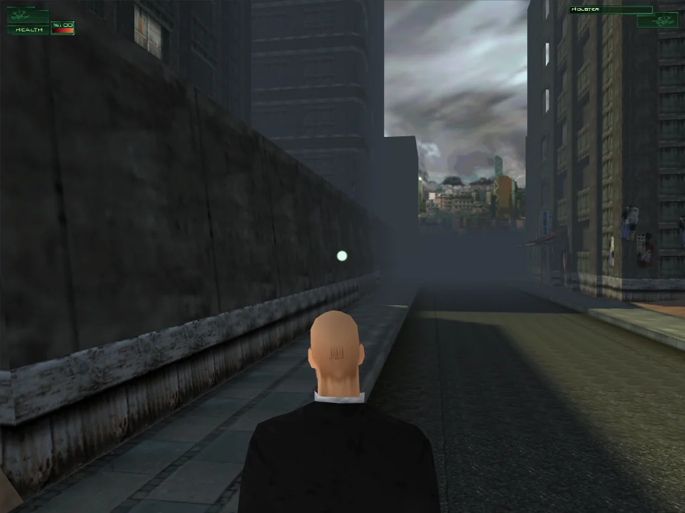
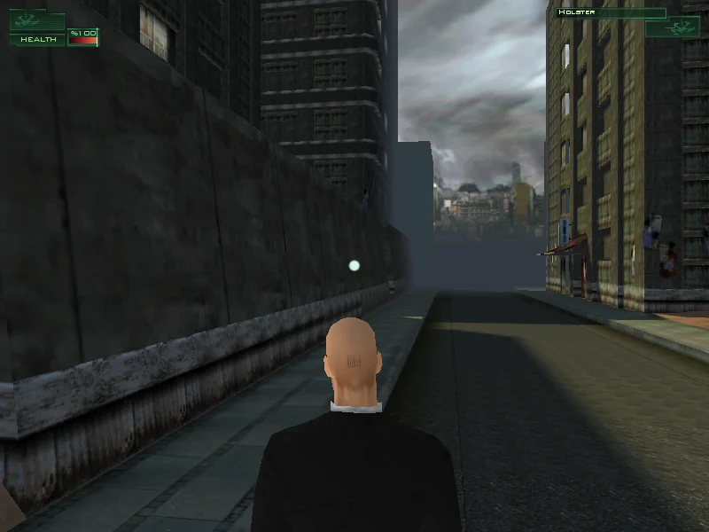

# Hitman: Codename 47 (2000 — Win32 3dfx Glide 3.x)

| Field | Value |
| :--- | :--- |
| **Category** | Commercial Game |
| **Year** | 2000 |
| **Platform(s)** | `Win32 / Wine (glide3x.dll)` |
| **Glide API & Version** | **Glide 3.x** (`3.10` on Voodoo5 / Voodoo3; `GR_CLIP_COORDS`, `GR_COLORFORMAT_RGBA`) |
| **Recommended Card Profile** | `Voodoo5` (default, 64 MB VRAM) · `Voodoo3` (authentic 16 MB `256×256` max tex) |
| **Verified Backends** | Vulkan · OpenGL 3.3 Core (WGL) · Software (AVX2 / AVX-512 / Scalar) |
| **Preset File(s)** | [`glide-ng.ini`](./glide-ng.ini) (Voodoo5 `1×`) · [`glide-ng.hq.ini`](./glide-ng.hq.ini) (Voodoo5 `4× MSAA` + Linear) · [`glide-ng.voodoo3.ini`](./glide-ng.voodoo3.ini) (Voodoo3 `1×`) · [`glide-ng.software.ini`](./glide-ng.software.ini) (CPU Software) |
| **Status** | Verified |

---

## Overview

IO Interactive's 2000 third-person stealth classic *Hitman: Codename 47* is a Windows-only Glacier engine release (no DOS edition exists) that supports three pluggable rendering drivers selected via `Hitman.ini`: **Glide 3.x** (`Render3DFX.dll`), **Direct3D 7** (`RenderD3D.dll`), and **OpenGL** (`RenderOpenGL.dll`).

Technically, `Render3DFX.dll` is a rich Glide 3.x clip-space workload: it opens `grSstWinOpen` with **`GR_COLORFORMAT_RGBA`**, submits all 3D menu and level geometry in homogeneous **`GR_CLIP_COORDS`** with simultaneous independent **`GR_PARAM_W`**, **`GR_PARAM_Q`**, and **`GR_PARAM_Q0`** vertex streams plus normalized `[0..1]` float vertex colors, enables W-buffer depth testing, and uses exponential-squared table fog (`guFogGenerateExp2`). Supported native Glide resolutions are `640×480`, `800×600`, and **`1024×768`**.

---

## Editions, Patches & Executables

All three renderer DLLs live side by side in the game directory and are swapped by editing the `DrawDll` line in `Hitman.ini`:

| Driver DLL (`Hitman.ini`) | Renderer / API | Works with `glide-ng`? | Technical Notes |
| :--- | :--- | :---: | :--- |
| **`Render3DFX.dll`** | 3dfx Glide 3.x (`glide3x.dll`) | **Yes (Recommended)** | Native `640×480`, `800×600`, and `1024×768`. Uses `GR_CLIP_COORDS`, `GR_COLORFORMAT_RGBA`, and `guFogGenerateExp2` table fog. Replace any bundled third-party `glide3x.dll` (e.g. `nGlide`) with `glide-ng`'s `glide3x.dll`. |
| **`RenderD3D.dll`** | Direct3D 7 (`ddraw.dll`) | No *(Comparison baseline)* | Supports arbitrary higher resolutions. Digital releases bundling `DDrawCompat` (`ddraw.dll`) may fail to initialize under Wine unless bypassed via `WINEDLLOVERRIDES="ddraw=b"`. |
| **`RenderOpenGL.dll`** | OpenGL 1.x | No *(Comparison baseline)* | Runs natively under Wine with linear OpenGL distance fog; no built-in MSAA. |

---

## Recommended Launch Configurations (Wine32 / Windows)

1. Install *Hitman: Codename 47* (retail CD or digital release).
2. **Replace any bundled third-party `glide3x.dll`** (for example, digital releases that include `nGlide` alongside `nglide_config.exe` / `glide.dll` / `glide2x.dll`) with `glide-ng`'s 32-bit **`build/win32/bin/glide3x.dll`**.
3. Edit `Hitman.ini` in the game directory to select **`Render3DFX.dll`** and a matching Glide resolution (`800x600` or `1024x768`):

```ini
Include Setup\Locale.zip
DrawDll Render3DFX.dll
//DrawDll RenderD3D.dll
//DrawDll RenderOpenGL.dll
SoundDll Sound.dll
ScriptDll GSC.dll
LocaleDLL Locale.dll
Resolution 1024x768
```

4. Copy the desired preset (`glide-ng.ini` or `glide-ng.hq.ini`) next to `Hitman.exe`. Match the Wine virtual desktop dimensions to `Resolution` in `Hitman.ini`.

### Option A: Standard Glide 3.x (`glide-ng.ini` — `800×600`, `1×`)

```bash
WINEARCH=win32 WINEPREFIX=/path/to/wineprefix \
WINEDLLOVERRIDES="glide3x=n" \
  wine explorer /desktop=Hitman47,800x600 ./Hitman.exe
```

To test the Win32 WGL OpenGL 3.3 Core backend instead of Vulkan without editing `glide-ng.ini`, add `GLIDE_NG_BACKEND=opengl_es`. To test the authentic 16 MB Voodoo3 profile (`256×256` max texture), pass `GLIDE_NG_CONFIG=/path/to/glide-ng.voodoo3.ini`.

### Option B: Best Visuals (`glide-ng.hq.ini` — `1024×768` + `4× MSAA`) *(Recommended)*

Set **`Resolution 1024x768`** in `Hitman.ini` and launch with [`glide-ng.hq.ini`](./glide-ng.hq.ini) (`Voodoo5`, `msaa = 4`, `presentation_filter = linear`, `no_dither_sub = true`):

```bash
WINEARCH=win32 WINEPREFIX=/path/to/wineprefix \
WINEDLLOVERRIDES="glide3x=n" \
GLIDE_NG_CONFIG=/path/to/glide-ng.hq.ini \
  wine explorer /desktop=Hitman47,1024x768 ./Hitman.exe
```

### Option C: CPU Software Rasterizer (`glide-ng.software.ini`)

On CPU-only hosts, cap `LP_NUM_THREADS=4` to preserve 32-bit Wine virtual address space under Mesa `llvmpipe`, or use `glide-ng`'s Software backend (`Resolution 800x600`):

```bash
WINEARCH=win32 WINEPREFIX=/path/to/wineprefix \
WINEDLLOVERRIDES="glide3x=n" \
GLIDE_NG_CONFIG=/path/to/glide-ng.software.ini \
  wine explorer /desktop=Hitman47,800x600 ./Hitman.exe
```

---

## Visual Progression Gallery

Captures below show `Render3DFX.dll` (`glide-ng` Vulkan, `Voodoo5` profile) on the Main Menu, Asylum Training, and Hong Kong (*Kowloon Triads in Gang War*) side by side with the native Direct3D 7 and OpenGL drivers:

| | |
| :---: | :---: |
| <br>**1. Main Menu (`800×600`, Glide 3.x Vulkan `1×`)**<br>Crisp white-fog fade and spinning silver Hitman emblem verified under `GR_COLORFORMAT_RGBA` (`0xFFFFFF00` fog color) and `GR_CLIP_COORDS`. | <br>**2. Asylum Training (`1024×768`, Glide 3.x Vulkan HQ `4× MSAA`)**<br>Padded cell, medical chart, Agent 47 barcode, translucent green HUD, and bottom subtitles under [`glide-ng.hq.ini`](./glide-ng.hq.ini). |
| <br>**3. Kowloon Start (`1024×768`, Glide 3.x Vulkan HQ `4× MSAA`)**<br>Crisp brick/wood textures, reflective car hood, Agent 47 barcode, and smooth anti-aliased building silhouettes. | <br>**4. Kowloon Street & Fog (`1024×768`, Glide 3.x Vulkan HQ `4× MSAA`)**<br>Smooth `guFogGenerateExp2` atmospheric haze veiling distant buildings before the far clip plane, with clean `4× MSAA` edges. |
| <br>**5. Kowloon Street (`800×600`, Direct3D `RenderD3D.dll`)**<br>Comparison baseline using Wine built-in `ddraw=b`. Matching geometry, textures, lighting, and skybox; `1×` aliased building silhouettes and slightly lighter linear distance fog. | <br>**6. Kowloon Street (`800×600`, OpenGL `RenderOpenGL.dll`)**<br>Comparison baseline. Matches Direct3D and Glide geometry/lighting identically; no built-in MSAA (`1×` edges). |

---

## Visual Quality & Performance Tuning

### 3-Flavour Comparison: Glide 3.x vs. Direct3D 7 vs. OpenGL

At `800×600` (`1×`), **Glide 3.x**, **Direct3D 7**, and **OpenGL** produce matching geometry, lighting, textures, skyboxes, reflections, and translucent HUD overlays. Glide 3.x's `guFogGenerateExp2` fog curve is slightly denser at mid-to-far range, smoothly softening distant buildings before the far clip plane.

**Verdict**: **Glide 3.x (`Render3DFX.dll`) with [`glide-ng.hq.ini`](./glide-ng.hq.ini)** (`Resolution 1024x768`, `msaa = 4`, `presentation_filter = linear`) provides the best overall image quality. Neither stock `RenderD3D.dll` nor stock `RenderOpenGL.dll` exposes in-game MSAA, whereas `glide-ng` applies clean **`4× MSAA`** across every polygon edge with full Vulkan, OpenGL 3.3 Core (WGL), and Software backend parity.

### Card Profiles & Resolution Limits
* **`1024×768` resolution cap:** `Render3DFX.dll` internally clamps `Hitman.ini`'s `Resolution` line to Glide 3.x modes up to `GR_RESOLUTION_1024x768`. Requesting `1280x960` or higher is silently clamped back to `1024×768` by `Render3DFX.dll`.
* **`Voodoo5` vs. `Voodoo3`:** Both `Voodoo5` (64 MB, `2048×2048` max texture) and `Voodoo3` (16 MB, `256×256` max texture) render with identical visual parity; `Voodoo5` is the default preset for generous texture headroom.

---

## Quirks, Known Issues & Controls

### Installation & Engine Notes
* **Homogeneous clip space & RGBA color format:** `Render3DFX.dll` renders in `GR_CLIP_COORDS` with `GR_COLORFORMAT_RGBA` (`grSstWinOpen`), normalized `[0.0..1.0]` float vertex colors, and independent `GR_PARAM_W` (projection) and `GR_PARAM_Q` (table fog / W-buffer) streams. `glide-ng` implements homogeneous 3D frustum clipping, viewport projection, aspect-adjusted `[0..1]` texture coordinate scaling, and `GR_COLORFORMAT_RGBA` color unpacking natively across all three backends.
* **Comparing Direct3D under Wine:** On digital releases that bundle `DDrawCompat` (`ddraw.dll`), pass `WINEDLLOVERRIDES="ddraw=b"` when running `DrawDll RenderD3D.dll` so Wine's built-in DirectDraw/Direct3D 7 driver is used.
* **Startup splash:** `glide-ng` plays its procedural startup splash once automatically on `grSstWinOpen()`. Uncomment `no_splash = true` in `glide-ng.ini` (or pass `FX_GLIDE_NO_SPLASH=1`) to jump straight to the title screen.

### Useful Controls
Default bindings (rebindable in-game under **Options → Controls** or in `Hitman.cfg`):
* `S` / `X` — Walk Forward / Backward · `W` — Run Forward · `Z` / `C` — Strafe Left / Right · `A` / `D` — Turn Left / Right · `Q` / `E` — Lean Left / Right · `Space` — Context Action · `F1` / `F2` / `M` — Laptop / Mission Status / Map · `Esc` — Pause / Main Menu
