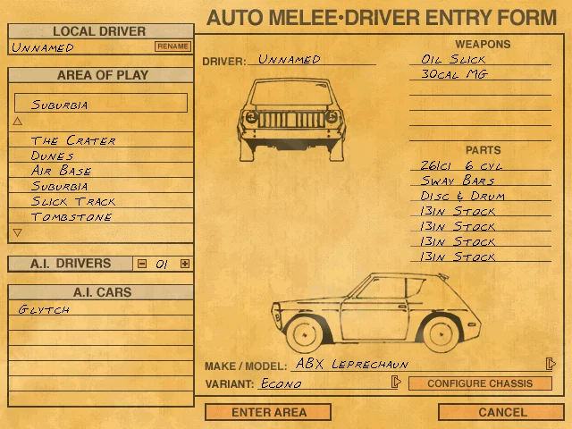
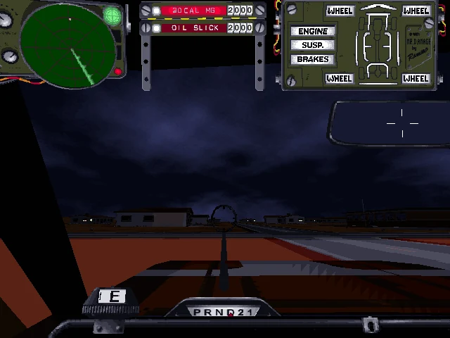
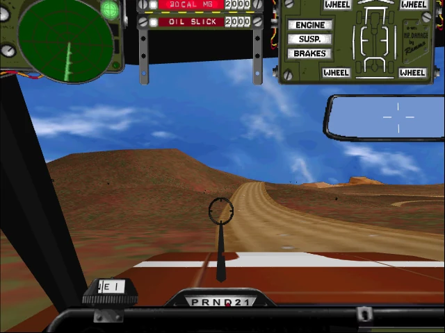
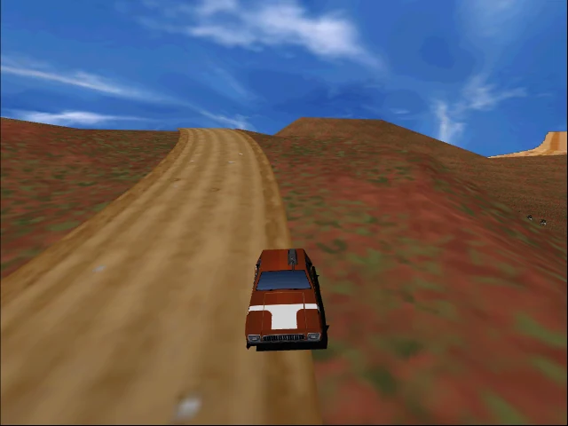
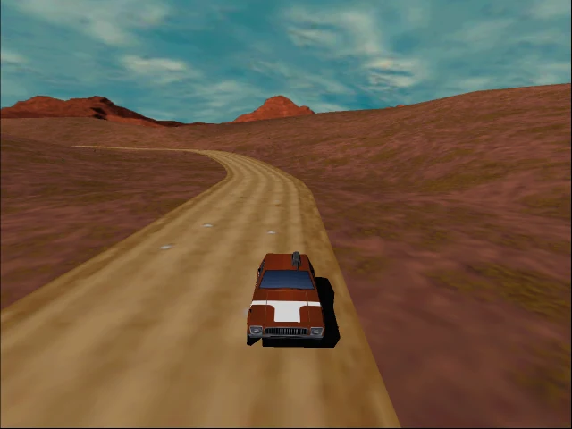
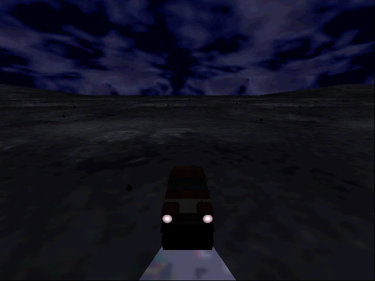

# Interstate '76 Gold Edition (1997/1998 — Win32 3dfx Glide 2.x)

| Field | Value |
| :--- | :--- |
| **Category** | Commercial Game |
| **Year** | 1997 *(Gold 1.2 Accelerated patch: 1998)* |
| **Platform(s)** | `Win32 / Wine (glide2x.dll)` |
| **Glide API & Version** | **Glide 2.x (`glide2x.dll`, Voodoo2 `2.56` / Voodoo1 `2.48`)** |
| **Recommended Card Profile** | `Voodoo2` (`2.56`, default) · `VoodooGraphics` (`2.48`) |
| **Verified Backends** | Vulkan · OpenGL 3.3 Core (WGL) · Software (AVX2 / AVX-512 / Scalar) |
| **Preset File(s)** | [`glide-ng.ini`](./glide-ng.ini) (`1×`, Vulkan) · [`glide-ng.hq.ini`](./glide-ng.hq.ini) (`4× MSAA` + Linear) · [`glide-ng.voodoo1.ini`](./glide-ng.voodoo1.ini) (Voodoo1 SST-1) · [`glide-ng.software.ini`](./glide-ng.software.ini) (CPU Software) |
| **Status** | Verified |

---

## Overview

Activision's iconic 1970s vehicular combat sim *Interstate '76* originally launched in March 1997 as a software-only 8-bit game using the *MechWarrior 2* engine lineage. The official **Gold Edition 1.2 Accelerated Patch (`i76gpat16.exe`)** upgrades retail installs with four plug-in 3D renderers (`ZGLIDE.DLL`, `ZDX5DRAW.DLL`, `zpowervr.dll`, `ZREDLINE.DLL`), bringing full 16-bit bilinear-filtered terrain, layered skyboxes, translucent dust, shadows, and dual-pass `GR_BLEND_DST_COLOR` / `GR_BLEND_ONE` night headlights over **`glide2x.dll`**.

Through `glide-ng`, **`I76.EXE /glide`** (`ZGLIDE.DLL` → `glide2x.dll`) turns the blocky, flat-shaded 8-bit software horizon into smooth textured desert highways, red-rock mesas, glowing clouds, crisp `MR. DAMAGE` / CRT radar cockpit instruments, active suspension drop, and dynamic night headlights across all three backends (`Vulkan`, `OpenGL 3.3 Core WGL`, and `CPU Software AVX2 2×2 SSAA`).

---

## Editions, Patches & Executables

| Binary / Renderer | Graphics API | Works with `glide-ng`? | Technical Notes |
| :--- | :--- | :---: | :--- |
| **`I76.EXE /glide`** + **`ZGLIDE.DLL`** *(Gold 1.2 + UCyborg AiO `v1.05`)* | **Glide 2.x (`glide2x.dll`)** | **Yes (Recommended)** | Native **`640×480`** hardware renderer using 8-bit paletted `GR_TEXFMT_P_8` textures (`grTexDownloadTable`), bilinear filtering, W-free painter / Z-buffer sorting, distance fog, and `GR_BLEND_DST_COLOR` night headlights. Beats both the 8-bit CPU renderer and WineD3D Direct3D. |
| **`I76.EXE`** *(no flag)* | 8-bit CPU Software | No *(Comparison baseline)* | Runs cleanly as a low-color software baseline with blocky texels and untextured desert surfaces around the road. |
| **`I76.EXE /d3d`** + **`ZDX5DRAW.DLL`** | Direct3D 5 (DirectX 5) | No | Crashes on startup under stock WineD3D (`llvmpipe`); requires a third-party DDraw/D3D wrapper on modern hosts. Use **`/glide`** instead. |
| **`i76.exe` (v1.0 retail)** | 8-bit CPU Software only | No | Does not include `ZGLIDE.DLL`; upgrade first with **`i76gpat16.exe`** (Gold 1.2 Accelerated patch). |

> **Recommended Community Patch:** After installing the official **`i76gpat16.exe`** (Gold 1.2 Accelerated 16-bit upgrade), apply the **UCyborg All-in-One Unofficial Patch** (`I76.EXE`, `I76PATCH.DLL`, `I76SHELL.DLL`, and `DLL/WINET.DLL`). It fixes startup memory checks on systems with `>2 GB` RAM, privileged CPU checks, modern timing (`20 FPS` frame limiter preventing high-FPS physics glitches), mission 12→13 stability, and hardware sound lockups.

---

## Recommended Launch Configurations (Wine32 / Windows)

Stage retail **`CD1`** (`I76_DISK1`) into `C:\Program Files\Activision\Interstate76\` (copying `I76MAX.ZIX` as `I76.ZIX` for a full install, plus any additional `MISSIONS/` and `CUTSCENE/` files from `CD2`). Apply **`i76gpat16.exe`**, overlay the **UCyborg AiO patch**, and copy **`glide-ng`'s** Win32 **`glide2x.dll`** alongside **`I76.EXE`**.

### One-Time Wine Prefix & Disc Setup

```bash
WINEARCH=win32 WINEPREFIX=/path/to/prefix wineboot -u
WINEARCH=win32 WINEPREFIX=/path/to/prefix wine reg add \
  'HKCU\Software\Wine' /v Version /t REG_SZ /d win98 /f

ln -sfn /path/to/cd1 /path/to/prefix/dosdevices/d:
ln -sfn /path/to/cd2 /path/to/prefix/dosdevices/e:
WINEARCH=win32 WINEPREFIX=/path/to/prefix wine reg add \
  'HKLM\Software\Wine\Drives' /v 'd:' /t REG_SZ /d cdrom /f
WINEARCH=win32 WINEPREFIX=/path/to/prefix wine reg add \
  'HKLM\Software\Wine\Drives' /v 'e:' /t REG_SZ /d cdrom /f
```

Add `.windows-label` containing `I76_DISK1` in `cd1/` and `I76_CD2` in `cd2/`.

> **`SETUP.EXE` Windows Version Note:** The original 1997 CD1 InstallShield wizard rejects newer OS version checks; either temporarily set `win95` when running `D:\SETUP.EXE`, or copy the uncompressed CD files directly and register `HKLM\SOFTWARE\Activision\Interstate '76\1.0` (`InstallPath`) before running `i76gpat16.exe`.

### Option A: Best Visuals (`glide-ng.hq.ini` — Vulkan `4× MSAA`) *(Recommended)*

```bash
WINEARCH=win32 WINEPREFIX=/path/to/prefix \
WINEDLLOVERRIDES="glide2x=n" \
GLIDE_NG_CONFIG=/path/to/glide-ng.hq.ini \
  wine explorer /desktop=I76,640x480 I76.EXE /glide
```

To use **`glide-ng`'s** automatic borderless fullscreen directly on a desktop display, run `wine I76.EXE /glide` (without `explorer /desktop`). On CPU-only Vulkan hosts (`llvmpipe`), add `LP_NUM_THREADS=4` to preserve 32-bit Wine virtual address space.

### Option B: Authentic Voodoo2 / Voodoo1 (`glide-ng.ini` / `glide-ng.voodoo1.ini`)

```bash
WINEARCH=win32 WINEPREFIX=/path/to/prefix \
WINEDLLOVERRIDES="glide2x=n" \
  wine explorer /desktop=I76,640x480 I76.EXE /glide
```

### Option C: OpenGL 3.3 Core (WGL)

DirectDraw menus inside `I76.EXE` reserve the shared window pixel format under Wine's default `gl` wined3d renderer. When selecting `backend = opengl_es` under Wine, set `HKCU\Software\Wine\Direct3D\renderer` to `no3d`:

```bash
WINEARCH=win32 WINEPREFIX=/path/to/prefix wine reg add \
  'HKCU\Software\Wine\Direct3D' /v renderer /t REG_SZ /d no3d /f
WINEARCH=win32 WINEPREFIX=/path/to/prefix \
WINEDLLOVERRIDES="glide2x=n" GLIDE_NG_BACKEND=opengl_es \
  wine explorer /desktop=I76,640x480 I76.EXE /glide
```

### Option D: CPU Software Rasterizer (`glide-ng.software.ini` — `2×2 SSAA`)

```bash
WINEARCH=win32 WINEPREFIX=/path/to/prefix \
WINEDLLOVERRIDES="glide2x=n" GLIDE_NG_BACKEND=software GLIDE_NG_SW_AA=ssaa \
  wine explorer /desktop=I76,640x480 I76.EXE /glide
```

---

## Visual Progression Gallery

All six captures below are native **`640×480`** frames from *Interstate '76 Gold Edition* (1.2 + UCyborg AiO patch) running under Wine32:

| | |
| :---: | :---: |
| <br>**1. Auto Melee Driver Entry Form (`640×480` · DirectDraw Shell)**<br>Selecting **MELEE → AUTO MELEE → INSTANT MELEE** switches directly into the mission configurator before handing the Win32 window off to `ZGLIDE.DLL` (`glide2x.dll`). | <br>**2. Native 8-Bit CPU Software (`Suburbia` · Comparison Baseline)**<br>Running `I76.EXE` without `/glide` renders pixelated, flat-shaded terrain polygons alongside the road and banded 8-bit sky dithering. |
| <br>**3. Cockpit View — `Tombstone` (Vulkan `4× MSAA` + `glide2x.dll`)**<br>Crisp bilinear-filtered desert hills and highway, smooth daytime skybox clouds, sharp hood sight, green CRT radar sweep, `30 CAL MG` / `OIL SLICK` weapon racks, `MR. DAMAGE` display, compass, and `PRND21` gear indicator. | <br>**4. Chase View — `Tombstone` (Vulkan `4× MSAA`)**<br>Press **`F3`** to step out to the exterior chase camera. Bilinear road surface, clean shadow polygon, deep blue sky dome, and smooth muscle-car edges with `4× MSAA`. |
| <br>**5. Chase View — CPU Software AVX2 (`2×2 SSAA`)**<br>Zero-GPU `glide-ng` CPU rasterizer running with `2×2 SSAA`: matches Vulkan colors, winding dirt road, mesa silhouettes, car livery, and smooth shadow placement identically. | <br>**6. Night Map — `Suburbia` (OpenGL 3.3 Core WGL)**<br>Same `640×480` night-driving scene via WGL OpenGL 3.3 Core (`renderer=no3d`): stormy moonlit sky, glowing headlamp quads, and authentic `GR_BLEND_DST_COLOR` additive road illumination. |

---

## Visual Quality & Performance Tuning

* **Best visual profile (`glide-ng.hq.ini`):** Uses `msaa = 4`, `presentation_filter = linear`, and `no_dither_sub = true` to clean up jagged muscle-car stripes, windshield pillars, and distant mesa ridges without adding shader blur to the cockpit gauges.
* **Frame pacing & physics (`20 FPS`):** The original 1997 physics tick speeds up erratically above 20–30 FPS (wheel suspension bounce and AI collision velocity depend on frame rate). UCyborg's AiO patch embeds a default **20 FPS limiter** that keeps driving feel authentic and steady (`~1,400–1,670` triangles/frame in Vulkan).
* **Subtle headlight banding at night:** On night maps such as *Suburbia*, `ZGLIDE.DLL` projects headlight beams using overlapping **`grAlphaBlendFunction(GR_BLEND_DST_COLOR, GR_BLEND_ONE)`** polygons over very dark `P_8` night-lit ground texels. Like authentic 1997 3dfx hardware, doubling the dark RGB channels amplifies subtle 16-bit palette quantization steps inside the illuminated cone on both Vulkan and OpenGL backends.

---

## Quirks, Known Issues & Controls

### Installation & Engine Notes
* **Renderer handoff on window open/close:** `I76.EXE` probes `grSstWinOpen()` once on startup, immediately closes it (`grSstWinClose()`) while the DirectDraw 2D shell runs, and re-opens **`glide2x.dll`** whenever entering a mission or melee arena.
* **Direct3D baseline under Wine:** Stock `I76.EXE /d3d` (`ZDX5DRAW.DLL`) crashes during WineD3D initialization on software `llvmpipe` hosts. Use **`/glide`** with `glide-ng` for rock-solid hardware acceleration.
* **Command-line flag syntax:** `Splash.exe` invokes `I76.EXE /glide`, `I76.EXE /d3d`, `I76.EXE /powervr`, or `I76.EXE /redline`. Both `/glide` and `-glide` are accepted by `I76.EXE`.

### Useful Controls

| Action | Key |
| :--- | :--- |
| **Accelerate / Brake / Steer** | `↑` / `↓` / `←` / `→` *(or numpad)* |
| **Fire Selected Weapon / Cycle Weapons** | `Space` / `Enter` |
| **Cockpit View (Inside Car)** | `F1` |
| **Exterior Chase Cameras** | `F2` – `F11` (`F3` classic rear chase) |
| **Toggle Rear-View Mirror** | `` ` `` *(backtick)* |
| **Toggle Detail / HUD Panels** | `[` / `]` |
| **Toggle Wireframe Overlay** | `Ctrl + W` |
| **Pause Simulation** | `Alt + P` or `Pause` |
| **Abort Mission / Return to Menu** | `Ctrl + Q` |
