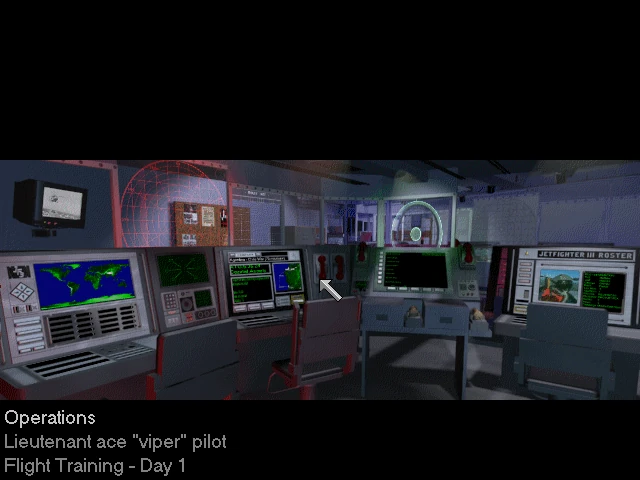
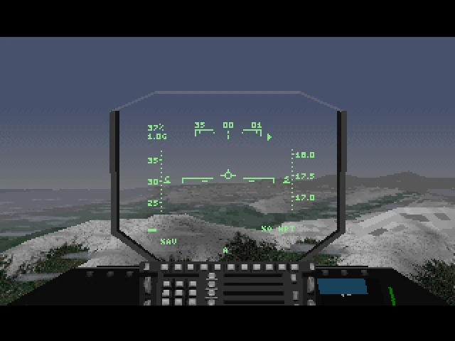
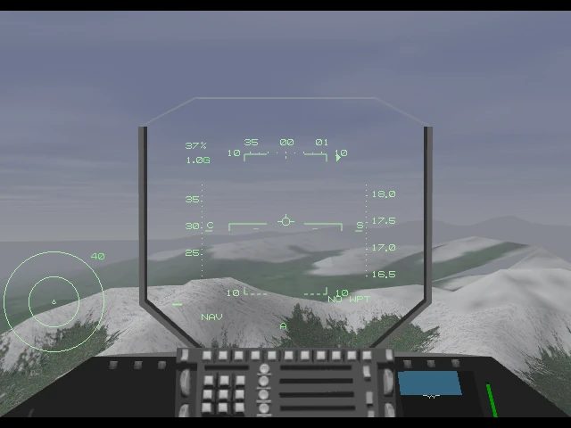
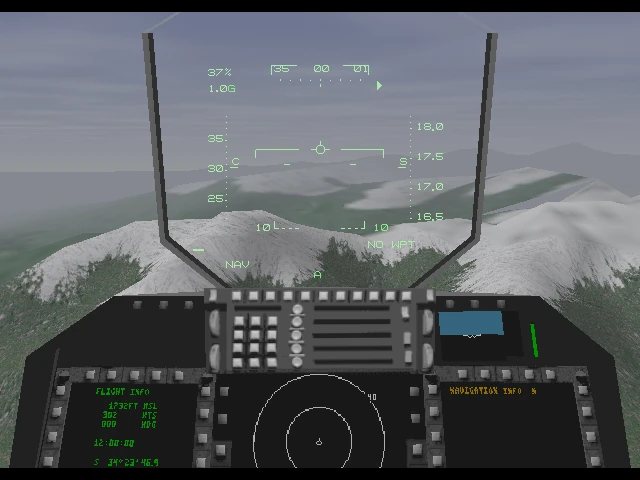
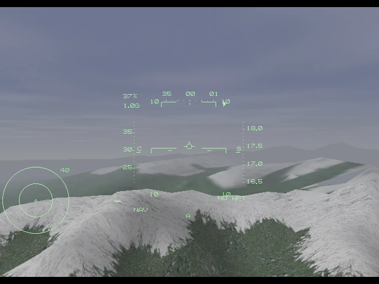
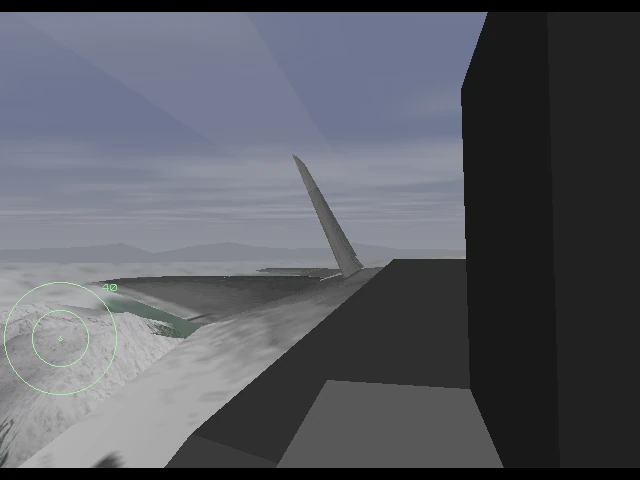

# JetFighter III: Platinum (1997 — 3dfx DOS)

| Field | Value |
| :--- | :--- |
| **Category** | Commercial Game |
| **Year** | 1996 (3dfx Platinum Edition: 1997 · Update 3: July 1998) |
| **Platform(s)** | `DOS/32 (GLIDE2X.OVL via DOSBox Glide pass-through)` |
| **Glide API & Version** | Glide 2.x (`2.56` on Voodoo2 / `2.48` on Voodoo Graphics) |
| **Recommended Card Profile** | `Voodoo2` (default) · `VoodooGraphics` (authentic SST-1) |
| **Verified Backends** | Vulkan · OpenGL ES · Software (AVX2 / AVX-512 / Scalar) |
| **Preset File(s)** | [`glide-ng.ini`](./glide-ng.ini) (Voodoo2) · [`glide-ng.hq.ini`](./glide-ng.hq.ini) (`4× MSAA`) · [`glide-ng.voodoo1.ini`](./glide-ng.voodoo1.ini) (SST-1) · [`glide-ng.software.ini`](./glide-ng.software.ini) (CPU Software) |
| **Status** | Verified |

---

## Overview

Mission Studios' carrier-based combat flight simulator *JetFighter III: Platinum Edition* pairs a 2D VGA point-and-click USS *Constellation* deck & Operations Room launcher (`JF3.EXE`) with the **`JF3X.EXE`** 3D flight engine. With the **Update 3** 3dfx patch (`JF3UPDT3.TXT`, July 1998), **`JF3X.EXE`** dynamically loads **`GLIDE2X.OVL`** to render the Andes mountains, ocean, sky gradient, `ALPHA_8` volumetric overcast cloud decks, and an interactive F/A-22N glass cockpit at **`640×480`**.

Compared with the native DOS software renderer (`320×200` unfiltered terrain and blocky pixelated cockpit HUD lettering), the 3dfx Glide path doubles both vertical and horizontal resolution to crisp `640×480`, enables smooth bilinear-filtered mountain/forest textures, distance-faded haze horizons, layered translucent cloud sheets, crisp antialiasing-friendly green HUD overlays, and legible dual multifunction displays (`FLIGHT INFO` & `NAVIGATION INFO`).

---

## Editions, Patches & Executables

| Executable / Patch | Renderer | Works with `glide-ng`? | Technical Notes |
| :--- | :--- | :---: | :--- |
| **`JF3X.EXE` (Update 3, Jul 1998)** | Glide 2.x (`GLIDE2X.OVL`) | **Yes (Recommended)** | Platinum Edition 3dfx engine (`3,927,139` B). Dynamically loads **`GLIDE2X.OVL`** when `3Dfx Voodoo card` is enabled via `INSTALL.EXE`. Pair with `glide-ng`'s clean-room `build/dos/glide2x.ovl`. |
| **`JF3.EXE` (Stub Launcher)** | DOS VGA / launches `JF3X.EXE` | **Yes** | Front-end launcher (`16,948` B) presenting the USS *Constellation* Operations Room, pilot roster, mission planner, and briefing before invoking `JF3X.EXE` with `JF3X10.DAT`. |
| **`INSTALL.EXE` (Setup Utility)** | DOS VGA | Setup tool | Interactive configurator (`159,496` B) for **`2 - SETUP 3D CARD`**, **`3 - SETUP SOUNDS`**, **`4 - SETUP MUSIC`**, and **`5 - SETUP JOYSTICK`**. Saves settings to `JF3.CFG` (`1,108` B). |
| **`JF3X.EXE` (Software setting)** | DOS CPU Software (`320×200` VGA) | No (No 3dfx) | Same binary toggled back to software mode in `INSTALL.EXE` (`2 - SETUP 3D CARD`). Blocky `320×200` unfiltered terrain, useful for visual comparison. |

---

## Recommended DOSBox Configurations

Keep the DOSBox configuration minimal — only non-default overrides are shown below.

> **Important Configuration Notes:**
> 1. Run **`INSTALL.EXE`** once before flying: select **`2 - SETUP 3D CARD`** → **`3Dfx Voodoo card`**, **`3 - SETUP SOUNDS`** → **`Sound Blaster 16`** (`IRQ 7`, `DMA 1/5`, `220h`), **`4 - SETUP MUSIC`**, and exit with **`7 - EXIT AND SAVE`** to write `JF3.CFG`.
> 2. Copy `glide-ng`'s clean-room HLE pass-through **`GLIDE2X.OVL`** (`build/dos/glide2x.ovl`) into the installed `JF3` directory alongside `JF3X.EXE`.
> 3. Overlay the **Update 3** (`JF3UPDT3`) files (`JF3X.EXE`, `INSTALL.EXE`, `STARTUP.EXE`, `CAMPAIGN/`, `RESOURCE/`, `SIMDATA/`) over the Platinum disc installation to add Voodoo2 / Voodoo Rush compatibility and in-sim music.
> 4. Mount the Platinum CD-ROM image as **`D:`** (`-t iso`) with **`[dosbox] memsize = 63`**.

### Option A: Patched DOSBox-SVN (Glide Pass-Through → `glide-ng`) *(Recommended)*

```ini
# dosbox-svn.conf (minimal overrides)
[dosbox]
memsize = 63

[sdl]
# Avoids SDL_UpdateRects SIGSEGV under sdl12-compat on modern Linux
output = opengl

[cpu]
cycles = max

[glide]
glide = true
```

```bash
GLIDE_NG_CONFIG=/path/to/glide-ng.ini \
  dosbox -conf dosbox-svn.conf \
  -c "mount C /path/to/jf3/game -freesize 512" \
  -c "imgmount D /path/to/JF3PLATINUM.iso -t iso" \
  -c "C:" \
  -c "JF3.EXE"
```

### Option B: DOSBox-X (Glide Pass-Through → `glide-ng`)

```ini
# dosbox-x-pass.conf (minimal overrides)
[dosbox]
memsize = 63

[cpu]
cycles = max

[voodoo]
glide = true
lfb = full
```

```bash
GLIDE_NG_CONFIG=/path/to/glide-ng.ini \
  dosbox-x -conf dosbox-x-pass.conf -nopromptfolder \
  -c "mount C /path/to/jf3/game -freesize 512" \
  -c "imgmount D /path/to/JF3PLATINUM.iso -t iso" \
  -c "C:" \
  -c "JF3.EXE"
```

### Option C: CPU Software Fallback (`glide-ng.software.ini`)

```bash
GLIDE_NG_CONFIG=/path/to/glide-ng.software.ini \
  dosbox -conf dosbox-svn.conf \
  -c "mount C /path/to/jf3/game -freesize 512" \
  -c "imgmount D /path/to/JF3PLATINUM.iso -t iso" \
  -c "C:" \
  -c "JF3.EXE"
```

### Reference Comparison: DOSBox-X Software Voodoo (No `glide-ng`)

```ini
# dosbox-x-sw.conf
[dosbox]
memsize = 63

[cpu]
cycles = max

[voodoo]
voodoo_card = software
glide = false
```

Replace the pass-through `GLIDE2X.OVL` with a real SST-1 **Glide 2.43** `GLIDE2X.OVL`.

---

## Visual Progression Gallery

All captures below show *JetFighter III: Platinum* (`Update 3`, Free Flight over the Andes) under patched DOSBox-SVN at `640×480` (software `320×200` upscaled for comparison):

| | |
| :---: | :---: |
| <br>**1. USS *Constellation* Operations (`JF3.EXE`)**<br>Interactive deck navigation hub leading to pilot roster, tactical radar screens, briefings, and Free Flight mission launcher (`O` → `F`). | <br>**2. Native DOS Software (`JF3X.EXE`, `320×200` VGA)**<br>Forward F/A-22N HUD view using the built-in CPU renderer: coarse unfiltered terrain blocks, flat haze sky band, and jagged HUD characters. |
| <br>**3. 3dfx Glide (`Vulkan 4× MSAA`, `640×480`)**<br>Clean slate-blue sky dome, wispy overcast `ALPHA_8` cloud strata, bilinear-filtered snow-capped Andes peaks, smooth distant fog band, and anti-aliased HUD glass. | <br>**4. 3dfx Glide (`OpenGL ES 1×`, `640×480`)**<br>Full glass cockpit frame showcasing both illuminated lower multifunction displays (`FLIGHT INFO` and `NAVIGATION INFO`), central radar ring, and UFC keypad buttons. |
| <br>**5. HUD-Only Panoramic View (`P` · `Vulkan 1×`)**<br>Cockpit framing toggled off (`P`), exposing uninterrupted terrain shading across forested valleys, snow peaks, and the semi-transparent cloud deck. | <br>**6. Rear Stabilizer Look-Back (`F4` · `Vulkan 1×`)**<br>Over-the-shoulder look-back over the starboard canted vertical tail fin and translucent wing plane against the alpine horizon. |

---

## Visual Quality & Performance Tuning

### Recommended Settings & Backends
* **`glide-ng.hq.ini` (`4× MSAA`, `no_dither_sub = true`) is clean and recommended:** Unlike Build Engine 3dfx titles, `JF3X.EXE` draws full 3D polygons cleanly with zero MSAA halo artifacts across the sky dome, translucent cloud planes, green HUD vector ladder, and radar rings. Enabling **`msaa = 4`** on Vulkan (or **`aa = ssaa`** on the CPU Software backend) smooths the angled HUD combiner struts, aircraft tail geometry, and horizon seams.
* **Gamma calibration:** Linear **`gamma = 1.0`** preserves natural overcast cloud contrast and bright green HUD legibility; avoid high SST-1 gamma overrides (`1.7`) which wash out the snow-capped Andes slopes.
* **Software `1×` horizon line:** Under `software` backend `1×` (`aa = none`), a thin horizontal edge pixel seam can occasionally appear along the distant left/right horizon edge when pitching; enabling **`aa = ssaa`** (`2×2` supersampling) or running Vulkan / OpenGL ES eliminates it.

### Performance Notes
* **Direct 3D sim fast-start:** Launching a sortie from `JF3.EXE` saves mission parameters to **`JF3X10.DAT`**. While a valid `JF3X10.DAT` exists in the game folder, executing **`JF3X.EXE`** directly skips the 2D deck menus and jumps right into the previous flight.
* **CD-ROM image conversion:** If starting from an Alcohol 120% `.mdf`/`.mds` disc image (`JF3PLATINUM.mdf`), convert track 1 to standard ISO (`mdf2iso JF3PLATINUM.mdf JF3PLATINUM.iso`) before mounting with DOSBox `imgmount`.

---

## Quirks, Known Issues & Controls

### Installation & Engine Notes
* **First-boot welcome emails:** After creating a pilot in the Roster (`JF3.EXE`), press **`Esc`** to dismiss each of the two welcome emails from Commander Davenport and Commander Holden Kohl before entering the carrier corridor.
* **Audio initialization:** Use **`INSTALL.EXE`** → **`3 - SETUP SOUNDS`** and **`4 - SETUP MUSIC`** to pick **`Sound Blaster 16`** matching DOSBox's `SET BLASTER=A220 I7 D1 H5 T6` defaults.
* **Wheel brakes engaged on takeoff:** Update 3 enables wheel brakes automatically when starting on the carrier deck or runway — press **`B`** to release brakes before applying throttle.
* **Startup splash:** Uncomment `no_splash = true` in `glide-ng.ini` (or pass `FX_GLIDE_NO_SPLASH=1` / `GLIDE_NG_NO_SPLASH=1`) to skip the one-shot startup splash animation.

### Useful Controls

| Key | Action |
| :--- | :--- |
| **`O` / `F`** *(in `JF3.EXE`)* | Jump to Operations room / open Free Flight screen |
| **`Esc`** *(in `JF3.EXE`)* | Dismiss welcome emails / back out of console screen |
| **`F1` / `F2` / `F3` / `F4`** | Cockpit forward / look right / look left / look rear tail |
| **`F5` / `F7` / `F8`** | Tactical view / zoom right MFD / zoom lower center MFD |
| **`P`** | Toggle cockpit frame on/off (HUD-only view) |
| **`B` / `G` / `Shift+G`** | Toggle wheel brakes / landing gear |
| **`+` / `-` or `0`–`9`** | Throttle control |
| **Arrow keys** | Pitch / roll flight controls |
| **`Esc` / `Q`** | Exit sortie / confirm return to carrier |
