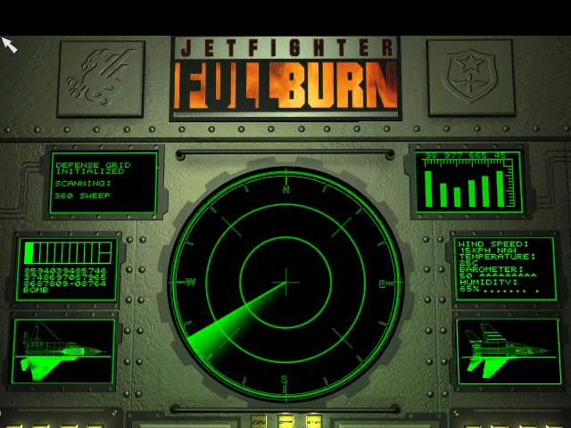
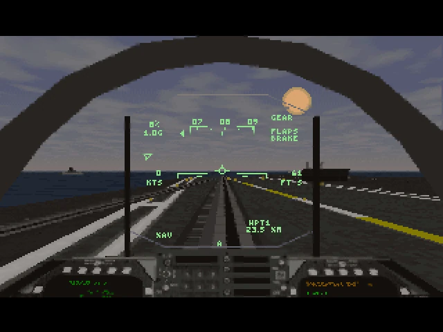
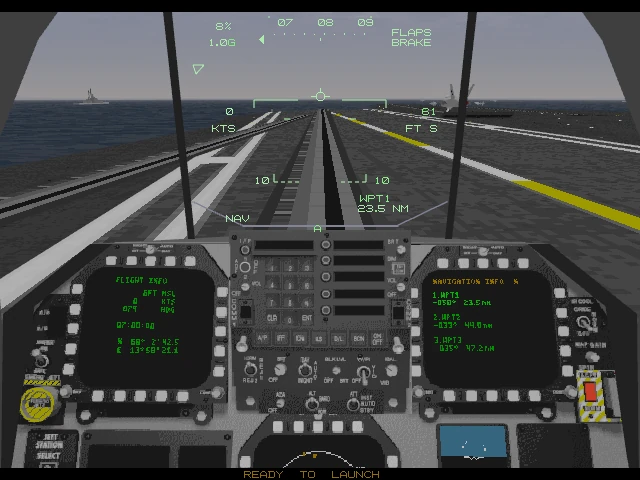
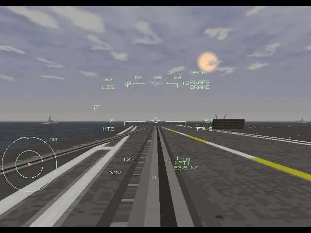
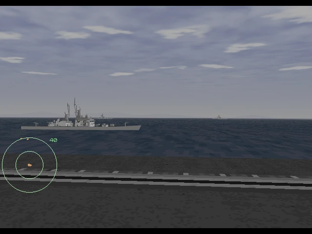
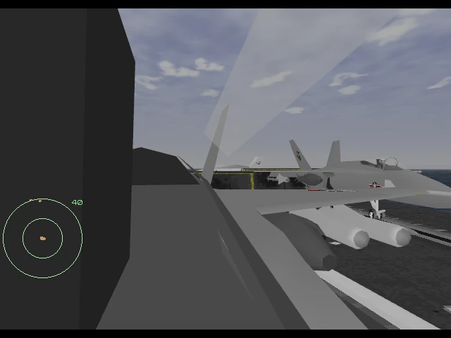

# JetFighter: Full Burn (1998 — 3dfx DOS)

| Field | Value |
| :--- | :--- |
| **Category** | Commercial Game |
| **Year** | 1998 (Update #1 / v1.27: July 1998) |
| **Platform(s)** | `DOS/32 (GLIDE2X.OVL via DOSBox Glide pass-through)` |
| **Glide API & Version** | Glide 2.x (`2.56` on Voodoo2 / `2.48` on Voodoo Graphics) |
| **Recommended Card Profile** | `Voodoo2` (default) · `VoodooGraphics` (authentic SST-1) |
| **Verified Backends** | Vulkan · OpenGL ES · Software (AVX2 / AVX-512 / Scalar) |
| **Preset File(s)** | [`glide-ng.ini`](./glide-ng.ini) (Voodoo2) · [`glide-ng.hq.ini`](./glide-ng.hq.ini) (`4× MSAA`) · [`glide-ng.voodoo1.ini`](./glide-ng.voodoo1.ini) (SST-1) · [`glide-ng.software.ini`](./glide-ng.software.ini) (CPU Software) |
| **Status** | Verified |

---

## Overview

Mission Studios' 1998 standalone four-disc flight simulator *JetFighter: Full Burn* upgrades the *JetFighter III* engine with higher-detail F/A-22N glass cockpits, photorealistic switch bezels, blended soft sun discs, multi-layer broken `ALPHA_8` cloud decks, Arctic naval carrier battle groups, and dynamic NATO/Russian campaigns across northern Norway and Russia.

When patched with **Update #1 (`fullburnupdate1.exe`, v1.27)** and paired with **`GLIDE2X.OVL`**, the simulator engine (`JFFBX.DAT`, spawned via `FB.EXE`) runs at `640×480` via dynamic **Glide 2.x**. Compared with the native DOS `320×200` software renderer, Glide delivers crisp legible dual multifunction displays (`FLIGHT INFO` & `NAVIGATION INFO`), smooth horizon haze, bilinear-filtered Arctic cloud/sun discs, sharper carrier flight deck catapult markings, and transparent anti-aliased canopy reflections.

---

## Editions, Patches & Executables

| Executable / Patch | Renderer | Works with `glide-ng`? | Technical Notes |
| :--- | :--- | :---: | :--- |
| **`FB.EXE` → `JFFB.DAT` / `JFFBX.DAT` (v1.27, Update #1)** | Glide 2.x (`GLIDE2X.OVL`) | **Yes (Recommended)** | Official Update #1 (`fullburnupdate1.exe`, July 1998) patches Voodoo2 / Voodoo Rush rendering (`JFFB.DAT` `1,162,307` B menu front-end; `JFFBX.DAT` `3,942,263` B 3D sim engine — both standard DOS/4GW `MZ` executables spawned by `FB.EXE` `17,230` B). Pair with `glide-ng`'s clean-room `build/dos/glide2x.ovl`. |
| **`INSTALL.EXE` (Setup Utility)** | DOS VGA | Setup tool | Interactive configurator (`353,060` B) supporting **`2 - SETUP 3D CARD`** (`Any 3Dfx Compatible Board` / Voodoo2 entries), **`3 - SETUP SOUNDS`**, **`4 - SETUP MUSIC`**, and **`5 - SETUP JOYSTICK`**. Writes settings to `JF3.CFG` (`1,108` B). |
| **`JFFBX.DAT` (Software setting)** | DOS CPU Software (`320×200` VGA) | No (No 3dfx) | Same binary with `No 3Dfx accelerator card` chosen in `INSTALL.EXE`. Renders coarse `320×200` terrain, jagged disc sun, and low-resolution cockpit lettering. |

---

## Recommended DOSBox Configurations

Keep the DOSBox configuration minimal — only non-default overrides are shown below.

> **Important Configuration Notes:**
> 1. **Scenery tiles & `FULLBURN.INI`:** Extract the campaign scenery folders (`E000N60`–`E035N65` from Disc 1) into the **`C:`** game directory (otherwise `JFFBX` exits with `OUTSIDE GAMING AREA BOUNDARIES`). Ensure **`FULLBURN.INI`** defines `[PATHS]` pointing `scene`, `sound`, and `maps` to `D:\x\...` and `script`, `campaigns`, `interface`, `missions` to `C:\...`, with writable `USER\` and `SAVE\` subdirectories.
> 2. **Run `INSTALL.EXE` once:** Select **`2 - SETUP 3D CARD`** → **`Any 3Dfx Compatible Board`**, **`3 - SETUP SOUNDS`** → **`Sound Blaster 16`** (`220h`, `IRQ 7`, `DMA 1`), and save with **`7 - EXIT AND SAVE`** (`JF3.CFG`).
> 3. **Apply `GLIDE2X.OVL`:** Copy `glide-ng`'s clean-room HLE pass-through **`GLIDE2X.OVL`** (`build/dos/glide2x.ovl`) next to `FB.EXE` and `JFFBX.DAT`.
> 4. **Apply Update #1 (`fullburnupdate1.exe`):** Standard WinZip self-extractor (`unzip -o`) updating `JFFB.DAT`, `JFFBX.DAT`, `CAMPAIGN/30–33.CMP`, `CAMPAIGN/DATA.INI`, `SCRIPTS/JFFB.AEX`, and `README.TXT`.
> 5. **Raw Alcohol 120% (`.mdf`/`.mds`) images:** The 4-disc images use **2448-byte raw sectors** (`2352` Mode 2/XA + `96` subchannel, `24`-byte sector header). Note that `mdf2iso` only skips `16` header bytes on some raw Mode 2 dumps (`CD001` shifted by 8 bytes); strip `24` header bytes per `2448`-byte sector when building ISO-9660 `.iso` files for DOSBox `imgmount`.

### Option A: Patched DOSBox-SVN (Glide Pass-Through → `glide-ng`) *(Recommended)*

```ini
# dosbox-svn.conf (minimal overrides)
[dosbox]
memsize = 63

[sdl]
# Avoids SDL_UpdateRects SIGSEGV under sdl12-compat on modern Linux
output = opengl

[cpu]
cycles = max

[glide]
glide = true
```

```bash
GLIDE_NG_CONFIG=/path/to/glide-ng.ini \
  dosbox -conf dosbox-svn.conf \
  -c "mount C /path/to/jffb/game -freesize 512" \
  -c "imgmount D /path/to/FULLBURN1.iso -t iso" \
  -c "C:" \
  -c "FB.EXE"
```

### Option B: DOSBox-X (Glide Pass-Through → `glide-ng`)

```ini
# dosbox-x-pass.conf (minimal overrides)
[dosbox]
memsize = 63

[cpu]
cycles = max

[voodoo]
glide = true
lfb = full
```

```bash
GLIDE_NG_CONFIG=/path/to/glide-ng.ini \
  dosbox-x -conf dosbox-x-pass.conf -nopromptfolder \
  -c "mount C /path/to/jffb/game -freesize 512" \
  -c "imgmount D /path/to/FULLBURN1.iso -t iso" \
  -c "C:" \
  -c "FB.EXE"
```

### Option C: CPU Software Fallback (`glide-ng.software.ini`)

```bash
GLIDE_NG_CONFIG=/path/to/glide-ng.software.ini \
  dosbox -conf dosbox-svn.conf \
  -c "mount C /path/to/jffb/game -freesize 512" \
  -c "imgmount D /path/to/FULLBURN1.iso -t iso" \
  -c "C:" \
  -c "FB.EXE"
```

### Reference Comparison: DOSBox-X Software Voodoo (No `glide-ng`)

```ini
# dosbox-x-sw.conf
[dosbox]
memsize = 63

[cpu]
cycles = max

[voodoo]
voodoo_card = software
glide = false
```

Replace the pass-through `GLIDE2X.OVL` with a real SST-1 **Glide 2.43** `GLIDE2X.OVL`.

---

## Visual Progression Gallery

All captures below show *JetFighter: Full Burn* (`v1.27`, Mission `M31_01T` — carrier catapult patrol off Bodø, Norway) under patched DOSBox-SVN at `640×480` (software `320×200` upscaled for comparison):

| | |
| :---: | :---: |
| <br>**1. Defense Grid Radar Console (`FB.EXE`)**<br>Opening tactical 2D VESA console with live 360° phosphor-green radar sweep, weather readout, and F/A-22N / MiG-29 wireframes. | <br>**2. Native DOS Software (`320×200` VGA)**<br>Same carrier catapult launch using the built-in CPU renderer: coarse pixels across the flight deck stripes, blocky solid sun disc, and unreadable lower MFD characters. |
| <br>**3. 3dfx Glide (`Vulkan 4× MSAA`, `640×480`)**<br>Upgraded photorealistic glass cockpit on catapult **`READY TO LAUNCH`**: sharp `FLIGHT INFO` & `NAVIGATION INFO` MFDs, anti-aliased HUD glass, escort cruiser, and parked wingman. | <br>**4. HUD-Only Launch (`OpenGL ES 1×`, `640×480`)**<br>Cockpit framing toggled off (`P`) showcasing the feathered warm sun shining softly behind translucent `ALPHA_8` cloud decks above the Arctic sea. |
| <br>**5. Battle Group Escorts (`F2` · `Vulkan 4× MSAA`)**<br>Port look showing three escorted cruisers/destroyers against distant fog-faded Norwegian coastal silhouettes and soft sky cloud strata. | <br>**6. Rear Deck Look-Back (`F4` · `Vulkan 4× MSAA`)**<br>Over-the-shoulder view through the translucent canopy glass showing an armed neighboring F/A-22N fighter with underwing drop tanks and missiles. |

---

## Visual Quality & Performance Tuning

### Recommended Settings & Backends
* **`glide-ng.hq.ini` (`4× MSAA`, `no_dither_sub = true`) is clean and recommended:** Smooths cockpit canopy frame arcs, carrier catapult stripe diagonals, distant naval ship rigging, and diagonal HUD ladder struts with zero ghosting or artifacts across Vulkan, OpenGL ES, and Software (`2×2 SSAA`).
* **Gamma calibration:** Linear **`gamma = 1.0`** preserves crisp deep Arctic water hues, warm feathered sun shading, and bright neon green/amber MFD text.

### Multi-Disc Setup
* *JetFighter: Full Burn* spans **4 CDs** covering separate mission theaters (Norway/Russia, Western Europe, Middle East/Balkans, and multiplayer/additional campaigns). Disc 1 (`FULLBURN1`) includes the **`E000N60`–`E035N65`** Scandinavia/Arctic scenery used by `M30_*` and `M31_*` missions (`Ctrl+F4` swaps images in DOSBox when `imgmount` lists multiple ISOs).

---

## Quirks, Known Issues & Controls

### Installation & Engine Notes
* **Executable file naming:** `JFFB.DAT` (menu) and `JFFBX.DAT` (3D flight sim) are standard DOS/4GW `MZ` executables renamed to `.DAT` on disc and spawned by the `FB.EXE` loader. When testing single missions directly from a DOS prompt, copy a mission `MISSION\M31_01T.DAT` → `JF3X10.DAT` and copy `JFFBX.DAT` → `JFFBX.EXE`.
* **Sound Blaster 16 IRQ check:** DOSBox defaults to `SET BLASTER=A220 I7 D1 H5 T6`; configure `INSTALL.EXE` to match **`IRQ 7`** and **`DMA 1`** (`0x220`).
* **Carrier launch brakes:** Wheel brakes (`BRAKE` illuminated on HUD) start engaged on deck — press **`B`** to release before advancing throttle (`+`/`9`) for catapult launch.
* **Startup splash:** Uncomment `no_splash = true` in `glide-ng.ini` (or pass `FX_GLIDE_NO_SPLASH=1` / `GLIDE_NG_NO_SPLASH=1`) to skip the one-shot startup splash animation.

### Useful Controls

| Key | Action |
| :--- | :--- |
| **`F1` / `F2` / `F3` / `F4`** | Forward cockpit / look port/starboard / rear look-back |
| **`F5` / `F7` / `F8`** | Tactical view / right MFD close-up / lower center console |
| **`P`** | Toggle cockpit frame on/off (HUD-only view) |
| **`B` / `G` / `Shift+G`** | Toggle wheel brakes / landing gear |
| **`+` / `-` or `0`–`9`** | Throttle control |
| **Arrow keys** | Pitch / roll flight controls |
| **`Esc` / `Q`** | Exit sortie / return to radar menu |
