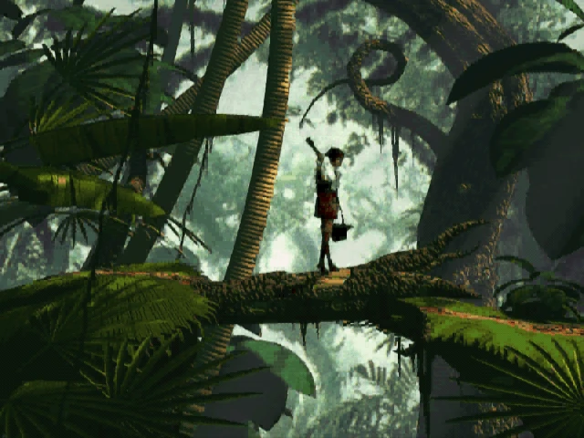
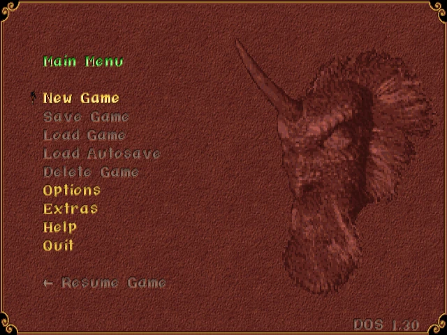
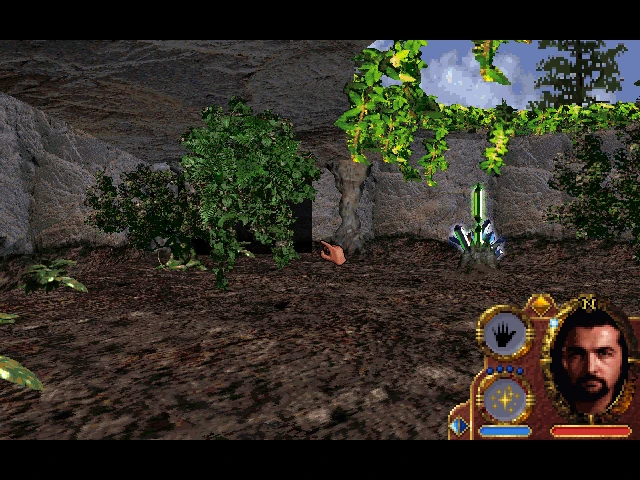
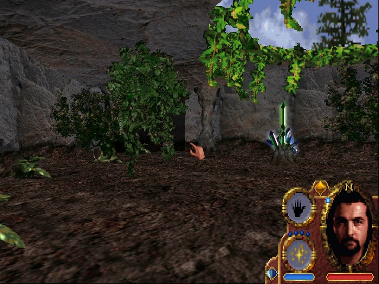
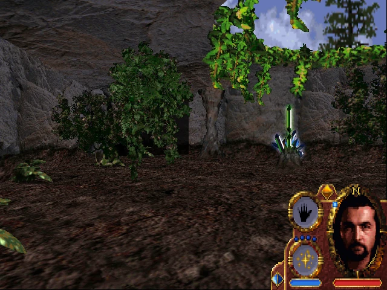
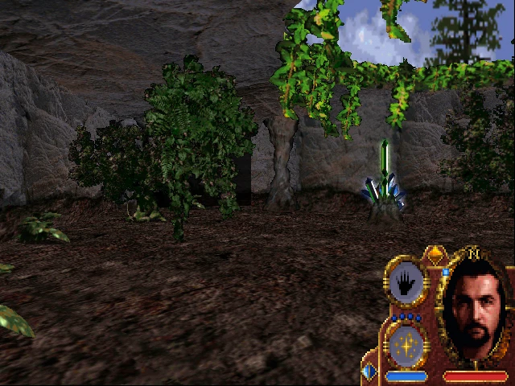
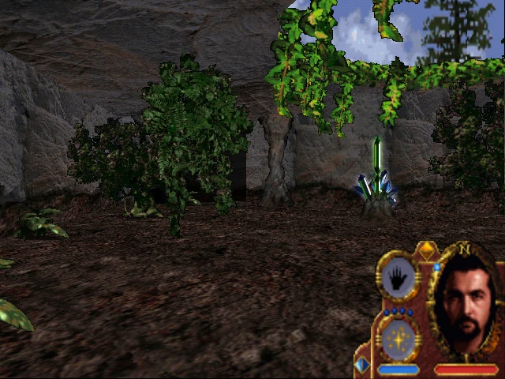
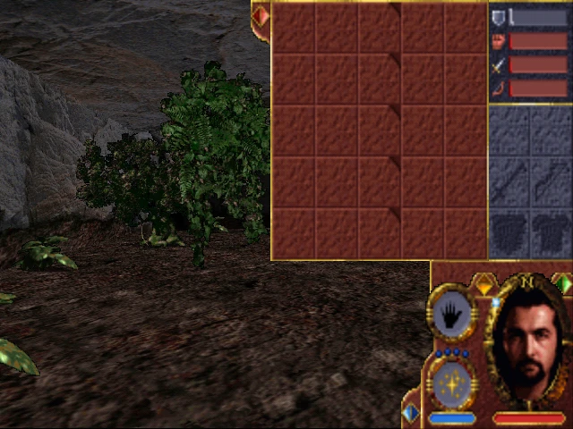

# Lands of Lore: Guardians of Destiny (1997 — DOS 3dfx)

| Field | Value |
| :--- | :--- |
| **Category** | Commercial Game |
| **Year** | 1997 |
| **Platform(s)** | `DOS/32 (GLIDE2X.OVL via DOSBox Glide pass-through)` |
| **Glide API & Version** | Glide 2.x (`2.48` on Voodoo Graphics / `2.56` on Voodoo2; v1.30e patch) |
| **Recommended Card Profile** | `VoodooGraphics` (default) · `Voodoo2` (optional / `4× MSAA` HQ) |
| **Verified Backends** | Vulkan · OpenGL ES · Software (AVX2 / AVX-512 / Scalar) |
| **Preset File(s)** | [`glide-ng.ini`](./glide-ng.ini) (Voodoo1 SST-1) · [`glide-ng.hq.ini`](./glide-ng.hq.ini) (Voodoo2 + 4× MSAA + Linear) · [`glide-ng.voodoo2.ini`](./glide-ng.voodoo2.ini) (Voodoo2) · [`glide-ng.software.ini`](./glide-ng.software.ini) (CPU Software) |
| **Status** | Verified |

---

## Overview

Westwood Studios' 1997 first-person action RPG *Lands of Lore: Guardians of Destiny* (*Lands of Lore II*) gained hardware 3D acceleration via the official **v1.30e patch (`LL2-130E.EXE`)**. The DOS engine (`LOLG.EXE` → `LOLG.DAT`) dynamically loads `GLIDE2X.OVL` (Glide 2.x), lifting rendering from letterboxed `640×400` 256-color software to **full-height `640×480×16`** with smooth bilinear texture filtering, crisp translucent foliage/crystals, live `.VQA` full-motion video compositing, and 24-bit color precision (`no_dither_sub = true`).

Technically, *Lands of Lore: Guardians of Destiny* emits **textured `grDrawLine` seam-filler edges** along every shared polygon boundary inside its terrain/cavern mesh using active TMU0/CCU combiners to hide subpixel rasterization T-junctions on original SST-1 hardware. Both `glide-ng`'s GPU (`Vulkan` / `OpenGL ES`) and CPU `Software` line pipelines execute the complete TMU + Color/Alpha combiner stage across `grDrawLine` and `grDrawPoint`, eliminating solid-white wireframe seams on the Software backend and achieving pixel-exact parity with authentic 1997 SST-1 emulation.

---

## Editions, Patches & Executables

Only the patched **DOS executable (`LOLG.EXE` + `LOLG.DAT` v1.30e)** uses 3dfx Glide. The companion **Windows 95 executable (`LOLG95.EXE`)** imports `DDRAW.dll` only (DirectDraw / Direct3D 3.0) and has no Glide support.

| Executable / Patch | Renderer | Works with `glide-ng`? | Technical Notes |
| :--- | :--- | :---: | :--- |
| **`LOLG.EXE` + `LOLG.DAT` v1.30e** *(DOS 3dfx patch)* | Glide 2.x (`GLIDE2X.OVL`) | **Yes (Recommended)** | Official patch adds `3Dfx` hardware acceleration (`[Acceleration]` section in `OPTIONS.INI`). Pair with the 32 MB DOS/4GW virtual-memory stub (`VirtualSize:32M` vs. stock `24M`) and `glide-ng`'s clean-room `build/dos/glide2x.ovl`. |
| **`LOLG.EXE` v1.30e** *(`Acceleration_Toggle=Off`)* | DOS 8-bit Software (`640×400` VGA/VESA) | No (Software comparison) | Letterboxed 256-color software renderer; noticeably noisier pixelation and sky quantization compared with 3dfx Glide `640×480×16`. |
| **`LOLG.EXE` v1.06** *(Unpatched retail CD)* | DOS 8-bit Software | No (Requires v1.30e) | Retail disc release predates Glide support. Apply the `1.30e` update (`LOLG.DAT`, `OPTTEXT.TRR`, `CREDITS.TRR`, `WOMS\`). |
| **`LOLG95.EXE` v1.30e** *(Windows 95)* | DirectDraw / Direct3D 3.0 (`DDRAW.dll`) | **No (No Glide support)** | Uses legacy `P8` palettized DirectDraw surfaces that display as solid whitewashed output under Wine 10.0 `wined3d` (`glsl_blitter_upload_palette: P8 texture loaded without a palette`). Use the DOS **`LOLG.EXE`** build for both visual quality and reliability. |

---

## Recommended DOSBox Configurations

Keep the DOSBox configuration minimal — only non-default overrides are shown below.

> **Set `[dosbox] memsize = 63`:**
> `LOLG.EXE` allocates large in-memory `.MIX` / `CDCACHE.MIX` caches and patched DOS/4GW virtual swap space (`32M`). Setting `memsize = 63` ensures smooth loading and prevents out-of-memory stalls with high-resolution textures enabled (`Video_Texture_Resolution=High`, `Video_Texture_Cache=Large`).

The launch commands below assume `glide-ng`'s `libglide2x.so` is installed system-wide (if running directly from a local build directory instead of a system package, prepend `LD_LIBRARY_PATH=/path/to/glide-ng/lib`; see [Building & Installing](../../../user-guide/building-and-installing.md)). Copy the clean-room `build/dos/glide2x.ovl` into `C:\WESTWOOD\LOLG\GLIDE2X.OVL`.

### Option A: Patched DOSBox-SVN (Glide Pass-Through → `glide-ng`) *(Recommended)*

```ini
# dosbox-svn.conf (minimal overrides)
[dosbox]
memsize = 63

[sdl]
# Avoids SDL_UpdateRects crashes under sdl12-compat -> sdl2-compat on modern Linux
output = opengl

[cpu]
cycles = max

[glide]
glide = true
```

```bash
GLIDE_NG_CONFIG=/path/to/glide-ng.ini \
  dosbox -conf dosbox-svn.conf \
  -c "imgmount D /path/to/LOLG_CD1.iso /path/to/LOLG_CD2.iso /path/to/LOLG_CD3.iso /path/to/LOLG_CD4.iso -t iso" \
  -c "mount C /path/to/C_DRIVE" \
  -c "C:" \
  -c "cd WESTWOOD\\LOLG" \
  -c "LOLG.EXE"
```

*(DOSBox switches mounted CD images dynamically with `Ctrl+F4` when the campaign prompts for Discs 2, 3, or 4.)*

### Option B: DOSBox-X (Glide Pass-Through → `glide-ng`)

```ini
# dosbox-x-pass.conf (minimal overrides)
[dosbox]
memsize = 63

[cpu]
cycles = max

[voodoo]
glide = true
lfb = full
```

```bash
GLIDE_NG_CONFIG=/path/to/glide-ng.ini \
  dosbox-x -conf dosbox-x-pass.conf -nopromptfolder \
  -c "imgmount D /path/to/LOLG_CD1.iso /path/to/LOLG_CD2.iso /path/to/LOLG_CD3.iso /path/to/LOLG_CD4.iso -t iso" \
  -c "mount C /path/to/C_DRIVE" \
  -c "C:" \
  -c "cd WESTWOOD\\LOLG" \
  -c "LOLG.EXE"
```

### Option C: Best Visuals (`glide-ng.hq.ini`, `4× MSAA` + Linear + `no_dither_sub`)

Launch with [`glide-ng.hq.ini`](./glide-ng.hq.ini) (`msaa = 4`, `presentation_filter = linear`, `no_dither_sub = true`) on hardware Vulkan or OpenGL ES GPUs, and ensure `OPTIONS.INI` sets `Video_Texture_Resolution=High`, `Video_Texture_Cache=Large`, and `Acceleration_Filtering=On`:

```bash
GLIDE_NG_CONFIG=/path/to/glide-ng.hq.ini \
  dosbox -conf dosbox-svn.conf \
  -c "imgmount D /path/to/LOLG_CD1.iso -t iso" \
  -c "mount C /path/to/C_DRIVE" \
  -c "C:" \
  -c "cd WESTWOOD\\LOLG" \
  -c "LOLG.EXE"
```

*(On CPU-only hosts, substitute [`glide-ng.software.ini`](./glide-ng.software.ini); optionally uncomment `aa = ssaa` for `2×2` supersampled edges.)*

### Reference Comparison: DOSBox-X Software Voodoo (No `glide-ng`)

Comparing against DOSBox-X's built-in low-level SST-1 software emulator requires swapping in a genuine SST-1 `GLIDE2X.OVL` (`2.42+`):

```ini
# dosbox-x-sw.conf
[dosbox]
memsize = 63

[cpu]
cycles = max

[voodoo]
voodoo_card = software
glide = false
```

---

## Visual Progression Gallery

All captures below depict `LOLG.EXE` (`DOS 1.30`) at the opening Dracoid Cave / Huline Jungle clearing (`CD1`), captured natively at `640×480`:

| | |
| :---: | :---: |
| <br>**1. Opening `.VQA` FMV Playback (`glide-ng` Vulkan)**<br>Luther running across the jungle canopy bridge — direct `grLfbLock` video compositing with `Acceleration_VGA_Movies=No` plays cleanly without switching host display modes. | <br>**2. Main Menu (`DOS 1.30`, `glide-ng` Vulkan)**<br>Crisp parchment-textured title UI and embossed Belial relief showing the patched `DOS 1.30` indicator in the lower-right corner. |
| <br>**3. DOS 8-bit Software (`Acceleration_Toggle=Off`, `640×400`)**<br>Unfiltered 256-color software renderer letterboxed with top/bottom black bars inside `640×480`; chunky rock and sky cloud textures and quantized foliage dithering. | <br>**4. Authentic SST-1 Reference (DOSBox-X Software Voodoo)**<br>Low-level hardware-register SST-1 emulation (cropped to `640×480`). Full-height frame with bilinear stone walls, alpha-cutout vines, crystal spire, and Luther's portrait HUD. |
| <br>**5. `glide-ng` Vulkan `1×` ([`glide-ng.ini`](./glide-ng.ini))**<br>Pixel-exact match to the authentic SST-1 reference across bilinear rock walls, translucent sky clouds, hanging ferns, dark cave tunnel behind the bush, and portrait HUD. | <br>**6. `glide-ng` Vulkan `4× MSAA` HQ ([`glide-ng.hq.ini`](./glide-ng.hq.ini))**<br>Best visuals: `4×` hardware MSAA + linear presentation filter + `no_dither_sub = true` eliminates dither noise across smooth cave ceiling shading while keeping the HUD crisp. |
| <br>**7. `glide-ng` OpenGL ES 3.2 (`backend = opengl_es`)**<br>Matches Vulkan and authentic SST-1 reference with zero foliage fringe or dark-square cutouts. | <br>**8. `glide-ng` CPU Software ([`glide-ng.software.ini`](./glide-ng.software.ini))**<br>Multi-threaded AVX2/AVX-512 rasterizer runs full TMU/CCU combiners on the engine's textured `grDrawLine` seam-fillers — eliminating white polygon-edge wireframes. |
| <br>**9. In-Game Inventory & Stats Panel (`I`)**<br>Clean 2D LFB overlay grid, live character gauges, and transparent border masking over the active 3D viewport. | <br>**10. `Use 4444 Color = Yes` Check (`OPTIONS.INI`)**<br>Visual verification confirming both `Acceleration_Use4444=No` (recommended default) and `Yes` render hanging vines and crystals identically with no black bounding boxes. |

---

## Visual Quality & Performance Tuning

### Flavour Comparison: DOS 3dfx Glide vs. DOS Software vs. Win95 D3D
* **DOS `LOLG.EXE` (Glide 2.x + [`glide-ng.hq.ini`](./glide-ng.hq.ini)) is the clear winner:** full `640×480×16` vertical aperture (no letterboxing), smooth bilinear-filtered cave rock and hanging foliage, crisp `.VQA` video compositing inside Glide, zero palettized shimmering, and `4×` hardware MSAA without sprite fringes.
* **DOS `LOLG.EXE` Software (`Acceleration_Toggle=Off`)** works reliably for comparison, but drops to letterboxed `640×400` 8-bit unfiltered pixels with visibly blocky distant trees and sky clouds.
* **Win95 `LOLG95.EXE` (Direct3D 3.0)** is not recommended under Wine 10.0 (`wined3d` exhibits broken palettized `P8` DirectDraw surface blits returning blank white output).

### Recommended `OPTIONS.INI` Settings (v1.30e)
Verify these entries inside `C:\WESTWOOD\LOLG\OPTIONS.INI` (CRLFs preserved):
```ini
[Video]
Video_Game_Resolution=High
Video_Movie_Resolution=High
Video_Viewport_Size=10
Video_Texture_Resolution=High
Video_Texture_Cache=Large
Video_Gamma_Correction=0
Video_Variable_Frame_Rate=No

[Acceleration]
Acceleration_Toggle=On
Acceleration_Card=Primary
Acceleration_Filtering=On
Acceleration_Use4444=No
Acceleration_VGA_Movies=No
Acceleration_VGA_Automap=No
```
* **Gamma:** `LOLG.DAT` invokes `grGammaCorrectionValue(0.95)` natively during startup and offers an in-game `Video_Gamma_Correction` slider (`0–10`); leave `gamma` unset in `glide-ng.ini`.
* **`Use 4444 Color` (`No` default):** Keeping `Acceleration_Use4444=No` preserves full color precision; both `No` and `Yes` render cleanly under `glide-ng` without black bounding squares around foliage or crystals.
* **`Switch Movie/Automap Display` (`No` default):** Leave both set to `No` so `glide-ng` handles `.VQA` movies and automap screens inline without closing/reopening the Glide display mode.

---

## Quirks, Known Issues & Controls

### Installation & Engine Notes
* **`LOLSETUP.INI` must use DOS `CRLF` (`\r\n`) line endings:** Hand-editing `LOLSETUP.INI` with Unix `LF` endings or overly long `DeviceName` strings can trigger a `DOS/4GW` page fault (`0Eh`) inside Westwood's INI reader. Standard Sound Blaster 16 (`0xE016`, `0x220`, IRQ `7`, DMA `1`) + OPL3 MIDI (`0xA002`, `0x388`) works directly inside DOSBox.
* **Patched `LOLG.EXE` 32 MB DOS/4GW stub:** The 2-byte upgraded `LOLG.EXE` stub raises `VirtualSize` from `24M` to `32M`, preventing disk swap churn during 3dfx texture uploads.
* **Unclean shutdown cache lock (`CDCACHE2.SMF`):** While running, the game holds an on-disk semaphore file `CDCACHE2.SMF` (`semiphore`). Always exit cleanly via **Main Menu → Quit**; if DOSBox is killed mid-session, delete `CDCACHE2.SMF` before relaunching so the game does not prompt to rebuild the `100 MB` `CDCACHE.MIX` archive (the launcher script clears any stale semaphore automatically only if not currently running).
* **Multi-CD `.ISO` swaps:** Pass all four disc images (`LOLG_CD1.iso` … `LOLG_CD4.iso`) to `imgmount D ... -t iso` and press **`Ctrl+F4`** inside DOSBox when prompted to swap discs.
* **Dark rectangle behind opening bush is intentional:** Inside the starting cavern clearing (`#3`–`#8`), the dark square directly behind the left fern is the shadowed entrance of the stone passageway — identical in DOS Software, authentic SST-1 emulation, and `glide-ng`.

### Useful Controls
* `Up` / `Down` — Move forward / backward · `Left` / `Right` — Turn · `Alt` + `Left`/`Right` — Strafe · `Q` / `Z` / `A` — Look up / down / center · `L` / `.` — Mouse look / toggle · `V` / Right-click — Toggle cursor/movement mode · `D` — Jump · `I` — Open inventory · `B` — Sack · `O` — Character body/stats · `M` — Spell book · `S` — Cast spell · **`F8`** — Quick auto-save · `H` — Help menu · **`K`** — Skip conversation · `Esc` — Main menu / Skip cutscene
