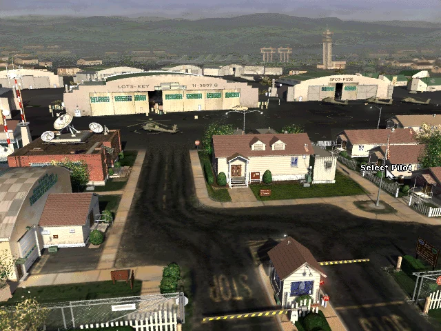
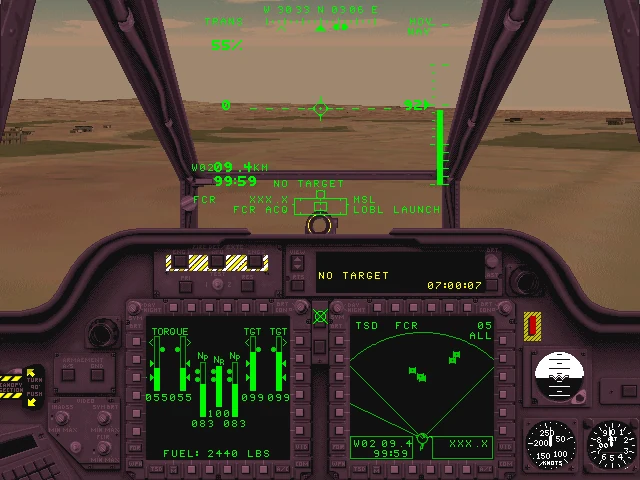
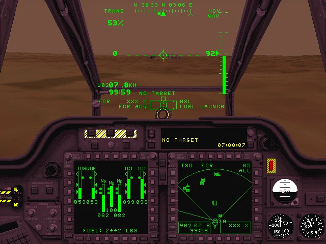
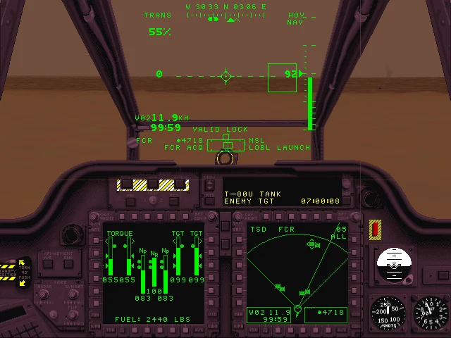
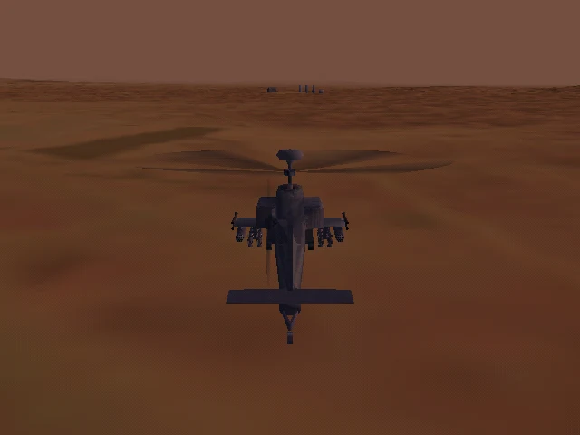
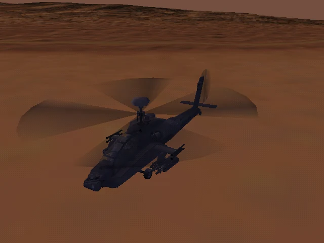

# Jane's Combat Simulations: Longbow 2 (1997 — Win32 3dfx Glide 2.x)

| Field | Value |
| :--- | :--- |
| **Category** | Commercial Game |
| **Year** | 1997 *(v2.09F patch: 1998)* |
| **Platform(s)** | `Win32 / Wine (glide2x.dll)` |
| **Glide API & Version** | **Glide 2.x (`glide2x.dll`, Voodoo2 `2.56` / Voodoo1 `2.48`)** |
| **Recommended Card Profile** | `Voodoo2` (`2.56`, default) · `VoodooGraphics` (`2.48`) |
| **Verified Backends** | Vulkan · OpenGL 3.3 Core (WGL) · Software (AVX2 / AVX-512 / Scalar) |
| **Preset File(s)** | [`glide-ng.ini`](./glide-ng.ini) (`1×`, Vulkan — seamless cockpit) · [`glide-ng.hq.ini`](./glide-ng.hq.ini) (`4× MSAA` + Linear) · [`glide-ng.voodoo1.ini`](./glide-ng.voodoo1.ini) (Voodoo1 SST-1) · [`glide-ng.software.ini`](./glide-ng.software.ini) (CPU Software) |
| **Status** | Verified |

---

## Overview

ORIGIN Systems' landmark AH-64D Apache Longbow gunship simulation splits its execution into a 2D DirectDraw airbase shell (`WRAPDLL.DLE`) and hot-loaded 3D flight modules. On systems with **`glide2x.dll`**, **`LB2.EXE`** loads **`FLIGHT3.DLE`** (and `TUTOR3.DLE` for training) automatically at mission launch, upgrading the pixelated **`FLIGHTS.DLE`** CPU software engine to bilinear-filtered 8-bit paletted `GR_TEXFMT_P_8` terrain with mid-frame dynamic palette swapping (`grTexDownloadTable`), smooth distance table fog (`GR_FOG_WITH_TABLE`), translucent spinning rotor blur discs, chromakeyed HUD/MFD cutouts, and crisp static-retained cockpit instrumentation.

Through **`glide-ng`**, **`FLIGHT3.DLE`** launches straight from the airbase hub into full `640×480` accelerated flight across **Vulkan**, **OpenGL 3.3 Core (WGL)**, and **CPU Software AVX2 (`2×2 SSAA`)** without changing any Wine renderer override.

---

## Editions, Patches & Executables

| Binary / Renderer | Graphics API | Works with `glide-ng`? | Technical Notes |
| :--- | :--- | :---: | :--- |
| **`LB2.EXE`** → **`FLIGHT3.DLE`** *(v2.09F)* | **Glide 2.x (`glide2x.dll`)** | **Yes (Recommended)** | Default accelerated module selected automatically whenever `glide2x.dll` is present (and `3DFX=0` is not set in `CA.INI`). Native **`640×480`**, bilinear desert terrain, smooth table fog, transparent feathered rotor blades, and crisp IHADSS/MFD avionics. |
| **`LB2.EXE`** → **`FLIGHTS.DLE`** (`3DFX=0`, `D3D=0`) | CPU Software | No *(Comparison baseline)* | Runs cleanly in native `640×480` software mode with coarse pixelated ground terrain, visible terrain stipple, and layered cloud striping above the horizon. |
| **`lb2_ddu.exe` / `D3DINST.EXE`** (`D3D=1`) | Direct3D 5 (Beta) | No | Official February/August 1998 beta driver targeted Riva 128, Rendition Verite, and Permedia 2 hardware; ORIGIN's own `LB2D3D.TXT` advises 3dfx users to keep the Glide renderer. |

> **Official Patch (`v2.09F`):** Always upgrade the retail 2.07F installation using the official **`lb2209e.exe`** English patch (run the extracted **`Patchit.exe`** in the `Longbow2` directory if the self-extractor stops after unpacking).
>
> **Classic `>366 MB` RAM Startup Crash:** Unpatched `LB2.EXE` and `WRAPDLL.DLE` read `GlobalMemoryStatus()` into fixed-size pools and crash on startup on hosts with more than `~366 MB` of physical RAM. Apply the community RAM-cap shim (e.g., Windows Application Compatibility `EmulateHeap` / `GlobalMemoryStatusLie`, DXWnd, or limiting `dwTotalPhys` / `dwAvailPhys` reported to `LB2.EXE` and `WRAPDLL.DLE` to `128 MB`) on modern systems.

---

## Recommended Launch Configurations (Wine32 / Windows)

Install from **`CD1`** (`LB2_207F_1`) via `D:\SETUP.EXE` into `C:\Janes\Longbow2`, apply the official **`v2.09F`** patch (`lb2209e.exe` / `Patchit.exe`), and place **`glide-ng`'s** Win32 **`glide2x.dll`** next to **`LB2.EXE`**.

### One-Time Wine Prefix & Disc Setup

```bash
WINEARCH=win32 WINEPREFIX=/path/to/prefix wineboot -u
WINEARCH=win32 WINEPREFIX=/path/to/prefix wine reg add \
  'HKCU\Software\Wine' /v Version /t REG_SZ /d win98 /f

ln -sfn /path/to/cd1 /path/to/prefix/dosdevices/d:
ln -sfn /path/to/cd2 /path/to/prefix/dosdevices/e:
WINEARCH=win32 WINEPREFIX=/path/to/prefix wine reg add \
  'HKLM\Software\Wine\Drives' /v 'd:' /t REG_SZ /d cdrom /f
WINEARCH=win32 WINEPREFIX=/path/to/prefix wine reg add \
  'HKLM\Software\Wine\Drives' /v 'e:' /t REG_SZ /d cdrom /f
```

Add `.windows-label` files containing `LB2_207F_1` (`cd1/`) and `LB2_207F_2` (`cd2/`).

### Option A: Best Visuals — Seamless Cockpit (`glide-ng.ini` — Vulkan `1×`) *(Recommended)*

```bash
WINEARCH=win32 WINEPREFIX=/path/to/prefix \
WINEDLLOVERRIDES="glide2x=n" \
GLIDE_NG_CONFIG=/path/to/glide-ng.ini \
  wine explorer /desktop=LB2,640x480 LB2.EXE
```

To use **`glide-ng`'s** automatic borderless fullscreen directly on a desktop display, run `wine LB2.EXE` without `explorer /desktop`. On CPU-only Vulkan hosts (`llvmpipe`), add `LP_NUM_THREADS=4` to conserve 32-bit Wine virtual address space.

### Option B: Exterior Anti-Aliasing (`glide-ng.hq.ini` — Vulkan `4× MSAA`)

```bash
WINEARCH=win32 WINEPREFIX=/path/to/prefix \
WINEDLLOVERRIDES="glide2x=n" \
GLIDE_NG_CONFIG=/path/to/glide-ng.hq.ini \
  wine explorer /desktop=LB2,640x480 LB2.EXE
```

### Option C: OpenGL 3.3 Core (WGL)

Because `FLIGHT3.DLE` opens a dedicated `grSstWinOpen(0, ...)` window separate from the 2D DirectDraw menu window, WGL OpenGL 3.3 Core works directly with Wine's default `Direct3D` setting:

```bash
WINEARCH=win32 WINEPREFIX=/path/to/prefix \
WINEDLLOVERRIDES="glide2x=n" GLIDE_NG_BACKEND=opengl_es \
  wine explorer /desktop=LB2,640x480 LB2.EXE
```

### Option D: CPU Software Rasterizer (`glide-ng.software.ini` — `2×2 SSAA`)

```bash
WINEARCH=win32 WINEPREFIX=/path/to/prefix \
WINEDLLOVERRIDES="glide2x=n" GLIDE_NG_BACKEND=software GLIDE_NG_SW_AA=ssaa \
  wine explorer /desktop=LB2,640x480 LB2.EXE
```

---

## Visual Progression Gallery

All six captures below are native **`640×480`** frames from *Jane's Longbow 2* (`v2.09F`) running under Wine32:

| | |
| :---: | :---: |
| <br>**1. Airbase Hub (`640×480` · DirectDraw Shell)**<br>After skipping the intro videos (`Esc`), the full-color airbase renders cleanly; click the AH-64 parked beside the `LOTS-KEY` hangar (**Instant Action**) to launch `FLIGHT3.DLE` via `glide2x.dll`. | <br>**2. Native CPU Software (`FLIGHTS.DLE` · Baseline)**<br>With `3DFX=0` and `D3D=0` in `CA.INI`, the unaccelerated software engine shows blocky desert terrain texels and stepped horizon cloud bands alongside the crisp 2D cockpit overlay. |
| <br>**3. AH-64D Cockpit — Vulkan `1×` (`glide2x.dll`)**<br>Recommended `msaa = 1` view: smooth bilinear terrain and table fog, seamless static-retained `256×256` cockpit canopy tiles, glowing green IHADSS symbology, dual `TORQUE` / `TSD FCR` MFDs, and crisp analog gauges. | <br>**4. AH-64D Cockpit — CPU Software AVX2 (`2×2 SSAA`)**<br>Zero-GPU `glide-ng` CPU rasterizer displaying locked `T-80U TANK` (`*4718`) in full cockpit colors after sustained flight (`07:00:08`), matching Vulkan identically across every static dash tile and HUD vector. |
| <br>**5. Tail Chase (`F5`) — Vulkan (`glide2x.dll`)**<br>Smooth bilinear-filtered morning desert haze (`GR_FOG_WITH_TABLE`), far oil complex silhouette, dark shadow projection across the dunes, translucent feathered main rotor disc, and AGM-114 Hellfire rails. | <br>**6. Exterior Orbit (`F6`) — OpenGL 3.3 Core (WGL)**<br>Direct WGL OpenGL 3.3 Core parity capture showing the twin-engine AH-64D Longbow fuselage, mast-mounted FCR dome, transparent tail/main rotor discs, and undulating horizon ridge. |

---

## Visual Quality & Performance Tuning

* **`msaa = 1` vs. `4× MSAA` (`hq`):** *Longbow 2* composites its static 2D AH-64D cockpit from adjacent `256×256` `GR_TEXFMT_P_8` quads. Native **`msaa = 1`** (`glide-ng.ini`, recommended) hides the tile borders completely (`03_glide_cockpit_vk.webp`). Under **`4× MSAA`** (`glide-ng.hq.ini`) or **`2×2 SSAA`** (`glide-ng.software.ini`), aircraft struts and exterior edges look extra smooth, while a very faint 1 px hairline is visible across the `y = 256` / `x = 512` cockpit quad seam.
* **Brightness / Gamma (`GammaCorrection=6`):** At launch, `FLIGHT3.DLE` calls `grGammaCorrectionValue(0.9f)` for its default `07:00` dawn palette, which looks noticeably darker on linear sRGB monitors than on 1997 CRTs. Either raise the in-game gamma slider (`Options → Graphics`) or set **`gamma = 1.3`** (Voodoo2 curve) in `glide-ng.ini` for brighter daytime dunes and sky haze.
* **Persistent sky haze (`GR_FOG_WITH_TABLE`):** With **`CA.INI`**'s default `FarClip=7890` and `GR_FOG_WITH_TABLE` enabled (`0x7A5848`), the upper desert sky transitions directly into atmospheric morning fog — the same look documented in ORIGIN's `LB2D3D.TXT`.

---

## Quirks, Known Issues & Controls

### Installation & Engine Notes
* **DirectDraw intro movie palette:** Under Wine `wined3d`, the early 8-bit palletized intro videos (`Esc` to skip) display temporary palette artifacts before entering the true-color airbase hub. The airbase hub and every 3D flight screen render cleanly.
* **Static-retained cockpit buffers:** `FLIGHT3.DLE` paints the static 2D cockpit frame only when entering `F1` (`grBufferClear` is skipped during normal frame loops), updating only the live terrain viewport, IHADSS HUD, MFDs, and analog gauges across `grBufferSwap` flips.
* **Switching between Glide and Software engines:** Under `[Init]` in **`CA.INI`**, omit `3DFX=`/`D3D=` (or set `3DFX=1`, `D3D=0`) for **`FLIGHT3.DLE`** (`glide2x.dll`), or set **`3DFX=0`** and **`D3D=0`** to compare **`FLIGHTS.DLE`** (`CPU software`).

### Useful Controls

| Action | Key |
| :--- | :--- |
| **Skip Intro Videos** | `Esc` |
| **Collective Up / Down (Throttle)** | `+` / `-` *(or `Q` / `A`)* |
| **Cyclic Pitch / Bank / Rudder** | Arrow keys / `,` `.` |
| **Front Pilot Cockpit View** | `F1` |
| **Virtual Cockpit / CPG Seat / HUD-only** | `F2` / `F3` / `F4` |
| **Chase / Orbit Exterior Cameras** | `F5` / `F6` |
| **Select / Cycle Target (Next / Prev)** | `T` / `BackSpace` |
| **Fire Selected Weapon / Chain Gun** | `Space` / `Enter` |
| **Toggle Night Vision (PNVS/FLIR)** | `N` |
| **Pause Simulation** | `P` |
| **Exit Mission to Airbase Hub** | `Esc` → confirm |
