# MDK (1997 — Win32 3dfx)

| Field | Value |
| :--- | :--- |
| **Category** | Commercial Game |
| **Year** | 1997 |
| **Platform(s)** | `Win32 / Wine (MDK3DFX.EXE → glide2x.dll)` |
| **Glide API & Version** | Glide 2.x (`2.48` on Voodoo Graphics / `2.56` on Voodoo2) |
| **Recommended Card Profile** | `VoodooGraphics` (default) · `Voodoo2` (optional / `4× MSAA` HQ) |
| **Verified Backends** | Vulkan · OpenGL ES / WGL · Software (AVX2 / AVX-512 / Scalar) |
| **Preset File(s)** | [`glide-ng.ini`](./glide-ng.ini) (Voodoo1 SST-1) · [`glide-ng.hq.ini`](./glide-ng.hq.ini) (Voodoo2 + 4× MSAA + Linear) · [`glide-ng.voodoo2.ini`](./glide-ng.voodoo2.ini) (Voodoo2) · [`glide-ng.software.ini`](./glide-ng.software.ini) (CPU Software) |
| **Status** | Verified |

---

## Overview

Shiny Entertainment's 1997 third-person action game *MDK* received an official **3dfx Glide Win32 executable (`MDK3DFX.EXE`, June 1997)** that links directly against `glide2x.dll` (`grDrawPolygonVertexList`, `grDrawTriangle`, `grDrawLine`, `grChromakeyMode`, palettized 8-bit texture downloads, and `grLfbLock` video/HUD compositing).

Running `MDK3DFX.EXE` with `glide-ng` transforms *MDK*'s blocky DOS 8-bit floor tiles into smooth bilinear-filtered `640×480` surfaces with vivid glowing spotlights, sharp translucent radar sweep beams during the iconic orbital free-fall (`FALL3D`), smooth missile explosions, dynamic ground shadows beneath Kurt Hectic, and a razor-sharp chromakey cutout around the organic sniper helmet visor (`Space` key, continuous zoom up to `100×`). All three `glide-ng` backends — Vulkan, OpenGL ES/WGL, and CPU Software AVX2 — render identically with zero warnings and dramatically outperform both the DOS software build (`MDK.EXE`) and the broken Direct3D 3.0 executable (`MDKD3D.EXE`) under Wine.

---

## Editions, Patches & Executables

The retail CD-ROM includes three executables (`MDK.EXE` DOS software, `MDK95.EXE` Win32 DirectDraw software, and `MDKD3D.EXE` Win32 Direct3D 3.0). The official **3dfx patch (`MDK3DFX.EXE`)** is required for Glide hardware acceleration. All four executables share a compatible `SAVES\*.SAV` binary save-game format.

| Executable | Renderer / API | Works with `glide-ng`? | Technical Notes |
| :--- | :--- | :---: | :--- |
| **`MDK3DFX.EXE`** *(June 1997 3dfx Patch)* | **Glide 2.x (`glide2x.dll`)** | **Yes (Recommended)** | Renders `640×480` bilinear geometry, `FLC` intro movies, translucent orbital radar cones, seamless chromakey bio-metallic sniper helmet HUD, and smooth distance lighting across Vulkan, OpenGL ES/WGL, and Software backends. |
| **`MDK.EXE`** *(DOS/4GW Software)* | DOS 8-bit Software (`VGA`/`VESA`) | No (Comparison) | Runs accurately inside DOSBox-SVN; useful pixel-for-pixel reference confirming stylized jet-black courtyard bastion silhouettes, but suffers blocky nearest-neighbor floor tiles and 256-color dithering. |
| **`MDKD3D.EXE`** *(Win32 Direct3D 3.0)* | DirectDraw / Direct3D 3.0 (`DDRAW.dll`) | No (Comparison) | Severely broken under Wine 10 `wined3d`: ground polygons drop their textures (flat solid brown floor) and distorted black diagonal triangle strips cut across the sky. |
| **`MDK95.EXE`** *(Win32 DirectDraw)* | DirectDraw 8-bit CPU (`DDRAW.dll`) | No (Comparison) | Displays blank black frames under Wine 10 headless DirectDraw page flips (`ddraw_surface1_Flip`). |

---

## Recommended Launch Configurations

Copy `glide-ng`'s Win32 **`glide2x.dll`** into the *MDK* game directory alongside `MDK3DFX.EXE`. If unpacking manually from the CD-ROM instead of running `SETUP.EXE`, ensure three items exist in the game root before the first launch:

1. **`MISC/MDKFONT.FTI`** — copy the desired language font (`MISC/FONTE.FTI` for English, `FONTF.FTI` for French, or `FONTS.FTI` for Spanish) to `MISC/MDKFONT.FTI`.
2. **`SCRATCH/`** — writable empty directory for temporary level caching (`TLEVEL.MTO`).
3. **`SAVES/`** — writable empty directory for `F2` / `F3` save slots (`*.SAV`).

### Option A: Default Balanced Profile (`glide-ng.ini`, Vulkan `1×`)

```bash
export WINEPREFIX=/path/to/mdk-prefix
export WINEARCH=win32
export WINEDLLOVERRIDES="glide2x=n"
export GLIDE_NG_CONFIG=/path/to/docs/catalog/games/mdk/glide-ng.ini

wine ./MDK3DFX.EXE
```

### Option B: Best Visuals (`glide-ng.hq.ini`, `4× MSAA` + Linear + `no_dither_sub`) *(Recommended)*

```bash
GLIDE_NG_CONFIG=/path/to/docs/catalog/games/mdk/glide-ng.hq.ini \
WINEDLLOVERRIDES="glide2x=n" \
  wine ./MDK3DFX.EXE
```

### Option C: OpenGL / WGL Backend Override

```bash
GLIDE_NG_BACKEND=opengl_es \
GLIDE_NG_CONFIG=/path/to/docs/catalog/games/mdk/glide-ng.ini \
WINEDLLOVERRIDES="glide2x=n" \
  wine ./MDK3DFX.EXE
```

### Option D: Pure CPU Software Backend (`glide-ng.software.ini`)

```bash
GLIDE_NG_CONFIG=/path/to/docs/catalog/games/mdk/glide-ng.software.ini \
WINEDLLOVERRIDES="glide2x=n" \
  wine ./MDK3DFX.EXE
```

*(On software-rendered Vulkan hosts using `llvmpipe`, export `LP_NUM_THREADS=4` to stay within the 32-bit Wine virtual address budget.)*

### Virtual Desktop Option (If Needed on Wayland / HiDPI)

```bash
WINEDLLOVERRIDES="glide2x=n" \
GLIDE_NG_CONFIG=/path/to/docs/catalog/games/mdk/glide-ng.hq.ini \
  wine explorer /desktop=MDK,640x480 ./MDK3DFX.EXE
```

---

## Visual Progression Gallery

All captures depict the **Level 3** *Laguna Beach* drop (`FALL3D`) and outdoor courtyard entrance (`TRAVERSE\LEVEL3`, loaded identically from the same save file across `MDK.EXE`, `MDKD3D.EXE`, and `MDK3DFX.EXE`) natively at `640×480`:

| | |
| :---: | :---: |
| 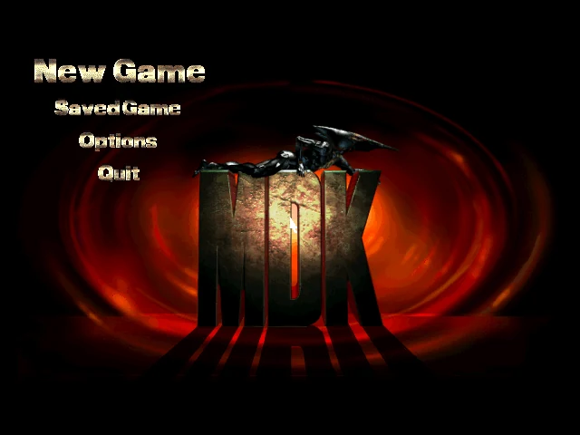<br>**1. Main Menu (`MDK3DFX.EXE`, `glide-ng` Vulkan)**<br>Iconic dark-orange backlit metallic logo and Kurt reclining atop the `MDK` lettering, composited via `grLfbLock` with `gamma = 1.0`. | 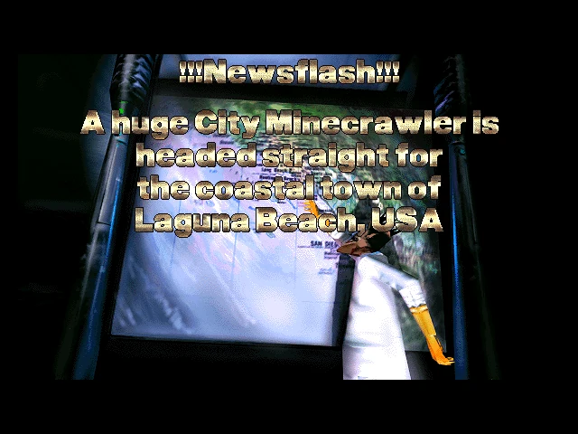<br>**2. Opening Briefing (`!!!Newsflash!!!`)**<br>Dr. Hawkins pointing toward Laguna Beach, USA before launching Kurt into orbit — metallic bitmap font overlays rendered cleanly via LFB writes. |
| 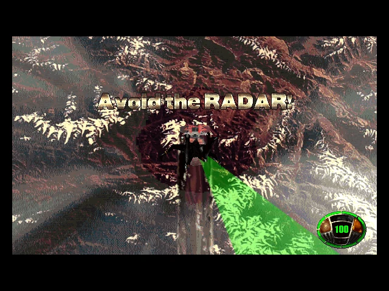<br>**3. Orbital Free-Fall (`FALL3D`, `glide-ng` Vulkan)**<br>Translucent emerald-green radar scan beam sweeping beneath Kurt with `"Avoid the RADAR!"` text, ground terrain mapping, and metallic oval health dial. | 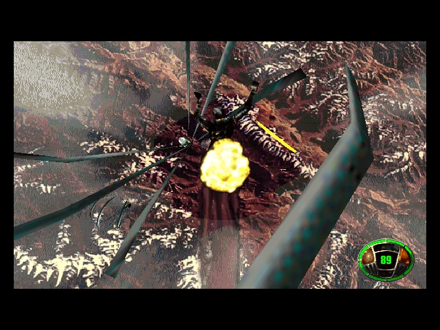<br>**4. Orbital Free-Fall Explosion (`glide-ng` Vulkan)**<br>Mid-drop missile trail corkscrews and glowing yellow blast sphere during re-entry toward the giant City Minecrawler (`health = 89`). |
| 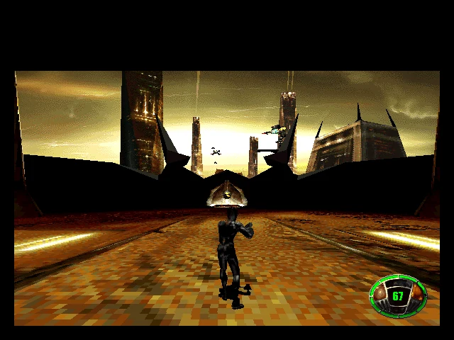<br>**5. DOS 8-bit Software (`MDK.EXE` in DOSBox-SVN)**<br>Authentic reference loaded from the exact same save slot: confirms the stylized black courtyard silhouettes, but displays heavily pixelated unfiltered floor texels. | 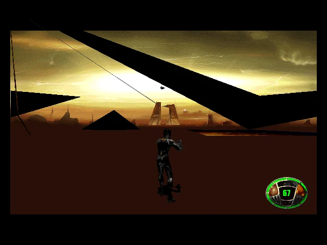<br>**6. Companion Direct3D 3.0 (`MDKD3D.EXE` under Wine `wined3d`)**<br>Broken under Wine 10: ground texture drops to flat solid brown and exploding black diagonal polygon strips slice across the golden skyline. |
| <br>**7. `glide-ng` Vulkan `1×` ([`glide-ng.ini`](./glide-ng.ini))**<br>Smooth bilinear metallic walkway, golden clouds, flying alien gunships hovering near skyscrapers, dynamic drop shadow, and vibrant `67` HUD dial. | 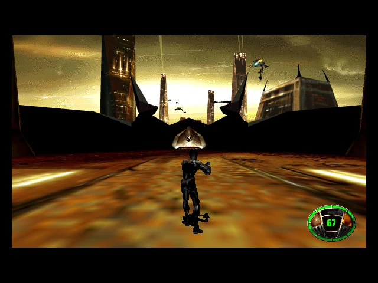<br>**8. `glide-ng` Vulkan `4× MSAA` HQ ([`glide-ng.hq.ini`](./glide-ng.hq.ini))**<br>Best visuals: `4×` hardware MSAA + linear filter + `no_dither_sub = true` produces crisp silhouette tower/wing edges with silky smooth floor light bands. |
| 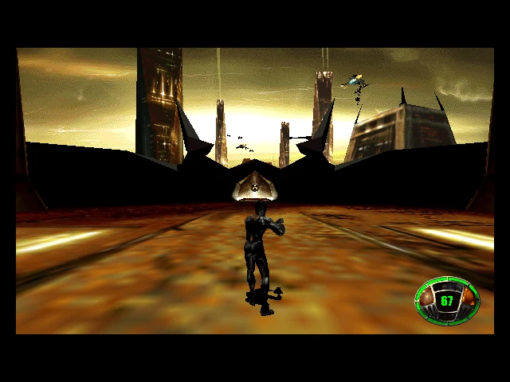<br>**9. `glide-ng` OpenGL ES / WGL (`backend = opengl_es`)**<br>Identical golden horizon skybox, turret towers, gunship sprites, bilinear ramp glow, and HUD clarity matching the Vulkan backend. | 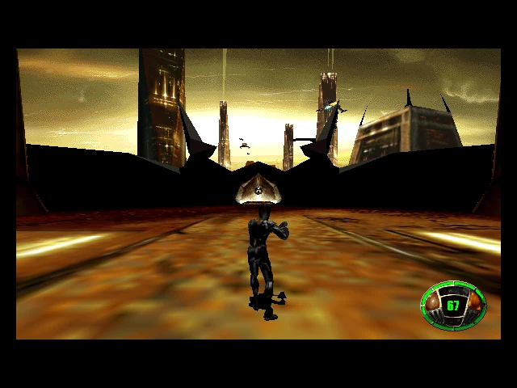<br>**10. `glide-ng` CPU Software ([`glide-ng.software.ini`](./glide-ng.software.ini))**<br>Multi-threaded AVX2/AVX-512 reference rasterizer achieves pixel-exact parity with Vulkan and OpenGL ES with zero black seams or z-fighting. |
| 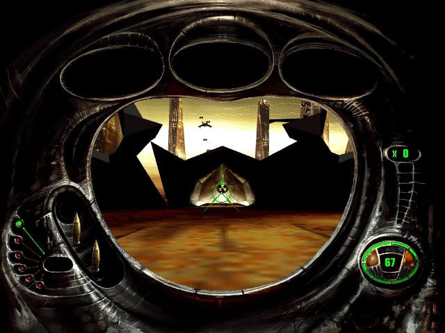<br>**11. Bio-Metallic Sniper Helmet Visor (`Space`, `4× MSAA` HQ)**<br>Crisp organic border mask chromakeyed around the live 3D courtyard aperture, golden ammo bay, zoom gauge (`x 0`), and sharp green reticle line crosshair. | 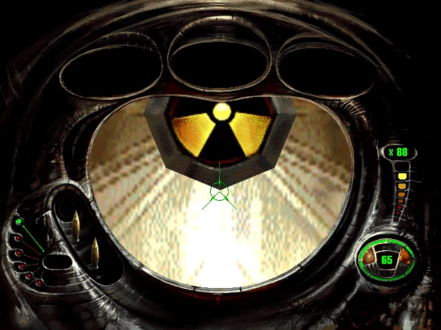<br>**12. Sniper Scope `88×` Zoom (`a` key, `4× MSAA` HQ)**<br>Optical telescopic zoom straight onto the distant radioactive bunker crest across the arena with illuminated vertical meter notches. |

---

## Visual Quality & Performance Tuning

### Flavour Comparison: Win32 `MDK3DFX.EXE` vs. DOS `MDK.EXE` vs. Win32 `MDKD3D.EXE` vs. `MDK95.EXE`
* **`MDK3DFX.EXE` (`glide-ng`, [`glide-ng.hq.ini`](./glide-ng.hq.ini)) is the clear winner:** smooth bilinear textures across all walkways and vertical monoliths, crisp translucent radar sweeps, clean sniper mask chromakey transparency, dynamic spotlight glow, smooth explosions, and zero geometry glitches.
* **`MDK.EXE` (DOSBox software)** works reliably for authentic silhouette comparison (`8-bit` palettized, `640×480` letterboxed widescreen), but renders coarsely pixelated foreground floor tiles without bilinear filtering.
* **`MDKD3D.EXE` (Direct3D 3.0)** suffers severe `wined3d` untextured-polygon / geometry corruption under Wine 10.
* **`MDK95.EXE` (DirectDraw 8-bit software)** produces blank black frames under Wine 10 `ddraw_surface1_Flip`.

### Atmospheric White Flash During `FALL3D` Entry
The brief milky haze seen right as Kurt leaps out of the orbital shuttle is the game's authentic **white-lightning transition fade** before descending through clouds toward the *Laguna Beach* Minecrawler; within ~2 seconds full rich red-brown mountain contrast returns identically on every backend.

---

## Quirks, Known Issues & Controls

### Missing Manual-Unpack Directories (`MDKFONT.FTI`, `SCRATCH\`, `SAVES\`)
* **`Error opening MISC\MDKFONT.FTI - check manual`**: Copy `MISC\FONTE.FTI` (English) to `MISC\MDKFONT.FTI`.
* **`Error opening/accessing SCRATCH\TLEVEL.MTO`**: Create an empty writable `SCRATCH\` directory in the game root.
* **Saving failing silently**: Create an empty writable `SAVES\` directory in the game root.

### Essential Controls

| Key | Action |
| :--- | :--- |
| **`Arrow keys`** | Move Kurt / aim inside sniper visor |
| **`Shift`** | Toggle turbo run/turn speed |
| **`,` / `.` (or `X` + Arrow)** | Sidestep / strafe left and right |
| **`Alt`** | Jump / deploy ribbon chute in mid-air (press twice) |
| **`Ctrl`** | Fire active weapon / sniper shot |
| **`Space`** | Toggle third-person ↔ Sniper helmet mode |
| **`A` / `Z`** | Zoom in / zoom out (in Sniper mode) or look up/down |
| **`Enter`** | Activate selected special pickup |
| **`F1` / `F12`** | In-game help menu / Options screen |
| **`F2` / `F3`** | Save game / Load saved game (`SAVES\*.SAV`) |
| **`Esc` / `F10`** | Exit confirmation prompt (`Yes` / `No`) |
