# MechWarrior 2: 31st Century Combat — 3Dfx Edition (1996 — Win32 Glide 2.11)

| Field | Value |
| :--- | :--- |
| **Category** | Commercial Game |
| **Year** | 1996 *(October 1996 3Dfx Interactive OEM Edition)* |
| **Platform(s)** | `Win32 / Wine (MW2.DLL → glide.dll)` |
| **Glide API & Version** | **Glide 2.11** (`glide.dll`, pre-2.3 SST-1 ABI) |
| **Recommended Card Profile** | `VoodooGraphics` (`api_version = 2.11`, 4 MB FB, 1 × 2 MB TMU) |
| **Verified Backends** | Vulkan · OpenGL ES / WGL · Software (AVX2 / AVX-512 / Scalar) |
| **Preset File(s)** | [`glide-ng.ini`](./glide-ng.ini) (Voodoo1 SST-1) · [`glide-ng.hq.ini`](./glide-ng.hq.ini) (Voodoo1 + 4× MSAA + Linear) · [`glide-ng.software.ini`](./glide-ng.software.ini) (CPU Software) |
| **Status** | Verified |

---

## Overview

In **October 1996**, Activision and 3Dfx Interactive released an OEM **Voodoo Graphics (`SST-1`)** edition of *MechWarrior 2: 31st Century Combat*—the earliest hardware-accelerated *MechWarrior 2* release, built directly against the **legacy Glide 2.11 (`glide.dll`)** API almost two years before the **[1998 Titanium Edition (`glide2x.dll`)](../mechwarrior-2/README.md)**.

Unlike the later Titanium Edition's pluggable `plugin/zglide.dll` rasterizer, this 1996 build statically links `MW2.DLL` (`724,480 B`) to **`glide.dll`** and uses a dedicated 8.4 MiB mipmap archive (**`MW2.MIP`**), rebuilt world archive (**`MW2.PRJ`**), and animated sky/ground parameter file (**`SKYGND.PAR`**). At `640×480×16`, it replaces the flat-shaded 8-bit software renderer's untextured terrain and banded gradient skies with **bilinear-filtered mipmapped mesas and terrain, animated rolling cloud sky domes, smooth Gouraud-shaded cockpit struts, 15-bit `RGB555` linear-framebuffer bitmap HUD fonts, live 3D wireframe targeting MFDs (`F4`), picture-in-picture `REAR` camera views (`F7`), and Enhanced Imaging wireframe mode (`w`)**.

---

## Editions, Patches & Executables

Start from the **original 1995/1996 Windows 95 release of *MechWarrior 2: 31st Century Combat*** (CD volume label **`MECH2`**) and overlay the **5-file October 1996 3Dfx Edition conversion** (`MW2.DLL`, `MW2.MIP`, `MW2.PRJ`, `MW2SHELL.DLL`, `SKYGND.PAR`) into the game directory beside `MECH2.EXE`.

| Edition / DLL | Graphics API | Works with `glide-ng`? | Technical Notes |
| :--- | :--- | :---: | :--- |
| **`MW2.DLL` (724,480 B, Oct 1996 3Dfx OEM)** | **Glide 2.11 (`glide.dll`)** | **Yes (This Guide)** | Imports **32/32** Glide 2.11 symbols (`grSstOpen`, `grLfbBegin`/`End`, `grLfbGetWritePtr`, `grLfbWriteMode`, `grLfbBypassMode`, `guTexAllocateMemory`). Full textured mesas, animated cloud domes (`SKYGND.PAR`), mipmapped ground (`MW2.MIP`), and `4× MSAA` compatibility. |
| **`MW2.DLL` (827,392 B, Dec 1995 Win95 Software)** | GDI 8-bit `CreateDIBSection` | No (Comparison) | Original unaccelerated 256-color Win95 build (`flat-shaded` terrain and banded sky horizon with no `glide.dll` dependency). |
| **[Titanium Edition (1998)](../mechwarrior-2/README.md)** | **Glide 2.x (`glide2x.dll`)** | **Yes (Separate Card)** | Later 1998 remaster (`mercsw.dll` + `plugin/zglide.dll`). Features distance fog and ground drop shadows on a different `glide2x.dll` engine—see [its dedicated catalog entry](../mechwarrior-2/README.md). |
| **DOS Software Release (`v1.1`, `MECH2.EXE`)** | DOS 8-bit VGA/VESA (`DOS/4GW`) | No | Original DOS release without 3dfx hardware acceleration. |

---

## Recommended Launch Configurations (Wine32 / Windows)

On modern systems and Wine (**`WINEARCH=win32`**), copy **`glide-ng`'s Win32 `glide.dll`** directly into the game folder next to **`MECH2.EXE`** and load it natively:

```text
<game-dir>/
├── glide.dll          <- glide-ng Win32 Glide 2.11 DLL (NOT glide2x.dll!)
├── glide-ng.ini       <- Optional preset (or pass GLIDE_NG_CONFIG=...)
├── MECH2.EXE          <- Main Win32 launcher (shell + sim host)
├── MW2.DLL            <- 3Dfx Glide 2.11 simulation DLL (724,480 B)
├── MW2.MIP            <- 3Dfx mipmap texture bank (8,742,336 B)
├── MW2.PRJ            <- 3Dfx edition world/asset archive (43,499,380 B)
├── MW2SHELL.DLL       <- 2D Clan Hall / MechLab / menu shell (544,256 B)
├── SKYGND.PAR         <- Per-mission animated sky/ground tiling table (4,603 B)
├── WAIL32.DLL         <- Miles Sound System runtime
└── SMACKW32.DLL       <- Smacker video decoder
```

### Option A: Default Authentic SST-1 Profile (`glide-ng.ini`, Vulkan `1×`)

```bash
export WINEPREFIX=/path/to/mw2-3dfx-prefix
export WINEARCH=win32
export WINEDLLOVERRIDES="glide=n"
export GLIDE_NG_CONFIG=/path/to/docs/catalog/games/mechwarrior-2-3dfx/glide-ng.ini

wine ./MECH2.EXE
```

### Option B: Best Visuals (`glide-ng.hq.ini`, `4× MSAA` + Linear + `no_dither_sub`) *(Recommended)*

```bash
GLIDE_NG_CONFIG=/path/to/docs/catalog/games/mechwarrior-2-3dfx/glide-ng.hq.ini \
WINEDLLOVERRIDES="glide=n" \
  wine ./MECH2.EXE
```

### Option C: OpenGL / WGL Backend Override

```bash
GLIDE_NG_BACKEND=opengl_es \
GLIDE_NG_CONFIG=/path/to/docs/catalog/games/mechwarrior-2-3dfx/glide-ng.hq.ini \
WINEDLLOVERRIDES="glide=n" \
  wine ./MECH2.EXE
```

### Option D: Pure CPU Software Backend (`glide-ng.software.ini`)

Useful on software-rendered systems or hosts without a 32-bit hardware Vulkan / OpenGL driver:

```bash
GLIDE_NG_CONFIG=/path/to/docs/catalog/games/mechwarrior-2-3dfx/glide-ng.software.ini \
WINEDLLOVERRIDES="glide=n" \
  wine ./MECH2.EXE
```

*(When launching a single mission directly without entering the 2D Clan Hall shell, pass the `.BWD` mission ID on the command line—for example `wine ./MECH2.EXE browscn1`, `greescn1`, `plumscn1`, or `whitscn1`. On software Vulkan drivers such as Mesa `llvmpipe`, export `LP_NUM_THREADS=4` to preserve 32-bit Wine virtual address space.)*

---

## Visual Progression Gallery

All `640×480` simulation captures showcase the October 1996 **3Dfx `glide.dll`** conversion running on **`glide-ng`** alongside the original unaccelerated **Win95 8-bit software renderer (`MW2.DLL`, 1995)**:

| | |
| :---: | :---: |
| 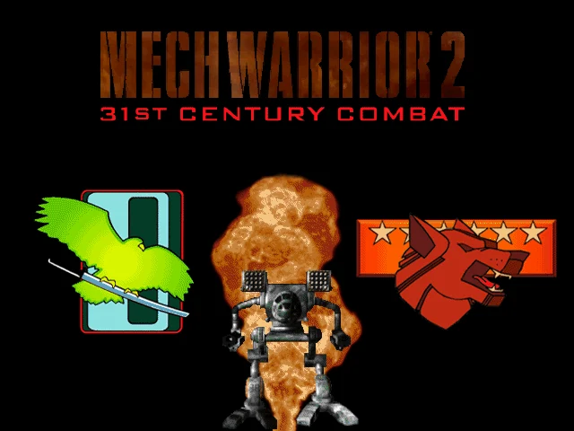<br>**1. Main Title & Clan Selector (`MW2SHELL.DLL`)**<br>Iconic 1996 splash screen rendered with Clan Jade Falcon (left), *Trials of Grievance* Timber Wolf (center), and Clan Wolf (right). | 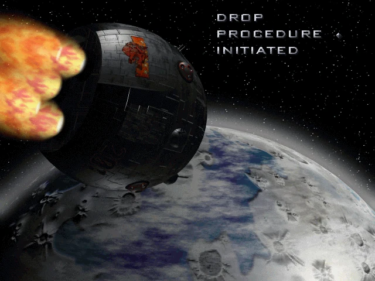<br>**2. Orbital Dropship Launch (`LAUNCH6.SHP`)**<br>Full-color `DROP PROCEDURE INITIATED` pre-mission splash presented immediately before `MW2.DLL` opens the Glide 2.11 context. |
| 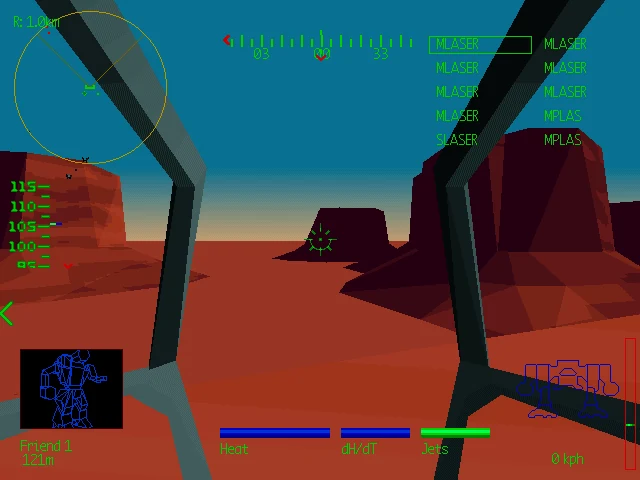<br>**3. Base 1995/1996 Win95 Software (`MW2.DLL`, `browscn1`)**<br>Flat-shaded polygonal canyon mesas, untextured ground plane, and 256-color banded cyan sky gradient for direct comparison. | 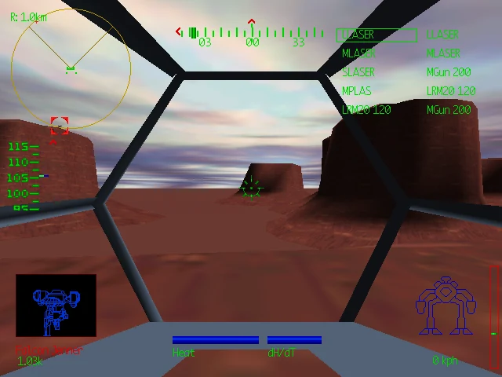<br>**4. `glide-ng` Vulkan `1×` ([`glide-ng.ini`](./glide-ng.ini))**<br>Authentic SST-1 `VoodooGraphics` output: bilinear textured mesas, rolling cloud dome skybox, red target brackets locked on `Falcon Jenner`, and wireframe MFD (`F4`). |
| 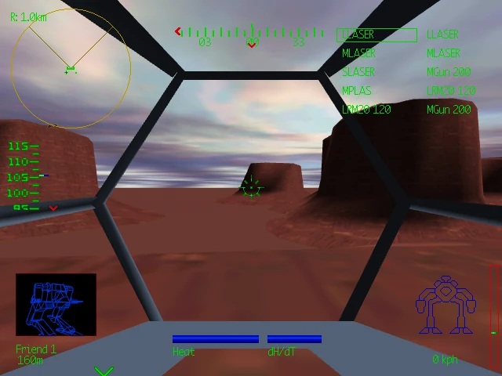<br>**5. `glide-ng` Vulkan `4× MSAA` HQ ([`glide-ng.hq.ini`](./glide-ng.hq.ini))**<br>Smooth `4×` MSAA diagonal cockpit struts, crisp `no_dither_sub` sunset sky gradients, full HUD weapon list, radar arc, and live rotating `Friend 1` wireframe MFD. | 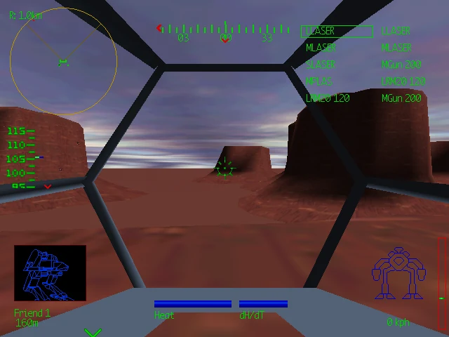<br>**6. `glide-ng` OpenGL / WGL (`backend = opengl_es`)**<br>Clean parity with Vulkan: green `RGB555` bitmap HUD weapon text (`LLASER`, `MLASER`, `SLASER`) layers crisply over the black canopy struts. |
| 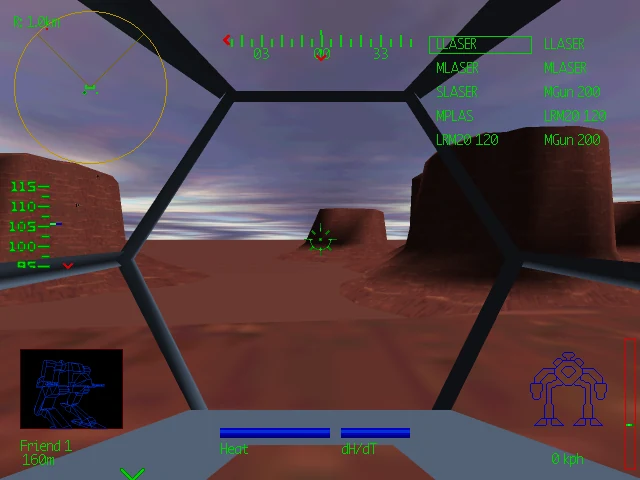<br>**7. `glide-ng` CPU Software `2×2 SSAA` ([`glide-ng.software.ini`](./glide-ng.software.ini))**<br>Multi-threaded AVX2/AVX-512 reference rasterizer matches the GPU backends pixel-for-pixel across terrain textures, vector gauges, and 3D wireframe MFDs. | 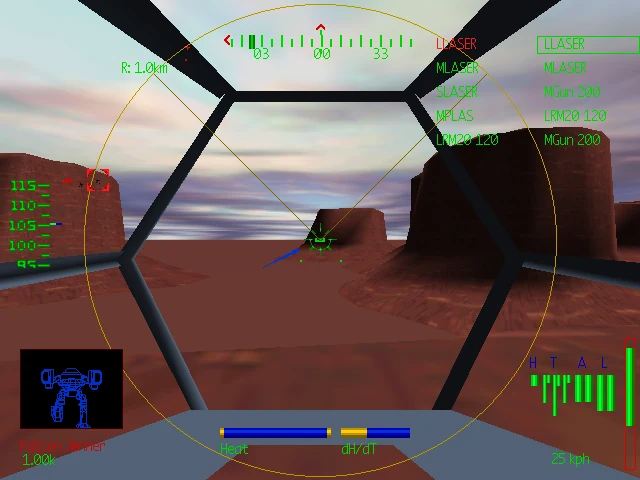<br>**8. Active Weapon Fire & Full-HUD Radar (`F2` / `F6`)**<br>Firing the Large Laser (`LLASER` recharging in red) projects a blue beam ahead, raises the `dH/dT` yellow thermal gauge, and overlays the expanded radar circle plus `H T A L` armor bars. |
| 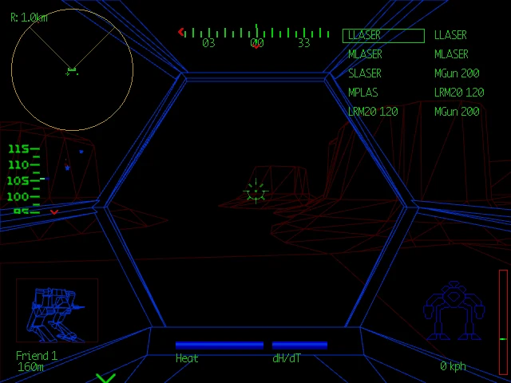<br>**9. Enhanced Vision Wireframe Mode (`w`, `4× MSAA`)**<br>Low-light tactical wireframe mode (`grDrawLine`) outlines cockpit bars in bright blue, canyon terrain in crimson, and the full vector HUD in neon green. | 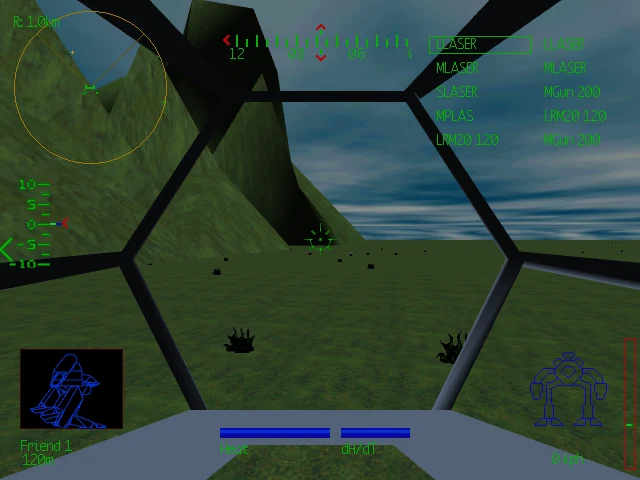<br>**10. Alternate Biome — Emerald Highlands (`greescn1`)**<br>Mipmapped green valley terrain, alpha-blended shrub sprites, swirling blue cloud dome, and live rotating `Friend 1` BattleMech target box. |
| 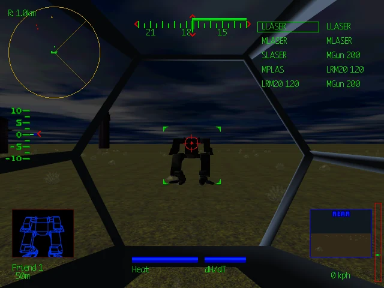<br>**11. Close-Up BattleMech & `REAR` Camera (`plumscn1`, `F7`)**<br>Starmate locked at `50m` dead ahead at dusk with the live clipped **`REAR`** picture-in-picture camera feed active in the lower-right MFD window. | 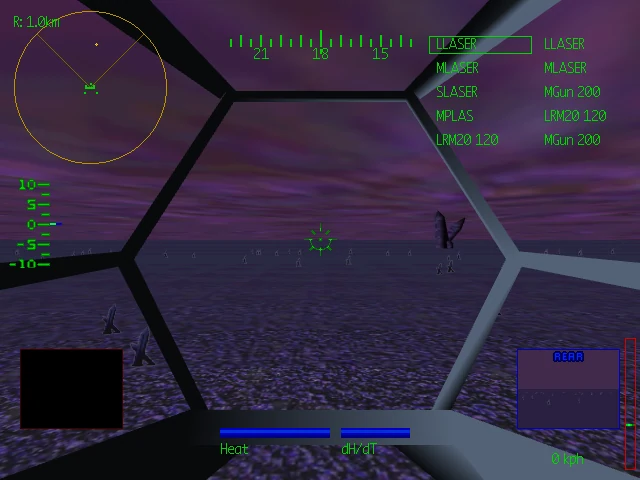<br>**12. Alternate Biome — Twilight Moon (`whitscn1`, `F7`)**<br>Magenta-violet swirling cloud deck over rocky alien spikes with textured ground ring and live **`REAR`** view mirror MFD. |

---

## Visual Quality & Performance Tuning

### Edition Comparison: `1996 3Dfx` vs. `1996 Software` vs. `1998 Titanium`
* **1996 3Dfx (`glide.dll`, `MW2.DLL`) vs. 1996 Software (`8-bit GDI`):** The `3Dfx` build is a dramatic leap—replacing flat-shaded mountains, untextured desert floors, and banded cyan skies with animated rolling cloud skyboxes, bilinear mipmapped terrain textures (`MW2.MIP`), Gouraud-shaded cockpit struts, and crisp 16-bit transparent HUD overlays.
* **1996 3Dfx (`glide.dll`) vs. [1998 Titanium Edition (`glide2x.dll`)](../mechwarrior-2/README.md):** The original 1996 3Dfx build preserves Activision's authentic vintage lighting, distinct `SKYGND.PAR` animated cloud domes, sharp untextured-vs-textured outer horizon distance ring, and classic 1995-era mission scripting/models (`MW2.PRJ`). The 1998 Titanium Edition adds atmospheric distance fog, projected ground drop shadows, and dynamic laser ground illumination on top of the newer `mercsw.dll` engine.
* **`glide-ng` Backend Comparison:** **Vulkan `4× MSAA` (`glide-ng.hq.ini`)**, **OpenGL 3.3 Core / WGL (`opengl_es`)**, and **CPU Software AVX2 `2×2 SSAA` (`glide-ng.software.ini`)** render pixel-consistent sky domes, textured mesas, wireframe MFDs (`F4`), `REAR` mirrors (`F7`), Enhanced Vision wireframes (`w`), and `RGB555` bitmap HUD fonts layered over canopy struts. For the sharpest vintage edges with minimal banding, **`glide-ng.hq.ini`** is recommended.

### In-Game Notes
* The 1996 3Dfx `MW2.DLL` renders natively at **`640×480`**. Ground texturing switches from bilinear mipmapped tiling to a flat biome color beyond the engine's fixed close-range detail ring—this matches original `SST-1` hardware behavior.
* Dusk/night worlds (such as `plumscn1` and `goldscn1`) use intentionally low ambient lighting on BattleMech hulls and buildings; bumping `[glide] gamma = 1.3` lifts shadows slightly if your display runs dark.

---

## Quirks, Known Issues & Controls

### Win95 / Wine & Modern Windows Compatibility Notes
The original 1995/1996 Win95 game binaries predate Windows NT/XP/10/11 and require standard legacy compatibility fixes when run outside Windows 95:

* **GDI `BitBlt` / `StretchBlt` return-value bug (`MW2SHELL.DLL` & `MW2.DLL` software build):** Activision's 1995 Win95 blitters mistakenly checked `BitBlt(...) == height` (480) instead of `!= 0`. On Windows NT/XP+ and Wine, `BitBlt` strictly returns `TRUE (1)`, causing `MECH2.EXE` to exit immediately with code `2` unless patched (or hosted via `gdi42.dll` / community XP patches).
* **8-bit `DIB_PAL_COLORS` palette mapping on 24/32-bit desktops (`MW2SHELL.DLL`):** The 2D shell constructs an 8-bpp `CreateDIBSection` using `DIB_PAL_COLORS` (`RealizePalette`) rather than updating `SetDIBColorTable` after every palette upload. Without either an 8-bpp palettized display mode or a `DIB_RGB_COLORS` / `SetDIBColorTable` shim, the 2D menu screens appear black until launching 3D simulation.
* **`WAIL32.DLL` (1995 Miles Sound System) audio & timer compatibility:**
  * *Timer callback calling convention:* On Wine / modern `winmm.dll`, `MW2.DLL` registers a `__cdecl` `timeSetEvent` callback expecting stack restoration inside `WAIL32.DLL` (avoiding a fault in `_TIME_MMSysTimeThread`).
  * *`waveOutProc` `WOM_OPEN` self-suspension deadlock:* When `waveOutOpen(..., CALLBACK_FUNCTION)` triggers `MM_WOM_OPEN` synchronously on the calling thread under modern `winmm.dll`, 1995 `WAIL32.DLL` invokes `SuspendThread(mainThread)` before checking `uMsg == MM_WOM_DONE`, hanging on the `DROP PROCEDURE INITIATED` loading screen unless `MM_WOM_DONE` (`0x3bd`) is checked prior to suspending the main thread (or wrapped by a `Kernel42.dll` shim).
* **CD-ROM label check:** Mount or link the `MECH2` disc root to Wine `D:` (`cdrom` drive type) containing label `MECH2`.

### Useful Controls (`GAMEKEY.MAP`)

| Key | Action |
| :--- | :--- |
| **`1`–`9` / `0`** | Throttle presets (`1` = stop, `0` = full speed; `` ` `` / `Backspace` reverses) |
| **`Left` / `Right` / `Up` / `Down`** | Turn legs / pitch torso |
| **`,` / `.`** | Rotate torso left / right independently |
| **`e` / `t`** | Target nearest enemy / cycle targets |
| **`Space` / `;` / `\`** | Fire selected weapon / fire group / toggle group fire |
| **`c`** | Toggle cockpit view (canopy struts on/off) |
| **`z` / `Ctrl+z`** | Cycle tactical zoom / reset zoom |
| **`F2` / `F3`** | Cycle HUD radar mode (corner ↔ full centered circle) / satellite map |
| **`F4` / `F5` / `F6`** | Toggle Target MFD (`3D wireframe`) / Damage display / `H T A L` armor bars |
| **`F7` / `F8` / `F9`** | Toggle **`REAR`** camera PiP / downward view / weapons list |
| **`w`** | Toggle **Enhanced Vision** (low-light wireframe mode) |
| **`Esc` / `Alt+X`** | Pause menu / quit simulation |
