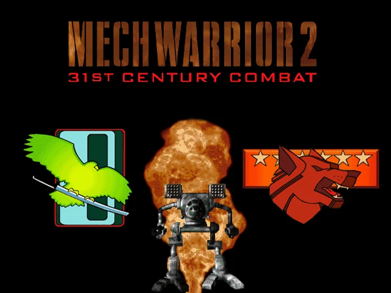
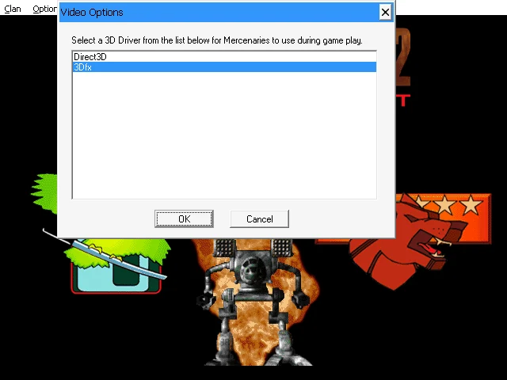
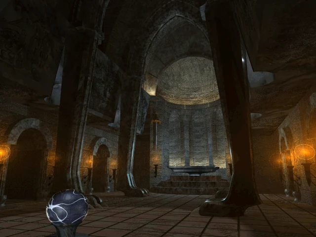
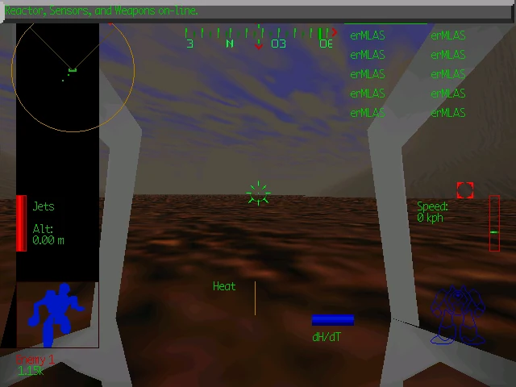
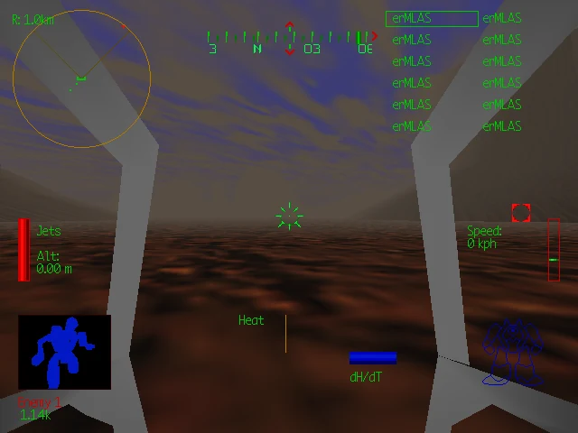
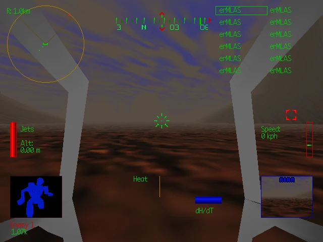
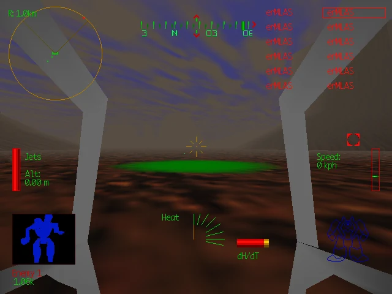
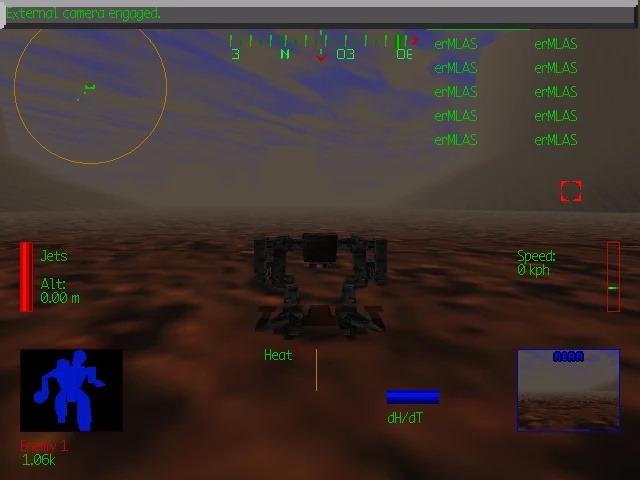
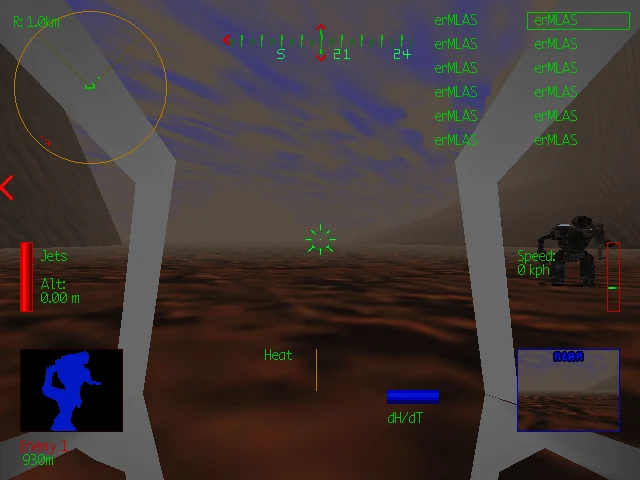
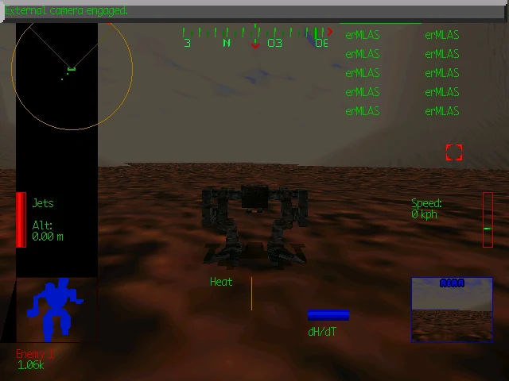

# MechWarrior 2: 31st Century Combat — Titanium Edition (1998 — Win32 3dfx)

| Field | Value |
| :--- | :--- |
| **Category** | Commercial Game |
| **Year** | 1998 |
| **Platform(s)** | `Win32 / Wine (plugin/zglide.dll → glide2x.dll)` |
| **Glide API & Version** | Glide 2.x (`2.56` on Voodoo2 / `2.48` on Voodoo Graphics) |
| **Recommended Card Profile** | `Voodoo2` (default / `4× MSAA` HQ) · `VoodooGraphics` (optional) |
| **Verified Backends** | Vulkan · OpenGL ES / WGL · Software (AVX2 / AVX-512 / Scalar) |
| **Preset File(s)** | [`glide-ng.ini`](./glide-ng.ini) (Voodoo2) · [`glide-ng.hq.ini`](./glide-ng.hq.ini) (Voodoo2 + 4× MSAA + Linear) · [`glide-ng.voodoo1.ini`](./glide-ng.voodoo1.ini) (Voodoo1 SST-1) · [`glide-ng.software.ini`](./glide-ng.software.ini) (CPU Software) |
| **Status** | Verified |

---

## Overview

Activision's **1998 Titanium Edition** remastered the 1995 Battletech simulation *MechWarrior 2: 31st Century Combat* with a 16-bit Win32 hardware-accelerated combat engine (`mercsw.dll`) built around pluggable rasterizer DLLs inside the `plugin/` directory (`zglide.dll` for 3dfx Glide 2.x, `dx5draw.dll` for Direct3D 5, and `zredline.dll` for Rendition Verite).

When paired with `glide-ng`'s `glide2x.dll`, the `zglide.dll` driver renders full `640×480×16` bilinear terrain, smooth sky-dome clouds, atmospheric distance fog, dynamic weapon ground-lighting flashes (`erMLAS`), ground-projected BattleMech drop shadows, clipped 3D target silhouette MFDs (`F4`), and live **picture-in-picture secondary 3D views** such as the **`REAR` camera mirror (`F7`)**. By contrast, Wine 10's Direct3D 5 emulation (`dx5draw.dll`) clips out a vertical strip along the left edge of the viewport behind the target MFD and exhibits jagged horizon seams.

---

## Editions, Patches & Executables

Only the **16-bit Titanium Edition (`Install/16bit`)** contains the **`plugin/zglide.dll`** 3dfx Glide 2.x renderer. Place `glide-ng`'s **`glide2x.dll` directly alongside `Mw2win.exe` / `realMW2Win.exe`**, **not** inside `plugin/` (`MW2SHELL.DLL` treats every DLL in `plugin/` as an Activision rasterizer driver).

| Executable / Renderer | Engine / API | Works with `glide-ng`? | Technical Notes |
| :--- | :--- | :---: | :--- |
| **`plugin/zglide.dll`** *(16-bit Titanium 3Dfx)* | **Glide 2.x (`glide2x.dll`)** | **Yes (Recommended)** | Full bilinear terrain, smooth distance fog, crisp 3D HUD & live `REAR` camera MFD (`F7`), dynamic laser ground lighting, and `4× MSAA` compatibility. Select via **`Options → Video Options → 3Dfx`** (saved to `dllfile.ini` and `rend.cfg`). |
| **`plugin/dx5draw.dll`** *(16-bit Titanium Direct3D 5)* | DirectDraw / Direct3D 5 (`DDRAW.dll`) | No (Comparison) | Runs under Wine 10 `wined3d`, but suffers a severe full-height black clipping strip down the left column above the target MFD plus hard fog-band edges along the horizon. |
| **`plugin/zredline.dll`** *(Rendition Verite)* | Rendition Redline | No | Legacy third-party Redline driver (`redline.dll` required). |
| **`Install/8bit/MW2WIN.EXE`** *(8-bit Software)* | DirectDraw 8-bit CPU | No (No Glide support) | Alternate 256-color software edition shipped on the Titanium disc (`Install/8bit`). |
| **[3Dfx Edition (Oct 1996 OEM, `MW2.DLL`)](../mechwarrior-2-3dfx/README.md)** | **Glide 2.11 (`glide.dll`)** | **Yes (Separate Card)** | Earlier 1996 `Voodoo Graphics` (`SST-1`) Win32 release built against **`glide.dll`** (`MW2.MIP` + `SKYGND.PAR`). Covered on its own [catalog entry](../mechwarrior-2-3dfx/README.md). |
| **Original DOS Edition** *(`MECH2.EXE` / `MW2.EXE`)* | DOS 8-bit Software (`DOS/4GW`) | No (No Glide in 1.1) | Pure software DOS release (unaccelerated 256-color `DOS/4GW` renderer). |

---

## Recommended Launch Configurations (Wine32 / Windows)

The Titanium Edition uses a standalone Win32 launcher (`Mw2win.exe` / MechVM `realMW2Win.exe`) wrapped around `MW2SHELL.DLL` and the 3D simulation DLL (`mercsw.dll`). On modern hosts and Wine (`WINEARCH=win32`), use a 32-bit prefix with `glide-ng`'s `glide2x.dll` copied alongside the executable and loaded natively:

```text
<game-dir>/
├── glide2x.dll        <- glide-ng Win32 DLL (NOT inside plugin/!)
├── glide-ng.ini       <- Optional preset (or pass GLIDE_NG_CONFIG=...)
├── Mw2win.exe         <- (or MechVM-patched realMW2Win.exe)
├── MW2SHELL.DLL       <- Apply MechVM 45-byte mw2shell.dll.diff on NT/Wine
├── mercsw.dll
├── dllfile.ini        <- Contains: zglide.dll
├── rend.cfg           <- Active plugin record (zglide.dll)
└── plugin/
    ├── dx5draw.dll
    ├── zglide.dll     <- Loads glide2x.dll from the game root
    └── zredline.dll
```

### Option A: Default Balanced Profile (`glide-ng.ini`, Vulkan `1×`)

```bash
export WINEPREFIX=/path/to/mw2-prefix
export WINEARCH=win32
export WINEDLLOVERRIDES="glide2x=n"
export GLIDE_NG_CONFIG=/path/to/docs/catalog/games/mechwarrior-2/glide-ng.ini

wine ./realMW2Win.exe
```

### Option B: Best Visuals (`glide-ng.hq.ini`, `4× MSAA` + Linear + `no_dither_sub`) *(Recommended)*

```bash
GLIDE_NG_CONFIG=/path/to/docs/catalog/games/mechwarrior-2/glide-ng.hq.ini \
WINEDLLOVERRIDES="glide2x=n" \
  wine ./realMW2Win.exe
```

### Option C: OpenGL / WGL Backend Override

```bash
GLIDE_NG_BACKEND=opengl_es \
GLIDE_NG_CONFIG=/path/to/docs/catalog/games/mechwarrior-2/glide-ng.ini \
WINEDLLOVERRIDES="glide2x=n" \
  wine ./realMW2Win.exe
```

### Option D: Pure CPU Software Backend (`glide-ng.software.ini`)

Useful on software-rendered systems or headless environments without a 32-bit hardware Vulkan ICD:

```bash
GLIDE_NG_CONFIG=/path/to/docs/catalog/games/mechwarrior-2/glide-ng.software.ini \
WINEDLLOVERRIDES="glide2x=n" \
  wine ./realMW2Win.exe
```

*(When running in a software Vulkan container or CPU rasterizer such as Mesa `llvmpipe`, export `LP_NUM_THREADS=4` to stay within the 32-bit Wine virtual address budget.)*

### Selecting the `3Dfx` Driver In-Game

1. Move the pointer to the top edge of the `MW2SHELL.DLL` launcher screen to expose the Win32 menu bar (`Clan | Options | Help`).
2. Open **`Options → Video Options`** and select **`3Dfx`** (`zglide.dll` appears automatically once `glide2x.dll` resides next to the executable).
3. Click **`OK`** to update `dllfile.ini` and `rend.cfg`.

---

## Visual Progression Gallery

All simulation captures depict *Trials of Grievance* (`Instant Action` Nova / Black Hawk OmniMech) inside `640×480` using `plugin/zglide.dll` (`glide-ng`) compared directly against `plugin/dx5draw.dll` (`Direct3D 5` under Wine 10 `wined3d`):

| | |
| :---: | :---: |
| <br>**1. Title Splash & Clan Selector (`MW2SHELL.DLL`)**<br>Main selection screen with Jade Falcon (left), *Trials of Grievance* instant action (center Timber Wolf), and Clan Wolf (right). | <br>**2. `Options → Video Options` Driver Picker**<br>`zglide.dll` automatically probes `glide-ng`'s `glide2x.dll` and registers **`3Dfx`** alongside **`Direct3D`**. |
| <br>**3. Clan Wolf Great Hall (`MW2SHELL.DLL`)**<br>Pre-rendered Win32 campaign hub running smoothly after applying the MechVM CD/heap compatibility patch. | <br>**4. Companion Direct3D 5 (`dx5draw.dll` under Wine `wined3d`)**<br>Defective full-height vertical black strip occludes the left viewport column above the target display, with a harsh jagged horizon seam. |
| <br>**5. `glide-ng` Vulkan `1×` ([`glide-ng.ini`](./glide-ng.ini))**<br>Complete unobstructed cockpit frame with bilinear terrain, distance fog, animated 3D enemy silhouette (`Enemy 1 / 1.14k`), targeting reticle, and radar HUD. | <br>**6. `glide-ng` Vulkan `4× MSAA` HQ ([`glide-ng.hq.ini`](./glide-ng.hq.ini))**<br>Best visuals: `4×` MSAA + linear filtering + `no_dither_sub = true` with smooth canopy edges, fog gradient, and live **`REAR`** camera MFD (`F7`). |
| <br>**7. `glide-ng` OpenGL ES / WGL (`backend = opengl_es`)**<br>Matches Vulkan output with clean distance fog, smooth terrain shading, targeting diamond, and crisp HUD bitmap overlays. | <br>**8. `glide-ng` CPU Software ([`glide-ng.software.ini`](./glide-ng.software.ini))**<br>Multi-threaded AVX2/AVX-512 reference rasterizer matches GPU output pixel-for-pixel, including both the target wireframe and live **`REAR`** picture-in-picture camera. |
| <br>**9. `erMLAS` Weapon Fire & Dynamic Terrain Glow (`glide-ng` Vulkan)**<br>Alpha strike flashes glowing green dynamic lighting over the textured valley floor while raising the bottom-center heat-dissipation fan and `dH/dT` indicator. | <br>**10. External Chase Camera (`c`, `glide-ng` Vulkan `4× MSAA`)**<br>Nova / Black Hawk OmniMech chassis with dark metallic texturing, projected ground shadows, target MFD, and active **`REAR`** picture-in-picture view. |
| <br>**11. Starmate BattleMech & `REAR` View (`glide-ng` Vulkan)**<br>Turned cockpit perspective displaying a friendly OmniMech on the right silhouette along with both live clipped sub-viewports (`Enemy 1` and `REAR`). | <br>**12. External Chase Camera — Direct3D 5 (`dx5draw.dll`)**<br>Side-by-side comparison shows the same persistent black column clipping artifact down the left quadrant in the Direct3D 5 renderer under Wine. |

---

## Visual Quality & Performance Tuning

### Flavour Comparison: `3Dfx` Glide (`zglide.dll`) vs. `Direct3D 5` (`dx5draw.dll`)
* **`plugin/zglide.dll` (`glide-ng`, [`glide-ng.hq.ini`](./glide-ng.hq.ini)) is the clear winner:** smooth fog-blended horizon, unobstructed picture-in-picture MFDs (`F4` target silhouette and `F7` `REAR` camera), dynamic laser lighting pools, clean `4×` MSAA canopy struts, and zero viewport-clipping artifacts across all three backends (Vulkan, OpenGL ES/WGL, and CPU Software).
* **`plugin/dx5draw.dll` (Direct3D 5 under Wine `wined3d`)** suffers a vertical black scissor/clear artifact slicing across the left quarter of the screen above the target MFD (visible in both cockpit and external views), a jagged horizon fog border, and inferior dithering/filtering compared with Glide 2.x.

### In-Game Notes
* `Mw2win.exe` locks the Titanium Edition combat viewport to **`640×480`**. A subtle 1-pixel diagonal seam appears near the lower-right cockpit strut joint across *both* Glide (`glide-ng`) and Direct3D (`dx5draw.dll`) renderers; this is caused by original 1998 canopy mesh vertex coordinates rather than wrapper rasterization.
* All three `glide-ng` backends render identical sky gradients, fog density, ground shadows, `erMLAS` lighting pulses, and picture-in-picture `REAR` camera projections. On discrete GPUs, choose `glide-ng.hq.ini` (`msaa = 4`, `no_dither_sub = true`, `presentation_filter = linear`).

---

## Quirks, Known Issues & Controls

### Installation & Engine Notes
* **Never put `glide2x.dll` inside `plugin/`:** `MW2SHELL.DLL` scans `plugin\*.dll` expecting Activision driver exports. Keep `glide2x.dll` in the **game root folder** beside `Mw2win.exe` / `realMW2Win.exe` so Windows resolves it strictly as an import of `plugin\zglide.dll`.
* **CD volume check & `MW2SHELL.DLL` patch:** Mount or point drive `D:` (`type = cdrom`) to the disc root labeled **`TITAN_MW2`**, and apply the community MechVM 45-byte **`mw2shell.dll.diff`** heap/PRJ patch (along with its `MW2Win` / `Kernel42.dll` / `gdi42.dll` / `AdvApi42.dll` launcher shims).
* **`WAIL32.DLL` audio note on headless hosts:** Without an active audio device, the legacy Miles Sound System `waveOutOpen` driver can stall shell entry. On headless systems without PulseAudio/PipeWire/ALSA, disable the Wine audio driver (`HKCU\Software\Wine\Drivers\Audio = ""`). On interactive desktops with real audio, keep default audio enabled.
* **Wine 10 `WINMM.dll` multimedia timer issue (`mercsw.dll` → `WAIL32.DLL`):** The 1998 `mercsw.dll` registers `__cdecl` (`ret`) timer callbacks (`_AIL_register_timer@4`) with the older 1995 `WAIL32.DLL` timer dispatcher, which expects `__stdcall` (`ret 4`). Restoring `ESP` after the `WAIL32.DLL` callback dispatch avoids a read fault inside Wine's `TIME_MMSysTimeThread`.

### Useful Controls (`GAMEKEY.MAP`)

| Key | Action |
| :--- | :--- |
| **`0`–`9`** | Set throttle (`0` stop, `5` half speed, `9` max flank speed) |
| **`Left` / `Right` / `Up` / `Down`** | Turn legs / pitch torso |
| **`e` / `t` / `f`** | Target nearest enemy / cycle target / target friendly starmate |
| **`;` / `p` / `Shift+p`** | Fire selected weapon group / cycle group / alpha strike |
| **`c`** | Cycle cockpit and external chase/drone camera views |
| **`u`** | Toggle cockpit canopy frame visibility |
| **`F4` / `F7` / `F8`** | Toggle target silhouette / `REAR` camera / downward view MFD |
| **`F2` / `F3`** | Cycle radar mode / toggle satellite map |
| **`w`** | Toggle Enhanced Vision (wireframe/low-light) |
| **`Esc` / `Alt+Q`** | In-mission pause menu / exit simulation |
