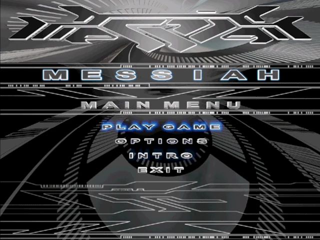
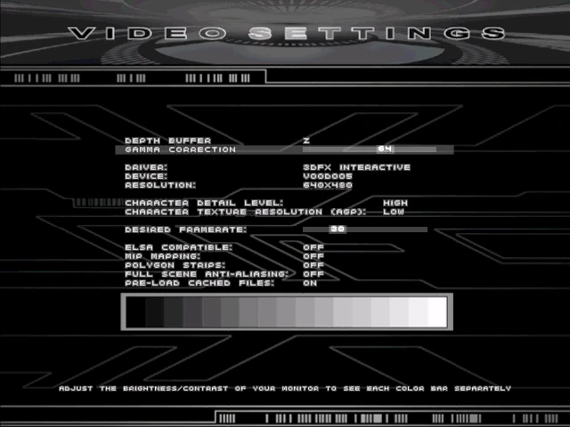
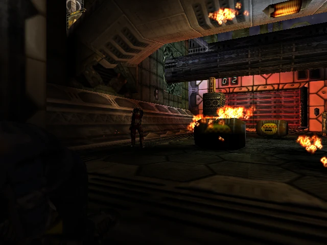
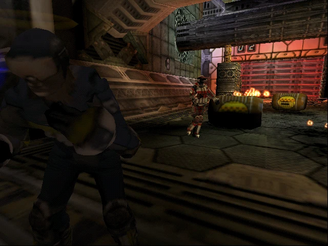
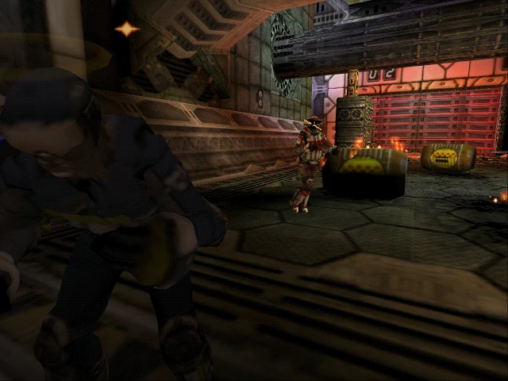
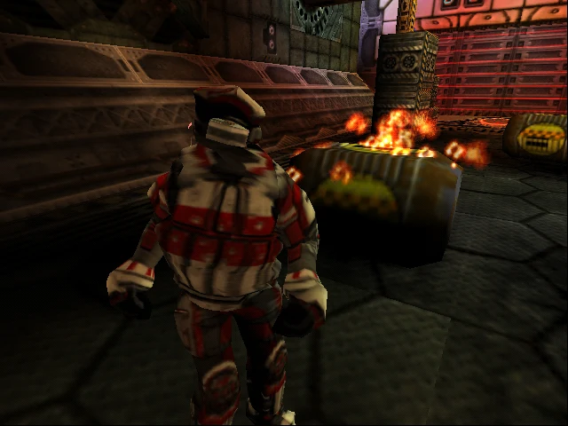
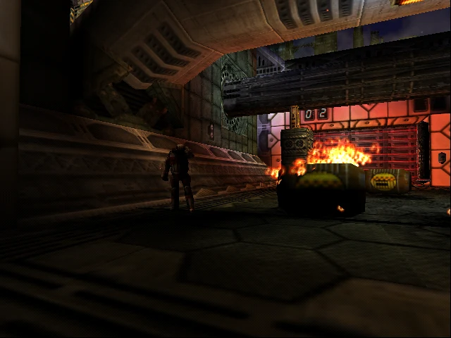
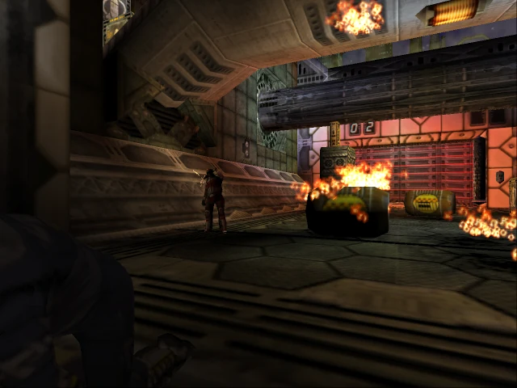

# Messiah (2000 — Win32 3dfx Glide 3.x)

| Field | Value |
| :--- | :--- |
| **Category** | Commercial Game |
| **Year** | 2000 *(v1.2 patch: 2000)* |
| **Platform(s)** | `Win32 / Wine (glide3x.dll)` |
| **Glide API & Version** | **Glide 3.x (`glide3x.dll`, Voodoo5 `3.10` `PIXEXT` / Voodoo3 `3.10` / Voodoo2 `3.03`)** |
| **Recommended Card Profile** | `Voodoo5` (`3.10`, native **`PIXEXT` 4× FSAA** via `grSstWinOpenExt`) · `Voodoo3` (`3.10`) · `Voodoo2` (`3.03`) |
| **Verified Backends** | Vulkan · OpenGL 3.3 Core (WGL) · Software (AVX2 / AVX-512 / Scalar) |
| **Preset File(s)** | [`glide-ng.ini`](./glide-ng.ini) (`1×`, Voodoo2) · [`glide-ng.hq.ini`](./glide-ng.hq.ini) (**Voodoo5 `PIXEXT` `4×` AA** + Linear, recommended) · [`glide-ng.voodoo3.ini`](./glide-ng.voodoo3.ini) (Voodoo3 `3.10`) · [`glide-ng.software.ini`](./glide-ng.software.ini) (CPU Software `2×2 SSAA`) |
| **Status** | Verified |

---

## Overview

Shiny Entertainment's cyberpunk action-adventure *Messiah* ships two dedicated Windows executables built on a real-time adaptive tessellation engine (**RT-LOD**): **`MessiahGlide3x.exe` (3dfx Glide 3.x)** and **`MessiahD3D.exe` (Direct3D 7 HAL)**. The **v1.2** executable is also a rare commercial showcase for 3dfx **VSA-100 (`Voodoo5`)** extensions: when **`PIXEXT`** and **`TEXFMT`** are reported in `GR_EXTENSION`, **`MessiahGlide3x.exe`** resolves **`grSstWinOpenExt`** and **`grTBufferWriteMaskExt`** automatically and opens its context with **`GR_PIXFMT_AA_4_ARGB_8888` (`0x000b`)** (32-bit 4× FSAA / T-Buffer).

Under **`glide-ng`**, **`MessiahGlide3x.exe`** runs reliably across **Vulkan** (`Voodoo2`, `Voodoo3`, and **`Voodoo5` `4×` FSAA**), **OpenGL 3.3 Core (WGL)**, and **CPU Software AVX2 (`2×2 SSAA`)**, matching **`MessiahD3D.exe`** (Direct3D 7 HAL) across additive flame bursts, laser gates, floating sparks, dark cyberpunk shadows, dynamic per-frame gamma table fades, and smooth tessellated character models while adding crisp hardware anti-aliasing.

---

## Editions, Patches & Executables

| Binary / Renderer | Graphics API | Works with `glide-ng`? | Technical Notes |
| :--- | :--- | :---: | :--- |
| **`MessiahGlide3x.exe`** (`v1.2`) | **Glide 3.x (`glide3x.dll`)** | **Yes (Recommended)** | Probes `PIXEXT` + `TEXFMT`. On **`Voodoo5` (`3.10`)**, auto-opens **`grSstWinOpenExt(..., GR_PIXFMT_AA_4_ARGB_8888)`** (`4×` FSAA) and lists `VOODOO5` in `OPTIONS → VIDEO SETTINGS`. On **`Voodoo2` / `Voodoo3`**, uses standard `grSstWinOpen`. |
| **`MessiahD3D.exe`** (`v1.2`) | Direct3D 7 HAL | No *(Comparison baseline)* | Works on WineD3D's default `gl` renderer for direct visual parity comparison against `MessiahGlide3x.exe`. |

> **Command-line switches (`README.txt` §11.0):** `-i` skips startup logo movies (`Interplay.MVE`, `Slogo.mve`, `ttslogo.mve`), `-s` disables sound, `-o` disables fog, `-v` disables mip-mapping, and `+!` enables the official Win2K menu-transition workaround (`Messiah 3DFX (SafeMode).bat`).

---

## Recommended Launch Configurations (Wine32 / Windows)

Install CD1 **`DATA1.CAB`**, apply the **`v1.2`** update, and copy **`glide-ng`'s** Win32 **`glide3x.dll`** into the **`Messiah`** directory next to **`MessiahGlide3x.exe`**.

### One-Time Wine Prefix & Disc Setup

```bash
WINEARCH=win32 WINEPREFIX=/path/to/prefix wineboot -u
WINEARCH=win32 WINEPREFIX=/path/to/prefix wine reg add \
  'HKCU\Software\Wine' /v Version /t REG_SZ /d win98 /f

ln -sfn /path/to/cd1 /path/to/prefix/dosdevices/d:
WINEARCH=win32 WINEPREFIX=/path/to/prefix wine reg add \
  'HKLM\Software\Wine\Drives' /v 'd:' /t REG_SZ /d cdrom /f
```

Add a `.windows-label` file containing **`MESSIAH`** inside `cd1/`.

> **Audio CD2 prompt:** On launch, if CD2 (audio disc) is not mounted, click **OK** (or press **`Enter`** / **`Space`**) on *"Please insert Messiah CD2 and wait for the drive light to turn off."* to enter the main menu immediately.

### Option A: Best Visuals — Voodoo5 `PIXEXT` `4×` AA (`glide-ng.hq.ini`) *(Recommended)*

```bash
WINEARCH=win32 WINEPREFIX=/path/to/prefix \
WINEDLLOVERRIDES="glide3x=n" \
GLIDE_NG_CONFIG=/path/to/glide-ng.hq.ini \
  wine explorer /desktop=MS,640x480 MessiahGlide3x.exe -i
```

Match the `/desktop=MS,WxH` resolution to the mode configured inside **`OPTIONS → VIDEO SETTINGS`** (e.g. **`640x480`** default, or **`800x600`**). On CPU-only Vulkan hosts (`llvmpipe`), pass `LP_NUM_THREADS=4`.

### Option B: Voodoo2 Vulkan `1×` (`glide-ng.ini`)

```bash
WINEARCH=win32 WINEPREFIX=/path/to/prefix \
WINEDLLOVERRIDES="glide3x=n" \
GLIDE_NG_CONFIG=/path/to/glide-ng.ini \
  wine explorer /desktop=MS,640x480 MessiahGlide3x.exe -i
```

### Option C: Voodoo3 Vulkan `1×` (`glide-ng.voodoo3.ini`)

```bash
WINEARCH=win32 WINEPREFIX=/path/to/prefix \
WINEDLLOVERRIDES="glide3x=n" \
GLIDE_NG_CONFIG=/path/to/glide-ng.voodoo3.ini \
  wine explorer /desktop=MS,640x480 MessiahGlide3x.exe -i
```

### Option D: OpenGL 3.3 Core (WGL)

Interplay's **`Mmac3.dll`** FMV movie player switches to DirectDraw on the **same `HWND`** between the menu and gameplay. On Wine, temporarily set `renderer=no3d` when using **`opengl_es` (WGL)** so `wined3d` does not collide with `SetPixelFormat()` on the reused window:

```bash
WINEARCH=win32 WINEPREFIX=/path/to/prefix wine reg add \
  'HKCU\Software\Wine\Direct3D' /v renderer /t REG_SZ /d no3d /f
WINEARCH=win32 WINEPREFIX=/path/to/prefix \
WINEDLLOVERRIDES="glide3x=n" GLIDE_NG_BACKEND=opengl_es \
  wine explorer /desktop=MS,640x480 MessiahGlide3x.exe -i
```

Delete the `renderer` registry value afterward if launching **`MessiahD3D.exe`** (Direct3D 7).

### Option E: CPU Software Rasterizer (`glide-ng.software.ini` — `2×2 SSAA`)

```bash
WINEARCH=win32 WINEPREFIX=/path/to/prefix \
WINEDLLOVERRIDES="glide3x=n" \
GLIDE_NG_CONFIG=/path/to/glide-ng.software.ini \
  wine explorer /desktop=MS,640x480 MessiahGlide3x.exe -i
```

---

## Visual Progression Gallery

All captures below are from *Messiah* **`v1.2`** (`640×480`) opening sector inside Wine32 (`MessiahGlide3x.exe` vs. `MessiahD3D.exe`):

| | |
| :---: | :---: |
| <br>**1. Main Menu (`Voodoo5` `4×` AA · `640×480`)**<br>Rotating silver wireframe badge and translucent glowing blue text highlights. | <br>**2. `VIDEO SETTINGS` (`VOODOO5` Detected)**<br>Reports `DRIVER: 3DFX INTERACTIVE`, `DEVICE: VOODOO5`, gamma calibration ramp, and native `FULL SCENE ANTI-ALIASING` toggle. |
| <br>**3. Direct3D 7 HAL Baseline (`MessiahD3D.exe`)**<br>WineD3D Direct3D 7 reference of the burning-barrel alley firefight and red laser door `02`. | <br>**4. Glide 3.x — Vulkan `1×` (`Voodoo2 3.03`)**<br>Clean parity with the D3D7 baseline across dynamic glow sparks, laser barrier, shadows, and hexagonal floor panels. |
| <br>**5. Glide 3.x — Vulkan `Voodoo5` `PIXEXT` `4×` AA (`glide-ng.hq.ini`)**<br>Opened via **`grSstWinOpenExt(..., GR_PIXFMT_AA_4_ARGB_8888)`**; smooth curved worker armor, glowing golden overhead halo, and crisp steel ribbing. | <br>**6. Glide 3.x — Vulkan `Voodoo3` (`3.10`) Close-Up**<br>Real-time RT-LOD Light Cop mesh silhouetted against additive barrel flames and neon gate lighting. |
| <br>**7. Glide 3.x — OpenGL 3.3 Core (WGL)**<br>Hardware OpenGL 3.3 Core parity across `grSstWinClose` / FMV transition / reopen (with Wine `renderer=no3d`). | <br>**8. Glide 3.x — CPU Software AVX2 (`2×2 SSAA`)**<br>Zero-GPU rasterizer matching Direct3D 7's exact camera angle, burning flames, ceiling spark cluster, and smooth diagonal edges. |

---

## Visual Quality & Performance Tuning

* **`Voodoo5` `PIXEXT` `4×` FSAA:** Choosing **`glide-ng.hq.ini`** reports a `32 MB` / TMU **`Voodoo5`** profile (`PIXEXT` + `TEXFMT`), letting `MessiahGlide3x.exe` invoke **`grSstWinOpenExt`** directly for 4× anti-aliasing without losing specular highlights or additive sparks.
* **Color precision & gamma:** *Messiah* updates a 256-entry hardware **`grLoadGammaTable`** LUT smoothly across screen fades; keep `gamma` unset (`1.0` default) and adjust brightness via **`OPTIONS → VIDEO SETTINGS → GAMMA CORRECTION`**.
* **Character detail & mip-mapping:** In `OPTIONS → VIDEO SETTINGS`, you can raise **`CHARACTER TEXTURE RESOLUTION (AGP)`**, **`RESOLUTION`**, and enable **`MIP MAPPING`** / **`POLYGON STRIPS`** on fast hardware Vulkan GPUs.

---

## Quirks, Known Issues & Controls

### Installation & Engine Notes
* **DirectDraw FMV window resize (`Mmac3.dll`):** When transitioning from the menu through `intro.mve` into gameplay, `Mmac3.dll` calls `SetDisplayMode(640, 480)`. On headless/virtual-desktop X11 displays without dynamic RandR switching, launching with **`explorer /desktop=MS,640x480`** avoids leaving black margins around the `640×480` canvas after the movie ends.
* **Corrupted config / controls reset:** All key bindings and video settings are saved in **`Messiah.cfg`**. Delete `Messiah.cfg` in the game folder to restore factory defaults.
* **Music soundtrack (`CD2`):** Background music tracks live as Red Book CD-audio on disc 2 (`mess2.cue`). Without CD2 mounted, dismissing the startup prompt plays all sound effects and voiceovers normally.

### Useful Controls

| Action | Key |
| :--- | :--- |
| **Move Forward / Backward / Turn** | `Up` / `Down` / `Left` / `Right` |
| **Strafe Left / Right** | `Z` / `X` |
| **Jump / Flap Wings** | `Ctrl` |
| **Action / Possess** | `Enter` |
| **Primary Weapon / Shoot** | `Space` / `Mouse 1` |
| **Secondary Weapon / Grenade** | `C` |
| **Depossess Character** | `Backspace` |
| **Crouch / Crawl** | `D` |
| **Walk Toggle** | `Shift` |
| **Freelook** | `A` / `Mouse 2` |
| **Mission Objectives** | `F5` |
| **Skip Cutscene / Pause Menu** | `Esc` |
