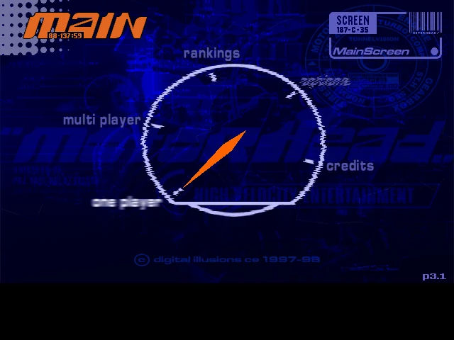
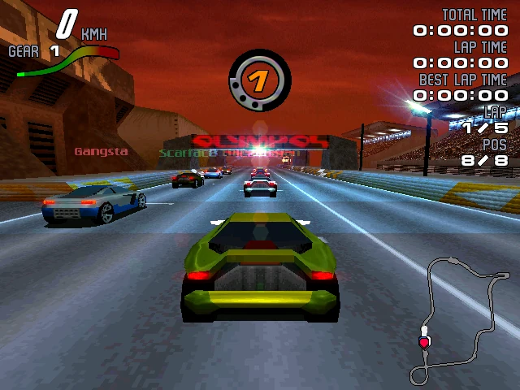
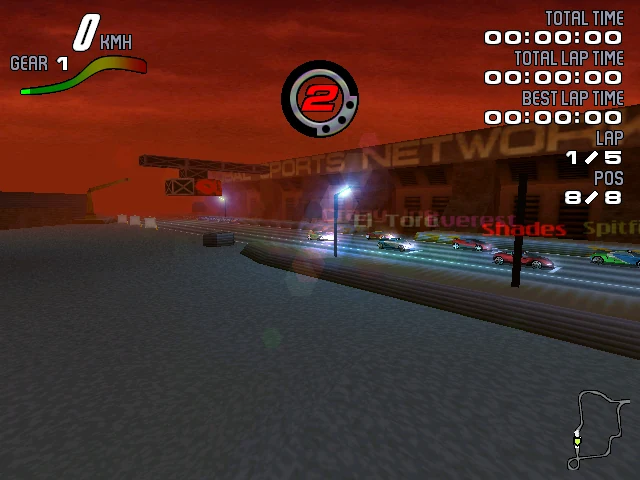
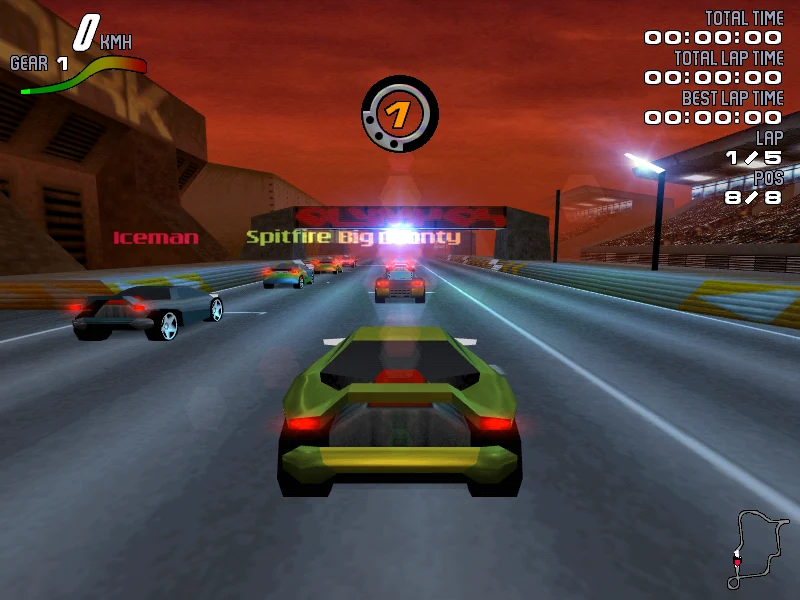
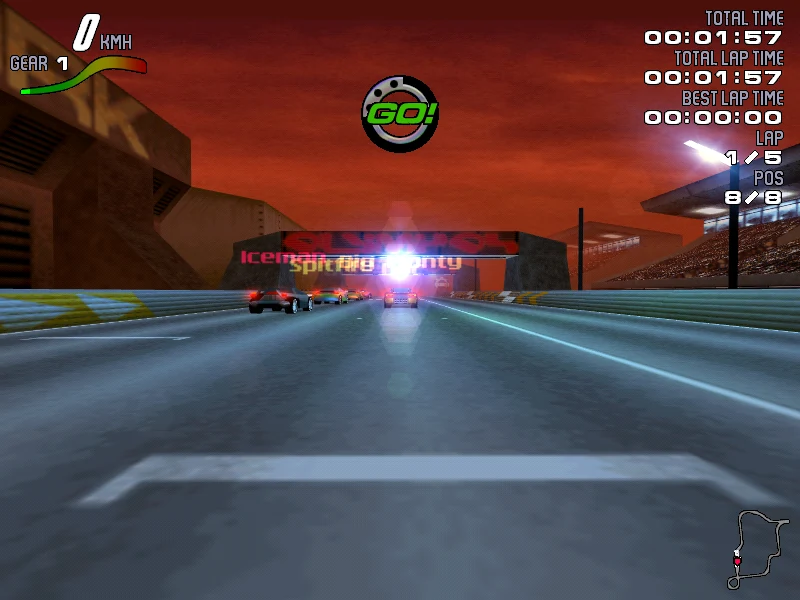
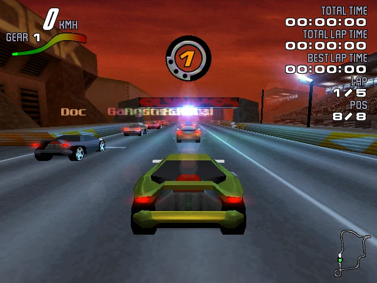
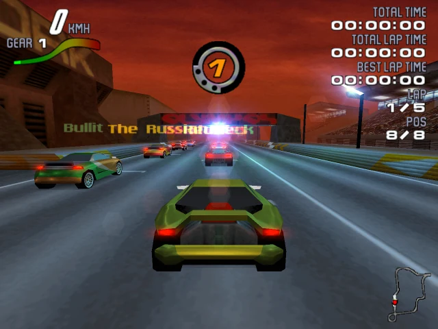

# Motorhead (1998 — Win32 3dfx Glide 2.x)

| Field | Value |
| :--- | :--- |
| **Category** | Commercial Game |
| **Year** | 1998 *(v3.0 / p3.1 patches: 1998–1999)* |
| **Platform(s)** | `Win32 / Wine (glide2x.dll)` |
| **Glide API & Version** | **Glide 2.x (`glide2x.dll`, Voodoo2 `2.56` / Voodoo1 `2.48`)** |
| **Recommended Card Profile** | `Voodoo2` (`2.56`, unlocks `800×600`) · `VoodooGraphics` (`2.48`, `640×480`) |
| **Verified Backends** | Vulkan · OpenGL 3.3 Core (WGL) · Software (AVX2 / AVX-512 / Scalar) |
| **Preset File(s)** | [`glide-ng.ini`](./glide-ng.ini) (`1×`, Vulkan) · [`glide-ng.hq.ini`](./glide-ng.hq.ini) (`4× MSAA` + Linear, recommended) · [`glide-ng.voodoo1.ini`](./glide-ng.voodoo1.ini) (Voodoo1 SST-1) · [`glide-ng.software.ini`](./glide-ng.software.ini) (CPU Software `2×2 SSAA`) |
| **Status** | Verified |

---

## Overview

Digital Illusions CE's (*DICE*) futuristic TransAtlantic-style arcade racer pairs a sleek `640×400×8` DirectDraw radial tachometer menu with a fast hardware-accelerated 3D racing engine supporting **`voodoo` (3dfx Glide 2.x)**, **`display` (Direct3D 5 HAL)**, `psgl` (PowerSGL), and **`cliff` (DICE's CPU software rasterizer)**.

In **`voodoo`** mode, **`motor.exe`** runs an **inverted 16-bit Z-buffer** (`GR_DEPTHBUFFER_ZBUFFER`, `GR_CMP_GEQUAL`, cleared to `0`), speculative chrome car-body reflection shading, additive headlamp beams, and per-frame **`GR_BUFFER_AUXBUFFER`** occlusion readbacks (`ZRead On`) that dynamically gate glowing red brake/taillight halos, trackside floodlight blooms, and stacked hexagonal lens-flare ghosts behind buildings, gantries, and opponent cars.

Under **`glide-ng`**, patched **`p3.1`** (`motor.exe`) launches cleanly at **`640×480`** and **`800×600`** across **Vulkan** (`1×` and **`4× MSAA`**), **OpenGL 3.3 Core (WGL)**, and **CPU Software AVX2 (`2×2 SSAA`)** with complete taillight glows, floodlight blooms, and lens-flare occlusion matching Direct3D while dramatically improving over the blocky point-sampled **`cliff`** software baseline.

---

## Editions, Patches & Executables

| Binary / Renderer | Graphics API | Works with `glide-ng`? | Technical Notes |
| :--- | :--- | :---: | :--- |
| **`motor.exe`** (`Renderer voodoo`, `p3.1` / `v3.0`) | **Glide 2.x (`glide2x.dll`)** | **Yes (Recommended)** | Native **`800×600`** (`Voodoo2`) and **`640×480`** (`Voodoo1`/`Voodoo2`). Full bilinear filtering, car reflection shading, smooth shadow projection, overhead floodlight halos, brake/taillight glows, and hexagonal sun lens flares (`4× MSAA` cleanly anti-aliases chassis & guardrail edges). |
| **`motor.exe`** (`Renderer display`) | Direct3D 5 HAL | No *(Comparison baseline)* | Works on WineD3D when `glide2x.dll` is not loaded (`glide2x.dll` auto-defaults to `voodoo` if present). Comparable lighting and lens flares at `640×480`, without Glide `4× MSAA` smoothing. |
| **`motor.exe`** (`Renderer cliff`) | CPU Software (`DI's Software Driver`) | No *(Comparison baseline)* | Runs without hardware acceleration. Point-sampled road and wall textures, horizontal shading bands across the wet asphalt, stepped polygon edges, and oversized HUD minimap. |
| **`motor.exe`** (`Renderer psgl`) | PowerVR `PowerSGL` | No | Legacy NEC/VideoLogic PowerVR PCX driver; ignored without `sgl.dll`. |

> **Patches (`v3.0` → `p3.1`):** Upgrade the base OEM/retail install with the official **`mhp30.exe`** (`v3.0`) patch (`DataNoDiamond/Tracks/Track3/Packed` merged into `Tracks/track3/`) followed by the **`p3.1`** **`motor.exe`** update (`p3.1` displays in the lower-right corner of the blue `MAIN` dial menu).

---

## Recommended Launch Configurations (Wine32 / Windows)

Install base **`data1.cab`**, apply **`v3.0`** and **`p3.1`**, and copy **`glide-ng`'s** Win32 **`glide2x.dll`** into the **`Motorhead`** directory next to **`motor.exe`**.

### One-Time Wine Prefix & Disc Setup

Keep **`Direct3D`** at Wine's default OpenGL renderer (**do not** set `renderer=no3d`/`gdi`, which crashes in the 8-bit DirectDraw menu under `wined3d`, and **do not** set `renderer=vulkan`, which rejects the `640×400×8` menu mode).

```bash
WINEARCH=win32 WINEPREFIX=/path/to/prefix wineboot -u
WINEARCH=win32 WINEPREFIX=/path/to/prefix wine reg add \
  'HKCU\Software\Wine' /v Version /t REG_SZ /d win98 /f

# Retail / p3.1 motor.exe checks D:\movies\movies.pak.
# Point dosdevices/d: directly at the subfolder containing Movies/ (e.g. cd/mhead).
ln -sfn /path/to/cd/mhead /path/to/prefix/dosdevices/d:
WINEARCH=win32 WINEPREFIX=/path/to/prefix wine reg add \
  'HKLM\Software\Wine\Drives' /v 'd:' /t REG_SZ /d cdrom /f
```

Add a `.windows-label` file containing **`Motorhead`** inside the linked `D:` disc directory.

### `Game/MotorHead.CFG` Key Visual Settings

```text
Renderer        voodoo
ScreenDimension 800 600
DetailMode      Max
LensFlares      On
Halos           On
Shadow          On
SkidMarks       On
ZRead           On
SkyImage        On
CarShading      Reflection
```

> Use **`explorer /desktop=MH,800x600`** (matching `ScreenDimension 800 600`, or **`640x480`** for `ScreenDimension 640 480`). Launching directly without a desktop manager on headless X11 leaves the game window sized at its `640×400` 2D menu geometry and clips the bottom 80 px (`y = 400..479`) of the 3D racing viewport.

### Option A: Best Visuals — `800×600` with `4× MSAA` (`glide-ng.hq.ini`) *(Recommended)*

```bash
WINEARCH=win32 WINEPREFIX=/path/to/prefix \
WINEDLLOVERRIDES="glide2x=n" \
GLIDE_NG_CONFIG=/path/to/glide-ng.hq.ini \
  wine explorer /desktop=MH,800x600 motor.exe
```

On CPU-only Vulkan hosts (`llvmpipe`), add `LP_NUM_THREADS=4` to conserve 32-bit Wine virtual address space.

### Option B: Native Vulkan `1×` (`glide-ng.ini`)

```bash
WINEARCH=win32 WINEPREFIX=/path/to/prefix \
WINEDLLOVERRIDES="glide2x=n" \
GLIDE_NG_CONFIG=/path/to/glide-ng.ini \
  wine explorer /desktop=MH,640x480 motor.exe
```

### Option C: OpenGL 3.3 Core (WGL)

```bash
WINEARCH=win32 WINEPREFIX=/path/to/prefix \
WINEDLLOVERRIDES="glide2x=n" GLIDE_NG_BACKEND=opengl_es \
  wine explorer /desktop=MH,640x480 motor.exe
```

### Option D: CPU Software Rasterizer (`glide-ng.software.ini` — `2×2 SSAA`)

```bash
WINEARCH=win32 WINEPREFIX=/path/to/prefix \
WINEDLLOVERRIDES="glide2x=n" GLIDE_NG_BACKEND=software GLIDE_NG_SW_AA=ssaa \
  wine explorer /desktop=MH,640x480 motor.exe
```

---

## Visual Progression Gallery

All captures below are from *Motorhead* **`p3.1`** (`RedRock` track, `DetailMode Max`, `ZRead On`, `LensFlares On`, `Halos On`) inside Wine32:

| | |
| :---: | :---: |
| <br>**1. Main Menu (`640×400×8` inside `640×480` Desktop)**<br>The `p3.1` radial tachometer dial rotates counter-clockwise/clockwise with **`Left`** / **`Right`**. Requires Wine's default `gl` DirectDraw path. | <br>**2. Native CPU Software (`Renderer cliff` · `640×480`)**<br>Unfiltered point-sampled road textures show visible staircase striping and rough polygon edges across `Resonic` and trackside walls. |
| <br>**3. Direct3D 5 HAL Baseline (`Renderer display` · `640×480`)**<br>WineD3D Direct3D 5 camera pan showing smooth lighting, floodlight glare, and translucent hexagonal bokeh flares. | <br>**4. Glide 2.x — Vulkan `4× MSAA` (`800×600`, `glide-ng.hq.ini`)**<br>Crisp native **`800×600`** Voodoo2 race grid with bilinear road reflection, glowing brake/taillight halos, booming **OLYMPUS** bridge flare, overhead lamp bloom, and hexagonal bokeh stack. |
| <br>**5. Glide 2.x — Bumper Cam (`F1` · `800×600` Vulkan `4× MSAA`)**<br>Race start **`GO!`** inside-car perspective highlighting translucent opponent nameplate overlays, starting-line horizon glare, and vertical lens-flare stack. | <br>**6. Glide 2.x — Vulkan `1×` (`640×480`, `glide-ng.ini`)**<br>Unfiltered `1×` Voodoo2 parity matching the `800×600` HQ chase camera and full red brake-light halos. |
| <br>**7. Glide 2.x — OpenGL 3.3 Core (WGL, `640×480`)**<br>Identical lamp blooms, taillight glows, metallic chassis shading, and hexagonal flare occlusion via desktop OpenGL 3.3 Core. | <br>**8. Glide 2.x — CPU Software AVX2 (`2×2 SSAA`, `640×480`)**<br>Zero-GPU rasterizer parity showing every glowing taillight halo, floodlight bloom, and vertical lens-flare ring. |

---

## Visual Quality & Performance Tuning

* **`800×600` Voodoo2 resolution + `4× MSAA`:** With `card_model = Voodoo2` and `ScreenDimension 800 600` in `Game/MotorHead.CFG`, *Motorhead* runs cleanly at `800×600` with **`msaa = 4`** (`glide-ng.hq.ini`) and shows zero polygon seam artifacts or sprite glitches.
* **Depth-buffer occlusion (`ZRead On`):** Leave **`ZRead On`**, **`LensFlares On`**, and **`Halos On`** in `Game/MotorHead.CFG` so *Motorhead* hides opponent taillight glows and sun flares when occluded by cars, walls, and tunnels. Setting `ZRead Off` slightly increases frame rate on weak hosts at the cost of flares shining through solid geometry.
* **Color depth:** Select a **24-bit** desktop display when launching under X11/Xvfb (`16-bit` X visuals fail `wined3d` GL menu blits).

---

## Quirks, Known Issues & Controls

### Installation & Engine Notes
* **Smacker intro movies (~90 s):** The unpatched disc movies (`D:\movies\movies.pak`) play at startup before entering the `MAIN` radial tachometer screen; press **`Esc`** / **`Space`** to step past each clip.
* **DirectDraw menu exit / resolution:** Ensure the virtual desktop (`explorer /desktop=MH,WxH`) matches **`ScreenDimension W H`** in `Game/MotorHead.CFG` so `motor.exe`'s transition from the `640×400` 2D menu into the `640×480` or `800×600` Glide framebuffer never clips the lower HUD or minimap.
* **OEM disc path vs. retail `p3.1`:** Some bundled discs store `movies.pak` inside a `mhead\Movies\` subfolder, whereas retail/patched `motor.exe` checks `D:\movies\movies.pak` at the root of the CD drive. Link `dosdevices/d:` to the subfolder containing `Movies/`.

### Useful Controls

| Action | Key |
| :--- | :--- |
| **Skip Intro Movies / Cancel** | `Esc` / `Space` |
| **Rotate Menu Tachometer Dial** | `Left` / `Right` |
| **Confirm Menu Selection** | `Enter` |
| **Accelerate / Brake & Reverse** | `Up` / `Down` |
| **Steer Left / Right** | `Left` / `Right` |
| **Cycle Camera View (Chase / Bumper)** | `F1` |
| **Rear-View Mirror / Look Back** | `F2` / `B` |
| **Shift Up / Down (Manual)** | `A` / `Z` |
| **Horn** | `H` |
| **Pause / Race Menu** | `Esc` |
