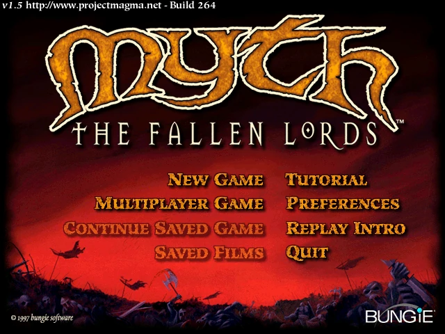
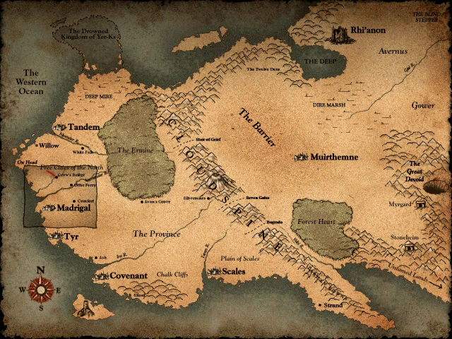
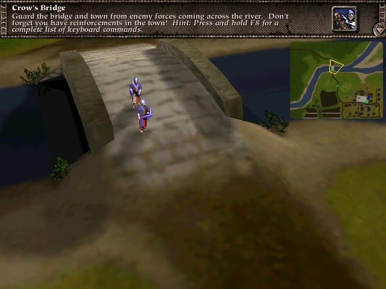
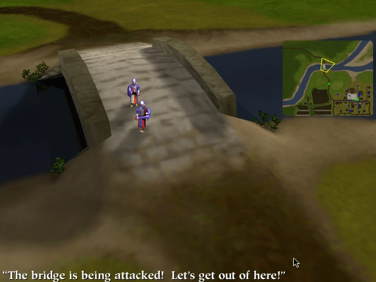
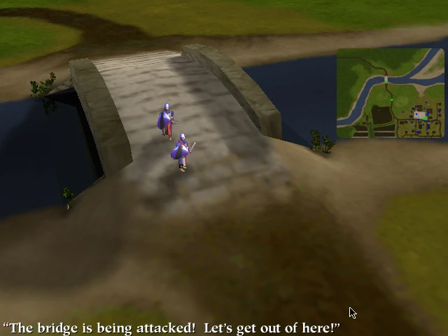

# Myth: The Fallen Lords (1997 — Win32 3dfx Glide 2.x)

| Field | Value |
| :--- | :--- |
| **Category** | Commercial Game |
| **Year** | 1997 |
| **Platform(s)** | `Win32 / Wine (glide2x.dll)` |
| **Glide API & Version** | **Glide 2.x** (`2.56` on Voodoo2 / `2.48` on Voodoo Graphics) |
| **Recommended Card Profile** | `Voodoo2` (default) · `VoodooGraphics` (`2.48`) |
| **Verified Backends** | Vulkan · OpenGL 3.3 Core (WGL) · Software (AVX2 / AVX-512 / Scalar) |
| **Preset File(s)** | [`glide-ng.ini`](./glide-ng.ini) (Voodoo2) · [`glide-ng.hq.ini`](./glide-ng.hq.ini) (4× MSAA + Linear) · [`glide-ng.voodoo1.ini`](./glide-ng.voodoo1.ini) (Voodoo1 SST-1) · [`glide-ng.software.ini`](./glide-ng.software.ini) (CPU Software) |
| **Status** | Verified |

---

## Overview

Bungie's 1997 real-time tactics classic *Myth: The Fallen Lords* paints its continuous 3D heightfield meshes without a hardware Z-buffer using back-to-front painter's sorting (`grDrawPolygonVertexList` / `grDrawPlanarPolygonVertexList`), two-pass multiplicative **shadow / lightmap modulation** (`GR_TEXFMT_P_8` base tile followed by `GR_TEXFMT_INTENSITY_8` with `grAlphaBlendFunction(GR_BLEND_ZERO, GR_BLEND_SRC_COLOR)`), paletted **`GR_TEXFMT_AP_88`** sprite billboards for warriors, trees, and reeds, an antialiased **`GR_TEXFMT_ALPHA_8`** (`256×256`) subtitle font atlas, and direct `grLfbLock()` compositing for the translucent tactical minimap.

When `glide2x.dll` is present next to the executable, *Myth* automatically enables the **`3Dfx`** entry inside **Preferences → Rendering** along with its live **3Dfx Gamma** slider (`grGammaCorrectionValue`).

---

## Editions, Patches & Executables

| Build / Renderer | Graphics API | Works with `glide-ng`? | Technical Notes |
| :--- | :--- | :---: | :--- |
| **Retail `MYTH_TFL.EXE` v1.2** *(743,424 B, Feb 1998)* | **Glide 2.x (`glide2x.dll`)** / Software | Yes *(RAM check limit)* | Original Bungie CD build with the classic `GlobalMemoryStatus` / `>2 GB` RAM startup dialog on modern systems. Its 3dfx texture bank table (`bank[0]=10×64×64`, `bank[1]=P_8`, `bank[2]=INTENSITY_8` shadow map, `bank[3]=ALPHA_8` font atlas) matches `render_3dfx.c` directly. |
| **Project Magma `Myth_TFL.exe` v1.5 Build 264** *(745,472 B, Jun 2005)* | **OpenGL** / Glide 2.x (`glide2x.dll`) / Software | Yes *(with bank table note below)* | Community update (`MythTFL_15_Update.exe`) fixing the `>2 GB` RAM check and adding native **OpenGL** rendering. Stock `v1.5` Build 264 ships with an upstream regression in its **3Dfx bank table** (`utilities_3dfx.c` at file offset `0x000b0f70`, details below). |
| **Stock `v1.5` Native `Open GL` Renderer** | OpenGL (`OPENGL32.dll`) | No *(Comparison baseline)* | Added by Project Magma `v1.5` (`Preferences → Rendering → Open GL`). Supports higher resolutions cleanly and serves as the reference comparison in the gallery below. |

> **Manual CD Layout Warning (`netonly` flag):** On a manual unpack of the retail disc without running `SETUP.EXE`, **`TAGS/LOCAL/FLAG/NETONLY`** forces the client into multiplayer-only spawn mode (greyed-out **New Game** button). Delete `tags/local/flag/netonly` in the installed game folder to unlock the single-player campaign, saved games, and cutscenes.

> **Upstream Project Magma v1.5 (Build 264) `3Dfx` Regression Note:** In unpatched `v1.5` Build 264 (`Myth_TFL.exe`, `745,472 B`), `render_3dfx.c` and the static `texture_bank_descriptor[4]` table at file offset **`0x000b0f70`** contain two regressions compared to retail `v1.2`:
> 1. **`bank[2]` ↔ `bank[3]` index swap:** `render_3dfx.c` uploads `64×64` terrain lightmaps to **bank `3`** (`256×256` `ALPHA_8`, leaving rows `16..255` zeroed → black terrain on real Voodoo hardware and all wrappers alike) and the font atlas to **bank `2`** (`64×64` `INTENSITY_8`, `alpha = 0xFF` → solid white subtitle blocks).
> 2. **`bank[0]` slot count (`10` vs `32`):** The status-bar updater loops `32` times (`0..31`) into a `10`-slot descriptor (`bank[0].count = 10`), passing out-of-bounds heap values as TMU `startAddress` entries on slots `10..31`.
>
> For testing stock **3Dfx Glide 2.x** with **Project Magma `v1.5`**, prefer **OpenGL** in stock `v1.5`, official retail **v1.3**, or restoring the matching `.data` descriptor layout (`bank[0].count = 32` and swapping the 40-byte `bank[2]`/`bank[3]` entries at `0x000b0fc0` ↔ `0x000b0fe8`).

---

## Recommended Launch Configurations (Wine32 / Windows)

Drop `glide-ng`'s 32-bit **`glide2x.dll`** into the game folder next to `MYTH_TFL.EXE`, make sure `tags/` holds `artsound.gor`, `cutscene.gor`, `scrap.gor`, and `tags.gor`, remove `tags/local/flag/netonly`, and select **`3Dfx`** under **Preferences → Rendering** inside the main menu.

### One-Time Wine Prefix Setup

```bash
WINEARCH=win32 WINEPREFIX=/path/to/prefix wineboot -u
WINEARCH=win32 WINEPREFIX=/path/to/prefix wine reg add \
  'HKCU\Software\Wine' /v Version /t REG_SZ /d winxp /f
ln -sfn /path/to/cd /path/to/prefix/dosdevices/d:
WINEARCH=win32 WINEPREFIX=/path/to/prefix wine reg add \
  'HKLM\Software\Wine\Drives' /v 'd:' /t REG_SZ /d cdrom /f
```

### Option A: Standard Glide 2.x (`glide-ng.ini` — Vulkan `1×`, `nearest` Scaling)

```bash
WINEARCH=win32 WINEPREFIX=/path/to/prefix \
WINEDLLOVERRIDES="glide2x=n" \
GLIDE_NG_CONFIG=/path/to/glide-ng.ini \
GLIDE_NG_FULLSCREEN=0 \
  wine explorer /desktop=Myth,640x480 ./MYTH_TFL.EXE
```

To use the Win32 WGL OpenGL 3.3 Core backend instead of Vulkan without editing the preset, add `GLIDE_NG_BACKEND=opengl_es`. To emulate an authentic 1997 **`VoodooGraphics` (`2.48`)** single-TMU SST-1 board, substitute [`glide-ng.voodoo1.ini`](./glide-ng.voodoo1.ini).

### Option B: Best Visuals (`glide-ng.hq.ini` — Vulkan `4× MSAA` + Linear) *(Recommended)*

```bash
WINEARCH=win32 WINEPREFIX=/path/to/prefix \
WINEDLLOVERRIDES="glide2x=n" \
GLIDE_NG_CONFIG=/path/to/glide-ng.hq.ini \
GLIDE_NG_FULLSCREEN=0 \
  wine explorer /desktop=Myth,640x480 ./MYTH_TFL.EXE
```

### Option C: CPU Software Rasterizer (`glide-ng.software.ini` — AVX2 / AVX-512)

```bash
WINEARCH=win32 WINEPREFIX=/path/to/prefix \
WINEDLLOVERRIDES="glide2x=n" \
GLIDE_NG_CONFIG=/path/to/glide-ng.software.ini \
GLIDE_NG_FULLSCREEN=0 \
  wine explorer /desktop=Myth,640x480 ./MYTH_TFL.EXE
```

---

## Visual Progression Gallery

All captures are `640×480` frames from the opening campaign mission **Crow's Bridge**:

| | |
| :---: | :---: |
| <br>**1. Main Menu (`640×480`, DirectDraw frontend)**<br>With `tags/local/flag/netonly` removed, `NEW GAME` and `REPLAY INTRO` unlock cleanly alongside `PREFERENCES` (where **3Dfx** appears when `glide2x.dll` is present). | <br>**2. Campaign World Map & Briefing (`640×480`)**<br>Hand-painted parchment map routing from Madrigal north to **Crow's Bridge** before handing control over to `glide2x.dll`. |
| <br>**3. Reference: Native OpenGL (`v1.5`, `640×480`)**<br>Project Magma `v1.5` built-in OpenGL baseline with the top objective bar open, soft bridge shadow pass, river banks, stone parapet, reeds, warriors, and transparent tactical map. | <br>**4. 3Dfx Glide 2.x — Vulkan `4× MSAA` HQ ([`glide-ng.hq.ini`](./glide-ng.hq.ini))**<br>Exact parity with native OpenGL across smooth terrain filtering, multiplicative cast bridge shadow, shoreline reeds, transparent minimap with yellow frustum wire, and antialiased white subtitle font atlas (`ALPHA_8`). |
| <br>**5. 3Dfx Glide 2.x — OpenGL 3.3 Core / WGL `1×`**<br>Matches Vulkan pixel-for-pixel across bridge stone shading, two-pass shadow blend (`GR_BLEND_ZERO`, `GR_BLEND_SRC_COLOR`), `AP_88` unit sprites, cursor overlay, and subtitles. | <br>**6. 3Dfx Glide 2.x — CPU Software AVX2 `1×` ([`glide-ng.software.ini`](./glide-ng.software.ini))**<br>Multi-threaded CPU rasterizer renders the identical terrain shading, shadows, paletted foliage/warriors, LFB-composited minimap, and crisp `ALPHA_8` subtitles cleanly. |

---

## Visual Quality & Performance Tuning

### Flavour Comparison: Glide 2.x (`glide-ng`) vs. Native `Open GL` (`v1.5`)
* At matching `640×480`, **`glide-ng` (`glide2x.dll`) achieves full visual parity with Project Magma `v1.5`'s native OpenGL renderer** across `P_8` heightfield tiles, soft `INTENSITY_8` shadow modulation, `AP_88` unit sprites and shoreline reeds, transparent `grLfbLock()` overhead minimap, and smooth `ALPHA_8` subtitle rendering, while adding **offscreen `4× MSAA`** (`glide-ng.hq.ini`) along bridge arches, water edges, and minimap camera lines.
* On modern wide/high-resolution monitors where players want native widescreen UI scaling (`1024×768`+) above classic `640×480`, **Project Magma `v1.5`'s native OpenGL renderer** is the most practical daily driver; **`glide-ng`** lets both `Voodoo2` (`2.56`) and `VoodooGraphics` (`2.48`) accurately showcase the original 1997 3dfx rendering pipeline across Vulkan, OpenGL ES / WGL, and Software AVX2.

### Gamma & Card Profiles
* Both **`Voodoo2` (`2.56`)** and **`VoodooGraphics` (`2.48`)** single-TMU SST-1 profiles pass with zero warnings (all four texture banks consume <600 KB of the 2 MB TMU pool).
* Leave `[glide] gamma` unset so the in-game **3Dfx Gamma** slider (`Preferences`) drives `grGammaCorrectionValue` directly.

---

## Quirks, Known Issues & Controls

### Installation & Engine Notes
* **Lowercase `tags/local/` merge on POSIX hosts:** When extracting `MythTFL_15_Update.exe` manually under Linux alongside the uppercase `TAGS/LOCAL/` disc directory, merge into one lowercase `tags/local/` tree (skip the duplicate `playmyth.net` alt tags if unpacking straight from NSIS) so Wine resolves a single directory without shadowing.
* **`externals` log warnings in `myth_log.txt`:** The `Tag files` scanner inspects loose files inside the root folder on startup; non-tag messages about `glide2x.dll` / `README.TXT` in `myth_log.txt` are harmless and expected.
* **Startup splash:** Uncomment `no_splash = true` in `glide-ng.ini` (or pass `FX_GLIDE_NO_SPLASH=1`) to skip the one-shot startup splash animation.

### Useful Controls

| Key / Input | Action |
| :--- | :--- |
| **`Left-click` / Drag** | Select unit / box-select squad |
| **`Right-click` / Drag** | Move / gesture-orient squad formation |
| **`W` / `A` / `S` / `D`** or screen edges | Pan camera |
| **`Q` / `E`**, **`Arrow Left` / `Right`** | Orbit / rotate camera |
| **`R` / `F`**, **`Arrow Up` / `Down`** | Zoom camera in / out |
| **`1`–`9`** | Select formation shape (`Short Line`, `Long Line`, `Loose`, etc.) |
| **`T`** | Attack ground / special ability |
| **`Tab`** | Toggle overhead minimap |
| **`F7`** | Toggle unit rankings / player overlay |
| **`F8`** | Hold for full keyboard command chart |
| **`Esc`** | Pause / options menu |
