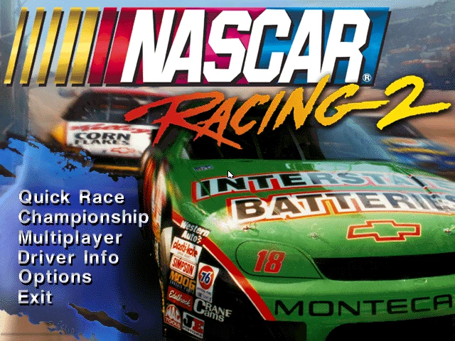
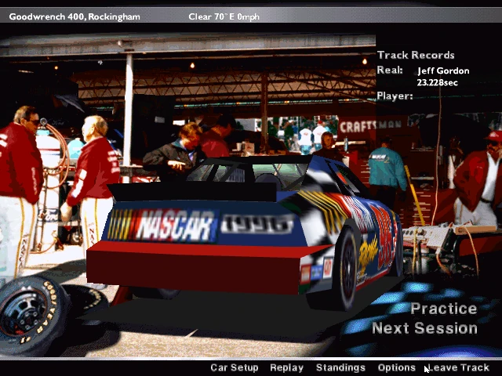
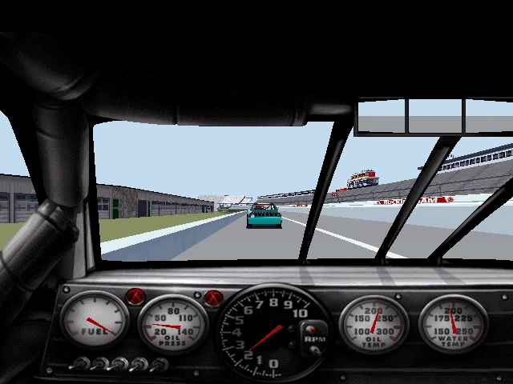
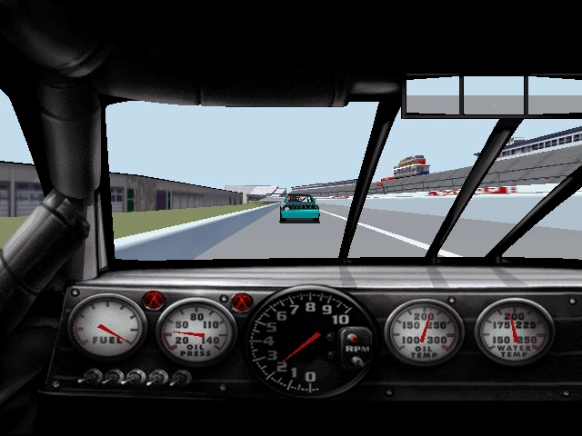
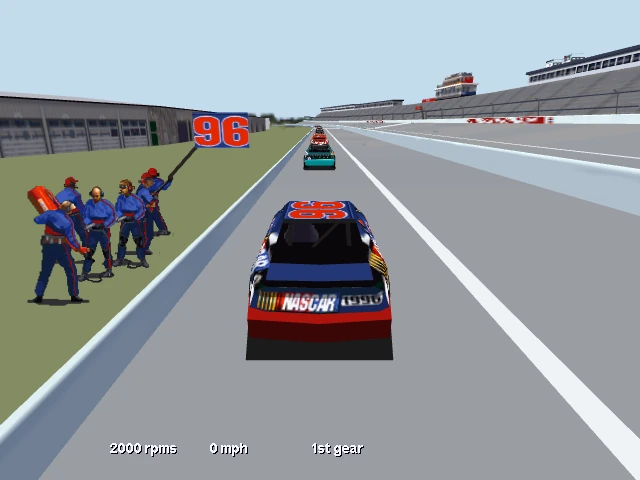

# NASCAR Racing 2 (1996 — 3dfx DOS)

| Field | Value |
| :--- | :--- |
| **Category** | Commercial Game |
| **Year** | 1996 (Official 3dfx Beta Patch v1.03: 1997) |
| **Platform(s)** | `DOS/32 (GLIDE2X.OVL via DOSBox Glide pass-through)` |
| **Glide API & Version** | Glide 2.x (`2.56` on Voodoo2 / `2.48` on Voodoo Graphics) |
| **Recommended Card Profile** | `Voodoo2` (default) · `VoodooGraphics` (authentic SST-1) |
| **Verified Backends** | Vulkan · OpenGL ES · Software (AVX2 / AVX-512 / Scalar) |
| **Preset File(s)** | [`glide-ng.ini`](./glide-ng.ini) (Voodoo2) · [`glide-ng.hq.ini`](./glide-ng.hq.ini) (`4× MSAA`) · [`glide-ng.voodoo1.ini`](./glide-ng.voodoo1.ini) (SST-1) · [`glide-ng.software.ini`](./glide-ng.software.ini) (CPU Software) |
| **Status** | Verified |

---

## Overview

Papyrus Design Group's 1996 stock-car racing simulator *NASCAR Racing 2* shipped with SVGA software (`NASCAR2.EXE`) and Rendition Vérité (`NASREND.EXE`) binaries before receiving an official **3dfx Glide 2.x DOS patch** (`N2-3DFX.EXE`, version `1.03(1)`). The patch supplies dynamically linked **`NAS3DFX.EXE`** (plus **`GNS3DFX.EXE`** for the *Grand National Series* expansion), loading **`GLIDE2X.OVL`** at **`640×480`**.

Inside the pit garage and on the oval track, `NAS3DFX.EXE` converts crisp photorealistic dashboards, track grandstands, catch fences, rotating 3D stock cars, distant fog haze (`N2FXFOG`), anti-aliased geometry (`N2FXAA`), chromakeyed pit crews, and the tri-pane rearview mirror to smooth bilinear-filtered Glide polygons, with an optional **`SET N2FXLOAD=0xffffffff`** flag unlocking full-resolution track and car livery mipmaps.

---

## Editions, Patches & Executables

| Executable / Patch | Renderer | Works with `glide-ng`? | Technical Notes |
| :--- | :--- | :---: | :--- |
| **`NAS3DFX.EXE` (v1.03 3dfx Patch, `N2-3DFX.EXE`)** | Glide 2.x (`GLIDE2X.OVL`) | **Yes (Recommended)** | Official Papyrus 3dfx beta executable (`1,374,731` B). Dynamically loads **`GLIDE2X.OVL`** (`grSstWinOpen`). Pair with `glide-ng`'s clean-room `build/dos/glide2x.ovl`. Requires launching from a **subdirectory** (see mount note below). |
| **`GNS3DFX.EXE` (v1.03 3dfx Patch)** | Glide 2.x (`GLIDE2X.OVL`) | **Yes** | Matching 3dfx binary (`1,382,131` B) for the *NASCAR Grand National Series* add-on pack (`N2-3DFX.EXE` bundles both). |
| **`NASCAR2.EXE` (Retail / v1.03)** | DOS CPU Software (`SVGA 640×480`) | No (No 3dfx) | Non-accelerated fallback (`1,386,067` B). Unfiltered 8-bit paletted track and pit billboards (`NAS3DFX.EXE` checks for `NASCAR2.EXE` in the same folder at startup!). |
| **`NASREND.EXE` (Retail)** | Rendition Vérité (`Speedy3D`) | No (Not Glide) | Legacy Speedy3D accelerator executable (`1,518,027` B). |

---

## Recommended DOSBox Configurations

Keep the DOSBox configuration minimal — only non-default overrides are shown below.

> **Important Mount & Patch Notes:**
> 1. **Do NOT mount the game folder directly as `C:\`!** `NAS3DFX.EXE` validates that **`NASCAR2.EXE`** lives inside `argv[0]`'s parent directory and fails with **`Unable to find nascar2.exe in ''`** if executed from the drive root `C:\`. Always mount the **parent** directory as `C:` and `cd` into a subfolder (e.g., `C:\NASCAR2` or `C:\game`).
> 2. **Keep `NASCAR2.EXE` installed beside `NAS3DFX.EXE`**, update retail v1.00 using **`PATCH.EXE`** (`v1.03` RTPatch revision 2) first, and run **`SETUP.EXE`** to confirm Sound Blaster 16 Stereo (`220h`, `IRQ 7`, `DMA 1`).
> 3. **Extract `N2-3DFX.EXE`:** The official `N2-3DFX.EXE` patch is a 16-bit Win3.1 Wise installer (`GLBSInstall`) containing `README3D.TXT`, `GNS3DFX.EXE`, and `NAS3DFX.EXE` as raw PKZIP deflate streams.
> 4. **Always set `SET N2FXLOAD=0xffffffff`** before starting `NAS3DFX.EXE` so Papyrus loads full-resolution textures instead of the default 1 MB (`0x100000`) downsampled mipmaps meant for 2 MB Voodoo Graphics cards.
> 5. Copy `glide-ng`'s clean-room HLE pass-through **`GLIDE2X.OVL`** (`build/dos/glide2x.ovl`) next to `NAS3DFX.EXE`.

### Option A: Patched DOSBox-SVN (Glide Pass-Through → `glide-ng`) *(Recommended)*

```ini
# dosbox-svn.conf (minimal overrides)
[dosbox]
memsize = 63

[sdl]
# Avoids SDL_UpdateRects SIGSEGV under sdl12-compat on modern Linux
output = opengl

[cpu]
cycles = max

[glide]
glide = true
```

```bash
GLIDE_NG_CONFIG=/path/to/glide-ng.ini \
  dosbox -conf dosbox-svn.conf \
  -c "mount C /path/to/nascar2_parent -freesize 512" \
  -c "imgmount D /path/to/Nascar_Racing_2.iso -t iso" \
  -c "C:" \
  -c "cd NASCAR2" \
  -c "SET N2FXLOAD=0xffffffff" \
  -c "NAS3DFX.EXE"
```

### Option B: DOSBox-X (Glide Pass-Through → `glide-ng`)

```ini
# dosbox-x-pass.conf (minimal overrides)
[dosbox]
memsize = 63

[cpu]
cycles = max

[voodoo]
glide = true
lfb = full
```

```bash
GLIDE_NG_CONFIG=/path/to/glide-ng.ini \
  dosbox-x -conf dosbox-x-pass.conf -nopromptfolder \
  -c "mount C /path/to/nascar2_parent -freesize 512" \
  -c "imgmount D /path/to/Nascar_Racing_2.iso -t iso" \
  -c "C:" \
  -c "cd NASCAR2" \
  -c "SET N2FXLOAD=0xffffffff" \
  -c "NAS3DFX.EXE"
```

### Option C: CPU Software Fallback (`glide-ng.software.ini`)

```bash
GLIDE_NG_CONFIG=/path/to/glide-ng.software.ini \
  dosbox -conf dosbox-svn.conf \
  -c "mount C /path/to/nascar2_parent -freesize 512" \
  -c "imgmount D /path/to/Nascar_Racing_2.iso -t iso" \
  -c "C:" \
  -c "cd NASCAR2" \
  -c "SET N2FXLOAD=0xffffffff" \
  -c "NAS3DFX.EXE"
```

### Reference Comparison: DOSBox-X Software Voodoo (No `glide-ng`)

```ini
# dosbox-x-sw.conf
[dosbox]
memsize = 63

[cpu]
cycles = max

[voodoo]
voodoo_card = software
glide = false
```

Replace the pass-through `GLIDE2X.OVL` with a real SST-1 **Glide 2.43** `GLIDE2X.OVL`.

---

## Visual Progression Gallery

All captures below show *NASCAR Racing 2* (`v1.03`, Goodwrench 400 at North Carolina Motor Speedway — Rockingham) under patched DOSBox-SVN at **`640×480`** with `SET N2FXLOAD=0xffffffff`:

| | |
| :---: | :---: |
| <br>**1. Main Menu (`NAS3DFX.EXE`, `640×480`)**<br>Iconic #18 Bobby Labonte title art written cleanly via Glide LFB frame blits. | <br>**2. Pit Garage (`Vulkan 4× MSAA`)**<br>Rotating 3D `#96` Chevrolet Monte Carlo rendered over the photorealistic Rockingham garage backdrop. |
| <br>**3. Native DOS Software (`NASCAR2.EXE`, `640×480` SVGA)**<br>In-car dashboard showing crisp analog needles over unfiltered 8-bit paletted walls, fences, and pit buildings. | <br>**4. 3dfx Glide (`Vulkan 4× MSAA`, `640×480`)**<br>Same pit-lane view with smooth bilinear-filtered concrete walls, anti-aliased roll-cage windshield struts, triple mirror, and metallic dashboard gauges. |
| <br>**5. 3dfx Glide (`OpenGL ES 1×`, `640×480`)**<br>Matching cockpit perspective showing identical gauge readability, sky brightness, wall gradients, and smooth bilinear filtering. | <br>**6. External Chase View (`F10` · `Vulkan 4× MSAA`)**<br>Chromakeyed pit crew raising the `#96` pit board beside the asphalt pit lane lined with rival stock cars. |

---

## Visual Quality & Performance Tuning

### Built-In 3dfx Environment Variables (`NAS3DFX.EXE`)
* **`SET N2FXLOAD=0xffffffff`** *(Highly recommended)*: Default `0x100000` (`1 MB`) falls back to low-resolution blurry mipmaps after the first megabyte of car/track textures load. `0xffffffff` loads full-resolution high-detail textures across all 39 rival liveries and speedway banners.
* **`SET N2FXFOG=0.01`** *(Optional)*: Enables subtle `grFogTable` atmospheric horizon haze (range `0.01` light to `2.0` heavy); customize tint via **`SET N2FXFOGCOLOR=0xa8a8a8`**.
* **`SET N2FXAA=0|1|2`** *(Optional)*: Keep **`0`** when using `glide-ng`'s **`glide-ng.hq.ini` (`msaa = 4`)**! Papyrus's own README notes that `N2FXAA=1/2` introduces two thin diagnostic edge-AA lines inside the in-car view and occasional black patches on track surfaces; Vulkan `4× MSAA` (or Software `2×2 SSAA`) smooths rollbars, retaining walls, and catch fences cleanly with zero artifacts.

### Gamma & Filtering
* Linear **`gamma = 1.0`** preserves crisp sunlit asphalt, blue skies, and saturated car liveries matching the retail SVGA palette.
* **`presentation_filter = linear`** (`glide-ng.hq.ini`) works cleanly with both 3D oval visuals and the high-contrast white menu typography.

---

## Quirks, Known Issues & Controls

### Installation & Engine Notes
* **Empty directory path crash (`Unable to find nascar2.exe in ''`):** Always launch `NAS3DFX.EXE` from inside a subdirectory on `C:` (e.g., `cd NASCAR2` before running `NAS3DFX.EXE`), never directly from `C:\`.
* **Built-in TGA screenshot option:** Launching `NAS3DFX.EXE -3DFX` enables internal 3dfx `.tga` screenshot capture.
* **Writable folders:** Ensure the `SEASONS` directory exists inside the game folder if copying manually from disc instead of running `INSTALL.EXE`.
* **Startup splash:** Uncomment `no_splash = true` in `glide-ng.ini` (or pass `FX_GLIDE_NO_SPLASH=1` / `GLIDE_NG_NO_SPLASH=1`) to skip the one-shot startup splash animation.

### Useful Controls

| Key | Action |
| :--- | :--- |
| **`F1` / `F10`** | Toggle cockpit / behind-car chase view |
| **`C`** | Cycle camera angles (`Replay` / track cameras) |
| **`Space` / `M`** | Toggle rearview mirror |
| **`Up` / `Down` or `A` / `Z`** | Accelerate / brake |
| **`Left` / `Right`** | Steer (`Tab` / `Q` shifts manual gears when enabled) |
| **`D` / `F` / `G` / `H`** | Cockpit lap/pit/standings/fuel HUD panels |
| **`Alt+Q` / `Esc`** | Pause / leave session menu |
