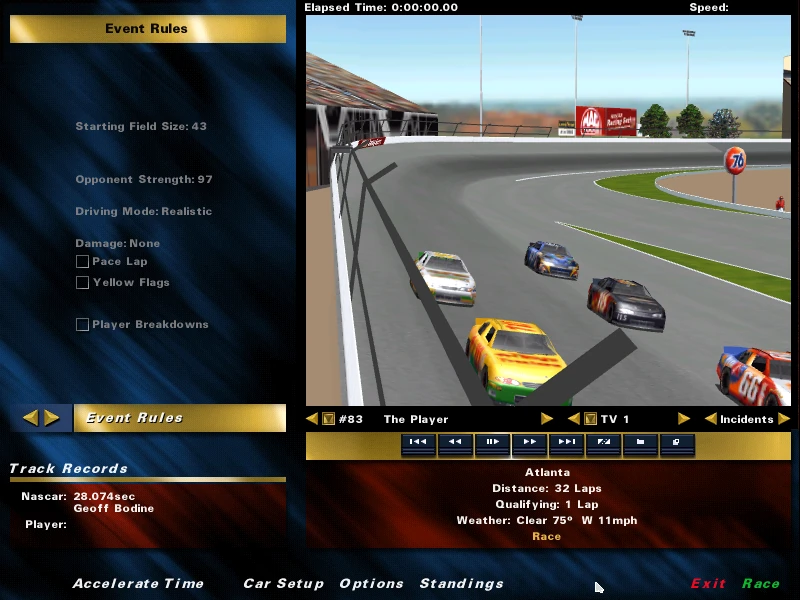
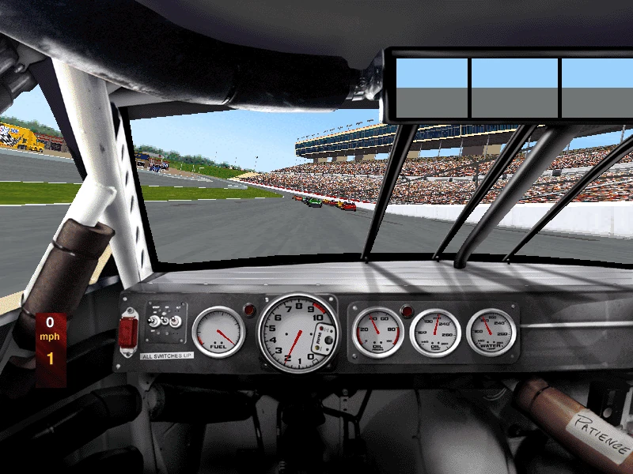
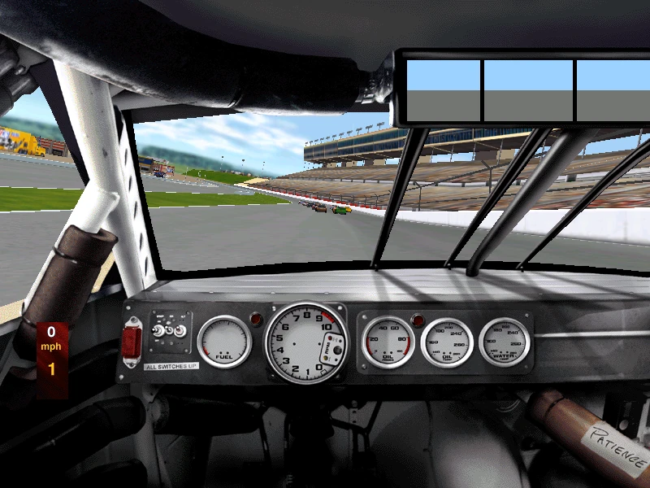
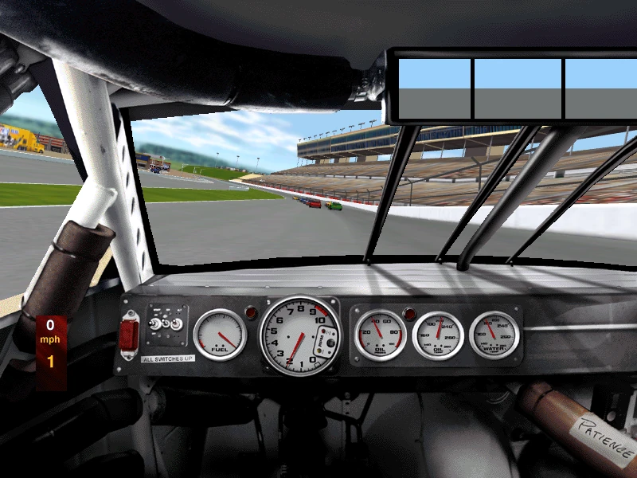

# NASCAR Racing 3 (1999 — Win32 3dfx Glide 2.x)

| Field | Value |
| :--- | :--- |
| **Category** | Commercial Game |
| **Year** | 1999 |
| **Platform(s)** | `Win32 / Wine (glide2x.dll)` |
| **Glide API & Version** | **Glide 2.x** (`2.56` on Voodoo2 / `2.60` on Voodoo3 / `2.48` on Voodoo Graphics) |
| **Recommended Card Profile** | `Voodoo2` (default) · `Voodoo3` (`2.60`) |
| **Verified Backends** | Vulkan · OpenGL 3.3 Core (WGL) · Software (AVX2 / AVX-512 / Scalar) |
| **Preset File(s)** | [`glide-ng.ini`](./glide-ng.ini) (Voodoo2) · [`glide-ng.hq.ini`](./glide-ng.hq.ini) (4× MSAA + Linear) · [`glide-ng.voodoo3.ini`](./glide-ng.voodoo3.ini) (Voodoo3) · [`glide-ng.software.ini`](./glide-ng.software.ini) (CPU Software) |
| **Status** | Verified |

---

## Overview

*NASCAR Racing 3* (Papyrus Design Group / Sierra Sports, August 1999) simulates the 1999 NASCAR Cup Series across full **43-car** grids with native Bink video intros, authentic **16-bit audio**, pit crews, dynamic weather, and three pluggable rendering DLLs selected from **`Options → Graphics → 3D Accelerator`**: CPU software (**`softrast.dll`**), Direct3D (**`rastd3d.dll`**), and **3dfx Glide 2.x (`3dfxdll.dll` → `glide2x.dll`)**.

Under **`glide-ng`**, the **`3dfxdll.dll`** rasterizer runs both the **`800×600` UI + live 3D `TV 1` broadcast inset** and full-screen **`640×480` / `800×600`** cockpit racing with crisp mipmapped grandstands, bilinear-filtered cumulus skies, anti-aliased **catch fences (`4× MSAA`)**, translucent speed/gear readouts, and **all five painted red analog cockpit gauge needles intact** — beating both the shimmering unfiltered software rasterizer (`softrast.dll`) and `rastd3d.dll` under WineD3D (where all five gauge needles disappear).

---

## Editions, Patches & Executables

| Binary / Patch | Graphics API | Works with `glide-ng`? | Technical Notes |
| :--- | :--- | :---: | :--- |
| **`NASCAR Racing 3.exe` + `3dfxdll.dll`** *(v1.2.0.4, `1,908,736 B` / `135,168 B`, Apr 2000)* | **Glide 2.x (`glide2x.dll`)** | **Yes (Recommended)** | Official **`n3_1204.EXE` (v1.2.0.4)** patch adds **3D wheels**, **cloudy weather**, **spark effects**, **mirror LOD fixes**, and **Alt+Tab** support across all 3 rasterizers. Dynamically links `glide2x.dll`. |
| **`NASCAR Racing 3.exe` + `3dfxdll.dll`** *(v1.0.0.0 retail, `1,419,264 B` / `147,968 B`, Aug 1999)* | **Glide 2.x (`glide2x.dll`)** | **Yes** | Unpatched CD payload inside `nr3/`. Upgrade with `n3_1204.EXE` for v1.2.0.4 rendering and AI improvements. |
| **`rastd3d.dll`** *(v1.2.0.4, `143,360 B`)* | Direct3D 6 | No *(Comparison baseline)* | Bilinear sky/grandstand rendering under WineD3D, but **drops all five red cockpit gauge needles** (`FUEL`, `RPM`, `OIL PRESS`, `OIL TEMP`, `WATER TEMP`). |
| **`softrast.dll`** *(v1.2.0.4, `151,552 B`)* | DirectDraw Software | No *(Comparison baseline)* | Default first-launch CPU rasterizer (`3D Accelerator: None`). Retains analog gauge needles, but suffers harsh nearest-neighbor texture shimmer across grandstands, clouds, cars, and fencing. |

> **Applying Official Patch `v1.2.0.4` (`n3_1204.EXE`):** Register the target path (`HKLM\Software\Sierra OnLine\Setup\NASCAR3\Directory = C:\Sierra\NASCAR3` and `C:\windows\SIERRA.INI`) and place `sierra.inf` beside `NASCAR Racing 3.exe`, then run **`wine n3_1204.EXE /S`** for an unattended update. (The patch updates `NASCAR Racing 3.exe`, `3dfxdll.dll`, `rastd3d.dll`, `softrast.dll`, `krnl.dll`, `Cars.dat`, `Irp.dat`, `Lasvegas.dat`, sparks, audio cues, and layouts.)

---

## Recommended Launch Configurations (Wine32 / Windows)

Copy `nr3/` and `sierra.inf` from the retail CD into `game/`, install **`n3_1204.EXE`**, drop `glide-ng`'s 32-bit **`glide2x.dll`** beside `NASCAR Racing 3.exe`, and expose a separate symlink directory (`cd_drive/` with `.windows-label` = **`NASCAR3`**) mapped as Wine's `D:` **`cdrom`** drive.

On first launch (`softrast.dll`), open **`Options → Graphics`**:
1. Set **`Grass & Asphalt Textures`**, **`Clouds`**, and **`Infield Textures`** to **`On`**.
2. Choose **`800 X 600`** driving resolution (matching the native `800×600` menu frontend).
3. Change **`3D Accelerator`** from **`None`** to **`3dfx Glide`**, confirm the restart prompt (**`Ok`**), click **`Exit`** to save **`options.cfg`**, and restart the game.

### One-Time Wine Prefix Setup

```bash
WINEARCH=win32 WINEPREFIX=/path/to/prefix wineboot -u
WINEARCH=win32 WINEPREFIX=/path/to/prefix wine reg add \
  'HKCU\Software\Wine' /v Version /t REG_SZ /d win98 /f

ln -sfn /path/to/cd_drive /path/to/prefix/dosdevices/d:
WINEARCH=win32 WINEPREFIX=/path/to/prefix wine reg add \
  'HKLM\Software\Wine\Drives' /v 'd:' /t REG_SZ /d cdrom /f
mkdir -p /path/to/prefix/drive_c/Sierra
ln -sfn /path/to/game /path/to/prefix/drive_c/Sierra/NASCAR3
WINEARCH=win32 WINEPREFIX=/path/to/prefix wine reg add \
  'HKLM\Software\Sierra OnLine\Setup\NASCAR3' /v 'Directory' /t REG_SZ /d 'C:\Sierra\NASCAR3' /f
```

### Option A: Standard Glide 2.x (`glide-ng.ini` — Vulkan `1×`, `nearest` Scaling)

```bash
WINEARCH=win32 WINEPREFIX=/path/to/prefix \
WINEDLLOVERRIDES="glide2x=n" \
GLIDE_NG_CONFIG=/path/to/glide-ng.ini \
GLIDE_NG_FULLSCREEN=1 \
  wine explorer /desktop=NR3,800x600 "./NASCAR Racing 3.exe"
```

Add `GLIDE_NG_BACKEND=opengl_es` to select the Win32 WGL OpenGL 3.3 Core backend without modifying the preset, or swap in [`glide-ng.voodoo3.ini`](./glide-ng.voodoo3.ini) for Voodoo3 (`2.60`) board reporting.

### Option B: Best Visuals (`glide-ng.hq.ini` — Vulkan `4× MSAA` + Linear) *(Recommended)*

```bash
WINEARCH=win32 WINEPREFIX=/path/to/prefix \
WINEDLLOVERRIDES="glide2x=n" \
GLIDE_NG_CONFIG=/path/to/glide-ng.hq.ini \
GLIDE_NG_FULLSCREEN=1 \
  wine explorer /desktop=NR3,800x600 "./NASCAR Racing 3.exe"
```

*(If running on a 32-bit CPU Vulkan driver such as `llvmpipe` on a high-core-count host, pass **`LP_NUM_THREADS=4`** to stay well inside the 2 GB 32-bit virtual address limit during 43-car track loads at **`800×600` `4× MSAA`**.)*

### Option C: CPU Software Rasterizer (`glide-ng.software.ini` — AVX2 / AVX-512)

```bash
WINEARCH=win32 WINEPREFIX=/path/to/prefix \
WINEDLLOVERRIDES="glide2x=n" \
GLIDE_NG_CONFIG=/path/to/glide-ng.software.ini \
GLIDE_NG_FULLSCREEN=1 \
  wine explorer /desktop=NR3,800x600 "./NASCAR Racing 3.exe"
```

---

## Visual Progression Gallery

All captures are **`800×600`** live frames at **Atlanta Motor Speedway** (43-car field, **`v1.2.0.4`**, `Grass & Asphalt`, `Clouds`, and `Infield Textures` enabled):

| | |
| :---: | :---: |
| <br>**1. Race Paddock `TV 1` Live Feed (`800×600`, `3dfxdll.dll` Glide 2.x)**<br>Embedded real-time 3D `TV 1` replay camera in the `glide-ng` Vulkan `4× MSAA` race lounge: stock cars charging through Turn 4 banking with smooth horizon haze, billboards, and razor-sharp LFB UI overlay. | <br>**2. Native Software Renderer (`softrast.dll`, `800×600`)**<br>Unfiltered nearest-neighbor sampling with heavy pixel crawl/shimmer across the Atlanta grandstand crowd, jagged yellow hauler on pit road, and blocky sky/cloud edges; red analog gauge needles intact. |
| <br>**3. Native Direct3D Renderer (`rastd3d.dll`, `800×600`)**<br>Bilinear filtering smooths the grandstands and cloud dome under WineD3D, **but all five red cockpit gauge needles (`FUEL`, `RPM`, `OIL PRESS`, `OIL TEMP`, `WATER TEMP`) fail to draw**. | <br>**4. Glide 2.x — Vulkan `4× MSAA` HQ ([`glide-ng.hq.ini`](./glide-ng.hq.ini))**<br>Best overall visuals: silky bilinear clouds and racing surface, mipmapped grandstands, anti-aliased catch-fence posts and windshield braces, crisp telemetry box, **and all five red analog gauge needles cleanly drawn**. |
| <br>**5. Glide 2.x — OpenGL 3.3 Core / WGL `1×`**<br>Exact color, cloud dome, crowd/grandstand mipmapping, cockpit lighting, translucent `mph` readout, and intact analog gauge needles matching Vulkan. | <br>**6. Glide 2.x — CPU Software AVX2 `1×` ([`glide-ng.software.ini`](./glide-ng.software.ini))**<br>Matches both GPU backends across 3D banking geometry, distant tree horizon, smooth pit-lane pack, triple-panel mirror framing, and crisp analog gauges. |

---

## Visual Quality & Performance Tuning

### Flavour Comparison: Glide 2.x (`3dfxdll.dll`) vs. Direct3D (`rastd3d.dll`) vs. Software (`softrast.dll`)
* **`3dfxdll.dll` via `glide-ng` + [`glide-ng.hq.ini`](./glide-ng.hq.ini) is the decisive visual and gameplay winner.**
  * Over **`softrast.dll`**, Glide adds smooth bilinear filtering, mipmapped grandstand crowds, and softened cumulus horizon domes while keeping the interior roll-cage chromakey crisp.
  * Over **`rastd3d.dll` (Direct3D under WineD3D)**, Glide preserves **all five red cockpit analog gauge needles** (`FUEL`, `RPM`, `OIL PRESS`, `OIL TEMP`, `WATER TEMP`), which fail to render in WineD3D `rastd3d.dll`.
* All three `glide-ng` backends (**Vulkan `4× MSAA`**, **OpenGL 3.3 Core / WGL**, and **CPU Software AVX2**) match closely across both the `800×600` embedded `TV 1` replay camera and full-screen cockpit driving views.

### Window Framing & Card Profiles
* **`GLIDE_NG_FULLSCREEN=1` inside `explorer /desktop=NR3,800x600`:** `NASCAR Racing 3.exe` creates its main window with a `WS_CAPTION` border (`806×632` outer frame). Setting **`fullscreen = true`** (the Win32 default) strips the caption bar inside the `800×600` desktop so the bottom navigation links (**`Exit`**, **`Go To Track`**, **`Next Session`**, **`Race`**) remain completely visible and clickable without vertical clipping.
* Note that **`NASCAR Racing 3.exe` enforces a minimum `800×600` desktop resolution** for its frontend (`grSstWinOpen(Res=8)`). Using a `640×480` virtual desktop exits cleanly before opening Glide. Both **`Voodoo2` (`2.56`)**, **`Voodoo3` (`2.60`)**, and **`VoodooGraphics` (`2.48`)** open cleanly inside an `800×600` or larger desktop.

---

## Quirks, Known Issues & Controls

### Setup & Troubleshooting Notes
* **32-bit CPU Vulkan (`llvmpipe`) with `4× MSAA`:** When loading a 43-car grid at `800×600` with `msaa = 4` on a host with a CPU Vulkan adapter and high core count, export **`LP_NUM_THREADS=4`** to avoid exhausting the 32-bit Wine process address space (hardware GPU Vulkan drivers do not need this override).
* **Skip intro movies:** Press **`Esc`** during startup to skip the Bink (`intro.bik`) intro video and jump directly to the main menu.
* **Three-panel rear-view mirror:** The overhead cockpit mirror draws horizon bands plus dynamic opponent car sprites only; sitting last on the grid displays an empty blue/grey horizon until other cars fall behind you.
* **A3D COM log messages:** Messages referencing `a3d.dll` in Wine stderr are benign when running standard `16-bit` stereo/DirectSound audio instead of Aureal A3D hardware.
* **Startup splash:** Uncomment `no_splash = true` in `glide-ng.ini` (or pass `FX_GLIDE_NO_SPLASH=1`) to skip the one-shot startup splash animation.

### Useful Controls

| Key / Input | Action |
| :--- | :--- |
| **`Up` / `Down`** | Accelerate / Brake |
| **`Left` / `Right`** | Steer left / right |
| **`Shift Up` / `Down`** | Manual gearbox *(see `Options → Controls`)* |
| **`Space` / `Enter`** | Advance pit / session screens |
| **`F1`–`F10`** | Cycle in-car telemetry & pit black-box HUD panels |
| **`M`** | Toggle cockpit rear-view mirror |
| **`L`** | Quick cockpit label / timing HUD |
| **`Esc`** | Skip intro / pause & exit to race lounge |
