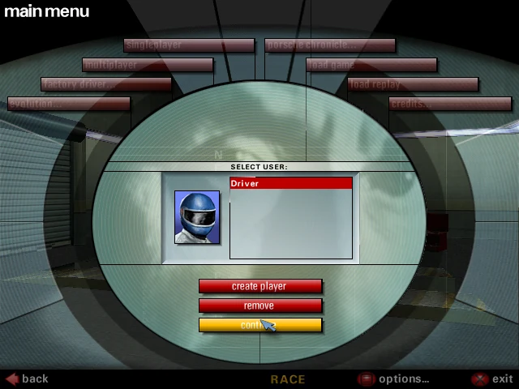
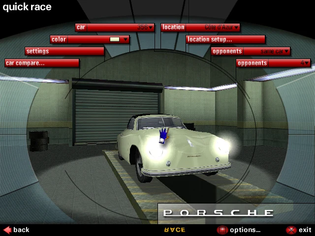
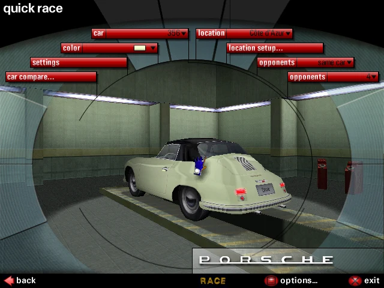
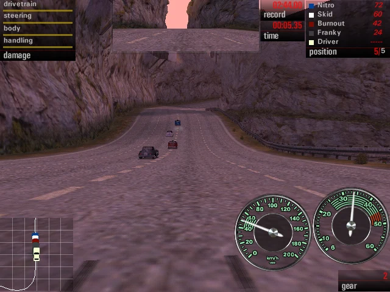
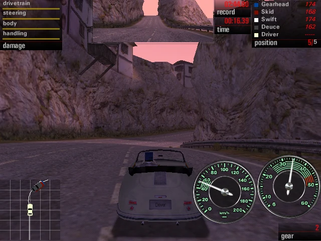
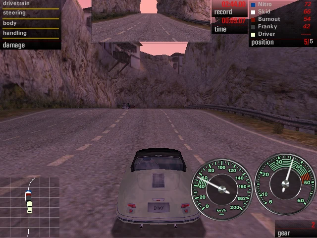
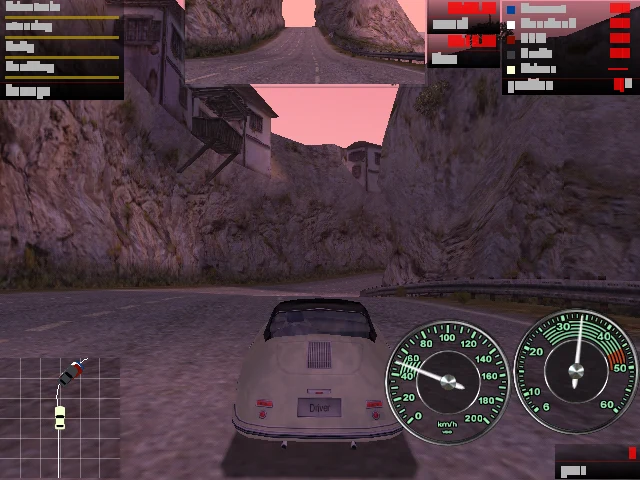
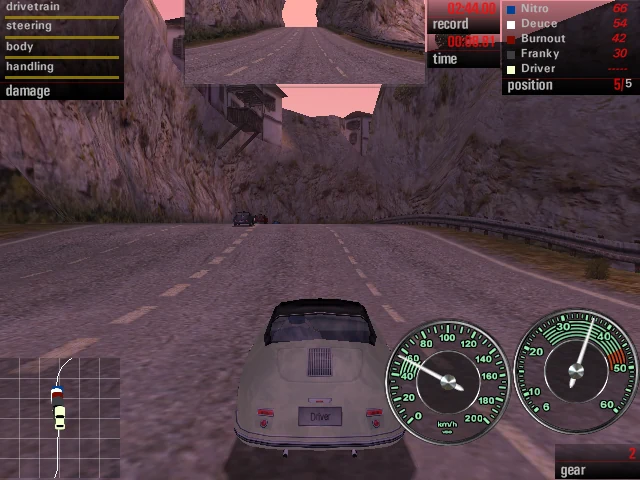

# Need for Speed: Porsche Unleashed (2000 — Win32 Glide 3.x)

| Field | Value |
| :--- | :--- |
| **Category** | Commercial Game |
| **Year** | 2000 |
| **Platform(s)** | `Win32 / Wine (glide3x.dll)` |
| **Glide API & Version** | Glide 3.x (`3.03` on Voodoo2 / `3.10` on Voodoo3) |
| **Recommended Card Profile** | `Voodoo2` (default) · `Voodoo3` (`3.10`) |
| **Verified Backends** | Vulkan · OpenGL ES (WGL) · Software (AVX2 / AVX-512 / Scalar) |
| **Preset File(s)** | [`glide-ng.ini`](./glide-ng.ini) (Voodoo2) · [`glide-ng.hq.ini`](./glide-ng.hq.ini) (4× MSAA + Linear) · [`glide-ng.voodoo3.ini`](./glide-ng.voodoo3.ini) (Voodoo3) · [`glide-ng.software.ini`](./glide-ng.software.ini) (CPU Software) |
| **Status** | Verified |

---

## Overview

EA Canada's 2000 racing classic *Need for Speed: Porsche Unleashed* (*Porsche 2000* in Europe) runs on EA's modular **Thrash** renderer abstraction (`voodoo2z.dll` → `glide3x.dll`, `dx7z.dll` → Direct3D 7, and community `opengl1z.dll` / `opengl3z.dll` drivers from the modern *NFS5 Combined Patch*). The authentic 3dfx Glide 3.x driver (`voodoo2z.dll`) drives circular lens-masked 3D showroom menus, hardware specular car bodywork, additive headlight/taillight glows, 3D rotating `RACE` badge, live picture-in-picture rear-view mirrors, animated 3D interior cockpits with gloved hands and live analog VDO gauges, track radar minimaps, and dynamic `grLoadGammaTable` fades.

Technically, `voodoo2z.dll` is one of the toughest real-world **Win32 Glide 3.x stress tests** in the catalog, exercising three rare corner cases inside `glide-ng`:

1. **Cross-thread Win32 Glide initialization:** A worker thread opens the Glide context (`grSstWinOpen`) while the main game thread performs all subsequent texture uploads, drawing, and `grBufferSwap` presentation.
2. **Post-`grSstWinOpen` DirectDraw takeover (`DDSCL_FULLSCREEN | DDSCL_EXCLUSIVE | DDSCL_NOWINDOWCHANGES`):** On `Voodoo2` profiles, immediately after `grSstWinOpen(hwnd)` returns, `voodoo2z.dll` invokes `DirectDrawCreate` + `SetCooperativeLevel` on the **same `HWND`** (with `DDSCL_NOWINDOWCHANGES`, keeping `GWL_STYLE` and client rect unchanged while hooking `GWLP_WNDPROC`). On Wine `winex11.drv`, `wined3d` detaches the host `HWND`'s existing X11 client window during exclusive mode setup.
3. **`PALETTE6666` (`GR_TEXTABLE_PALETTE_6666_EXT`) alpha-paletted HUD fonts:** When running on a **Voodoo3+** (`3.10`) profile advertising `PALETTE6666` in `GR_EXTENSION`, `voodoo2z.dll` downloads anti-aliased HUD text glyphs (`drivetrain`, `damage`, timer, race standings, gear) using `grTexDownloadTable(GR_TEXTABLE_PALETTE_6666_EXT, data)` with standard 32-bit **`ARGB8888` (`0xAARRGGBB`)** table entries containing per-entry alpha.

---

## Editions, Patches & Executables

| Executable / Renderer | Graphics API | Works with `glide-ng`? | Technical Notes |
| :--- | :--- | :---: | :--- |
| **`nfs5.exe` + `Drivers/glide3x/voodoo2z.dll`** (*Combined Patch v1.1*) | **Glide 3.x (`glide3x.dll`)** | **Yes (Recommended)** | Modern community launcher (`Verok` / *NFS5 Combined Patch v1.1*, replaces disc checks, unlocks modern CPUs/RAM, bundles clean Thrash drivers). Set `ThrashDriver=glide3x` and **`SingleProcAffinity=0`** in `nfs5.ini`. Replace/override `glide3x.dll` in both the game root and `Drivers/glide3x/`. Full pixel parity across Vulkan `1×`, Vulkan `4× MSAA`, Voodoo3 `3.10`, OpenGL ES / WGL, and Software AVX2. |
| **Stock CD `voodoo2z.dll` (`Feb 2000`)** | Glide 3.x (`glide3x.dll`) | Yes (Alternate) | Original EA Thrash Glide 3.x driver shipped on the retail CD (no wide-resolution patch). Use alongside the official v3.5 patch (`Porsche.exe`) or the Combined Patch (`nfs5.exe`). |
| **`Drivers/opengl3/opengl3z.dll`** | OpenGL 3.x | No (No 3dfx) | Modern community OpenGL 3 Thrash driver (`Verok`). Useful as a visual reference; output matches `glide-ng` pixel-for-pixel across showroom lights, skies, interior cockpit, gauges, and rear-view mirror. |
| **`Drivers/opengl1/opengl1z.dll`** | OpenGL 1.x | No (No 3dfx) | Legacy fixed-function OpenGL 1 Thrash driver. Matches `opengl3z.dll` and `glide-ng` colors and geometry cleanly. |
| **`Drivers/dx7/dx7z.dll`** | Direct3D 7 | No (No 3dfx) | Stock/patched Direct3D 7 Thrash driver (runs via `wined3d` under Wine). Identical visuals in headless `640×480` tests, but lacks 3dfx Glide `4× MSAA` offscreen resolve and hardware `PALETTE6666` / `grLoadGammaTable` parity controls. |

> **Important: Avoid Leaving Bundled Third-Party `glide3x.dll` Wrappers Active**
> The *NFS5 Combined Patch* includes a `Drivers/nglide/` directory containing a third-party `glide3x.dll`. Set **`ThrashDriver=glide3x`** in `nfs5.ini` and remove or rename `Drivers/nglide/glide3x.dll` so `nfs5.exe` loads **`glide-ng`'s `glide3x.dll`** unambiguously.

---

## Launch Commands (Win32 / Wine)

Copy `glide3x.dll` from `glide-ng`'s Win32 build into **both** the game directory (next to `nfs5.exe`) **and** `Drivers/glide3x/glide3x.dll`. Configure `nfs5.ini`:

```ini
[NFS5]
Language=english
ThrashDriver=glide3x
WindowedMode=0
SingleProcAffinity=0
CpuLimit=0
NoErrorReporting=0
NoMovies=0
Fog=1
Filtering=1
CarControl=0
```

*(Note: Setting `SingleProcAffinity=0` unlocks all CPU cores for `glide-ng`'s multi-threaded AVX2/AVX-512 Software rasterizer instead of pinning the process to a single core. Set `NoMovies=1` to jump straight to the loading screen and garage menu.)*

### One-Time Wine Setup & Registry Keys

```bash
WINEARCH=win32 WINEPREFIX=/path/to/prefix wineboot -u
WINEARCH=win32 WINEPREFIX=/path/to/prefix wine reg add \
  'HKCU\Software\Wine' /v Version /t REG_SZ /d winxp /f
WINEARCH=win32 WINEPREFIX=/path/to/prefix wine reg add \
  'HKLM\Software\Electronic Arts\Need For Speed - Porsche Unleashed' \
  /v 'InstallPath' /t REG_SZ /d 'Z:\path\to\nfspu' /f
WINEARCH=win32 WINEPREFIX=/path/to/prefix wine reg add \
  'HKLM\Software\Electronic Arts\Need For Speed - Porsche Unleashed' \
  /v 'Thrash Driver' /t REG_SZ /d 'voodoo2' /f
WINEARCH=win32 WINEPREFIX=/path/to/prefix wine reg add \
  'HKLM\Software\Electronic Arts\Need For Speed - Porsche Unleashed' \
  /v 'Group' /t REG_SZ /d '3Dfx' /f
```

### Standard Launch (`glide-ng.ini` — Vulkan `1×`, `nearest` Scaling)

```bash
cd /path/to/nfspu
WINEDLLOVERRIDES="glide3x=n" \
GLIDE_NG_CONFIG=/path/to/docs/catalog/games/nfs-porsche-unleashed/glide-ng.ini \
  wine explorer /desktop=NFSPU,800x600 ./nfs5.exe
```

### Best Visuals (`glide-ng.hq.ini` — Vulkan `4× MSAA` + Linear Upscale)

```bash
cd /path/to/nfspu
WINEDLLOVERRIDES="glide3x=n" \
GLIDE_NG_CONFIG=/path/to/docs/catalog/games/nfs-porsche-unleashed/glide-ng.hq.ini \
  wine explorer /desktop=NFSPU,800x600 ./nfs5.exe
```

### Authentic Voodoo3 Profile (`glide-ng.voodoo3.ini` — `PALETTE6666`, Glide `3.10`)

```bash
cd /path/to/nfspu
WINEDLLOVERRIDES="glide3x=n" \
GLIDE_NG_CONFIG=/path/to/docs/catalog/games/nfs-porsche-unleashed/glide-ng.voodoo3.ini \
  wine explorer /desktop=NFSPU,800x600 ./nfs5.exe
```

### CPU Software Backend (`glide-ng.software.ini` — AVX2 / AVX-512)

```bash
cd /path/to/nfspu
WINEDLLOVERRIDES="glide3x=n" \
GLIDE_NG_CONFIG=/path/to/docs/catalog/games/nfs-porsche-unleashed/glide-ng.software.ini \
  wine explorer /desktop=NFSPU,800x600 ./nfs5.exe
```

---

## Visual Progression Gallery

### 1. Splash, Menus & 3D Garage Showroom (`640×480`)

| Scene / Capture | Comparison |
| :---: | :---: |
| <br>**Loading Screen (`Need for Speed: Porsche Unleashed`)** | <br>**`SELECT USER` Dialog — `Vulkan 1×` (`glide-ng.ini`)** |
| <br>**Circular Lens Main Menu — `Software AVX2` (`glide-ng.software.ini`)** | <br>**1950 Porsche 356 Headlights Glow — `Software AVX2`** |
| <br>**Showroom Cabriolet (Top Down) — `Vulkan 4× MSAA` (`glide-ng.hq.ini`)** | <br>**Showroom Cabriolet (Soft Top Up) — `OpenGL ES / WGL`** |

### 2. In-Race Cameras: Bumper, 3D Interior Cockpit & Chase (`Côte d'Azur`)

| Backend / Camera | Comparison |
| :---: | :---: |
| <br>**Bumper Cam + Live PiP Mirror — `Software AVX2`** | <br>**3D Interior Cockpit & Gloved Hands — `Vulkan 1×`** |
| <br>**3D Interior Cockpit & VDO Dials — `OpenGL ES / WGL`** | <br>**Chase Cam (`Voodoo2 3.03`) — `Vulkan 1×`** |
| <br>**Chase Cam (`4× MSAA` HQ) — `glide-ng.hq.ini`** | <br>**Chase Cam (`Voodoo2 3.03`) — `Software AVX2`** |

### 3. `Voodoo3` `PALETTE6666` Fix & Alternative Flavour References

| Before / Reference | After / Reference |
| :---: | :---: |
| <br>**Before Fix — `Voodoo3` (`3.10`) Opaque HUD Font Boxes** | <br>**After Fix — `Voodoo3` (`3.10`) Crisp `PALETTE6666` Fonts** |
| <br>**Reference: Verok `opengl3z.dll` (OpenGL 3.x)** | <br>**Reference: `dx7z.dll` (Direct3D 7 via `wined3d`)** |

**Visual Winner:** **`voodoo2z.dll` + `glide-ng.hq.ini` (`Vulkan 4× MSAA`, `no_dither_sub = true`)**. The 1950 Porsche 356 bodywork silhouettes, louvered rear decklid, glowing additive headlights, cliffside guardrail meshes, and VDO analog dial needles match the modern `opengl3z.dll` OpenGL 3.x reference across lighting, twilight rose sky tone, shadows, and live PiP rear-view mirror while benefiting from clean hardware `4× MSAA` anti-aliasing and authentic 24-bit color fidelity without 16-bit dither banding.

---

## Tuning & Known Quirks

- **DirectDraw Exclusive-Mode Surface Takeover (`DDSCL_NOWINDOWCHANGES`, Fixed in `glide-ng`):** On `Voodoo2` profiles, `voodoo2z.dll` calls `DirectDrawCreate` → `SetCooperativeLevel(hwnd, DDSCL_FULLSCREEN | DDSCL_EXCLUSIVE | DDSCL_NOWINDOWCHANGES)` *after* `grSstWinOpen(hwnd)` has already created `glide-ng`'s `VK_KHR_win32_surface` / WGL binding. Because `DDSCL_NOWINDOWCHANGES` leaves `GWL_STYLE` and `GetClientRect` untouched, the `wined3d` client window swap (`detach_client_window`) previously orphaned `glide-ng`'s Vulkan surface inside a hidden `1×1` window (black display despite frames rendering normally). `NativeSurfaceHost::SyncBounds()` now tracks `GWLP_WNDPROC`, `GWL_EXSTYLE`, and `GetPixelFormat(hdc)` alongside `GWL_STYLE`, detecting the `ddraw` takeover cleanly and triggering a one-shot surface/swapchain rebuild (Vulkan) or `HDC` re-bind (WGL).
- **Cross-Thread Win32 WGL Context Acquisition (Fixed in `glide-ng`):** `nfs5.exe` invokes `grSstWinOpen` on a secondary worker thread and executes every subsequent draw/texture/swap call on the main thread. `OpenGLESBackend` previously retained its WGL `HGLRC` current on the creator thread, causing `wglMakeCurrent` on the render thread to fail repeatedly with `ERROR_BUSY (170)`. `OpenGLESBackend` now releases the WGL context at the end of `AttachWindow()` and immediately after the automatic startup splash (`ReleaseThreadContext()`), and defers `grLoadGammaTable` / `grGammaCorrectionValue` GL texture upload (`m_gammaLutDirty`) to `PresentToWindowSurface()` so a background setup call never steals the active render thread's context.
- **`GR_TEXTABLE_PALETTE_6666_EXT` (`PALETTE6666`) Alpha Bit Packing on Voodoo3+ (Fixed in `glide-ng`):** When running under a **`Voodoo3`** (`3.10`), **`Voodoo4`**, or **`Voodoo5`** profile, `voodoo2z.dll` detects **`PALETTE6666`** in `GR_EXTENSION` and switches HUD font glyphs to `grTexDownloadTable(GR_TEXTABLE_PALETTE_6666_EXT, data)`. Per the official 3dfx `cvg`/`h3`/`h5` Glide 3.x driver implementation (`gtexdl.c`), callers pass standard **32-bit `ARGB8888` (`0xAARRGGBB`)** palette entries, and the driver quantizes/packs the **top 6 bits** of each channel (`0xFC000000`, `0x00FC0000`, `0x0000FC00`, `0x000000FC`) into the 24-bit `A6R6G6B6` hardware LUT register. `TextureManager::DownloadTablePartial()` previously assumed pre-packed 24-bit `A6R6G6B6`, discarding byte `[31:24]` alpha and turning transparent `0x00FFFFFF` font backgrounds into solid opaque white/red rectangles. Reconstructing the top 6 bits per byte with authentic MSB-to-LSB bit replication restores crisp anti-aliased HUD typography on all three backends.
- **Note on Convertible Roof State in Quick Race:** *Need for Speed: Porsche Unleashed* varies whether the 1950 Porsche 356 Cabriolet spawns with its canvas soft-top raised or folded down; both closed-top and open-top cars (with transparent windscreen frame and blue-helmeted driver) render accurately across all backends.
- **Lean Staging Slot on 32-bit CPU Vulkan (`llvmpipe`):** During initial track load at `640×480` on a 32-bit software Vulkan adapter, large texture bursts automatically trigger a benign mid-frame staging flush (`[WARN] [Vulkan] Texture staging slot size exceeded!`). Prefer **`glide-ng.software.ini`** on hosts lacking a 32-bit hardware Vulkan ICD.
- **Keep `SingleProcAffinity=0` for Software Backend:** Leaving EA's single-core affinity option enabled restricts the multi-threaded `SoftwareBackend` AVX2 rasterizer to one hardware thread. Setting `SingleProcAffinity=0` inside `nfs5.ini` restores full parallel tile throughput.

---

## Useful In-Game Controls

| Key / Input | Action |
| :--- | :--- |
| **`Up` / `Down`** | Accelerate / Brake & Reverse |
| **`Left` / `Right`** | Steer left / right |
| **`Space`** | Handbrake |
| **`C`** | Cycle camera (`Bumper` → `3D Cockpit` → `Chase` → `Heli`) |
| **`B`** | Look behind |
| **`M`** | Toggle rear-view mirror |
| **`L`** | Toggle headlights |
| **`H`** | Horn |
| **`D`** | Toggle damage / race HUD overlays |
| **`R`** | Reset car to track |
| **`Esc` / `P`** | Pause menu / return to garage |

---

## Verified Backends & Profiles

| Backend | Profile | API Version | Result | Notes |
| :--- | :--- | :---: | :---: | :--- |
| **Vulkan (`1×`, `nearest`)** | `Voodoo2` | `3.03` | **Pass** | Auto-recovers from `voodoo2z.dll` `ddraw` takeover on `HWND`; crisp menus, cockpit, rear-view mirror, and chase views |
| **Vulkan (`4× MSAA`, `linear`)** | `Voodoo2` | `3.03` | **Pass** | Smooth `4× MSAA` bodywork edges and louvers (`glide-ng.hq.ini`), zero artifacts |
| **Vulkan (`1×`, `nearest`)** | `Voodoo3` | `3.10` | **Pass** | Clean anti-aliased `PALETTE6666` HUD fonts, `no_dither_sub = true` (`glide-ng.voodoo3.ini`) |
| **OpenGL ES / WGL (`1×`)** | `Voodoo2` | `3.03` | **Pass** | Verified both with and without automatic startup splash; zero `wglMakeCurrent` (`ERROR_BUSY`) errors |
| **Software AVX2 (`1×`)** | `Voodoo2` | `3.03` | **Pass** | Identical pixel parity with Vulkan and Verok `opengl3z.dll`; fast multi-threaded CPU rendering with `SingleProcAffinity=0` |

---

## Related Links

- [Back to Compatibility Catalog](../../README.md)
- [Configuration & Environment Variables](../../../user-guide/configuration.md)
- [Hardware Profiles & Glide Versions](../../../user-guide/hardware-and-versions.md)
- [Diablo II Catalog Entry](../diablo-2/README.md) *(companion Glide 3.x entry)*
