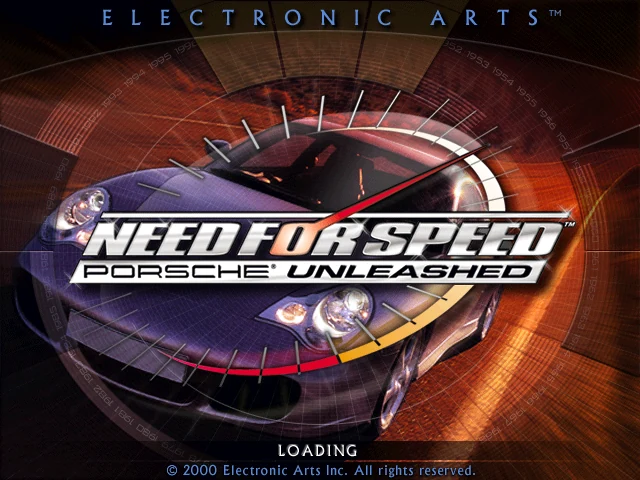
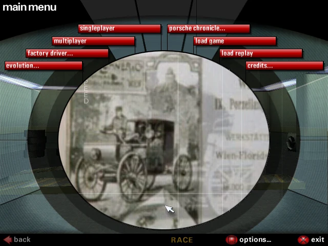
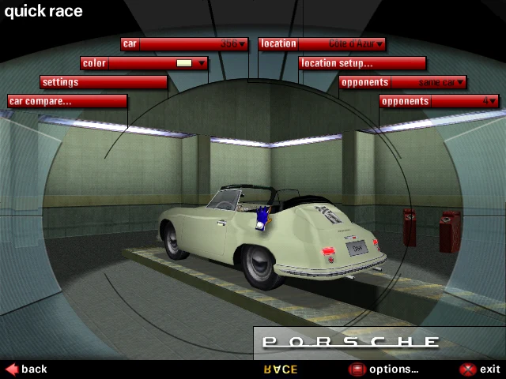
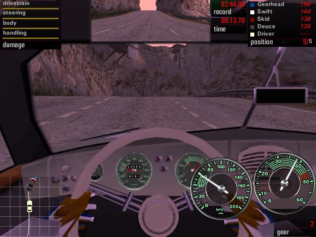
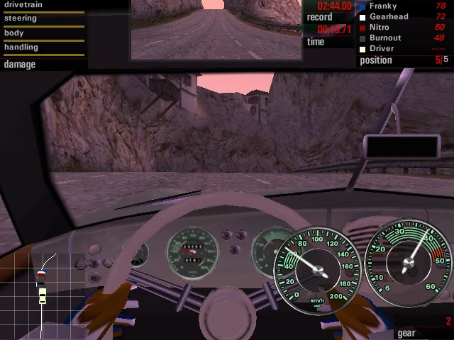
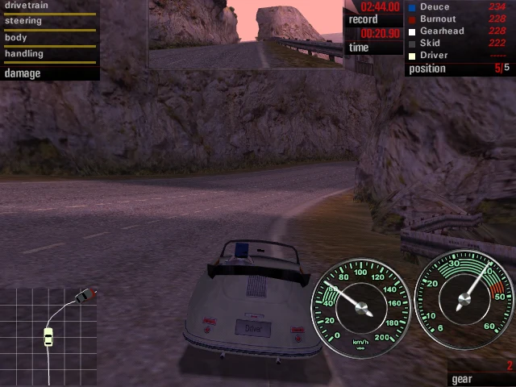
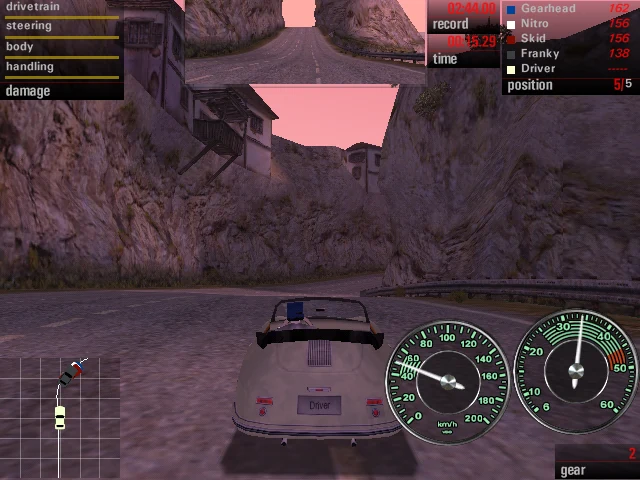
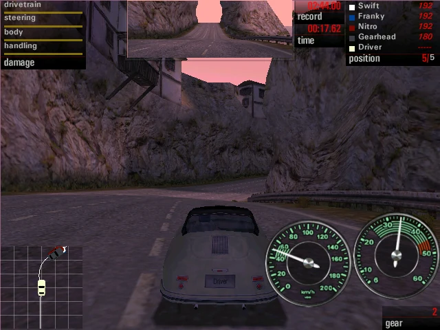

# Need for Speed: Porsche Unleashed (2000 — Win32 3dfx Glide 3.x)

| Field | Value |
| :--- | :--- |
| **Category** | Commercial Game |
| **Year** | 2000 |
| **Platform(s)** | `Win32 / Wine (glide3x.dll)` |
| **Glide API & Version** | **Glide 3.x** (`3.03` on Voodoo2 / `3.10` on Voodoo3) |
| **Recommended Card Profile** | `Voodoo2` (default) · `Voodoo3` (`3.10`) |
| **Verified Backends** | Vulkan · OpenGL 3.3 Core (WGL) · Software (AVX2 / AVX-512 / Scalar) |
| **Preset File(s)** | [`glide-ng.ini`](./glide-ng.ini) (Voodoo2) · [`glide-ng.hq.ini`](./glide-ng.hq.ini) (4× MSAA + Linear) · [`glide-ng.voodoo3.ini`](./glide-ng.voodoo3.ini) (Voodoo3) · [`glide-ng.software.ini`](./glide-ng.software.ini) (CPU Software) |
| **Status** | Verified |

---

## Overview

EA Canada's 2000 racing classic *Need for Speed: Porsche Unleashed* (*Porsche 2000* in Europe) runs on EA's modular **Thrash** renderer abstraction (`voodoo2z.dll` → `glide3x.dll`, `dx7z.dll` → Direct3D 7, and community `opengl1z.dll` / `opengl3z.dll` drivers from the *NFS5 Combined Patch*). The 3dfx Glide 3.x driver (`voodoo2z.dll`) drives circular lens-masked 3D showroom menus, hardware specular car bodywork, additive headlight/taillight glows, 3D rotating `RACE` badges, live picture-in-picture rear-view mirrors, animated 3D interior cockpits with gloved hands and live analog VDO gauges, track radar minimaps, and dynamic `grLoadGammaTable` transitions.

On `Voodoo3` (`3.10`) and newer profiles advertising `PALETTE6666`, `voodoo2z.dll` also renders anti-aliased HUD typography (`drivetrain`, `damage`, timer, gear, and standings) using alpha-paletted `GR_TEXTABLE_PALETTE_6666_EXT` tables.

---

## Editions, Patches & Executables

| Executable / Renderer | Graphics API | Works with `glide-ng`? | Technical Notes |
| :--- | :--- | :---: | :--- |
| **`nfs5.exe` + `Drivers/glide3x/voodoo2z.dll`** *(Combined Patch v1.1)* | **Glide 3.x (`glide3x.dll`)** | **Yes (Recommended)** | Community launcher (`Verok` / *NFS5 Combined Patch v1.1*, removes disc check, supports modern CPUs/RAM, bundles clean Thrash drivers). Set `ThrashDriver=glide3x` and **`SingleProcAffinity=0`** in `nfs5.ini`. Copy `glide-ng`'s `glide3x.dll` to both the game root and `Drivers/glide3x/`. |
| **Stock CD `voodoo2z.dll`** *(Feb 2000)* | Glide 3.x (`glide3x.dll`) | Yes *(Alternate)* | Original EA Thrash Glide 3.x driver shipped on the retail disc (use with official v3.5 patch `Porsche.exe` or the Combined Patch). |
| **`Drivers/opengl3/opengl3z.dll`** | OpenGL 3.x | No *(Comparison baseline)* | Community OpenGL 3 Thrash driver (`Verok`). Useful as a pixel reference for showroom lights, skies, interior cockpit, and rear-view mirror. |
| **`Drivers/opengl1/opengl1z.dll`** | OpenGL 1.x | No *(Comparison baseline)* | Legacy fixed-function OpenGL 1 Thrash driver matching `opengl3z.dll`. |
| **`Drivers/dx7/dx7z.dll`** | Direct3D 7 | No *(Comparison baseline)* | Direct3D 7 Thrash driver (runs via Wine `wined3d`). Lacks built-in `4× MSAA` offscreen resolve and hardware `PALETTE6666` / `grLoadGammaTable` controls. |

> **Avoid Leaving Bundled Third-Party `glide3x.dll` Wrappers Active:** The *NFS5 Combined Patch* bundles a `Drivers/nglide/` directory containing a third-party `glide3x.dll`. Set **`ThrashDriver=glide3x`** in `nfs5.ini` and remove or rename `Drivers/nglide/glide3x.dll` so `nfs5.exe` loads **`glide-ng`'s `glide3x.dll`**.

---

## Recommended Launch Configurations (Wine32 / Windows)

Copy `glide-ng`'s 32-bit **`glide3x.dll`** into **both** the game directory (next to `nfs5.exe`) **and** `Drivers/glide3x/glide3x.dll`, then configure `nfs5.ini`:

```ini
[NFS5]
Language=english
ThrashDriver=glide3x
WindowedMode=0
SingleProcAffinity=0
CpuLimit=0
NoErrorReporting=0
NoMovies=0
Fog=1
Filtering=1
CarControl=0
```

*(Setting `SingleProcAffinity=0` unlocks all CPU cores for `glide-ng`'s multi-threaded AVX2/AVX-512 Software rasterizer. Set `NoMovies=1` to jump straight to the loading screen and garage menu.)*

### One-Time Wine Setup & Registry Keys

```bash
WINEARCH=win32 WINEPREFIX=/path/to/prefix wineboot -u
WINEARCH=win32 WINEPREFIX=/path/to/prefix wine reg add \
  'HKCU\Software\Wine' /v Version /t REG_SZ /d winxp /f
WINEARCH=win32 WINEPREFIX=/path/to/prefix wine reg add \
  'HKLM\Software\Electronic Arts\Need For Speed - Porsche Unleashed' \
  /v 'InstallPath' /t REG_SZ /d 'Z:\path\to\nfspu' /f
WINEARCH=win32 WINEPREFIX=/path/to/prefix wine reg add \
  'HKLM\Software\Electronic Arts\Need For Speed - Porsche Unleashed' \
  /v 'Thrash Driver' /t REG_SZ /d 'voodoo2' /f
WINEARCH=win32 WINEPREFIX=/path/to/prefix wine reg add \
  'HKLM\Software\Electronic Arts\Need For Speed - Porsche Unleashed' \
  /v 'Group' /t REG_SZ /d '3Dfx' /f
```

### Option A: Standard Glide 3.x (`glide-ng.ini` — Vulkan `1×`, `nearest` Scaling)

```bash
WINEARCH=win32 WINEPREFIX=/path/to/prefix \
WINEDLLOVERRIDES="glide3x=n" \
GLIDE_NG_CONFIG=/path/to/glide-ng.ini \
  wine explorer /desktop=NFSPU,800x600 ./nfs5.exe
```

To test the Win32 WGL OpenGL 3.3 Core backend instead of Vulkan without editing the preset, add `GLIDE_NG_BACKEND=opengl_es`. To run under the authentic **`Voodoo3` (`3.10`, `PALETTE6666`)** card profile, substitute [`glide-ng.voodoo3.ini`](./glide-ng.voodoo3.ini).

### Option B: Best Visuals (`glide-ng.hq.ini` — Vulkan `4× MSAA` + Linear) *(Recommended)*

```bash
WINEARCH=win32 WINEPREFIX=/path/to/prefix \
WINEDLLOVERRIDES="glide3x=n" \
GLIDE_NG_CONFIG=/path/to/glide-ng.hq.ini \
  wine explorer /desktop=NFSPU,800x600 ./nfs5.exe
```

### Option C: CPU Software Rasterizer (`glide-ng.software.ini` — AVX2 / AVX-512)

```bash
WINEARCH=win32 WINEPREFIX=/path/to/prefix \
WINEDLLOVERRIDES="glide3x=n" \
GLIDE_NG_CONFIG=/path/to/glide-ng.software.ini \
  wine explorer /desktop=NFSPU,800x600 ./nfs5.exe
```

---

## Visual Progression Gallery

All captures depict the `640×480` menus, 3D garage showroom, and *Côte d'Azur* race track across `glide-ng` backends (`Vulkan`, `OpenGL 3.3 Core / WGL`, `Software AVX2`, and `Voodoo3 3.10`) alongside `opengl3z.dll` and `dx7z.dll` references:

| | |
| :---: | :---: |
| <br>**1. Loading Screen (`640×480`, Glide 3.x)**<br>Crisp high-color title plate and progress bar loaded through `voodoo2z.dll`. | <br>**2. Circular Lens Main Menu (`Software AVX2`)**<br>Animated 3D showroom garage framed behind the translucent circular lens UI with rotating `RACE` badge. |
| <br>**3. Showroom Front — 1950 Porsche 356 (`Software AVX2`)**<br>Additive headlight flare bloom and clean metallic reflections inside the dimly lit turntable bay. | <br>**4. Showroom Cabriolet — Open Top (`Vulkan 4× MSAA` HQ)**<br>Smooth rounded fenders, louvered rear decklid, and additive taillight glow under [`glide-ng.hq.ini`](./glide-ng.hq.ini). |
| <br>**5. Showroom Cabriolet — Soft Top (`OpenGL / WGL`)**<br>Exact parity across specular body paint, shadows, and showroom lighting on the WGL backend. | <br>**6. Bumper Camera & Live PiP Mirror (`Software AVX2`)**<br>*Côte d'Azur* tarmac, twilight horizon, live rear-view mirror overlay, and analog telemetry HUD. |
| <br>**7. 3D Interior Cockpit (`Vulkan 1×`, `glide-ng.ini`)**<br>Animated steering wheel with gloved hands, painted dash hood, VDO analog gauges, and live mirror. | <br>**8. 3D Interior Cockpit (`OpenGL / WGL`)**<br>Matching dashboard shading, glass transparency, road sky gradient, and instrument clarity. |
| <br>**9. Chase Camera — Vulkan `1×` (`Voodoo2` `3.03`)**<br>Baseline hardware Glide pass with crisp road edge lighting and glowing crimson brake lights. | <br>**10. Chase Camera — Vulkan `4× MSAA` HQ ([`glide-ng.hq.ini`](./glide-ng.hq.ini))**<br>Best visuals: smooth body curvature, cliffside guardrail railings, shadows, and 24-bit sky gradient (`no_dither_sub = true`). |
| <br>**11. Chase Camera — CPU Software ([`glide-ng.software.ini`](./glide-ng.software.ini))**<br>Multi-threaded AVX2/AVX-512 rasterizer matches the GPU backends cleanly across road textures and sky fog. | <br>**12. Chase Camera — `Voodoo3` (`3.10`, `PALETTE6666`)**<br>Verified under [`glide-ng.voodoo3.ini`](./glide-ng.voodoo3.ini) with clean anti-aliased alpha-paletted HUD typography. |
| <br>**13. Reference: `opengl3z.dll` (OpenGL 3.x)**<br>Comparison baseline from the *Combined Patch*. Matching lighting, twilight sky tone, shadows, and mirror inset. | <br>**14. Reference: `dx7z.dll` (Direct3D 7 via `wined3d`)**<br>Comparison baseline matching geometry and color curves at `1×` without hardware `4× MSAA`. |

---

## Visual Quality & Performance Tuning

### Flavour Comparison: Glide 3.x (`voodoo2z.dll`) vs. OpenGL (`opengl3z.dll`) vs. Direct3D 7 (`dx7z.dll`)
* **`voodoo2z.dll` (`glide-ng` + [`glide-ng.hq.ini`](./glide-ng.hq.ini)) matches the community `opengl3z.dll` renderer on colors, twilight skies, specular bodywork, live rear-view mirror, and additive flares**, while adding **`4× MSAA`** anti-aliasing across fenders, decklid louvers, VDO needles, and cliffside guardrails with `no_dither_sub = true`.
* **`Voodoo2` (`3.03`) vs. `Voodoo3` (`3.10`):** Both card profiles render identically on track; `Voodoo3` additionally exercises anti-aliased **`PALETTE6666`** alpha-paletted HUD glyphs.

### CPU Core Affinity & Software Vulkan Notes
* **Keep `SingleProcAffinity=0`:** In `nfs5.ini`, the default single-core affinity option restricts `glide-ng`'s multi-threaded Software rasterizer to one hardware thread. Setting **`SingleProcAffinity=0`** enables full multi-core scaling.
* **Headless / CPU-only hosts:** Select [`glide-ng.software.ini`](./glide-ng.software.ini) on hosts lacking a 32-bit hardware Vulkan ICD, or cap `LP_NUM_THREADS=4` when running `llvmpipe`.

---

## Quirks, Known Issues & Controls

### Installation & Engine Notes
* **Direct wrapper loading:** Replace or remove `Drivers/nglide/glide3x.dll` and place `glide-ng`'s `glide3x.dll` in both the root folder and `Drivers/glide3x/`.
* **Convertible roof variation:** Quick Race randomly spawns the 1950 Porsche 356 Cabriolet with its soft-top raised or folded down; both states render with transparent windscreen frames cleanly.
* **Startup splash:** Uncomment `no_splash = true` in `glide-ng.ini` (or pass `FX_GLIDE_NO_SPLASH=1`) to skip the one-shot startup splash on launch.

### Useful Controls

| Key / Input | Action |
| :--- | :--- |
| **`Up` / `Down`** | Accelerate / Brake & Reverse |
| **`Left` / `Right`** | Steer left / right |
| **`Space`** | Handbrake |
| **`C`** | Cycle camera (`Bumper` → `3D Cockpit` → `Chase` → `Heli`) |
| **`B`** | Look behind |
| **`M`** | Toggle rear-view mirror |
| **`L`** | Toggle headlights |
| **`H`** | Horn |
| **`D`** | Toggle damage / race HUD overlays |
| **`R`** | Reset car to track |
| **`Esc` / `P`** | Pause menu / return to garage |
