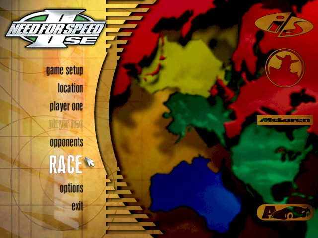
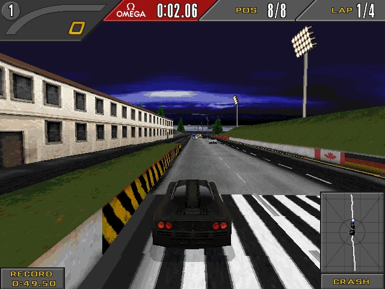
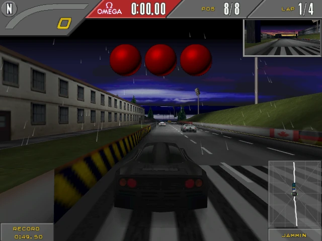
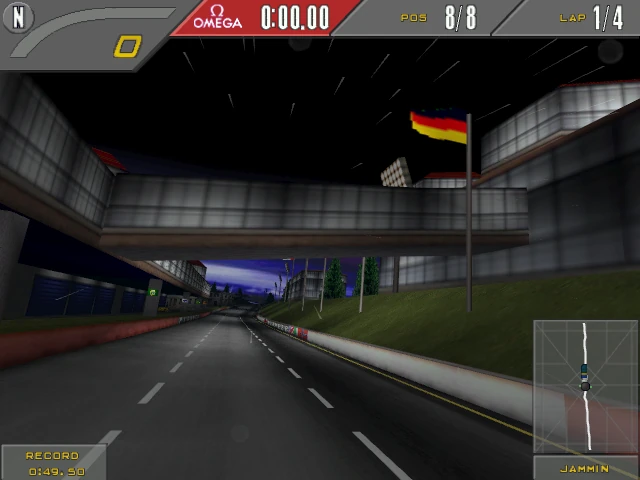
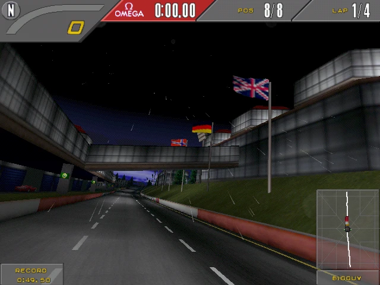
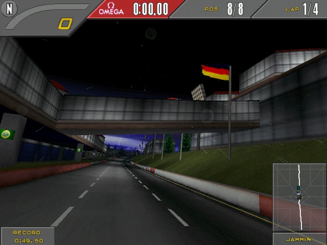

# Need for Speed II: Special Edition (1997 — Win32 3dfx Glide 2.x)

| Field | Value |
| :--- | :--- |
| **Category** | Commercial Game |
| **Year** | 1997 |
| **Platform(s)** | `Win32 / Wine (glide2x.dll)` |
| **Glide API & Version** | **Glide 2.x** (`2.56` on Voodoo2 / `2.48` on Voodoo Graphics) |
| **Recommended Card Profile** | `Voodoo2` (default) · `VoodooGraphics` (`2.48`) |
| **Verified Backends** | Vulkan · OpenGL 3.3 Core (WGL) · Software (AVX2 / AVX-512 / Scalar) |
| **Preset File(s)** | [`glide-ng.ini`](./glide-ng.ini) (Voodoo2) · [`glide-ng.hq.ini`](./glide-ng.hq.ini) (4× MSAA + Linear) · [`glide-ng.voodoo1.ini`](./glide-ng.voodoo1.ini) (Voodoo1 SST-1) · [`glide-ng.software.ini`](./glide-ng.software.ini) (CPU Software) |
| **Status** | Verified |

---

## Overview

*Need for Speed II: Special Edition* (EA Seattle / Electronic Arts, September 1997) is the hardware-accelerated expansion of *Need for Speed II*, adding the bonus **Last Resort** track, extra supercars (including the *FZR 2000*, *Ferrari F355 F1*, and *Ford Indigo*), Wild driving physics, and native **3dfx Glide 2.x** support via **`NFS2SEA.EXE`** (`LoadLibraryA("glide2x.dll")`).

Unlike the flat, unlit **DirectDraw software build (`NFS2SEN.EXE`)**, the Glide 2.x executable (**`NFS2SEA.EXE`**) adds hardware **bilinear filtering**, smooth specular **twilight/night skyboxes**, **projected headlight cones on wet tarmac**, **diagonal rain/snow streaks**, **translucent camera-lens water droplets** (plus flying bugs and leaves on daytime circuits), **alpha-blended skid marks and smoke**, animated overhead banners/flags, transparent race radar overlays, and a **live picture-in-picture rear-view mirror** over a fixed `640×480` framebuffer.

---

## Editions, Patches & Executables

| Executable | Graphics API | Works with `glide-ng`? | Technical Notes |
| :--- | :--- | :---: | :--- |
| **`NFS2SEA.EXE`** *(975,360 B, Sep 1997)* | **Glide 2.x (`glide2x.dll`)** | **Yes (Recommended)** | Official 3dfx Special Edition executable. Dynamically loads `glide2x.dll` after spinning up the `640×480` DirectDraw golden globe frontend. |
| **`NFS2SEN.EXE`** *(900,096 B, Sep 1997)* | DirectDraw Software | No *(Comparison baseline)* | Unaccelerated 16-bit software renderer shipped on the same disc. Crisp nearest-neighbor baseline without bilinear filtering, wet tarmac headlight cones, rain streaks, lens droplets, or live smooth fog shading. |

> **Manual CD Installation (`install.win`):** When copying disc contents directly to a directory without running the 16-bit InstallShield installer, copy `INSTALL.NFS` verbatim to **`install.win`** (`cp INSTALL.NFS install.win`). **Do not strip the 3-character prefix tokens** from `INSTALL.NFS` — `NFS2SEA.EXE` parses and removes those tokens internally at launch.

> **Multi-Core Movie Decoder Note (`SHOWDCT`):** On multi-core CPUs, `NFS2SEA.EXE`'s DCT video decoder can race and stall with `SHOWDCT: No DCT chunks found!`. Pin execution to a single logical CPU core using **`taskset -c 0`** under Linux/Wine (or CPU affinity mask `1` on Windows).

---

## Recommended Launch Configurations (Wine32 / Windows)

Copy the CD payload into a local folder (`game/`), copy `INSTALL.NFS` → `install.win`, drop `glide-ng`'s 32-bit **`glide2x.dll`** next to `NFS2SEA.EXE`, and expose a **separate symlink directory** (`cd_drive/`) holding `.windows-label` set to **`NFSIISE`** as Wine's `D:` **`cdrom`** drive. Keeping `game/` on a fixed drive (`Z:`) and `cd_drive/` mapped as `D:` satisfies the retail CD-ROM check without triggering the `"you must first install it on your computer"` error.

### One-Time Wine Prefix & CD-ROM Setup

```bash
WINEARCH=win32 WINEPREFIX=/path/to/prefix wineboot -u
WINEARCH=win32 WINEPREFIX=/path/to/prefix wine reg add \
  'HKCU\Software\Wine' /v Version /t REG_SZ /d winxp /f

# Create separate CD-ROM symlink directory and volume label
mkdir -p /path/to/cd_drive
ln -sf /path/to/game/* /path/to/cd_drive/
printf 'NFSIISE\n' > /path/to/cd_drive/.windows-label
ln -sfn /path/to/cd_drive /path/to/prefix/dosdevices/d:
WINEARCH=win32 WINEPREFIX=/path/to/prefix wine reg add \
  'HKLM\Software\Wine\Drives' /v 'd:' /t REG_SZ /d cdrom /f
```

### Option A: Standard Glide 2.x (`glide-ng.ini` — Vulkan `1×`, `nearest` Scaling)

```bash
WINEARCH=win32 WINEPREFIX=/path/to/prefix \
WINEDLLOVERRIDES="glide2x=n" \
GLIDE_NG_CONFIG=/path/to/glide-ng.ini \
  taskset -c 0 wine explorer /desktop=NFS2SE,640x480 ./NFS2SEA.EXE
```

To use the Win32 WGL OpenGL 3.3 Core backend instead of Vulkan without editing the preset, add `GLIDE_NG_BACKEND=opengl_es`. For authentic 1997 single-TMU `VoodooGraphics` (`2.48`) capability reporting, substitute [`glide-ng.voodoo1.ini`](./glide-ng.voodoo1.ini).

### Option B: Best Visuals (`glide-ng.hq.ini` — Vulkan `4× MSAA` + Linear) *(Recommended)*

```bash
WINEARCH=win32 WINEPREFIX=/path/to/prefix \
WINEDLLOVERRIDES="glide2x=n" \
GLIDE_NG_CONFIG=/path/to/glide-ng.hq.ini \
  taskset -c 0 wine explorer /desktop=NFS2SE,640x480 ./NFS2SEA.EXE
```

### Option C: CPU Software Rasterizer (`glide-ng.software.ini` — AVX2 / AVX-512)

```bash
WINEARCH=win32 WINEPREFIX=/path/to/prefix \
WINEDLLOVERRIDES="glide2x=n" \
GLIDE_NG_CONFIG=/path/to/glide-ng.software.ini \
  taskset -c 0 wine explorer /desktop=NFS2SE,640x480 ./NFS2SEA.EXE
```

*(For windowed desktop tests inside `explorer /desktop=...`, pass `GLIDE_NG_FULLSCREEN=0` so `glide-ng` remains contained inside the `640×480` virtual desktop window.)*

---

## Visual Progression Gallery

All captures are `640×480` live frames on the **Proving Grounds** night circuit (*McLaren F1*):

| | |
| :---: | :---: |
| <br>**1. Main Menu (`640×480`, `NFS2SEA.EXE` DirectDraw/Glide frontend)**<br>Spinning golden globe menu with crisp antialiased title emblem, marquee icons, and clean cursor response before handing the window off to `glide2x.dll`. | <br>**2. Native Software Renderer (`NFS2SEN.EXE`, `640×480`)**<br>Baseline DirectDraw software chase view: pixelated barriers and grass, stepped dark-blue sky band, flat road luminance, no weather effects, no lens droplets, and no rear-view mirror inset. |
| <br>**3. Glide 2.x — Vulkan `4× MSAA` HQ ([`glide-ng.hq.ini`](./glide-ng.hq.ini))**<br>Exact matching chase camera (*McLaren F1* on start grid): shaded red countdown lights, **live rear-view mirror with twilight horizon**, diagonal rain streaks, translucent windshield droplet ring, smooth wet-tarmac headlights, and bilinear filtering. | <br>**4. Glide 2.x — Vulkan `4× MSAA` HQ (Overhead Bridge)**<br>Smooth pit walkway lighting, bright dynamic headlight cone on wet asphalt, fluttering German flag, diagonal rain lines, soft grass embankments, and crisp speed/timer telemetry HUD. |
| <br>**5. Glide 2.x — OpenGL 3.3 Core / WGL `1×`**<br>Exact visual parity with Vulkan across twilight clouds, rippling trackside flags, semi-transparent glass walkway, diagonal rain streaks, and wet headlight highlights. | <br>**6. Glide 2.x — CPU Software AVX2 `1×` ([`glide-ng.software.ini`](./glide-ng.software.ini))**<br>Matches both GPU backends across rain streak alpha, circular water droplets, pit banners, fluttering flags, horizon gradients, and specular road sheen. |

---

## Visual Quality & Performance Tuning

### Flavour Comparison: Glide 2.x (`NFS2SEA.EXE`) vs. DirectDraw Software (`NFS2SEN.EXE`)
* **`NFS2SEA.EXE` (`glide-ng` + [`glide-ng.hq.ini`](./glide-ng.hq.ini)) is overwhelmingly superior to `NFS2SEN.EXE`.** The Glide edition unlocks bilinear texture filtering, wet specular headlight cones, diagonal rain/snow streaks, translucent lens raindrops, 3D glowing starting countdown spheres, animated overhead flags, smooth twilight sky gradients (`no_dither_sub = true`), and the live picture-in-picture rear-view mirror.
* All three `glide-ng` backends (**Vulkan `4× MSAA`**, **OpenGL 3.3 Core / WGL**, and **CPU Software AVX2**) match seamlessly with clean DirectDraw-to-Glide window transitions (`NativeSurfaceHost` recovers automatically when EA's shell hands the Win32 `HWND` over to `glide2x.dll`).
* **`4× MSAA` (`glide-ng.hq.ini`)** visibly smooths supercar rooflines, road lane lines, diagonal flagpoles, and bridge railings without harming HUD legibility or countdown lights.

### Card Profiles & Gamma
* Both **`Voodoo2` (`2.56`)** and **`VoodooGraphics` (`2.48`)** single-TMU SST-1 profiles run cleanly at the native fixed `640×480` framebuffer.
* Leave **`gamma` untouched** (app-controlled) or adjust lightly in game options if night tracks appear dark on a low-brightness display.

---

## Quirks, Known Issues & Controls

### Installation & Wine Audio Notes
* **DirectSound audio on legacy / Wine hosts:** `EACSND.DLL` uses legacy DirectSound 3D streaming buffers. On desktops with active PipeWire / PulseAudio sinks, audio initializes automatically; if sound crackles or drops out, the community `dsound.dll` replacement can be dropped next to `NFS2SEA.EXE` with `WINEDLLOVERRIDES="glide2x,dsound=n"`. On headless systems without an audio daemon, `EACSND.DLL` can stall waiting on the audio device until a dummy sink is running or the Wine audio driver is disabled.
* **Keep `game/` off the `D:` CD-ROM mount path:** Mounting `game/` itself as a Wine CD-ROM drive causes `NFS2SEA.EXE` to fail with `"To play Need For Speed II SE, you must first install it on your computer"`. Launch from the fixed-drive path (`Z:\...\game`) while mapping a separate symlink folder as `D:` (`cdrom`).
* **DirectDraw menu transition:** The frontend menu (`640×480`) executes in DirectDraw before opening the Glide 2.x surface (`grSstWinOpen`). Under Wine, launching inside `explorer /desktop=NFS2SE,640x480` avoids unwanted mode-switch flicker on high-resolution displays.
* **Startup splash:** Uncomment `no_splash = true` in `glide-ng.ini` (or pass `FX_GLIDE_NO_SPLASH=1`) to skip the one-shot startup splash animation.

### Useful Controls

| Key / Input | Action |
| :--- | :--- |
| **`Up` / `Down`** | Accelerate / Brake & Reverse |
| **`Left` / `Right`** | Steer left / right |
| **`Space`** | Handbrake |
| **`A` / `Z`** | Shift gear up / down *(manual transmission)* |
| **`C`** | Cycle camera (`Bumper` → `Cockpit` → `Chase` → `Heli` / `Road`) |
| **`B`** | Look behind |
| **`M`** | Toggle live rear-view mirror |
| **`L`** | Toggle headlights |
| **`H`** | Horn |
| **`R`** | Reset car onto track |
| **`Esc` / `P`** | Pause menu / exit to main menu |
