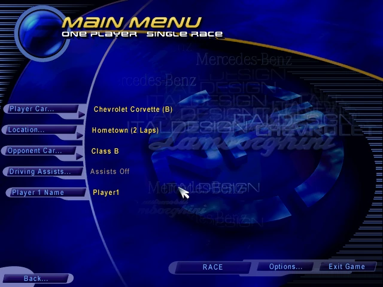
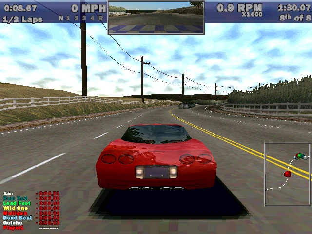
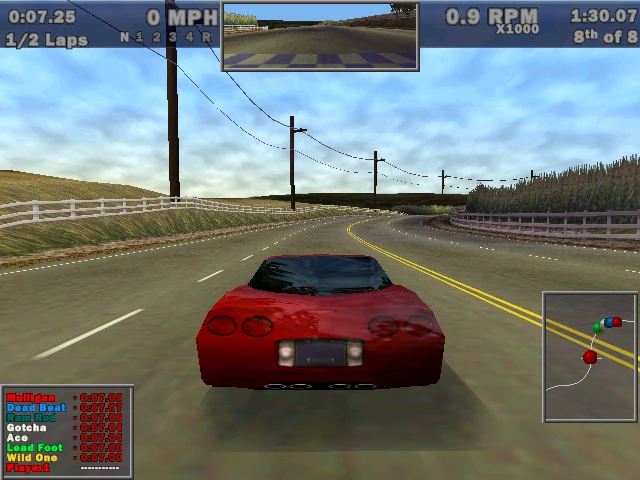
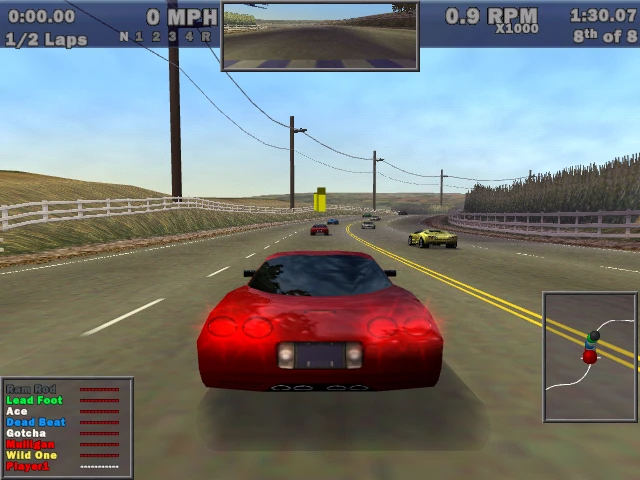
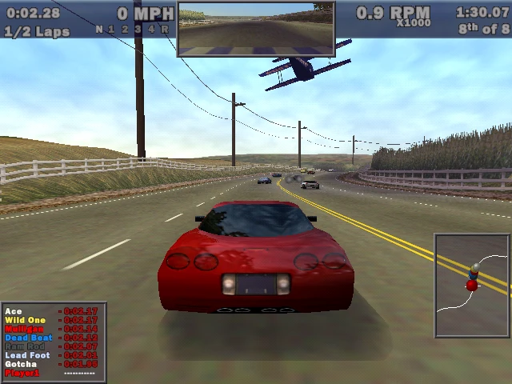
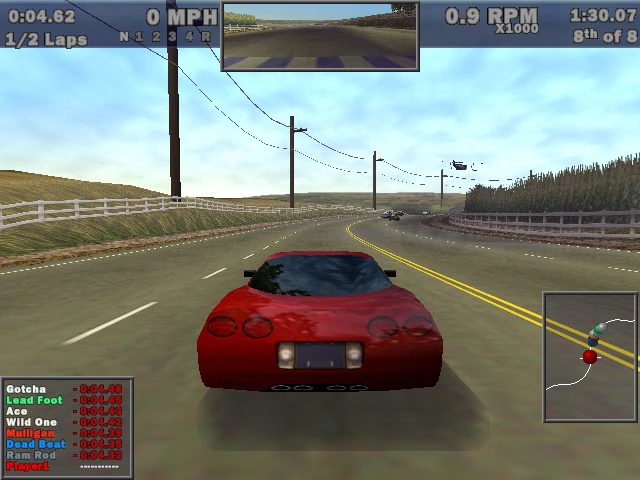

# Need for Speed III: Hot Pursuit (1998 — Win32 3dfx Glide 2.x)

| Field | Value |
| :--- | :--- |
| **Category** | Commercial Game |
| **Year** | 1998 |
| **Platform(s)** | `Win32 / Wine (glide2x.dll)` |
| **Glide API & Version** | **Glide 2.x** (`2.56` on Voodoo2 / `2.48` on Voodoo Graphics) |
| **Recommended Card Profile** | `Voodoo2` (default) · `VoodooGraphics` (`2.48`) |
| **Verified Backends** | Vulkan · OpenGL 3.3 Core (WGL) · Software (AVX2 / AVX-512 / Scalar) |
| **Preset File(s)** | [`glide-ng.ini`](./glide-ng.ini) (Voodoo2) · [`glide-ng.hq.ini`](./glide-ng.hq.ini) (4× MSAA + Linear) · [`glide-ng.voodoo1.ini`](./glide-ng.voodoo1.ini) (Voodoo1 SST-1) · [`glide-ng.software.ini`](./glide-ng.software.ini) (CPU Software) |
| **Status** | Verified |

---

## Overview

*Need for Speed III: Hot Pursuit* (EA Canada / Electronic Arts, September 1998) launches exotic supercars and police cruisers across dynamic daytime, dusk, night, rain, snow, and fog circuits via EA's modular **Thrash** 3D abstraction layer (`nfs3.exe`). Both the frontend menus (`640×480` animated translucent emblem and scrolling manufacturer marquees) and the full in-race 3D engine run through **Glide 2.x (`glide2x.dll`)** when using the **Voodoo2 (`voodoo2a.dll`, `-voodoo2`)** or **Voodoo Graphics / Rush (`voodooa.dll`, `-voodoo`)** Thrash driver.

Unlike the flat **`softtria.dll` (`-softtri`)** software rasterizer and stock Direct3D (**`d3da.dll`, `-d3d`** under WineD3D), the 3dfx Glide 2.x drivers deliver **bilinear-filtered road/terrain**, **real-time metallic chrome environment mapping**, **smooth translucent drop shadows**, **volumetric glowing brake lights**, **full atmospheric table fog fading seamlessly into the cloud horizon dome**, `512×384` / `640×480` / **`800×600`** in-race resolutions (`voodoo2a.dll`), and live **rear-view mirror** rendering.

---

## Editions, Patches & Executables

| Binary / Thrash Driver | Graphics API | Works with `glide-ng`? | Technical Notes |
| :--- | :--- | :---: | :--- |
| **`nfs3.exe` + `voodoo2a.dll`** *(1,589,248 B / 93,382 B, Sep 1998)* | **Glide 2.x (`glide2x.dll`)** | **Yes (Recommended)** | Dual-TMU **3Dfx Voodoo2** Thrash driver selected with `-voodoo2` (or `Thrash Driver = voodoo2`). Unlocks **`512×384`**, **`640×480`**, and **`800×600`** in-race modes. |
| **`nfs3.exe` + `voodooa.dll`** *(93,858 B retail / **70,144 B** Oct 1998 Banshee patch)* | **Glide 2.x (`glide2x.dll`)** | **Yes** | Single-TMU **3Dfx Voodoo Graphics / Rush / Banshee** Thrash driver selected with `-voodoo`. Official EA Banshee patch (`nfs3patch.exe`, Oct 1998) replaces `voodooa.dll` with the updated `70,144 B` build; both pass with `glide-ng`. |
| **`nfs3.exe` + `d3da.dll`** *(98,641 B, Sep 1998)* | Direct3D 5/6 | No *(Comparison baseline)* | Direct3D Thrash driver selected with `-d3d`. Runs under WineD3D with bilinear filtering and glass reflections, though far horizon hills appear darker without the warm 3dfx table fog haze. |
| **`nfs3.exe` + `softtria.dll`** *(304,482 B, Sep 1998)* | DirectDraw Software | No *(Comparison baseline)* | Built-in CPU software rasterizer selected with `-softtri`. Pixelated nearest-neighbor sampling, solid opaque rectangular black car shadow slabs, stair-stepped wires, and no smooth atmospheric fog. |

> **Per-Driver Settings & High Detail Defaults:** On first launch without the hardware profiler (`3dsetup.exe`), `nfs3.exe` defaults `Car Chrome`, `Car Shading`, `Special Effects`, and `Horizon` to **`Off`**, **`Car Detail`** to **`Low`**, and **`View Distance`** to **`Close`** (showing a flat solid blue sky and matte black car rear glass). Visit **`Options → Graphics`** and **`Advanced Settings…`** to turn **`Car Chrome: On`**, **`Car Shading: On`**, **`Car Detail: High`**, **`Special Effects: High`**, **`Horizon: High`**, **`View Distance: Full`**, and **`Headlights: Projected`**. Switching between `-voodoo2`, `-voodoo`, `-d3d`, and `-softtri` uses separate slots inside `fedata/config/config.dat`.

---

## Recommended Launch Configurations (Wine32 / Windows)

Stage the disc payload into a local `game/` folder with writable `fedata/config/`, `fedata/save/`, and `fedata/stats/`, write the 27-line Windows `install.win` path index (pointing audio/movie streams to `D:\`), drop `glide-ng`'s 32-bit **`glide2x.dll`** beside `nfs3.exe`, and mount a separate CD-ROM symlink directory (`cd_drive/` with `.windows-label` matching the disc label `980915_1453`) as Wine's `D:` **`cdrom`** drive.

### One-Time Wine Prefix & Registry Setup

```bash
WINEARCH=win32 WINEPREFIX=/path/to/prefix wineboot -u
WINEARCH=win32 WINEPREFIX=/path/to/prefix wine reg add \
  'HKCU\Software\Wine' /v Version /t REG_SZ /d win98 /f

ln -sfn /path/to/cd_drive /path/to/prefix/dosdevices/d:
WINEARCH=win32 WINEPREFIX=/path/to/prefix wine reg add \
  'HKLM\Software\Wine\Drives' /v 'd:' /t REG_SZ /d cdrom /f

REG_KEY='HKLM\Software\Electronic Arts\Need For Speed III'
WINEARCH=win32 WINEPREFIX=/path/to/prefix wine reg add "$REG_KEY" /v 'DisplayName' /t REG_SZ /d 'Need For Speed III' /f
WINEARCH=win32 WINEPREFIX=/path/to/prefix wine reg add "$REG_KEY" /v 'Language' /t REG_SZ /d 'English' /f
WINEARCH=win32 WINEPREFIX=/path/to/prefix wine reg add "$REG_KEY" /v 'Group' /t REG_SZ /d '3Dfx' /f
WINEARCH=win32 WINEPREFIX=/path/to/prefix wine reg add "$REG_KEY" /v 'Thrash Driver' /t REG_SZ /d 'voodoo2' /f
WINEARCH=win32 WINEPREFIX=/path/to/prefix wine reg add "$REG_KEY" /v '3D Device Description' /t REG_SZ /d '3Dfx Voodoo2' /f
WINEARCH=win32 WINEPREFIX=/path/to/prefix wine reg add "$REG_KEY" /v 'D3D Device' /t REG_DWORD /d 0 /f
WINEARCH=win32 WINEPREFIX=/path/to/prefix wine reg add "$REG_KEY" /v 'Hardware Acceleration' /t REG_DWORD /d 1 /f
WINEARCH=win32 WINEPREFIX=/path/to/prefix wine reg add "$REG_KEY" /v 'Triple Buffer' /t REG_DWORD /d 0 /f
```

### Option A: Standard Glide 2.x (`glide-ng.ini` — Vulkan `1×`, `nearest` Scaling)

```bash
WINEARCH=win32 WINEPREFIX=/path/to/prefix \
WINEDLLOVERRIDES="glide2x=n" \
GLIDE_NG_CONFIG=/path/to/glide-ng.ini \
  taskset -c 0 wine explorer /desktop=NFS3,640x480 ./nfs3.exe -voodoo2
```

Add `GLIDE_NG_BACKEND=opengl_es` to use the Win32 WGL OpenGL 3.3 Core backend without editing the preset. Pass **`-voodoo`** with [`glide-ng.voodoo1.ini`](./glide-ng.voodoo1.ini) for the single-TMU Voodoo Graphics (`voodooa.dll`) driver. If launching at `800×600` in-game resolution, expand the virtual desktop to **`explorer /desktop=NFS3,800x600`**.

### Option B: Best Visuals (`glide-ng.hq.ini` — Vulkan `4× MSAA` + Linear) *(Recommended)*

```bash
WINEARCH=win32 WINEPREFIX=/path/to/prefix \
WINEDLLOVERRIDES="glide2x=n" \
GLIDE_NG_CONFIG=/path/to/glide-ng.hq.ini \
  taskset -c 0 wine explorer /desktop=NFS3,640x480 ./nfs3.exe -voodoo2
```

### Option C: CPU Software Rasterizer (`glide-ng.software.ini` — AVX2 / AVX-512)

```bash
WINEARCH=win32 WINEPREFIX=/path/to/prefix \
WINEDLLOVERRIDES="glide2x=n" \
GLIDE_NG_CONFIG=/path/to/glide-ng.software.ini \
  taskset -c 0 wine explorer /desktop=NFS3,640x480 ./nfs3.exe -voodoo2
```

*(For windowed desktop tests inside `explorer /desktop=...`, pass `GLIDE_NG_FULLSCREEN=0` so `glide-ng` remains contained inside the virtual desktop window; append **`-nomovie`** to skip opening FMV cutscenes during quick starts.)*

---

## Visual Progression Gallery

All in-race captures are `640×480` frames on **Hometown** (*Chevrolet Corvette*, `Car Chrome: On`, `Car Shading: On`, `Car Detail: High`, `Special Effects: High`, `Horizon: High`, `View Distance: Full`):

| | |
| :---: | :---: |
| <br>**1. Main Menu (`640×480`, `voodoo2a.dll` Glide 2.x)**<br>Hardware-accelerated translucent blue frontend with rotating chrome `NFS` emblem, scrolling alpha-blended manufacturer watermarks, crisp typography, and glass pill buttons. | <br>**2. Native Software Renderer (`-softtri` / `softtria.dll`, `640×480`)**<br>Unfiltered nearest-neighbor road/sky textures, **solid opaque pitch-black rectangular car shadow slab**, jagged telephone cables, un-hazed dark distant ridge, and coarse tire smoke. |
| <br>**3. Native Direct3D Renderer (`-d3d` / `d3da.dll`, `640×480`)**<br>Bilinear filtering, soft translucent drop shadow, and glossy rear-glass reflections under WineD3D, but with a noticeably darker, un-fogged ridge along the distant horizon. | <br>**4. Glide 2.x — Vulkan `4× MSAA` HQ ([`glide-ng.hq.ini`](./glide-ng.hq.ini))**<br>Best overall visuals: smooth **warm atmospheric table fog** blending the distant hills into the cloud sky dome, anti-aliased power lines and double yellow stripes, soft rear-view mirror reflection, metallic chrome reflection on rear glass & body panels, and volumetric red brake-light bloom. |
| <br>**5. Glide 2.x — OpenGL 3.3 Core / WGL `1×`**<br>Exact color, fog, reflection, cloud horizon, biplane fly-by, opponent tire smoke, and translucent ground shadow parity with the Vulkan backend. | <br>**6. Glide 2.x — CPU Software AVX2 `1×` ([`glide-ng.software.ini`](./glide-ng.software.ini))**<br>Matches both GPU backends across atmospheric fog density, cloud reflection mapping across the rear glass, glowing HUD gradients, and live rear-view mirror inset. |

---

## Visual Quality & Performance Tuning

### Flavour Comparison: Glide 2.x (`voodoo2a.dll`) vs. Direct3D (`d3da.dll`) vs. Software (`softtria.dll`)
* **`voodoo2a.dll` via `glide-ng` + [`glide-ng.hq.ini`](./glide-ng.hq.ini) is the clear visual winner.** Over **`softtria.dll` (`-softtri`)**, Glide delivers full bilinear texture filtering, smooth translucent drop shadows (replacing the opaque black rectangle), specular bodywork chrome reflections, glowing brake-light halos, and transparent glass HUD overlays.
* Over **`d3da.dll` (`-d3d` via WineD3D)**, Glide 2.x accurately preserves **3dfx hardware table fog** fading distant rolling ridges gently into the blue sky horizon, volumetric brake-light glow blooms, and smooth **`4× MSAA`** anti-aliasing on thin overhead utility wires, trackside white wooden fences, and yellow double centerlines.
* All three `glide-ng` backends (**Vulkan `4× MSAA`**, **OpenGL 3.3 Core / WGL**, and **CPU Software AVX2**) render identically across both the translucent Glide frontend and the full 3D racing engine.

### Resolution Switching & Card Profiles
* **`voodoo2a.dll` (`Voodoo2`, `api_version = 2.56`):** Supports mid-session switching between **`512×384` (`Res=3`)**, **`640×480` (`Res=7`)**, and **`800×600` (`Res=8`)** directly from **`Options → Graphics → Screen Size`**, cleanly transitioning back to the `640×480` frontend between races.
* **`voodooa.dll` (`VoodooGraphics`, `api_version = 2.48`):** Both the retail `93,858 B` build and the official EA Oct 1998 Banshee patch (`70,144 B`) run cleanly under **`-voodoo`**.

---

## Quirks, Known Issues & Controls

### Installation & Compatibility Notes
* **Direct `Screen Size = 800×600` sizing under `explorer /desktop`:** The frontend menus always open at **`640×480`**. If you select **`800 x 600 x 16 (z)`** in **`Options → Graphics`**, launch inside an **`800×600`** virtual desktop (`explorer /desktop=NFS3,800x600`) or direct borderless fullscreen so the swapchain isn't clamped down to `640×480`.
* **Low default graphics profile:** After a fresh manual install, enable **`Car Chrome`**, **`Car Shading`**, **`Car Detail: High`**, **`Special Effects: High`**, **`Horizon: High`**, and **`View Distance: Full`** in **`Options → Graphics`** so textured cloud domes, table fog, and metallic car reflections are active.
* **Single-core pinning:** Use **`taskset -c 0`** to keep the legacy FMV / movie playback and timing loops deterministic on modern multi-core CPUs. Pass **`-nomovie`** to jump straight into the loading splash.
* **DirectSound audio (`eacsnd.dll`):** On desktops with active PipeWire / PulseAudio sinks, sound initializes normally. On headless machines without an audio daemon, legacy `eacsnd.dll` builds may pause briefly or drop audio streams.
* **Startup splash:** Uncomment `no_splash = true` in `glide-ng.ini` (or pass `FX_GLIDE_NO_SPLASH=1`) to skip the one-shot startup splash animation.

### Useful Controls

| Key / Input | Action |
| :--- | :--- |
| **`Up` / `Down`** | Accelerate / Brake & Reverse |
| **`Left` / `Right`** | Steer left / right |
| **`Space`** | Handbrake |
| **`A` / `Z`** | Shift gear up / down *(manual transmission)* |
| **`C`** | Cycle camera (`Cockpit` → `Chase` → `Bumper` → `Heli`) |
| **`B`** | Look behind |
| **`M`** | Toggle live rear-view mirror |
| **`L` / `H`** | Toggle headlights / Horn |
| **`R`** | Reset car onto track |
| **`Esc` / `P`** | Pause menu / return to setup |
