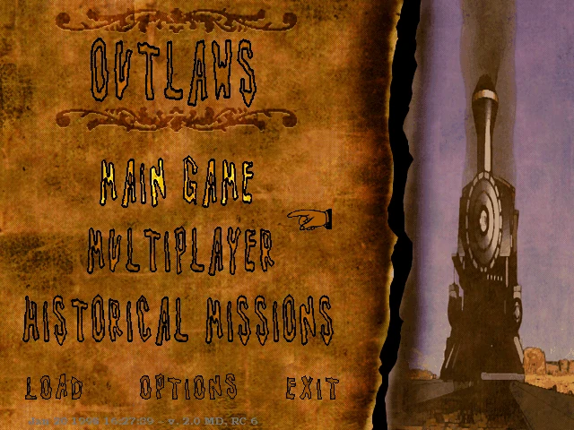
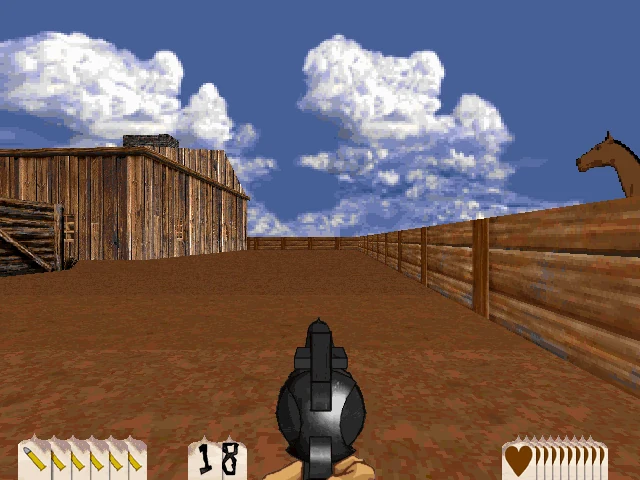
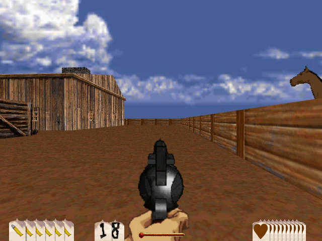
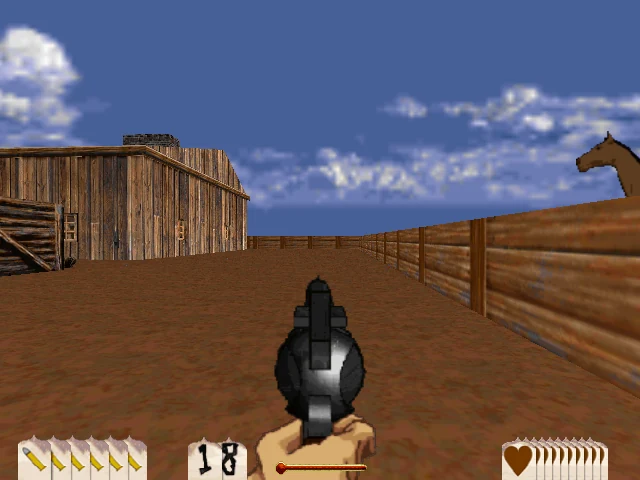

# Outlaws (1997 — Win32 3dfx Glide 2.11 & 2.x)

| Field | Value |
| :--- | :--- |
| **Category** | Commercial Game |
| **Year** | 1997 |
| **Platform(s)** | `Win32 / Wine (glide2x.dll / glide.dll)` |
| **Glide API & Version** | **Glide 2.x (`LECGL23.DLL` → `glide2x.dll`)** · **Glide 2.11 (`LECGLIDE.DLL` → `glide.dll`)** |
| **Recommended Card Profile** | `Voodoo2` (`2.56`, default) · `VoodooGraphics` (`2.11` for `LECGLIDE.DLL`) |
| **Verified Backends** | Vulkan · OpenGL 3.3 Core (WGL) · Software (AVX2 / AVX-512 / Scalar) |
| **Preset File(s)** | [`glide-ng.ini`](./glide-ng.ini) (`LECGL23.DLL` `1×`) · [`glide-ng.hq.ini`](./glide-ng.hq.ini) (4× MSAA + Linear) · [`glide-ng.glide211.ini`](./glide-ng.glide211.ini) (`LECGLIDE.DLL` Glide 2.11) · [`glide-ng.software.ini`](./glide-ng.software.ini) (CPU Software) |
| **Status** | Verified |

---

## Overview

*Outlaws* (LucasArts, March 1997) is a Wild West first-person shooter powered by an enhanced version of the **Jedi Engine** (`olwin.exe`). The original `v1.0` retail disc shipped software DirectDraw (`lecddraw.dll`) and GDI window (`lecgdi.dll`) rasterizers only. Applying the official **v1.1 patch** (`OL_v11.exe`) adds the **3Dfx Glide 2.11 (`LECGLIDE.DLL` → `glide.dll`)** driver, and the **v2.0 *"Handful of Missions"* patch** (`outlaws_missions.exe`) adds the **3Dfx Glide 2.3 (`LECGL23.DLL` → `glide2x.dll`)** driver plus five bonus historical missions (`v2.01` `olupd201.exe` updates `olwin.exe` with Win98 compatibility fixes).

Both Glide drivers work natively through `glide-ng` (`glide2x.dll` and `glide.dll`), turning flat pixelated `8-bit` walls, desert dirt, and clouds into crisp **bilinear-filtered wooden barns, corals, rolling blue skyboxes, shaded dirt yards, and smooth hardware-clipped hand-drawn revolver sprites and playing-card HUD counters**.

---

## Editions, Patches & Executables

| Binary / Display Driver | Graphics API | Works with `glide-ng`? | Technical Notes |
| :--- | :--- | :---: | :--- |
| **`olwin.exe` + `LECGL23.DLL`** *(v2.0/v2.01, `84,748 B`)* | **Glide 2.x (`glide2x.dll`)** | **Yes (Recommended)** | Official **3Dfx Glide 2.3** display driver added by the *Handful of Missions* (`v2.0`) patch. Supports **`512×384`** and **`640×480`**. |
| **`olwin.exe` + `LECGLIDE.DLL`** *(v1.1 `47,616 B` / v2.0 `52,224 B`)* | **Glide 2.11 (`glide.dll`)** | **Yes** | Pre-2.3 SST-1 **3Dfx Glide 2.1.1** display driver added in **`v1.1`** and updated in **`v2.0`**. Uses `grSstOpen`, `grSstPassthruMode`, and legacy `grLfbBegin`/`grLfbGetWritePtr`. |
| **`olwin.exe` + `lecddraw.dll`** *(`35,328 B`)* | DirectDraw Software | No *(Comparison baseline)* | Native CPU software renderer (`8-bit` nearest-neighbor textures, jagged horizontal seams across skybox clouds and corral boards). |
| **`olwin.exe` + `lecgdi.dll`** *(`17,920 B`)* | Win32 GDI Software | No | Windowed desktop software fallback (`olcfg.exe` → `Window`). |

> **Patch order matters:** Overlay official updates cleanly in order **`v1.0` CD → `v1.1` (`OL_v11.exe`) → `v2.0` (`outlaws_missions.exe`) → `v2.01` (`olupd201.exe`)**, keeping **`olpatch1.lab` (`10.8 MB`)** and **`olpatch2.lab` (`12.4 MB`)** beside `olwin.exe`. Also copy the six CD-2 `.SAN` cutscene files (`SAE_HIB.SAN`, `MNE_CLB.SAN`, `RAM.SAN`, `HIE_MNB.SAN`, `RAE.SAN`, `CLE_RAB.SAN`) into the game directory for complete story playback.

---

## Recommended Launch Configurations (Wine32 / Windows)

Stage the `OUTLAWS\` folder from CD 1 into `game/`, apply `v1.1`, `v2.0`, and `v2.01`, copy both **`glide2x.dll`** (`LECGL23.DLL`) and **`glide.dll`** (`LECGLIDE.DLL`) next to `olwin.exe`, and mount `cd_drive/` with `.windows-label` set to **`OUTLAWS_1`** as Wine's `D:` **`cdrom`** drive.

### One-Time Wine Prefix & Registry Setup

> **Important:** *Outlaws* reads `Display Width`, `Display Height`, and `SafeExit` as **Windows `REG_SZ` text strings** (`"640"`, `"480"`, `"YUP"` — **NOT** `REG_DWORD`!). Writing `REG_DWORD` produces an immediate `memory.c Line: 653 (size > 0)` assertion on startup.

```bash
WINEARCH=win32 WINEPREFIX=/path/to/prefix wineboot -u
WINEARCH=win32 WINEPREFIX=/path/to/prefix wine reg add \
  'HKCU\Software\Wine' /v Version /t REG_SZ /d win98 /f

ln -sfn /path/to/cd_drive /path/to/prefix/dosdevices/d:
WINEARCH=win32 WINEPREFIX=/path/to/prefix wine reg add \
  'HKLM\Software\Wine\Drives' /v 'd:' /t REG_SZ /d cdrom /f

for rk in \
  'HKLM\Software\LucasArts Entertainment Company\Outlaws\v1.0' \
  'HKLM\Software\LucasArts Entertainment Company\Outlaws\v1.1' \
  'HKCU\Software\LucasArts Entertainment Company\Outlaws\v1.0' \
  'HKCU\Software\LucasArts Entertainment Company\Outlaws\v1.1'; do
  WINEARCH=win32 WINEPREFIX=/path/to/prefix wine reg add "$rk" /v 'Display Driver' /t REG_SZ /d 'LECGL23.DLL' /f
  WINEARCH=win32 WINEPREFIX=/path/to/prefix wine reg add "$rk" /v 'Display Width'  /t REG_SZ /d '640' /f
  WINEARCH=win32 WINEPREFIX=/path/to/prefix wine reg add "$rk" /v 'Display Height' /t REG_SZ /d '480' /f
  WINEARCH=win32 WINEPREFIX=/path/to/prefix wine reg add "$rk" /v 'SafeExit'       /t REG_SZ /d 'YUP' /f
done
```

### Option A: Standard Glide 2.x (`glide-ng.ini` — `LECGL23.DLL`, Vulkan `1×`)

```bash
WINEARCH=win32 WINEPREFIX=/path/to/prefix \
WINEDLLOVERRIDES="glide,glide2x=n" \
GLIDE_NG_CONFIG=/path/to/glide-ng.ini \
  wine explorer /desktop=Outlaws,640x480 ./olwin.exe
```

Add `GLIDE_NG_BACKEND=opengl_es` to use the Win32 WGL OpenGL 3.3 Core backend without editing the preset *(under Wine, set `HKCU\Software\Wine\Direct3D\renderer = no3d` when using `opengl_es` so WineD3D's `gl` DirectDraw menus do not contend with the `HWND`'s single Win32 `SetPixelFormat` slot; Vulkan and Software backends work with the default WineD3D setting)*. Switch `Display Driver` to **`LECGLIDE.DLL`** with [`glide-ng.glide211.ini`](./glide-ng.glide211.ini) to run on the **Glide 2.11 (`glide.dll`)** driver (`olcfg.exe` lists both side by side).

### Option B: Best Visuals (`glide-ng.hq.ini` — Vulkan `4× MSAA` + Linear) *(Recommended)*

```bash
WINEARCH=win32 WINEPREFIX=/path/to/prefix \
WINEDLLOVERRIDES="glide,glide2x=n" \
GLIDE_NG_CONFIG=/path/to/glide-ng.hq.ini \
  wine explorer /desktop=Outlaws,640x480 ./olwin.exe
```

### Option C: CPU Software Rasterizer (`glide-ng.software.ini` — AVX2 / AVX-512)

```bash
WINEARCH=win32 WINEPREFIX=/path/to/prefix \
WINEDLLOVERRIDES="glide,glide2x=n" \
GLIDE_NG_CONFIG=/path/to/glide-ng.software.ini \
  wine explorer /desktop=Outlaws,640x480 ./olwin.exe
```

*(Using `wine explorer /desktop=Outlaws,640x480` provides Wine's virtual display mode-switching so the opening 2D DirectDraw SMUSH menus transition cleanly into Glide.)*

---

## Visual Progression Gallery

All in-game captures show native `640×480` frames from **Level 1 (`Hideout` — wooden barn, corral, horse, and skybox clouds)**:

| | |
| :---: | :---: |
| <br>**1. Main Menu (`640×480`, `olwin.exe` v2.01)**<br>Opening front-end screen with animated parchment options and western locomotive illustration. | <br>**2. Native Software Renderer (`lecddraw.dll`, `640×480`)**<br>Jagged nearest-neighbor ground texels, blocky skybox clouds, harsh stair-stepping on corral planks, and un-filtered 8-bit color bands. |
| <br>**3. Glide 2.x (`LECGL23.DLL`) — Vulkan `4× MSAA` HQ ([`glide-ng.hq.ini`](./glide-ng.hq.ini))**<br>Best overall visuals: silky bilinear-filtered wooden barn planks, horizontal fence rails, shaded dirt yard, smooth clouds, crisp revolver silhouette, and clean playing-card bullet/health HUD. | <br>**4. Glide 2.x (`LECGL23.DLL`) — OpenGL 3.3 Core / WGL `1×`**<br>Exact visual parity with Vulkan across barn planking, skybox dome filtering, horse sprite chromakey, and bottom HUD cards. |
| <br>**5. Glide 2.x (`LECGL23.DLL`) — CPU Software AVX2 `1×` ([`glide-ng.software.ini`](./glide-ng.software.ini))**<br>Identical bilinear ground, barn wall, cloud blending, sky horizon, weapon shading, and HUD alpha/chromakey cutouts across the CPU rasterizer. | <br>**6. Glide 2.11 (`LECGLIDE.DLL` → `glide.dll`) — Vulkan `1×` ([`glide-ng.glide211.ini`](./glide-ng.glide211.ini))**<br>Pre-2.3 SST-1 Glide 2.11 driver produces exact parity with the `LECGL23.DLL` Glide 2.3 driver across terrain, sprites, skybox, and HUD elements. |

---

## Visual Quality & Performance Tuning

### Flavour Comparison: Glide (`LECGL23.DLL` / `LECGLIDE.DLL`) vs. DirectDraw Software (`lecddraw.dll`)
* **Both `LECGL23.DLL` (`glide2x.dll`) and `LECGLIDE.DLL` (`glide.dll`) render identically** and deliver a dramatic filtering upgrade over `lecddraw.dll`. The Jedi Engine software renderer displays blocky nearest-neighbor texels across the dirt yard, fence boards, and painted cloud dome; hardware Glide applies smooth bilinear filtering, distance shading, and clean chromakeyed cutouts across sprites (`horse`, `revolver`, playing-card ammo/health bar).
* **Use `LECGL23.DLL` + [`glide-ng.hq.ini`](./glide-ng.hq.ini)** as the default profile for smoother `4× MSAA` angled roof/fence edges and linear upscale presentation.
* **`olcfg.exe` driver selector:** Run `wine ./olcfg.exe` anytime to interactively switch between **`3Dfx Glide 2.1.1`**, **`3Dfx Glide 2.3`**, **`DirectDraw (Full Screen)`**, and **`Window`**, as well as `512×384` vs `640×480`.

---

## Quirks, Known Issues & Controls

### Installation & Compatibility Notes
* **`Display Width` / `Display Height` must be `REG_SZ` strings:** Creating them as `REG_DWORD` triggers a `memory.c Line: 653 (size > 0)` assertion during startup. Always write `"640"` / `"480"` as strings (or let `olcfg.exe` populate the registry automatically).
* **DirectDraw-to-Glide virtual desktop:** Launch inside `wine explorer /desktop=Outlaws,640x480` so Wine cleanly handles the `ChangeDisplaySettings` mode transition between the 2D `8-bit` SMUSH intro/menus and the `640×480` Glide 3D world.
* **Unclean-exit Safe Mode prompt:** Setting `SafeExit = "YUP"` prevents the *"Outlaws has detected that the last execution didn't exit cleanly"* dialog if a previous run was forcibly terminated.
* **Redbook CD audio:** Mount the original mixed-mode CD image as a virtual drive for the full Ennio Morricone-inspired CDDA soundtrack.

### Useful Controls

| Key / Input | Action |
| :--- | :--- |
| **`Arrow keys` / Mouse** | Move / aim *(mouselook configurable in `Options → Controls`)* |
| **`Ctrl` / `LMB`** | Fire revolver / primary attack |
| **`Alt` / `RMB`** | Secondary fire *(e.g. fan hammer / zoom scope)* |
| **`R`** | Reload cylinder |
| **`1`–`7`** | Select weapon *(revolver, rifle, sawed-off, dynamite, etc.)* |
| **`Space`** | Open doors / interact |
| **`X` / `Z`** | Jump / crouch |
| **`Esc`** | Skip SMUSH cutscene / open menu |
