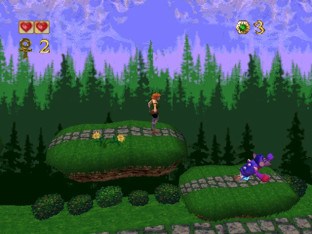

# Pandemonium! (1997)

| Field | Value |
| :--- | :--- |
| **Title** | *Pandemonium!* |
| **Developer / Publisher** | Toys for Bob / Crystal Dynamics |
| **Release Year** | 1997 (PC Win95 / 3dfx port) |
| **Platform** | Win32 / Wine (`PANDY3.EXE` — Glide 2.11 via `glide.dll`) |
| **Glide API** | **Glide 2.11** (`glide.dll`, `api_version = 2.11`) |
| **Recommended Profile** | `VoodooGraphics` (`api_version = 2.11`) |
| **Backends Verified** | Vulkan (Pass) · OpenGL ES (Pass) · Software (Pass) |
| **Presets** | [`glide-ng.ini`](./glide-ng.ini) · [`glide-ng.hq.ini`](./glide-ng.hq.ini) · [`glide-ng.software.ini`](./glide-ng.software.ini) |

---

## 1. Overview & Supported Editions

*Pandemonium!* is a Windows 95 2.5D polygon platformer (no DOS edition exists). The retail CD-ROM ships two Win32 executables:

- **3dfx Glide 2.11 (`PANDY3.EXE`)**: Uses early **Glide 2.11** (`glide.dll`, `grSstOpen`, `grSstPassthruMode`, `grLfbBegin`/`grLfbGetWritePtr`/`grLfbEnd`) at fixed `640×480` with full bilinear texture filtering, Gouraud lighting, and alpha-blended dust/orb effects.
- **DirectDraw Software (`PANDY.EXE`)**: Non-accelerated 16-bit DirectDraw software renderer (`320×240`, `640×400`, or `640×480` with optional low-texture / flat-shading toggles for 1997 CPUs).

**Flavour Verdict**: The **3dfx Glide 2.11 (`PANDY3.EXE`)** edition is strongly preferred over the DirectDraw software renderer — it adds hardware bilinear texture filtering, smooth translucent particle/orb blending, and clean `4× MSAA` anti-aliasing (`glide-ng.hq.ini`) across all three `glide-ng` backends.

---

## 2. Installation & Launch Setup (Win32 / Wine)

### Installing the 3dfx Edition

You can either run the CD's `SETUP.EXE` with **"Use my 3Dfx accelerator card"** + **Full Install** checked, or copy the `[Full3]` file list directly from `SETUP.CNF` on the CD:

1. Copy `PANDY3.EXE`, `XANLIB.DLL`, `JESTERS.PKG`, `LEVEL21.PKG`, `LEVEL653.PKG`–`LEVEL683.PKG`, `LEVEL75.PKG`–`LEVEL77.PKG`, `LEVEL96.PKG`–`LEVEL97.PKG`, `LOGOS.AVI`, `INTROS.AVI`, and `OUTROS.AVI` into a game directory.
2. Copy `FULL3.CNF` as **`RESOURCE.CNF`** in the same directory.
3. **Replace the bundled 1997 `GLIDE.DLL`** with `glide-ng`'s Win32 **`build/win32/bin/glide.dll`** and remove the legacy `SST1INIT.DLL`.
4. Copy [`glide-ng.ini`](./glide-ng.ini) (or [`glide-ng.hq.ini`](./glide-ng.hq.ini)) next to `PANDY3.EXE`.

> **CD-ROM Audio Check under Wine**: Unmodified `PANDY3.EXE` (and `PANDY.EXE`) verifies the mixed-mode retail CD via Windows MCI (`sysinfo cdaudio name 1 wait`) right after `LOGOS.AVI`. Under Wine without a mounted physical/virtual mixed-mode audio disc (`cdemu`), use a No-CD patched `PANDY3.EXE` or mount the full mixed-mode disc image.

### Launch Command (Wine32)

```bash
WINEARCH=win32 \
WINEDLLOVERRIDES="glide=n" \
wine explorer /desktop=Pandy,800x600 ./PANDY3.EXE
```

- **HiDPI / HQ**: Use `/desktop=Pandy,1280x960` paired with [`glide-ng.hq.ini`](./glide-ng.hq.ini) (`msaa = 4`, `presentation_filter = linear`).
- **CPU-only Vulkan hosts**: Cap `LP_NUM_THREADS=4` to preserve 32-bit Wine virtual address space under Mesa `llvmpipe`, or use [`glide-ng.software.ini`](./glide-ng.software.ini).

---

## 3. Quirks & Controls

- **Native Win32 Menu Bar (`SHOW_VGA` ↔ `SHOW_SST1`)**: Pressing **`Esc`** invokes `grSstPassthruMode(GR_PASSTHRU_SHOW_VGA)` to expose the native Windows menu bar (`Game | Options | Password`). `glide-ng` yields the embedded presentation surface cleanly for GDI dialogs (`Volumes`, `Keyboard Setup`) and reclaims it automatically when returning to the game.
- **Gamma**: The CD's `PANDY3.BAT` explicitly sets `SST_RGAMMA=1.0`, `SST_GGAMMA=1.0`, and `SST_BGAMMA=1.0`. Leaving gamma unset in `glide-ng.ini` uses the matching linear `1.0` default.
- **Timing & VSync**: Keep `vsync = true` and `max_fps = 60` enabled to maintain authentic platforming speed.
- **Default Keyboard Controls** (rebindable via `Esc` → `Options` → `Keyboard`):
  - **`A`** / **`S`**: Move Left / Right
  - **`PgUp`** / **`X`**: Move Up / Down (also switches between Nikki and Fargus on the starting hub island)
  - **`Space`**: Jump (and enter highlighted level on the World Map)
  - **`Ctrl`**: Fire / Attack
  - **`Z`**: Special (Nikki double-jump / Fargus spin attack)
  - **`Esc`**: Pause & open Win32 menu bar

---

## 4. Verification Gallery

| Title Screen (`800×600`, Vulkan + `4× MSAA`) | 3D World Map Hub (`640×480`, Vulkan) |
| :---: | :---: |
|  |  |

| Level 1 *Skull Fortress* (`640×480`, Vulkan 1×) | Level 1 *Skull Fortress* (`1280×960`, Vulkan HQ `4× MSAA`) |
| :---: | :---: |
|  |  |

| Level 1 *Skull Fortress* (`640×480`, OpenGL ES/WGL) |
| :---: |
|  |
