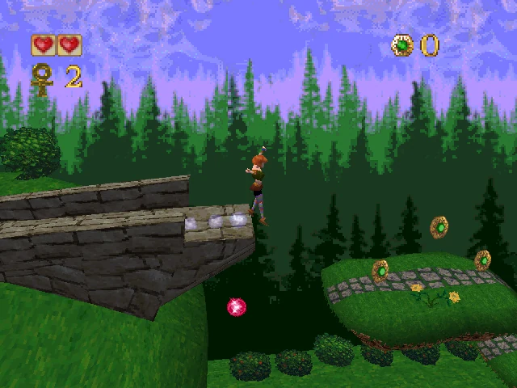

# Pandemonium! (1997 — Win32 3dfx Glide 2.11)

| Field | Value |
| :--- | :--- |
| **Category** | Commercial Game |
| **Year** | 1997 (PC Win95 / 3dfx port) |
| **Platform(s)** | `Win32 / Wine (glide.dll)` |
| **Glide API & Version** | **Glide 2.11** (`glide.dll` — pre-2.3 SST-1 ABI) |
| **Recommended Card Profile** | `VoodooGraphics` (`SST-1`: 4 MB FB, 1× 2 MB TMU, API `2.11`) |
| **Verified Backends** | Vulkan · OpenGL 3.3 Core (WGL) · Software (AVX2 / AVX-512 / Scalar) |
| **Preset File(s)** | [`glide-ng.ini`](./glide-ng.ini) (Authentic SST-1, `1×`) · [`glide-ng.hq.ini`](./glide-ng.hq.ini) (`4× MSAA` + Linear) · [`glide-ng.software.ini`](./glide-ng.software.ini) (CPU Software) |
| **Status** | Verified |

---

## Overview

Toys for Bob and Crystal Dynamics' 1997 2.5D polygon platformer *Pandemonium!* is a Windows 95 release (no DOS edition exists) that includes an early **Glide 2.11 (`glide.dll`)** 3dfx port (`PANDY3.EXE`) alongside its DirectDraw software renderer (`PANDY.EXE`). At fixed `640×480`, the 3dfx renderer adds hardware bilinear texture filtering, Gouraud lighting, and translucent particle/orb blending.

Under `glide-ng`'s **`glide.dll`** frontend (`grSstOpen`, `grSstPassthruMode`, fixed-stride `grLfbBegin`/`grLfbGetWritePtr`/`grLfbEnd`), *Pandemonium!* seamlessly alternates between its hardware-accelerated 3D world and the native Win32 menu bar (`Esc` invokes `GR_PASSTHRU_SHOW_VGA` to yield the embedded window for GDI dialogs such as `Volumes` and `Keyboard Setup`, then reclaims it via `GR_PASSTHRU_SHOW_SST1`).

---

## Editions, Patches & Executables

| Executable / Driver | Renderer | Works with `glide-ng`? | Technical Notes |
| :--- | :--- | :---: | :--- |
| **`PANDY3.EXE`** *(Retail 3dfx Win32)* | Glide 2.11 (`GLIDE.DLL`) | **Yes (Recommended)** | Fixed `640×480` Glide 2.11 hardware renderer. Requires `FULL3.CNF` copied as `RESOURCE.CNF`, replacing the bundled 1997 `GLIDE.DLL` with `glide-ng`'s `glide.dll`, and removing the legacy `SST1INIT.DLL`. |
| **`PANDY.EXE`** *(Retail DirectDraw Software)* | DirectDraw 16-bit Software | No (No 3dfx) | Non-accelerated software renderer (`320×240`, `640×400`, or `640×480` with optional low-texture / flat-shading toggles for 1997 CPUs). Does not use Glide. |

> **Manual Full Install File List (`SETUP.CNF` `[Full3]`):**
> Either run the CD's `SETUP.EXE` with **"Use my 3Dfx accelerator card"** + **Full Install**, or copy `PANDY3.EXE`, `XANLIB.DLL`, `JESTERS.PKG`, `LEVEL21.PKG`, `LEVEL653.PKG`–`LEVEL683.PKG`, `LEVEL75.PKG`–`LEVEL77.PKG`, `LEVEL96.PKG`–`LEVEL97.PKG`, `LOGOS.AVI`, `INTROS.AVI`, and `OUTROS.AVI` into a game directory, then copy **`FULL3.CNF` → `RESOURCE.CNF`**.

---

## Recommended Launch Configurations (Wine32 / Windows)

Copy `glide-ng`'s 32-bit **`glide.dll`** (from `build_release/win32/bin/glide.dll` or `build/win32/bin/glide.dll`) and the desired preset (`glide-ng.ini`) into the game directory alongside `PANDY3.EXE`, and remove the legacy `SST1INIT.DLL`.

### Option A: Authentic Voodoo Graphics (`glide-ng.ini` — Vulkan or OpenGL 3.3 Core) *(Recommended)*

```bash
WINEARCH=win32 WINEPREFIX=/path/to/wineprefix \
WINEDLLOVERRIDES="glide=n" \
  wine explorer /desktop=Pandy,800x600 ./PANDY3.EXE
```

To use the Win32 WGL OpenGL 3.3 Core backend instead of Vulkan without editing `glide-ng.ini`:

```bash
WINEARCH=win32 WINEPREFIX=/path/to/wineprefix \
WINEDLLOVERRIDES="glide=n" GLIDE_NG_BACKEND=opengl_es \
  wine explorer /desktop=Pandy,800x600 ./PANDY3.EXE
```

### Option B: Best Visuals (`glide-ng.hq.ini` — `4× MSAA` + `1280×960`)

Use [`glide-ng.hq.ini`](./glide-ng.hq.ini) (`msaa = 4`, `presentation_filter = linear`, `no_dither_sub = true`) on a `1280×960` Wine virtual desktop:

```bash
WINEARCH=win32 WINEPREFIX=/path/to/wineprefix \
WINEDLLOVERRIDES="glide=n" \
GLIDE_NG_CONFIG=/path/to/glide-ng.hq.ini \
  wine explorer /desktop=Pandy,1280x960 ./PANDY3.EXE
```

### Option C: CPU Software Rasterizer (`glide-ng.software.ini`)

On hosts without a 32-bit hardware Vulkan ICD, cap `LP_NUM_THREADS=4` to preserve 32-bit Wine virtual address space under Mesa `llvmpipe`, or run `glide-ng`'s CPU Software backend directly:

```bash
WINEARCH=win32 WINEPREFIX=/path/to/wineprefix \
WINEDLLOVERRIDES="glide=n" \
GLIDE_NG_CONFIG=/path/to/glide-ng.software.ini \
  wine explorer /desktop=Pandy,800x600 ./PANDY3.EXE
```

---

## Visual Progression Gallery

All captures below are taken from `PANDY3.EXE` running under Wine32 + `glide-ng`'s `glide.dll` (Glide 2.11):

| | |
| :---: | :---: |
| <br>**1. Title Screen (`800×600`, Vulkan HQ `4× MSAA`)**<br>Clean pre-2.3 Glide 2.11 logo and menu startup under [`glide-ng.hq.ini`](./glide-ng.hq.ini). | <br>**2. 3D World Map Hub (`640×480`, Vulkan `1×`)**<br>Starting overworld hub island with bilinear texture filtering and character swap. |
| <br>**3. Level 1 *Skull Fortress* (`640×480`, Vulkan `1×`, [`glide-ng.ini`](./glide-ng.ini))**<br>Authentic SST-1 `1×` baseline showing bilinear textures, Gouraud shading, and translucent dust/orb effects with native polygon aliasing. | <br>**4. Level 1 *Skull Fortress* (`1280×960`, Vulkan HQ `4× MSAA`, [`glide-ng.hq.ini`](./glide-ng.hq.ini))**<br>4× MSAA with linear upscaling eliminates staircase edges across platforms, arches, and character geometry. |
| <br>**5. Level 1 *Skull Fortress* (`640×480`, OpenGL 3.3 Core WGL)**<br>Matches Vulkan lighting, transparency, and polygon sorting identically. | |

---

## Visual Quality & Performance Tuning

* **Flavour verdict (3dfx Glide vs. Software):** The **3dfx Glide 2.11 (`PANDY3.EXE`)** edition is strongly preferred over the DirectDraw software renderer (`PANDY.EXE`) — it adds hardware bilinear texture filtering, smooth translucent particle/orb blending, and clean **`4× MSAA`** anti-aliasing (`glide-ng.hq.ini`) across all three `glide-ng` backends.
* **Gamma (`1.0` default):** The retail CD's `PANDY3.BAT` explicitly sets `SST_RGAMMA=1.0`, `SST_GGAMMA=1.0`, and `SST_BGAMMA=1.0`. Leaving gamma unset in `glide-ng.ini` preserves the exact linear `1.0` default.
* **Timing & VSync:** Keep `vsync = true` and `max_fps = 60` enabled to maintain authentic platforming speed.

---

## Quirks, Known Issues & Controls

### Installation & Engine Notes
* **Mixed-mode CD-ROM audio check under Wine:** Unmodified `PANDY3.EXE` (and `PANDY.EXE`) checks the mixed-mode retail CD via Windows MCI (`sysinfo cdaudio name 1 wait`) immediately after `LOGOS.AVI`. Under Wine without a mounted physical or virtual mixed-mode audio disc (`cdemu`), use a No-CD patched `PANDY3.EXE` or mount the complete mixed-mode disc image.
* **Native Win32 menu bar (`SHOW_VGA` ↔ `SHOW_SST1`):** Pressing **`Esc`** invokes `grSstPassthruMode(GR_PASSTHRU_SHOW_VGA)` to expose the native Windows menu bar (`Game | Options | Password`). `glide-ng` yields the embedded presentation surface cleanly for GDI dialogs (`Volumes`, `Keyboard Setup`) and reclaims it automatically when resuming play.
* **Startup splash:** `glide-ng` plays its procedural startup splash once automatically on `grSstOpen()`. Uncomment `no_splash = true` in `glide-ng.ini` (or pass `FX_GLIDE_NO_SPLASH=1`) to skip it.

### Useful Controls
Default bindings (rebindable via `Esc` → **Options → Keyboard**):
* `A` / `S` — Move Left / Right · `PgUp` / `X` — Move Up / Down (also swaps between Nikki and Fargus on the hub island) · `Space` — Jump / Enter highlighted level · `Ctrl` — Fire / Attack · `Z` — Special (Nikki double-jump / Fargus spin attack) · `Esc` — Pause & open native Win32 menu bar
