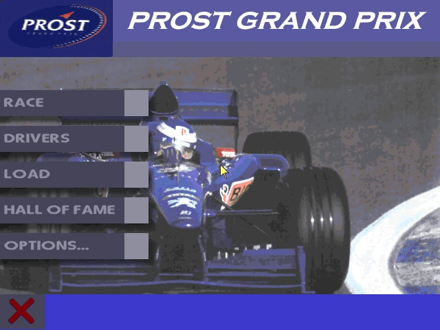
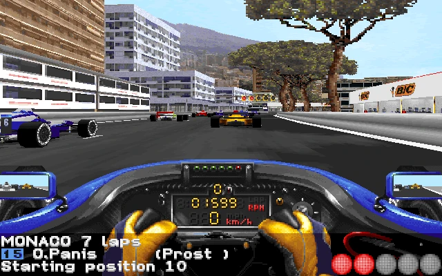
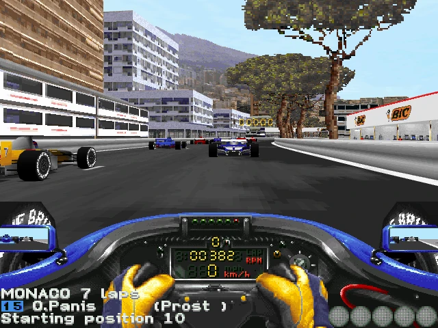
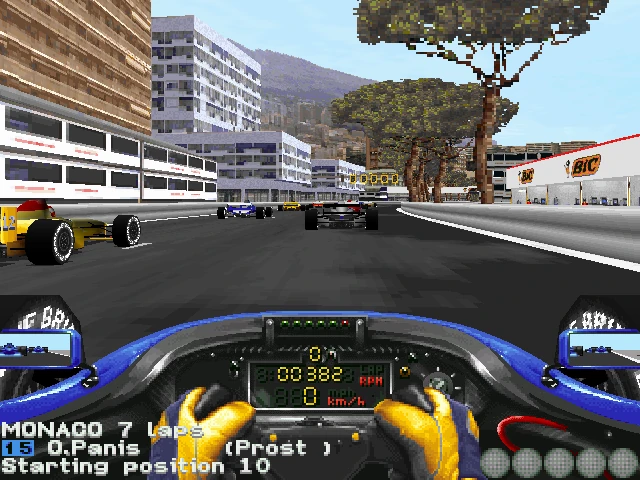
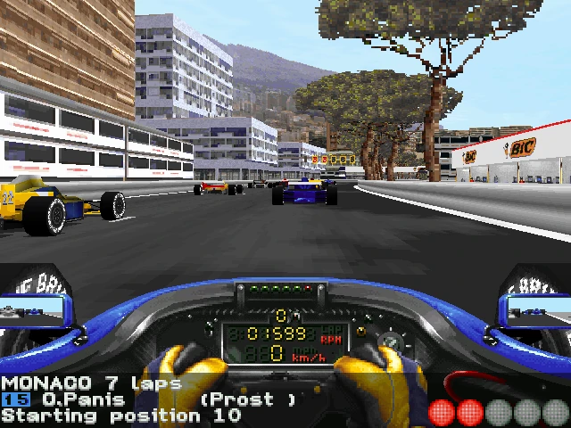
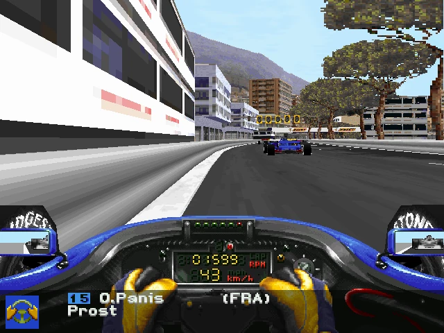

# Prost Grand Prix (1998 — 3dfx DOS)

| Field | Value |
| :--- | :--- |
| **Category** | Commercial Game |
| **Year** | 1998 |
| **Platform(s)** | `DOS/32 (GLIDE2X.OVL via DOSBox Glide pass-through)` |
| **Glide API & Version** | Glide 2.x (`2.48` on Voodoo Graphics / `2.56` on Voodoo2) |
| **Recommended Card Profile** | `VoodooGraphics` (default, retail SST-1 target) · `Voodoo2` (also verified) |
| **Verified Backends** | Vulkan · OpenGL ES · Software (AVX2 / AVX-512 / Scalar) |
| **Preset File(s)** | [`glide-ng.ini`](./glide-ng.ini) (Voodoo1) · [`glide-ng.hq.ini`](./glide-ng.hq.ini) (`4× MSAA`) · [`glide-ng.voodoo2.ini`](./glide-ng.voodoo2.ini) (Voodoo2) · [`glide-ng.software.ini`](./glide-ng.software.ini) (CPU Software) |
| **Status** | Verified |

---

## Overview

Canal+ Multimedia / Visiware / Infogrames' *Prost Grand Prix* (`1998`, also known as *Prost Grand Prix 1998*) is a DOS/4GW Formula 1 racing simulator featuring an official **1997/1998 Prost AP01 cockpit**, live dual rear-view mirrors, full 16-track calendar (including Monaco, Suzuka, Monza, and Spa-Francorchamps), and dynamic **3dfx Glide 2.x (`GLIDE2X.OVL`)** hardware acceleration at **`640×480`**.

A single unified binary (`PGP.EXE`, `987,726` B) supports both VESA 2.0 `640×400` 8-bit software rendering and **`640×480` 16-bit 3dfx Glide** acceleration. At startup, `PGP.EXE` probes the host root for **`C:\PGP3DFX.INI`**: when present alongside `GLIDE2X.OVL`, the engine initializes Glide with bilinear-filtered asphalt, smooth horizon buildings and barriers, crisp chromakey alpha-cutout trees, and full **`640×480`** cockpit framing (`16-bit` RGB565 LFB overlay with live mirrors and starting lights).

---

## Editions, Patches & Executables

| Executable / Package | Renderer | Works with `glide-ng`? | Technical Notes |
| :--- | :--- | :---: | :--- |
| **`Sg\PGP.EXE` (Retail CD, 1998-04-29)** | Glide 2.x (`GLIDE2X.OVL`) & SVGA SW | **Yes (Recommended)** | Single unified DOS/4GW executable (`987,726` B). Dynamically loads `GLIDE2X.OVL` when **`C:\PGP3DFX.INI`** exists; falls back to `640×400` 8-bit SVGA when absent. Pair with `glide-ng`'s clean-room **`build/dos/glide2x.ovl`**. |
| **`Sg\SETUP.EXE`** | DOS VESA Installer | Setup tool | Installs game data (`Sg\`), creates **`SETUP.DAT`** (language index and km/h vs. mph units), and writes **`C:\PGP3DFX.INI`** when 3dfx acceleration is selected. |
| **`Sg\SETSOUND.EXE`** | Miles Sound System | Setup tool | Configures `DIG.INI` (`SBLASTER.DIG` / `SB16.DIG`, matching DOSBox `A220 I7 D1`) and optional `MDI.INI` music output. |

---

## Recommended DOSBox Configurations

Keep the DOSBox configuration minimal — only non-default overrides are shown below.

> **Important Configuration Notes:**
> 1. **Clean-room `GLIDE2X.OVL`:** Place `glide-ng`'s **`build/dos/glide2x.ovl`** directly inside the game folder next to `PGP.EXE`. Do **not** extract the legacy `383,011`-byte `GLIDE2X.OVL` shipped inside `Sg\3dfx\GLIDE\DRIVERS\VOODOO\DOS\`.
> 2. **Enabling 3dfx (`C:\PGP3DFX.INI`):** `PGP.EXE` checks the exact path **`C:\PGP3DFX.INI`** on boot (`"rb"` open check). When mounting the game directory directly as `C:`, ensure an empty or 1-line `pgp3dfx.ini` exists at the root of `C:`. Remove it to run the native `640×400` software renderer.
> 3. **Language selection (`SETUP.DAT`):** Create `SETUP.DAT` beside `PGP.EXE` with three CRLF lines: root path (`C:\`), language index (`0` = French, `1` = English, `2` = German, `3` = Italian, `4` = Spanish, `5` = Dutch), and speed unit (`0` = km/h, `1` = mph). For English + km/h: `C:\` / `1` / `0`.
> 4. **Sound Blaster IRQ matching DOSBox:** The default `DIG.INI` on the disc sets `IRQ 5`; edit it to **`IRQ 7`** (or rerun `SETSOUND.EXE`) to match DOSBox's default `SET BLASTER=A220 I7 D1 H5 T6`.
> 5. **Voodoo1 vs. Voodoo2 profile:** Although the retail `PGP README.txt` advises against real Voodoo2 cards, both **`VoodooGraphics` (`2.48`)** and **`Voodoo2` (`2.56`)** presets run cleanly under `glide-ng`.

### Option A: Patched DOSBox-SVN (Glide Pass-Through → `glide-ng`) *(Recommended)*

```ini
# dosbox-svn.conf (minimal overrides)
[dosbox]
memsize = 63

[sdl]
# Avoids SDL_UpdateRects SIGSEGV under sdl12-compat on modern Linux
output = opengl

[cpu]
cycles = max

[glide]
glide = true
```

```bash
GLIDE_NG_CONFIG=/path/to/glide-ng.ini \
  dosbox -conf dosbox-svn.conf \
  -c "mount C /path/to/prost/game -freesize 512" \
  -c "C:" \
  -c "PGP.EXE"
```

### Option B: DOSBox-X (Glide Pass-Through → `glide-ng`)

```ini
# dosbox-x-pass.conf (minimal overrides)
[dosbox]
memsize = 63

[cpu]
cycles = max

[voodoo]
glide = true
lfb = full
```

```bash
GLIDE_NG_CONFIG=/path/to/glide-ng.ini \
  dosbox-x -conf dosbox-x-pass.conf -nopromptfolder \
  -c "mount C /path/to/prost/game -freesize 512" \
  -c "C:" \
  -c "PGP.EXE"
```

### Option C: CPU Software Fallback (`glide-ng.software.ini`)

```bash
GLIDE_NG_CONFIG=/path/to/glide-ng.software.ini \
  dosbox -conf dosbox-svn.conf \
  -c "mount C /path/to/prost/game -freesize 512" \
  -c "C:" \
  -c "PGP.EXE"
```

### Reference Comparison: DOSBox-X Software Voodoo (No `glide-ng`)

```ini
# dosbox-x-sw.conf
[dosbox]
memsize = 63

[cpu]
cycles = max

[voodoo]
voodoo_card = software
glide = false
```

Replace the pass-through `GLIDE2X.OVL` with the disc's original SST-1 **Glide 2.43** `Sg\3dfx\GLIDE\DRIVERS\VOODOO\DOS\GLIDE2X.OVL`.

---

## Visual Progression Gallery

All captures below show *Prost Grand Prix* (`PGP.EXE`, Direct Race starting grid at **Monaco**) under patched DOSBox-SVN:

| | |
| :---: | :---: |
| <br>**1. Main Menu (`English`, `640×480`)**<br>Click `RACE` → `DIRECT RACE` to jump straight to the Monaco grid with `O. Panis` (configured in English via `SETUP.DAT`). | <br>**2. Native DOS SVGA Software (`640×400`)**<br>Built-in 8-bit paletted software renderer without `PGP3DFX.INI` (`glide = false`): steeper aspect, visibly quantized palette bands, and harsh edge stair-stepping. |
| <br>**3. 3dfx Glide (`Vulkan 4× MSAA`, `640×480`)**<br>Smooth shaded 16-bit road and guardrails, anti-aliased pit-wall edges and F1 wings, chromakey pine trees, full-frame starting lights, and dual live rear-view mirrors. | <br>**4. 3dfx Glide (`OpenGL ES 1×`, `640×480`)**<br>Matches Vulkan cockpit coloring, mirrors, `BIC` pit garage signage, alpine skyline, and LCD telemetry framing across every element. |
| <br>**5. 3dfx Glide (`CPU Software AVX2`, `640×480`)**<br>Pure-CPU Glide reference rasterizer matching Vulkan and OpenGL ES sky gradients, opponent cars, pine canopies, and steering-wheel LCD graphics. | <br>**6. In-Race Straight (`Vulkan / 3dfx`, `640×480`)**<br>Mid-race acceleration (`43 km/h`) passing the white grandstand wall with steering-aid HUD icon and trailing Formula 1 car visible inside both side mirrors. |

---

## Visual Quality & Performance Tuning

### Recommended Settings & Backends
* **`glide-ng.hq.ini` (`4× MSAA`, `no_dither_sub = true`) is recommended:** Smooths track barrier geometry, distant car suspensions, and overhead bridge angles cleanly with zero cockpit LFB artifacts or tree cutout halos.
* **`VoodooGraphics` (`2.48`) or `Voodoo2` (`2.56`):** The game targets single-TMU SST-1 hardware natively; both `VoodooGraphics` (`glide-ng.ini`) and `Voodoo2` (`glide-ng.voodoo2.ini`) run without visual differences.
* **True 16-bit LFB cockpit overlay:** `PGP.EXE` blits `INTERNAL\CPIT640.RAW` and the live dual rear-view mirrors directly into the `640×480` backbuffer using `grLfbLock()` (RGB565 `pixelPipeline = FXTRUE`). All three backends render it cleanly with full chromakey transparency over the 3D scene.

---

## Quirks, Known Issues & Controls

### Installation & Engine Notes
* **Must sit under root of `C:` when using `C:\PGP3DFX.INI`:** `PGP.EXE` opens the hardcoded path `c:\pgp3dfx.ini`. Keep the file inside whatever directory is mounted as DOS `C:`.
* **`3dfx.bat` references legacy binary name:** The disc's `3dfx.bat` invokes `visisg 3dfx`; launch **`PGP.EXE`** directly instead.
* **Opening credit slides:** Four purple Canal+ / Visiware / Eclipse / G3 credit cards play at boot before the main menu (`click` or wait to advance).
* **Startup splash:** Uncomment `no_splash = true` in `glide-ng.ini` (or pass `FX_GLIDE_NO_SPLASH=1` / `GLIDE_NG_NO_SPLASH=1`) to skip the one-shot startup splash animation.

### Useful Controls

| Key | Action |
| :--- | :--- |
| **`Up` / `Down`** | Accelerate / brake |
| **`Left` / `Right`** | Steer left / right |
| **`Space`** | Advance splash / toggle shift or in-race confirmation |
| **`F4`** | Toggle ideal racing line / trajectory guide |
| **`F5`** | Toggle automatic / manual gearbox |
| **`P`** | Pause race |
| **`Esc`** | Exit session / return to main menu |
