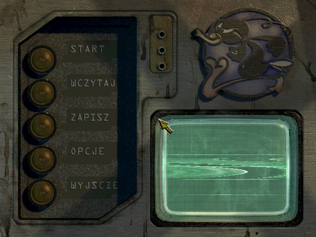
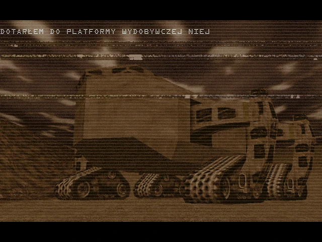
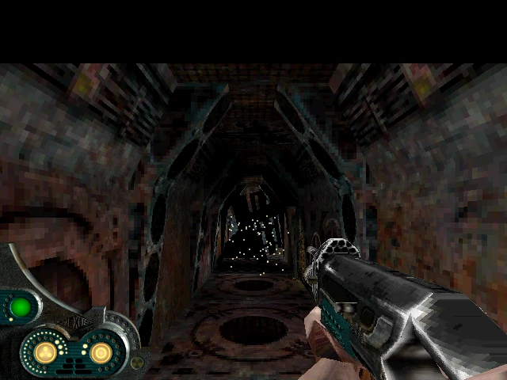
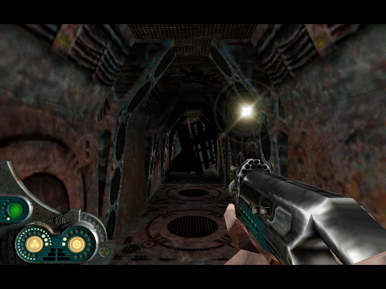
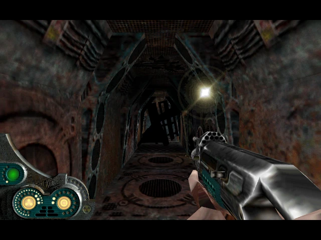
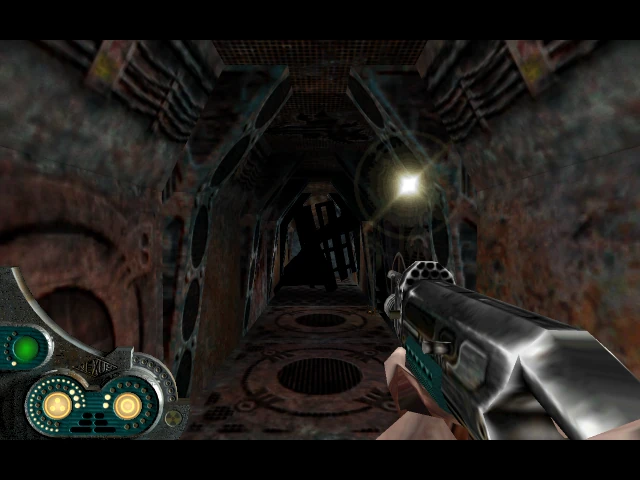

# Pył (1998 — 3dfx DOS)

| Field | Value |
| :--- | :--- |
| **Category** | Commercial Game |
| **Year** | 1998 |
| **Platform(s)** | `DOS/32 (GLIDE2X.OVL via DOSBox Glide pass-through)` |
| **Glide API & Version** | Glide 2.x (`2.56` on Voodoo2 / `2.48` on Voodoo Graphics) |
| **Recommended Card Profile** | `Voodoo2` (default) · `VoodooGraphics` (authentic SST-1) |
| **Verified Backends** | Vulkan · OpenGL ES · Software (AVX2 / AVX-512 / Scalar) |
| **Preset File(s)** | [`glide-ng.ini`](./glide-ng.ini) (Voodoo2) · [`glide-ng.hq.ini`](./glide-ng.hq.ini) (4× MSAA + Linear) · [`glide-ng.voodoo1.ini`](./glide-ng.voodoo1.ini) (SST-1) · [`glide-ng.software.ini`](./glide-ng.software.ini) (CPU Software) |
| **Status** | Verified |

---

## Overview

Optimus Nexus's 1998 Polish sci-fi first-person shooter *Pył* (*Dust*) runs on a custom DOS/4GW 3D engine supporting both native 16-bit VESA software rendering and **3dfx Glide 2.x** acceleration (`640×480×16`) via a single dynamic binary (`PYL.EXE` loading `GLIDE2X.OVL`). Under Glide 2.x, the industrial corridor scenes gain bilinear-filtered `GR_TEXFMT_ARGB_1555` and `GR_TEXFMT_ARGB_4444` textures, volumetric lens-flare lamp halos, dynamic real-time multi-pass shadows and lightmaps, and iterated-alpha fog (`GR_FOG_WITH_ITERATED_ALPHA`).

Technically, `PYL.EXE -V1` is one of the most demanding late-DOS Glide 2.x blend-pipeline workloads: ~350–880 triangles/frame during active corridor gameplay using single-TMU (`TMU0`) multi-pass blending combining opaque base geometry (`ONE, ZERO`), multiplicative lightmaps (`DST_COLOR, ZERO`), subtractive lighting/shadow passes (`ZERO, ONE_MINUS_SRC_COLOR`), translucent glow/corona overlays (`SRC_ALPHA, ONE_MINUS_SRC_ALPHA`), dynamic gamma transitions (`grGammaCorrectionValue(1.16)`), and menu-only `grLfbLock` writes (~750 KB/frame in the main console menu; zero LFB writes during 3D gameplay).

---

## Editions, Patches & Executables

| Executable / Flag | Renderer | Works with `glide-ng`? | Technical Notes |
| :--- | :--- | :---: | :--- |
| **`PYL.EXE -V1`** *(3dfx Voodoo)* | Glide 2.x (`GLIDE2X.OVL`) | **Yes (Recommended)** | Native `640×480×16` Glide 2.x path. Dynamically imports `GLIDE2X.OVL` (compatible with `glide-ng`'s clean-room `build/dos/glide2x.ovl`). Adds bilinear filtering, volumetric lamp flares, and smoother alpha effects over VESA 2.0. |
| **`PYL.EXE -V2` / `-V3`** *(VESA 2.0 / 1.2 Software `640×480`)* | 16-bit CPU Software | No (No 3dfx) | High-color software renderer (`-V2` linear LFB, `-V3` banked). Renders the same dark backlit geometry and particle sparks with blocky unfiltered texels and omits 3dfx lens-flare coronas. |
| **`PYL.EXE -V5` / `-V6`** *(VESA `320×200`)* | 16-bit CPU Software | No (No 3dfx) | Low-resolution software fallback (`320×200×16`). |
| **`PYLstart.exe` + `PYLSTART.DAT`** *(Official update launcher)* | Win32 patcher | Optional | Official post-release launcher patch distributed for the Polish release; retail unpatched `PYL.EXE` already boots and plays directly under DOSBox pass-through. |

---

## Recommended DOSBox Configurations

Keep the DOSBox configuration minimal — only non-default overrides are shown below.

> **Set `[dosbox] memsize = 63`:**
> *Pył* caches level textures, briefing slides, and dynamic lightmaps heavily in extended DOS/4GW memory. Raising `memsize` from DOSBox's default `16` MB to `63` MB ensures all levels load cleanly.

Place `glide-ng`'s clean-room HLE pass-through `GLIDE2X.OVL` (`build/dos/glide2x.ovl`) inside the game directory alongside `PYL.EXE`.

### Option A: Patched DOSBox-SVN (Glide Pass-Through → `glide-ng`) *(Recommended)*

```ini
# dosbox-svn.conf (minimal overrides)
[dosbox]
memsize = 63

[sdl]
# Avoids SDL_UpdateRects SIGSEGV under sdl12-compat on modern Linux
output = opengl

[cpu]
cycles = max

[glide]
glide = true
```

```bash
GLIDE_NG_CONFIG=/path/to/glide-ng.ini \
  dosbox -conf dosbox-svn.conf \
  -c "mount C /path/to/pyl/game" \
  -c "imgmount D /path/to/Pyl.iso -t iso" \
  -c "C:" \
  -c "PYL.EXE -V1"
```

### Option B: DOSBox-X (Glide Pass-Through → `glide-ng`)

```ini
# dosbox-x-pass.conf (minimal overrides)
[dosbox]
memsize = 63

[cpu]
cycles = max

[voodoo]
glide = true
lfb = full
```

```bash
GLIDE_NG_CONFIG=/path/to/glide-ng.ini \
  dosbox-x -conf dosbox-x-pass.conf -nopromptfolder \
  -c "mount C /path/to/pyl/game" \
  -c "imgmount D /path/to/Pyl.iso -t iso" \
  -c "C:" \
  -c "PYL.EXE -V1"
```

### Option C: Best Visuals (`glide-ng.hq.ini` — `4× MSAA` + `no_dither_sub`)

```bash
GLIDE_NG_CONFIG=/path/to/glide-ng.hq.ini \
  dosbox -conf dosbox-svn.conf \
  -c "mount C /path/to/pyl/game" \
  -c "imgmount D /path/to/Pyl.iso -t iso" \
  -c "C:" \
  -c "PYL.EXE -V1"
```

*(On CPU-only hosts, use [`glide-ng.software.ini`](./glide-ng.software.ini) with `GLIDE_NG_SW_AA=ssaa` for `2×2` supersampled anti-aliasing.)*

### Reference Comparison: DOSBox-X Software Voodoo (No `glide-ng`)

When comparing against DOSBox-X's built-in low-level SST-1 software Voodoo emulator:

```ini
# dosbox-x-sw.conf
[dosbox]
memsize = 63

[cpu]
cycles = max

[voodoo]
voodoo_card = software
glide = false
```

Replace the pass-through `GLIDE2X.OVL` with a real SST-1 **Glide 2.42** `GLIDE2X.OVL` for hardware-register emulation.

---

## Visual Progression Gallery

All captures below are native `640×480` frames from *Pył* running inside patched DOSBox-SVN, comparing the native DOS VESA 2.0 `640×480×16` software renderer (`-V2`) against 3dfx Glide 2.x (`-V1`) across `glide-ng`'s Vulkan (`1×` and `4× MSAA` HQ) and CPU Software (`2×2 SSAA`) backends:

| | |
| :---: | :---: |
| <br>**1. Main Menu (`640×480` · Glide 2.x)**<br>Industrial metallic door-slide interface with glowing amber `START` lamp and animated green CRT panel (`NOWA GRA` / `KONTYNUACJA GRY`). | <br>**2. Briefing Slide (`PLAT0` Mining Rig)**<br>Scanline-styled mission introduction showing the tracked mining platform preceding the first 3D level (`PLAT1`). |
| <br>**3. Native VESA 2.0 Software (`PYL.EXE -V2`, `640×480`)**<br>16-bit CPU rasterizer showing pixelated unfiltered wall textures, the backlit black corridor barricade with electrical sparks, and no lens-flare halo. | <br>**4. 3dfx Glide (`PYL.EXE -V1`, Vulkan `1×`, [`glide-ng.ini`](./glide-ng.ini))**<br>Bilinear-filtered rusty corridor plates, smooth volumetric ceiling lamp flare, metallic specular rifle shading, and razor-sharp bottom-left wrist HUD. |
| <br>**5. 3dfx Glide Best Visuals (`4× MSAA` + `no_dither_sub`, [`glide-ng.hq.ini`](./glide-ng.hq.ini))**<br>Hardware `4× MSAA` smooths the backlit corridor barricade edges and angled bulkhead frames with full 24-bit color blending on smooth lamp corona gradients. | <br>**6. 3dfx Glide CPU Software (`2×2 SSAA`, [`glide-ng.software.ini`](./glide-ng.software.ini))**<br>Pure CPU rasterizer matching Vulkan and OpenGL ES pixel-for-pixel across multi-pass lighting, dark barricade occlusion, lens flare, and HUD elements. |

---

## Visual Quality & Performance Tuning

### Anti-Aliasing, Blending & Gamma
* **Multi-pass lighting accuracy:** *Pył* heavily exercises `DST_COLOR, ZERO` and `ZERO, ONE_MINUS_SRC_COLOR` blending passes along with `GR_FOG_WITH_ITERATED_ALPHA`. Keeping `no_dither_sub = true` (in [`glide-ng.hq.ini`](./glide-ng.hq.ini)) reduces subtle banding inside radial lamp flare coronas and dark corridors.
* **Anti-aliasing:** Both **`msaa = 4`** (`vulkan` / `opengl_es`) and **`aa = ssaa`** (`software` `2×2 SSAA`) cleanly anti-alias angled doorframes, weapons, and the corridor grille without disturbing the `640×480` letterboxed wrist-console HUD.
* **Gamma:** Leave `[glide] gamma` unset — `PYL.EXE` explicitly calls `grGammaCorrectionValue(1.16)` as the main menu initializes. Overriding gamma upward washes out dark ambient corridor atmospheres.
* **Single-level mipmaps:** `PYL.EXE` primarily downloads single-LOD `ARGB_1555` (`format=11`) and `ARGB_4444` (`format=12`) textures, so `force_trilinear` provides no additional benefit.

### Performance Notes
* **GPU hosts (`vulkan` / `opengl_es`):** Easily hold 60 FPS with `msaa = 4` (`~350–880` triangles/frame in `PLAT1`).
* **CPU-only hosts (`software`):** Measured during `PLAT1` starting corridor gameplay under AVX2 (`1×`), wrapper rasterization CPU cost averages **`~4.95 ms/frame`** (`~2.1 ms` draw, zero LFB write-stall during 3D play).

---

## Quirks, Known Issues & Controls

### Installation & Engine Notes
* **Unpacking directly from ISO:** *Pył* installs directly from `Pyl.iso` (copy all files into a writable mounted `C:` directory and add `build/dos/glide2x.ovl` as `GLIDE2X.OVL`). Create/keep the `PLAYER\` subdirectory writable for saves and `PYL.INI`.
* **Opening logo timing:** The glowing metallic `PYŁ` animation is real-time-clock paced (`~15 s` in DOSBox) before the main console menu door slides open.
* **Useful `PYL.EXE` CLI switches:**
  * `-V0` auto-detect · `-V1` 3dfx Voodoo `640×480` · `-V2` VESA 2.0 `640×480` · `-V5` VESA 2.0 `320×200`
  * `-L <level>` / `-LN <num>` launch directly into a map name/number (`PLAT1`..`PLAT8`, `KANYON`, `GOLEB1`..`GOLEB5`, `ANASTA1`, `ANASTA2`, `WALKIRIE`)
  * `-MOUSE <mode> <scale>` customize DOS mouse sensitivity (e.g., `-MOUSE 0 2`)
  * `-LAN english` / `-LAN polish` select language string table (`EMENU.DAT` / `MENU.DAT`)
* **Startup splash:** Uncomment `no_splash = true` in `glide-ng.ini` (or pass `FX_GLIDE_NO_SPLASH=1`) to skip the one-shot startup splash on launch.

### Useful Controls

| Key / Input | Action |
| :--- | :--- |
| **Mouse + Left Click** | Navigate metallic console menu (`START` → `NOWA GRA`) / Aim & Fire |
| **`Esc`** | Skip briefing slide / open main menu in-game |
| **Arrow keys** / rebindable in `OPCJE` | Move forward / backward / turn |
| **`Ctrl` / Left Click** | Fire primary weapon |
| **`Space`** | Use / interact / jump |
| **`X`** | Save native game screenshot *(when `-RECORD` path is configured)* |
