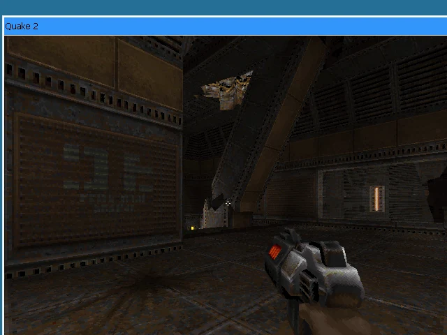
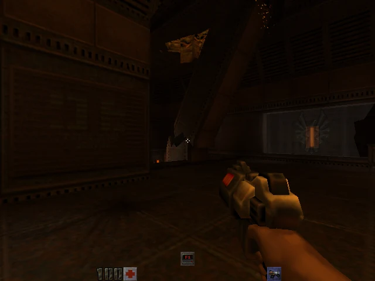
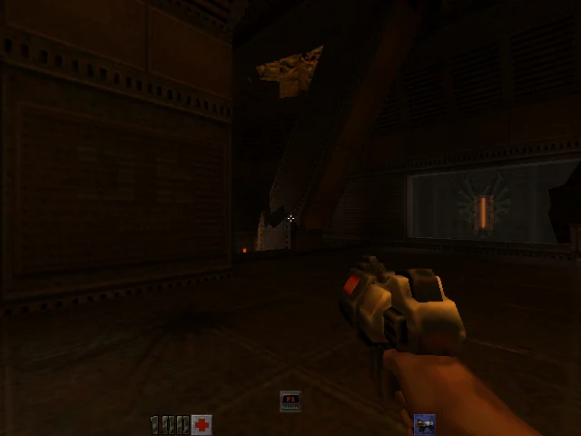
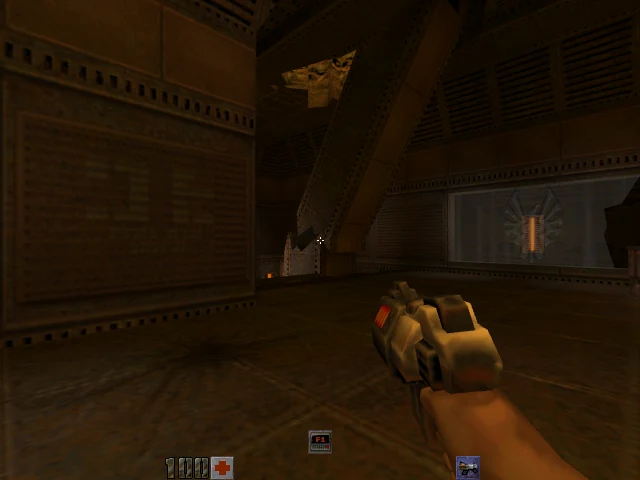
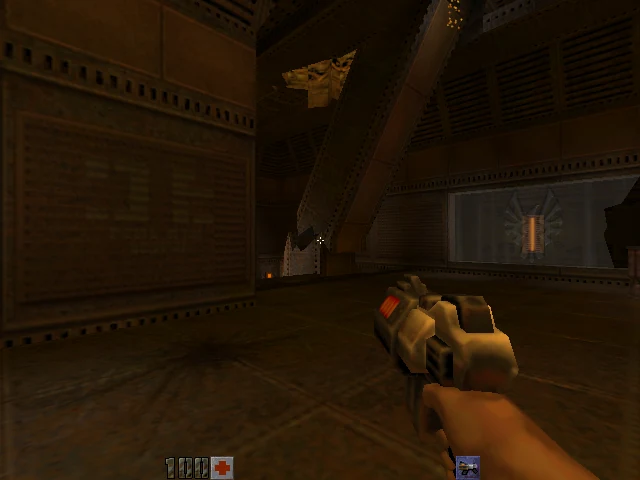
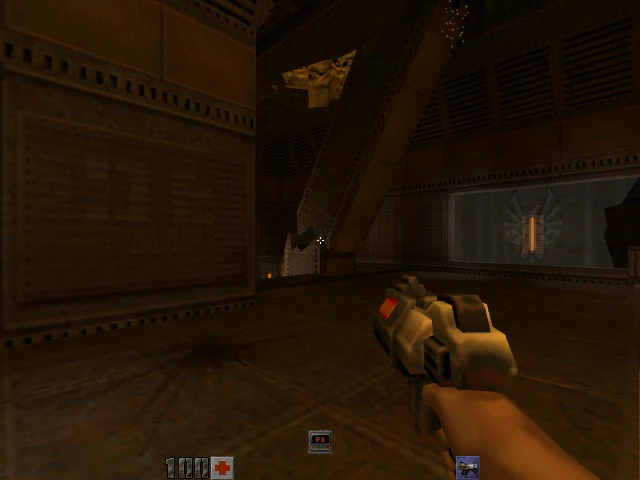
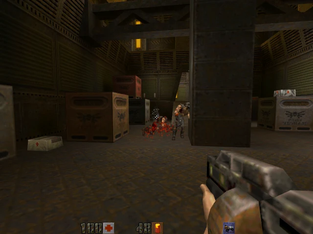
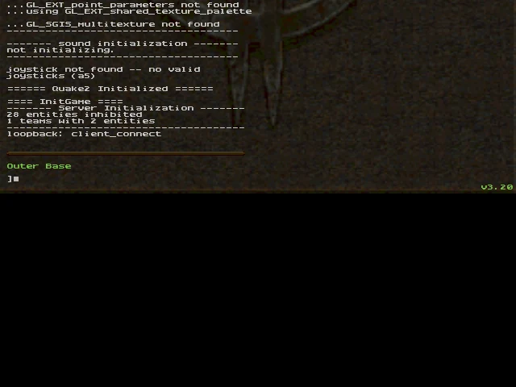

# Quake II (1997 — Win32 3dfx MiniGL → Glide 2.x)

| Field | Value |
| :--- | :--- |
| **Category** | Commercial Game |
| **Year** | 1997 *(v3.20 patch: Nov 1998)* |
| **Platform(s)** | `Win32 / Wine (ref_gl.dll + 3dfxgl.dll → glide2x.dll)` |
| **Glide API & Version** | **Glide 2.x via 3dfx MiniGL (`3dfxgl.dll` → `glide2x.dll`, Voodoo1 `2.48`)** |
| **Recommended Card Profile** | `VoodooGraphics` (`2.48`, **required** for bundled Nov 1997 `3dfxgl.dll`) · `Voodoo2` (`2.56`, for `1998+` MiniGL `1.4x+`) |
| **Verified Backends** | Vulkan · OpenGL 3.3 Core (WGL) · Software (AVX2 / AVX-512 / Scalar) |
| **Preset File(s)** | [`glide-ng.ini`](./glide-ng.ini) (`1×`, Voodoo1, **`gamma = 1.3`**) · [`glide-ng.hq.ini`](./glide-ng.hq.ini) (`4× MSAA` + Linear, recommended) · [`glide-ng.voodoo2.ini`](./glide-ng.voodoo2.ini) (Voodoo2 for MiniGL `1.4x+`) · [`glide-ng.software.ini`](./glide-ng.software.ini) (CPU Software `2×2 SSAA`) |
| **Status** | Verified |

---

## Overview

id Software's *Quake II* (`id Tech 2`, **`v3.20`**) introduced dynamic pluggable renderer modules: **`ref_soft.dll`** (8-bit CPU software rasterizer) and **`ref_gl.dll`**, which loads either native **`opengl32.dll`** or the bundled **`3dfxgl.dll`** (3dfx OpenGL MiniGL translator targeting **`glide2x.dll`**). Because `ref_gl.dll` loads **`3dfxgl.dll` by its own distinct filename** (instead of shadowing `opengl32.dll` like *GLQuake*), **all three `glide-ng` backends — Vulkan, OpenGL 3.3 Core (WGL), and CPU Software AVX2 (`2×2 SSAA`) — work cleanly side by side!**

The stock **November 16, 1997 `3dfxgl.dll`** (`142,336 B`) enables **`GL_EXT_shared_texture_palette`**, colored bilinear lightmaps, volumetric dynamic blaster lighting, spark showers, and translucent reflective glass panes (such as the Strogg eagle crest window visible right at the start of `base1`, which is invisible on `ref_soft.dll`). Like *GLQuake*, that 1997 MiniGL predates Voodoo2 CVG and requires **`card_model = VoodooGraphics` (`2.48`)** in `glide-ng.ini`.

---

## Editions, Patches & Executables

| Binary / Renderer | Graphics API | Works with `glide-ng`? | Technical Notes |
| :--- | :--- | :---: | :--- |
| **`quake2.exe` + `ref_gl.dll` + `3dfxgl.dll`** (`v3.20`) | **OpenGL 1.1 → Glide 2.x (`glide2x.dll`)** | **Yes (Recommended)** | Stock Nov 1997 MiniGL (`+set vid_ref gl +set gl_driver 3dfxgl +set gl_mode 3`). Full **Vulkan**, **OpenGL 3.3 Core (WGL)**, and **Software `2×2 SSAA`** parity with warm colored lightmaps, translucent winged emblem window, sparks, and smooth **`4× MSAA`**. |
| **`quake2.exe` + `ref_gl.dll` + `opengl32.dll`** | Host OpenGL 1.1 | No *(Comparison baseline)* | Native OpenGL comparison baseline (`MESA_EXTENSION_MAX_YEAR=1999`). Matches **`3dfxgl.dll`** at linear `gamma = 1.0`. |
| **`quake2.exe` + `ref_soft.dll`** | CPU Software (`8-bit`) | No *(Comparison baseline)* | Point-sampled 8-bit software renderer (`+set vid_ref soft`). Noticeably blockier gradients, no bilinear filtering, and omits translucent glass window overlays. |
| **`3dfxVGL.dll` (`Voodoo3` full OpenGL ICD)** | Private `glide3x` surface ext | No | Queries private Voodoo3/Napalm DirectDraw ICD extensions (`grSurfaceCreateContextExt`, etc.) not exposed by public Glide 3.x wrappers. Use **`3dfxgl.dll`**. |

> **Patches (`v3.20`):** Apply `q2-3.20-x86-full-ctf.exe` (`pak1.pak`, `pak2.pak`, CTF, `v3.20` `quake2.exe` / `ref_gl.dll` / `ref_soft.dll`) before launching.

---

## Recommended Launch Configurations (Wine32 / Windows)

Stage `quake2.exe` **`v3.20`**, `baseq2/pak0..2.pak`, `3dfxgl.dll`, `ref_gl.dll`, and **`glide-ng`'s** Win32 **`glide2x.dll`** in the same game folder.

### Option A: Best Visuals — Vulkan `4× MSAA` (`glide-ng.hq.ini`) *(Recommended)*

```bash
WINEARCH=win32 WINEPREFIX=/path/to/prefix \
WINEDLLOVERRIDES="glide2x=n" \
GLIDE_NG_CONFIG=/path/to/glide-ng.hq.ini \
  wine explorer /desktop=Q2,640x480 quake2.exe \
    +set vid_ref gl +set gl_driver 3dfxgl +set gl_mode 3 +set vid_fullscreen 1
```

On CPU-only Vulkan hosts (`llvmpipe`), add `LP_NUM_THREADS=4`.

### Option B: Native Vulkan `1×` (`glide-ng.ini`)

```bash
WINEARCH=win32 WINEPREFIX=/path/to/prefix \
WINEDLLOVERRIDES="glide2x=n" \
GLIDE_NG_CONFIG=/path/to/glide-ng.ini \
  wine explorer /desktop=Q2,640x480 quake2.exe \
    +set vid_ref gl +set gl_driver 3dfxgl +set gl_mode 3 +set vid_fullscreen 1
```

### Option C: OpenGL 3.3 Core (WGL)

```bash
WINEARCH=win32 WINEPREFIX=/path/to/prefix \
WINEDLLOVERRIDES="glide2x=n" \
GLIDE_NG_CONFIG=/path/to/glide-ng.ini GLIDE_NG_BACKEND=opengl_es \
  wine explorer /desktop=Q2,640x480 quake2.exe \
    +set vid_ref gl +set gl_driver 3dfxgl +set gl_mode 3 +set vid_fullscreen 1
```

### Option D: CPU Software Rasterizer (`glide-ng.software.ini` — `2×2 SSAA`)

```bash
WINEARCH=win32 WINEPREFIX=/path/to/prefix \
WINEDLLOVERRIDES="glide2x=n" \
GLIDE_NG_CONFIG=/path/to/glide-ng.software.ini \
  wine explorer /desktop=Q2,640x480 quake2.exe \
    +set vid_ref gl +set gl_driver 3dfxgl +set gl_mode 3 +set vid_fullscreen 1
```

---

## Visual Progression Gallery

All captures below are from *Quake II* **`v3.20`** **`base1` (*Outer Base*)** and **`demo1.dm2`** at **`640×480`** inside Wine32:

| | |
| :---: | :---: |
| <br>**1. Native CPU Software (`ref_soft.dll` · `640×480`)**<br>Unfiltered point-sampled pixels with stepped gradients; omits the translucent glass winged emblem window on the right wall. | <br>**2. Native OpenGL Baseline (`ref_gl.dll` + `opengl32.dll`)**<br>Colored bilinear lightmaps and translucent glass window rendered directly through host OpenGL (`gamma = 1.0`). |
| <br>**3. 3dfx MiniGL — Vulkan `1×` (`gamma = 1.0`)**<br>Direct `gamma = 1.0` match against native OpenGL via `3dfxgl.dll` → `glide2x.dll`. | <br>**4. 3dfx MiniGL — Vulkan `4× MSAA` (`gamma = 1.3`, `glide-ng.hq.ini`)**<br>Warm authentic 3dfx brightness highlighting girder seams, glowing blaster coils, Strogg stencil text, and translucent eagle window. |
| <br>**5. 3dfx MiniGL — OpenGL 3.3 Core (`WGL`, `gamma = 1.3`)**<br>Complete 3-layer parity (`quake2` → `3dfxgl.dll` → `glide2x.dll` → system `opengl32.dll` 3.3 Core), including overhead ceiling spark shower. | <br>**6. 3dfx MiniGL — CPU Software AVX2 (`2×2 SSAA`, `gamma = 1.3`)**<br>Zero-GPU rasterizer parity matching Vulkan and WGL lightmaps, translucent glass, and animated sparks pixel-for-pixel. |
| <br>**7. 3dfx MiniGL — `demo1.dm2` Live Firefight (`4× MSAA`)**<br>Action view showing crate stencils, red particle bursts, smooth bilinear shadow projection, health/ammo counters, and blaster view-model. | <br>**8. `3dfxgl.dll` Startup Console (`v3.20`)**<br>Confirms **`GL_EXT_shared_texture_palette`** active via **`3dfxgl.dll`** with zero driver warnings. |

---

## Visual Quality & Performance Tuning

* **Gamma (`1.3` default):** *Quake II*'s colored lightmaps were tuned brighter than *Quake I*'s SST-1 defaults; **`gamma = 1.3`** matches the authentic warm 3dfx presentation without washing out orange sparks or shadow gradients. Adjust freely via the in-game **`intensity`** / **Video Brightness** slider or `SST_GAMMA`.
* **Upgrading to `Voodoo2` / `800×600`:** Swap `3dfxgl.dll` with a later `1998+` **`3dfx MiniGL 1.4x`** build to pair with **`glide-ng.voodoo2.ini`** (`card_model = Voodoo2`, `GL_SGIS_multitexture`, `gl_mode 4` `800×600`).

---

## Quirks, Known Issues & Controls

### Installation & Engine Notes
* **`card_model = VoodooGraphics` required for retail `3dfxgl.dll`:** Just like *GLQuake*'s Aug 1997 MiniGL, *Quake II*'s bundled Nov 1997 **`3dfxgl.dll`** predates Voodoo2 and falls back to software if a `GR_SSTTYPE_Voodoo2` card is reported.
* **No-CD / audio tracks:** Pass **`+set cd_nocd 1`** if no physical CD audio disc is attached.
* **Persistent renderer setting:** *Quake II* saves `vid_ref` and `gl_driver` inside `baseq2/config.cfg`; passing **`+set vid_ref gl +set gl_driver 3dfxgl`** on the command line keeps launches deterministic across driver comparisons.

### Useful Controls

| Action | Key |
| :--- | :--- |
| **Move / Turn / Strafe** | `Arrow Keys` / `W/A/S/D` |
| **Fire Weapon** | `Ctrl` / `Mouse 1` |
| **Jump** | `Space` |
| **Mission Computer (`Objectives`)** | `F1` |
| **Toggle Console (`map base1`, `timedemo 1`)** | `` ` `` *(Backtick / Tilde)* |
| **Pause / Video Menu** | `Esc` |
