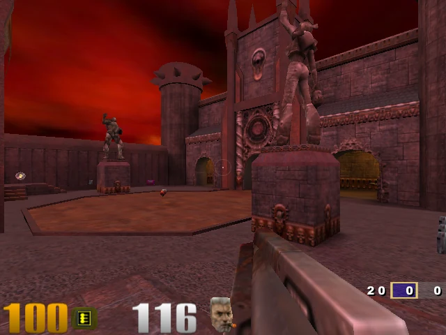
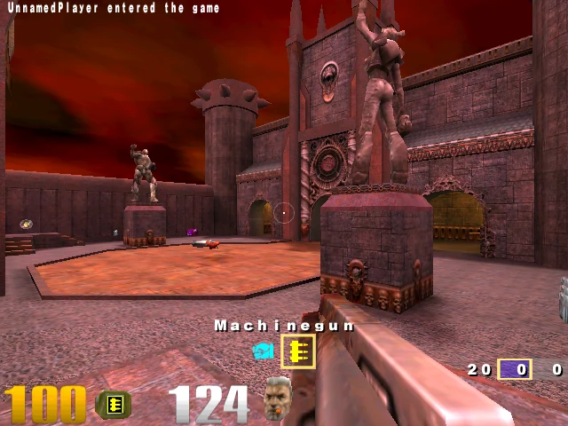
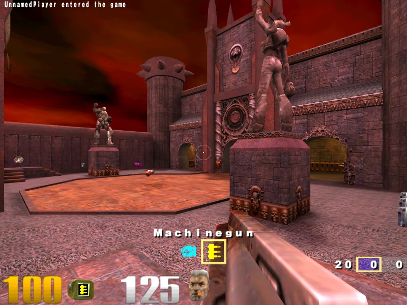
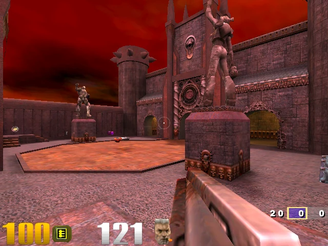
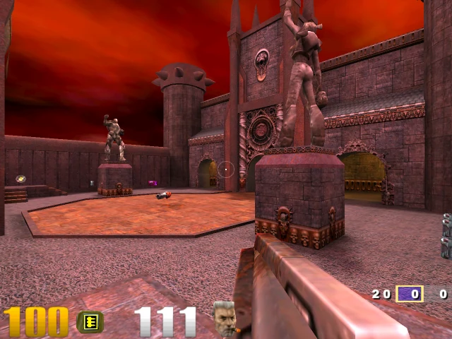
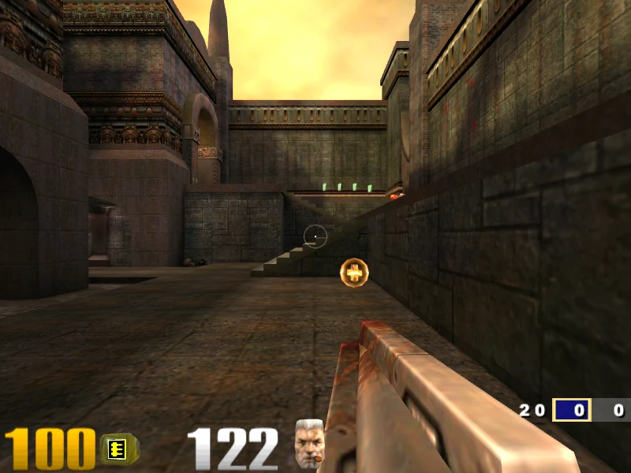
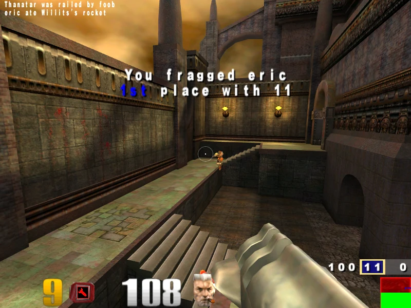

# Quake III Arena (1999 — Win32 3dfxVGL OpenGL ICD → Glide 3.x)

| Field | Value |
| :--- | :--- |
| **Category** | Commercial Game |
| **Year** | 1999 |
| **Platform(s)** | `Win32 / Wine (quake3.exe + 3dfxVGL.dll → glide3x.dll)` |
| **Glide API & Version** | **Glide 3.x via standalone 3dfx OpenGL 1.1 ICD (`3dfxVGL.dll` → `glide3x.dll`)** |
| **Recommended Card Profile** | `Voodoo3` (`3.10`, 2 TMUs / 16 MB UMA) · `Voodoo5` (`3.10`, 64 MB UMA, `PIXEXT`/`COMBINE`/`TEXFMT`) · `Voodoo2` (`3.03`, 2 TMUs / 16 MB) |
| **Verified Backends** | Vulkan · OpenGL 3.3 Core (WGL) · Software (AVX2 / AVX-512 / Scalar) |
| **Preset File(s)** | [`glide-ng.ini`](./glide-ng.ini) (`1×`, Voodoo3) · [`glide-ng.hq.ini`](./glide-ng.hq.ini) (`4× MSAA` + Linear, recommended) · [`glide-ng.voodoo2.ini`](./glide-ng.voodoo2.ini) (Voodoo2 `3.03`) · [`glide-ng.voodoo5.ini`](./glide-ng.voodoo5.ini) (Voodoo5 `3.10` / 64 MB) · [`glide-ng.software.ini`](./glide-ng.software.ini) (CPU Software `2×2 SSAA`) |
| **Status** | Verified |

---

## Overview

id Software's *Quake III Arena* (`id Tech 3`, retail **v1.11**) supports loading a standalone 3dfx OpenGL 1.1 ICD directly via **`+set r_glDriver 3dfxVGL`**. Pairing **`3dfxVGL.dll`** (the official **January 17, 2000** Voodoo2 standalone OpenGL ICD, `1,298,432 B`) with **`glide-ng`'s `glide3x.dll`** runs the entire *Quake III Arena* multi-pass shader engine — **curved Bezier patches**, **scrolling sky domes**, **dynamic lightmaps**, **hardware overbright gamma lighting**, **translucent power-ups**, **blood decals**, and **3D HUD player head models** — straight through **`glide3x.dll`** on **`Voodoo2`**, **`Voodoo3`**, and **`Voodoo5` (`SLI / 64 MB`)** profiles.

Because `quake3.exe` loads **`3dfxVGL.dll` by its own distinct filename** instead of shadowing `opengl32.dll`, **all three `glide-ng` backends — Vulkan, OpenGL 3.3 Core (WGL), and CPU Software AVX2 (`2×2 SSAA`) — operate cleanly side by side!**

---

## Editions, Patches & Executables

| Binary / Driver | Graphics API | Works with `glide-ng`? | Technical Notes |
| :--- | :--- | :---: | :--- |
| **`quake3.exe` + `3dfxVGL.dll`** (`v1.11` standalone ICD) | **OpenGL 1.1 → Glide 3.x (`glide3x.dll`)** | **Yes (Recommended)** | Standalone **Voodoo2** `3dfxVGL.dll` (`1,298,432 B`, Jan 2000 driver `3.02.02`). Adapts cleanly to **`Voodoo2` (`16 MB`)**, **`Voodoo3` (`16 MB`)**, and **`Voodoo5` (`64 MB`, `PIXEXT`/`COMBINE`/`TEXFMT`)** across all 3 backends with rich authentic overbright lightmaps (`GL_ARB_multitexture`). |
| **`quake3.exe` + `opengl32.dll`** | Host OpenGL ICD | No *(Comparison baseline)* | Native OpenGL comparison baseline (`MESA_EXTENSION_MAX_YEAR=2000`). Noticeably dimmer/flatter contrast without the hardware 3dfx `r_overBrightBits` ramp visible in `3dfxVGL.dll`. |
| **`3dfxOGL.dll`** (Banshee/Voodoo3 desktop ICD) | Windows ICD / `GETREGISTRY` | No | Requires a full desktop Win9x 3dfx display driver registry context and crashes when invoked standalone via `r_glDriver`; use **`3dfxVGL.dll`**. |

> **Version note:** Retail **`v1.11`** pairs directly with disc files **`baseq3/pak0.pk3` + `pak1.pk3`** (including `demo001.dm3`, `demo002.dm3`, and all 30 arenas). Upgrading to **`v1.32c`** requires running **`q3pointrelease_132.exe`** first to install `pak2.pk3`–`pak8.pk3`.

---

## Recommended Launch Configurations (Wine32 / Windows)

Place retail **`3dfxVGL.dll`** (`1,298,432 B`, standalone OpenGL ICD) and **`glide-ng`'s** Win32 **`glide3x.dll`** directly inside the **`Quake III Arena`** game folder next to **`quake3.exe`**.

> **Wine 32-bit `DirectDraw` threading note:** `3dfxVGL.dll` calls `DirectDrawCreate()` while holding its own global initialization critical section. Under Wine, disable Wine's async `wined3d` command-stream thread once in the prefix before launching **`3dfxVGL.dll`** (`csmt = 0` prevents a loader-lock `DLL_THREAD_ATTACH` deadlock during `wglCreateContext()`):
> ```bash
> WINEPREFIX=/path/to/prefix wine reg add 'HKCU\Software\Wine\Direct3D' /v csmt /t REG_DWORD /d 0 /f
> WINEPREFIX=/path/to/prefix wine reg add 'HKCU\Software\Wine\Direct3D' /v renderer /t REG_SZ /d no3d /f
> ```
> Remove the `renderer` key when switching back to native host `opengl32.dll`.

### Option A: Best Visuals — Vulkan `4× MSAA` `800×600` (`glide-ng.hq.ini`) *(Recommended)*

```bash
WINEARCH=win32 WINEPREFIX=/path/to/prefix \
WINEDLLOVERRIDES="glide3x=n" \
GLIDE_NG_CONFIG=/path/to/glide-ng.hq.ini \
  wine explorer /desktop=Q3A,800x600 quake3.exe \
    +set r_glDriver 3dfxVGL +set r_mode 4 +set r_colorbits 16 +set r_fullscreen 1
```

On CPU-only Vulkan hosts (`llvmpipe`), add `LP_NUM_THREADS=4`. Swap `glide-ng.hq.ini` with **`glide-ng.voodoo5.ini`** (`card_model = Voodoo5`, `64 MB`) for `3Dfx/Voodoo5 SLI/2 TMUs/64 MB` (`PIXEXT` + `COMBINE` + `TEXFMT`).

### Option B: Native Vulkan `1×` `640×480` (`glide-ng.ini` or `glide-ng.voodoo2.ini`)

```bash
WINEARCH=win32 WINEPREFIX=/path/to/prefix \
WINEDLLOVERRIDES="glide3x=n" \
GLIDE_NG_CONFIG=/path/to/glide-ng.ini \
  wine explorer /desktop=Q3A,640x480 quake3.exe \
    +set r_glDriver 3dfxVGL +set r_mode 3 +set r_colorbits 16 +set r_fullscreen 1
```

### Option C: OpenGL 3.3 Core (WGL)

```bash
WINEARCH=win32 WINEPREFIX=/path/to/prefix \
WINEDLLOVERRIDES="glide3x=n" \
GLIDE_NG_CONFIG=/path/to/glide-ng.ini GLIDE_NG_BACKEND=opengl_es \
  wine explorer /desktop=Q3A,640x480 quake3.exe \
    +set r_glDriver 3dfxVGL +set r_mode 3 +set r_colorbits 16 +set r_fullscreen 1
```

### Option D: CPU Software Rasterizer (`glide-ng.software.ini` — `2×2 SSAA`)

```bash
WINEARCH=win32 WINEPREFIX=/path/to/prefix \
WINEDLLOVERRIDES="glide3x=n" \
GLIDE_NG_CONFIG=/path/to/glide-ng.software.ini \
  wine explorer /desktop=Q3A,640x480 quake3.exe \
    +set r_glDriver 3dfxVGL +set r_mode 3 +set r_colorbits 16 +set r_fullscreen 1
```

---

## Visual Progression Gallery

All captures below are from *Quake III Arena* (`v1.11`, **`q3dm1` *Arena Gate***, **`q3dm7` *Temple of Retribution***, and **`demo001.dm3`**) inside Wine32:

| | |
| :---: | :---: |
| <br>**1. Native OpenGL Baseline (`opengl32.dll` · `640×480`)**<br>Host Mesa OpenGL 4.6 Compatibility profile; muted lighting without 3dfx overbright ramp. | <br>**2. `3dfxVGL.dll` — Voodoo2 (`3.03`, `2 TMUs / 16 MB`, `640×480`)**<br>Vibrant authentic `3Dfx/Voodoo2` lightmaps, fiery sky dome, crisp skull pedestals, and glowing pickup/weapon icons. |
| <br>**3. `3dfxVGL.dll` — Voodoo3 (`3.10`, `4× MSAA`, `800×600` HQ)**<br>Razor-sharp archway trim, Bezier stone curves, crimson clouds, and vibrant rocket launcher lighting (`glide-ng.hq.ini`). | <br>**4. `3dfxVGL.dll` — Voodoo5 (`3.10`, `64 MB`, `PIXEXT`/`COMBINE`/`TEXFMT`)**<br>Active `3Dfx/Voodoo5 SLI/2 TMUs/64 MB` profile exercising the extended VSA-100 combiner and texture paths cleanly. |
| <br>**5. `3dfxVGL.dll` — OpenGL 3.3 Core (`WGL`, `640×480`)**<br>Full 3-layer stack (`quake3` → `3dfxVGL.dll` → `glide3x.dll` → system `opengl32.dll` 3.3 Core) with identical brightness and shader parity. | <br>**6. `3dfxVGL.dll` — CPU Software AVX2 (`2×2 SSAA`, `640×480`)**<br>Zero-GPU software rasterizer matching Vulkan and WGL multi-pass `id Tech 3` lightmaps, statues, and dynamic HUD pixel-for-pixel. |
| <br>**7. *Temple of Retribution* (`q3dm7` · `800×600` `4× MSAA`)**<br>Golden courtyard skybox, rotating translucent mega-health orb, stone pillar shading, and curved stair shadows. | <br>**8. `demo001.dm3` Live Combat (`800×600` `4× MSAA`)**<br>Full-speed combat replay with glowing wall torches, translucent wall decals, metallic weapon shaders, and crisp center-screen HUD overlays. |

---

## Visual Quality & Performance Tuning

* **Gamma (`1.0` default):** *Quake III Arena* computes hardware overbright gamma natively through **`r_gamma`** / **`r_overBrightBits`**. Keep **`gamma = 1.0`** in `glide-ng.ini` so the game controls brightness accurately without double-lifting the highlights.
* **`r_mode` resolutions:** `3` = `640×480`, `4` = `800×600` *(recommended)*, `6` = `1024×768` (`Voodoo3` / `Voodoo5` profiles). Always use **`r_colorbits 16`** with **`3dfxVGL.dll`** on `Voodoo2`/`Voodoo3`.
* **`Voodoo2` vs. `Voodoo3` vs. `Voodoo5`:** All three deliver identical `GL_ARB_multitexture` / **2-TMU** visuals (`16 MB` on Voodoo2/3, **`64 MB` on Voodoo5** to hold every arena's full shader set resident without eviction thrashing).

---

## Quirks, Known Issues & Controls

### Installation & Engine Notes
* **Always use a retail standalone `3dfxVGL.dll`:** Copy **`3dfxVGL.dll`** (from 3dfx Voodoo2 reference driver **`3.02.02`**, Jan 17, 2000) beside `quake3.exe` and select it with **`+set r_glDriver 3dfxVGL`**.
* **CD key (`baseq3/q3key`):** Store your valid 16-character key inside **`baseq3/q3key`** (or enter it once on first launch).
* **Skip intro cinematic (`idlogo.RoQ`):** Pass **`+set com_introplayed 1`** on the command line (or press `Esc` / click mouse).

### Useful Controls

| Action | Key |
| :--- | :--- |
| **Move / Strafe** | `W/A/S/D` or `Arrow Keys` |
| **Fire / Weapon Select** | `Mouse 1` / `1`–`9` |
| **Jump / Crouch** | `Space` / `C` |
| **Toggle Console (`map q3dm1`, `timedemo 1`)** | `` ` `` *(Backtick / Tilde)* |
| **Scoreboard** | `Tab` |
| **Menu / Back** | `Esc` |
