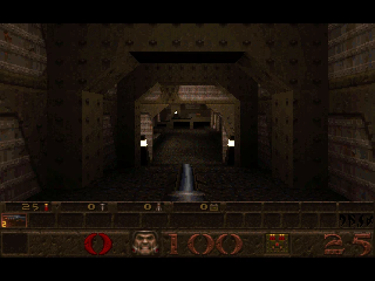
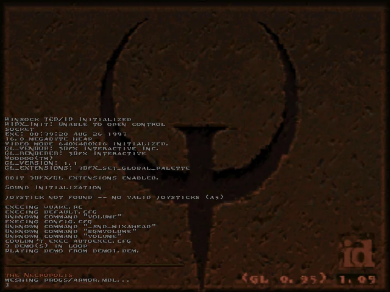
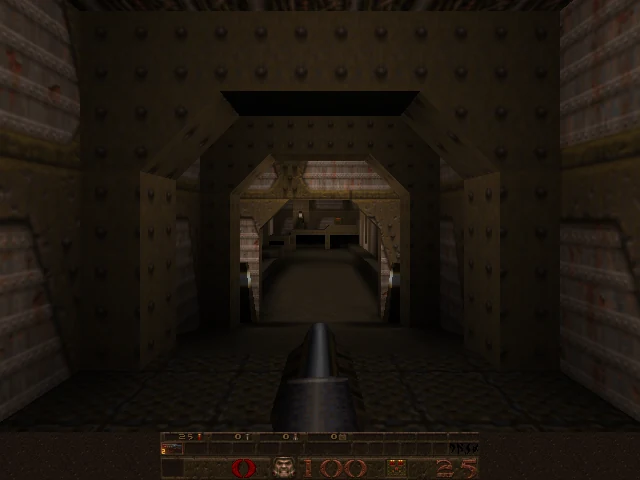
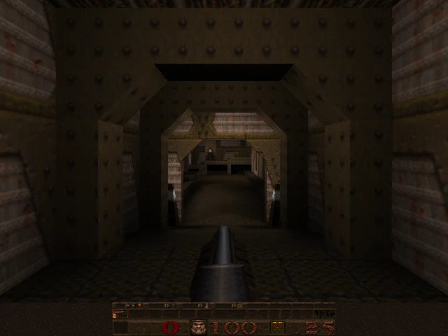
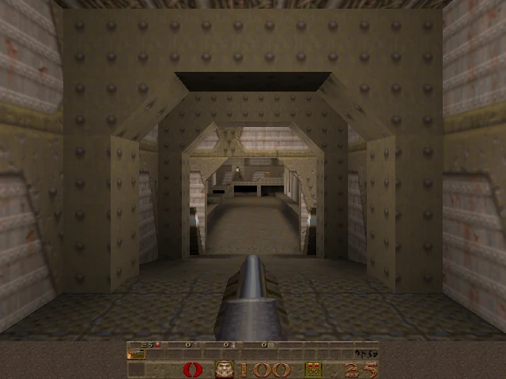
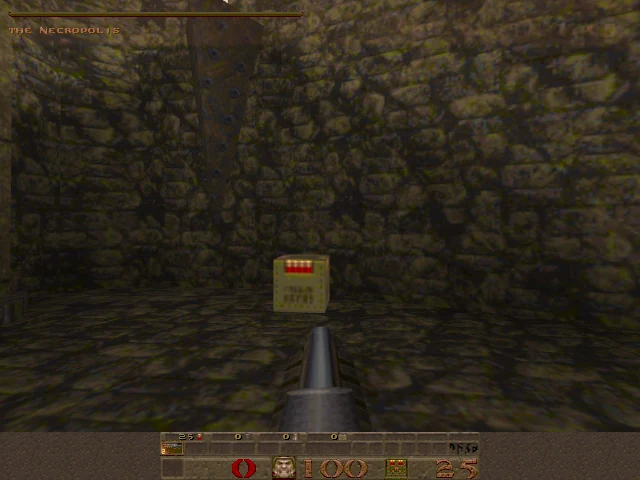
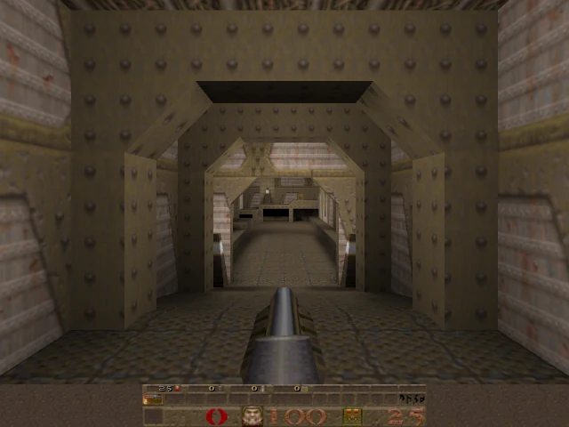

# Quake / GLQuake (1996 — Win32 3dfx MiniGL → Glide 2.x)

| Field | Value |
| :--- | :--- |
| **Category** | Commercial Game |
| **Year** | 1996 *(WinQuake / GLQuake v0.95 & 3dfx MiniGL: 1997)* |
| **Platform(s)** | `Win32 / Wine (3dfx MiniGL opengl32.dll → glide2x.dll)` · `DOS/32 (SW only)` |
| **Glide API & Version** | **Glide 2.x via 3dfx MiniGL (`opengl32.dll` → `glide2x.dll`, Voodoo1 `2.48`)** |
| **Recommended Card Profile** | `VoodooGraphics` (`2.48`, **required** for bundled Aug 1997 MiniGL) · `Voodoo2` (`2.56`, for `1998+` MiniGL `1.4x` only) |
| **Verified Backends** | Vulkan · Software (AVX2 / AVX-512 / Scalar) *(OpenGL/WGL conflicts when an app replaces `opengl32.dll` in-process)* |
| **Preset File(s)** | [`glide-ng.ini`](./glide-ng.ini) (`1×`, Voodoo1, **`gamma = 1.7`**) · [`glide-ng.hq.ini`](./glide-ng.hq.ini) (`4× MSAA` + Linear, recommended) · [`glide-ng.voodoo2.ini`](./glide-ng.voodoo2.ini) (Voodoo2 for MiniGL `1.4x+`) · [`glide-ng.software.ini`](./glide-ng.software.ini) (CPU Software `2×2 SSAA`) |
| **Status** | Verified |

---

## Overview

id Software's *Quake* ushered in the hardware-accelerated 3D shooter era via **`GLQUAKE.EXE` (`v0.95`, 1997)** paired with **3dfx's OpenGL MiniGL driver** (shipped as `OPENGL32.DLL` next to the executable), translating GLQuake's OpenGL 1.1 subset — including **`3DFX_set_global_palette` (`8-bit` paletted textures)** and **`grTexDownloadMipMapLevelPartial` dynamic lightmaps** — directly into **`glide2x.dll`**.

The bundled **August 1997 `3dfx MiniGL`** (`137,216 B`) predates Voodoo2 CVG and strictly checks **`grSstQueryHardware()`** for a **Voodoo Graphics (`SST-1`, `GR_SSTTYPE_VOODOO`)** board — selecting `card_model = Voodoo2` triggers `wglCreateContext failed`. Setting **`card_model = VoodooGraphics`** (`api_version = 2.48`) initializes `GL_RENDERER: 3Dfx Interactive Voodoo(TM)` cleanly with **8-bit `3DFX/GL` extensions enabled**.

Like *Demo Room* and *Wizard's Tower*, *GLQuake* was authored against **SST-1's default hardware RAMDAC curve (`gamma = 1.7`)**. With linear `gamma = 1.0`, the lighting matches native OpenGL (`mesa`/`opengl32.dll`) but appears famously dark; enabling **`gamma = 1.7`** restores authentic bright golden-brown 1997 Voodoo Graphics contrast across both **Vulkan (`1×` and `4× MSAA`)** and **CPU Software AVX2 (`2×2 SSAA`)**.

---

## Editions, Patches & Executables

| Binary / Renderer | Graphics API | Works with `glide-ng`? | Technical Notes |
| :--- | :--- | :---: | :--- |
| **`GLQUAKE.EXE` + `3dfx MiniGL` (`opengl32.dll`, Aug 1997)** | **OpenGL 1.1 → Glide 2.x (`glide2x.dll`)** | **Yes (Recommended)** | Requires **`card_model = VoodooGraphics`** (`2.48`). Enables `3DFX_set_global_palette`, bilinear filtering, animated lightmaps, and `640×480` full-color lighting. Supports **Vulkan** (`1×` / **`4× MSAA`**) and **CPU Software AVX2 (`2×2 SSAA`)**. |
| **`GLQUAKE.EXE` + native `opengl32.dll`** | Host OpenGL 1.1 | No *(Comparison baseline)* | Works on Wine/Mesa when **no** local `opengl32.dll` MiniGL exists in the game folder. **Set `MESA_EXTENSION_MAX_YEAR=1998`** (or `__GL_ExtensionStringVersion=17700` on NVIDIA) to prevent GLQuake's fixed-buffer `GL_EXTENSIONS` stack overflow. Darker linear `gamma = 1.0` look. |
| **`quake.exe` (DOS `v1.08`)** | CPU Software (`VGA` / `VESA 2.0`) | No *(Software only)* | MS-DOS executable has **no** 3dfx Glide renderer. Runs `320×200` 8-bit VGA / `VESA 2.0` under DOSBox-X (requires **`CWSDPMI.EXE`** next to `quake.exe`). |
| **`Winquake.exe` (`v1.09`)** | Win32 Software (`SciTech MGL`) | No *(Software only)* | Requires **`WDIR32.DLL`**, `WDIR16.DLL`, `PMPRO*.DLL`, and `QUAKEUDP.DLL` next to `Winquake.exe`; palette artifacts occur in 8-bit `-dibonly` mode under Wine. |

> **Why `opengl_es` (WGL) cannot wrap an app-local `opengl32.dll`:** Because *GLQuake* imports **`opengl32.dll`** by filename rather than loading a driver like `3dfxgl.dll`, Windows/Wine maps **3dfx MiniGL** into the process as the single loaded `opengl32.dll` module. Any subsequent `LoadLibrary` of `opengl32.dll` reuses that same MiniGL handle instead of the system OpenGL driver. Use **`backend = vulkan`** (default) or **`backend = software`**.

---

## Recommended Launch Configurations (Wine32 / Windows)

Stage `GLQUAKE.EXE`, `id1/PAK0.PAK`, `id1/PAK1.PAK`, **3dfx MiniGL renamed to `opengl32.dll`**, and **`glide-ng`'s** Win32 **`glide2x.dll`** inside the same folder.

### Option A: Best Visuals — Vulkan `4× MSAA` (`glide-ng.hq.ini`, `gamma = 1.7`) *(Recommended)*

```bash
WINEARCH=win32 WINEPREFIX=/path/to/prefix \
WINEDLLOVERRIDES="opengl32,glide2x=n" \
GLIDE_NG_CONFIG=/path/to/glide-ng.hq.ini \
  wine explorer /desktop=Q1,640x480 GLQUAKE.EXE -width 640 -height 480
```

On CPU-only Vulkan hosts (`llvmpipe`), add **`LP_NUM_THREADS=4`** to conserve 32-bit Wine virtual address space.

### Option B: Authentic SST-1 `1×` (`glide-ng.ini`, `gamma = 1.7`)

```bash
WINEARCH=win32 WINEPREFIX=/path/to/prefix \
WINEDLLOVERRIDES="opengl32,glide2x=n" \
GLIDE_NG_CONFIG=/path/to/glide-ng.ini \
  wine explorer /desktop=Q1,640x480 GLQUAKE.EXE -width 640 -height 480
```

### Option C: CPU Software Rasterizer (`glide-ng.software.ini` — `2×2 SSAA`, `gamma = 1.7`)

```bash
WINEARCH=win32 WINEPREFIX=/path/to/prefix \
WINEDLLOVERRIDES="opengl32,glide2x=n" \
GLIDE_NG_CONFIG=/path/to/glide-ng.software.ini \
  wine explorer /desktop=Q1,640x480 GLQUAKE.EXE -width 640 -height 480
```

### Native OpenGL Comparison Baseline (No MiniGL)

Remove/rename `opengl32.dll` out of the game folder so Wine uses the system driver:

```bash
MESA_EXTENSION_MAX_YEAR=1998 __GL_ExtensionStringVersion=17700 \
WINEARCH=win32 WINEPREFIX=/path/to/prefix \
  wine explorer /desktop=Q1,640x480 GLQUAKE.EXE -width 640 -height 480
```

---

## Visual Progression Gallery

All captures below are from *Quake* **`e1m1` (*The Slipgate Complex*)** and **`demo1.dem` (*The Necropolis*)** at `640×480` (DOS VGA `320×200` scaled for comparison):

| | |
| :---: | :---: |
| <br>**1. MS-DOS `quake.exe` (`320×200` 8-bit VGA Software)**<br>Original chunky point-sampled DOS software baseline (`e1m1`). | <br>**2. `GLQUAKE.EXE` Startup Console (`Voodoo1`)**<br>Reports `GL_VENDOR: 3Dfx Interactive Inc.`, `GL_RENDERER: 3Dfx Interactive Voodoo(TM)`, **`3DFX_SET_GLOBAL_PALETTE`**, `8BIT 3DFX/GL EXTENSIONS ENABLED`. |
| <br>**3. Native OpenGL Baseline (`opengl32.dll`, `gamma = 1.0`)**<br>Direct host OpenGL 1.1 (`MESA_EXTENSION_MAX_YEAR=1998`): characteristically dark without SST-1 RAMDAC gamma lift. | <br>**4. 3dfx MiniGL — Vulkan `1×` (`gamma = 1.0`, Linear)**<br>Matches native OpenGL brightness identically before applying the SST-1 RAMDAC curve. |
| <br>**5. 3dfx MiniGL — Vulkan `1×` (`gamma = 1.7`, `glide-ng.ini`)**<br>Authentic Voodoo Graphics (`SST-1`) RAMDAC `1.7` curve restores crisp warmth, rivets, archway lightmaps, and steel corridors. | <br>**6. 3dfx MiniGL — Vulkan `4× MSAA` (`glide-ng.hq.ini`)**<br>Full `4× MSAA` edge anti-aliasing on angled corridor bulkheads and the shotgun barrel (`gamma = 1.7`). |
| <br>**7. 3dfx MiniGL — `demo1.dem` (*The Necropolis*)**<br>Live flyby with bilinear stonework, overhead nail trap shadows, dynamic lighting, and glowing ammo pickup box (`4× MSAA`, `gamma = 1.7`). | <br>**8. 3dfx MiniGL — CPU Software AVX2 (`2×2 SSAA`)**<br>Zero-GPU rasterizer parity matching Vulkan `gamma = 1.7` lightmaps, corridor depth, and HUD numerals pixel-for-pixel. |

---

## Visual Quality & Performance Tuning

* **Gamma (`1.7` vs. `1.0`):** Adjust `[glide] gamma` (`SST_GAMMA`) between `1.4` (moodier) and **`1.7`** (authentic 1997 SST-1 default) to taste.
* **Later `3dfx MiniGL 1.4x` (Voodoo2 / `800×600`):** If you substitute a 1998 Voodoo2-capable MiniGL (such as *Half-Life*'s `gldrv/3dfxgl.dll`), use [`glide-ng.voodoo2.ini`](./glide-ng.voodoo2.ini) to unlock **`800×600`** (`-width 800 -height 600`) and dual-TMU rendering.
* **Sub-pixel coordinate snapping:** The 1997 MiniGL applies 3dfx's hardware vertex snap bias (`3 × 2^18 = 786432`) to 2D console/HUD vertices; `glide-ng` handles this transparently across all backends.

---

## Quirks, Known Issues & Controls

### Installation & Engine Notes
* **`wglCreateContext failed` with `Voodoo2` profile:** The original Aug 1997 `3dfx MiniGL` refuses to open on `GR_SSTTYPE_Voodoo2`. Always run it with **`card_model = VoodooGraphics`** (`api_version = 2.48`).
* **First-launch `.ms2` mesh cache:** `GLQUAKE.EXE` writes pre-computed mesh caches inside `id1/glquake/` on first visit to each map (`MESHING PROGS/...`). Ensure `id1/glquake/` is writable.
* **CD audio & sound:** Pass **`-nocdaudio`** if no physical/virtual Red Book audio disc is attached. `glquake` starts sound automatically via Wine audio drivers (`-nosound` disables audio if troubleshooting).

### Useful Controls

| Action | Key |
| :--- | :--- |
| **Move / Strafe** | `Arrow Keys` *(or rebind `W/A/S/D`)* |
| **Fire Weapon** | `Ctrl` / `Mouse 1` |
| **Jump / Swim Up** | `Space` |
| **Switch Weapons** | `1`–`8` |
| **Toggle Console (`map e1m1`, `timedemo demo1`)** | `` ` `` *(Backtick / Tilde)* |
| **Pause / Main Menu** | `Esc` |
