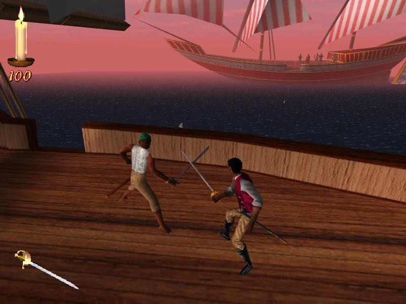
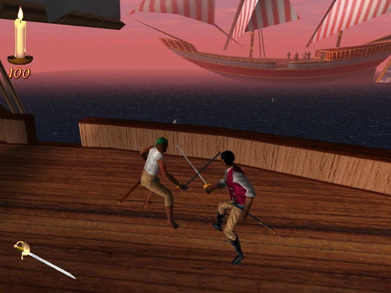
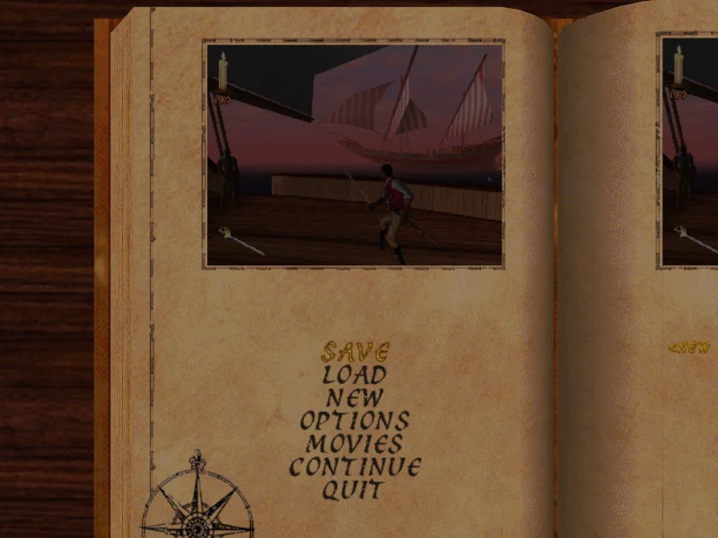

# The Elder Scrolls Adventures: Redguard (1998 — 3dfx DOS)

| Field | Value |
| :--- | :--- |
| **Category** | Commercial Game |
| **Year** | 1998 (v1.0.1.0) |
| **Platform(s)** | `DOS/32 (GLIDE2X.OVL via DOSBox Glide pass-through)` |
| **Glide API & Version** | Glide 2.x (`2.56` on Voodoo2 / `2.48` on Voodoo Graphics) |
| **Recommended Card Profile** | `Voodoo2` (default, unlocks `800×600`) · `VoodooGraphics` (authentic SST-1, `640×480`) |
| **Verified Backends** | Vulkan · OpenGL ES · Software (AVX2 / AVX-512 / Scalar) |
| **Preset File(s)** | [`glide-ng.ini`](./glide-ng.ini) (Voodoo2 `1×`) · [`glide-ng.hq.ini`](./glide-ng.hq.ini) (Voodoo2 `4× MSAA`) · [`glide-ng.voodoo1.ini`](./glide-ng.voodoo1.ini) (SST-1) · [`glide-ng.software.ini`](./glide-ng.software.ini) (CPU Software) |
| **Status** | Verified |

---

## Overview

Bethesda Softworks' 1998 action-adventure *The Elder Scrolls Adventures: Redguard* is one of the most demanding late-DOS titles ever released. Built on the XnGine engine and shipped on two CD-ROMs (Disc 1: Install CD; Disc 2: Play CD with Smacker `.SMK` cinematics and Redbook audio), it pairs a native 3dfx Glide 2.x renderer (`RGFX.EXE` + `fxart/`) with an 8-bit palettized SVGA software fallback (`RG.EXE` + `3dart/`).

Under `glide-ng`, the **unmodified retail `RGFX.EXE`** runs directly with `glide-ng`'s clean-room GPL-3.0 `build/dos/glide2x.ovl` — no community Windows XP wrapper patches are required — delivering bilinear-filtered `fxart/` textures, smooth 16-bit/24-bit Gouraud lighting, hardware W-fog horizon blending, live `grLfbReadRegion` scene thumbnails inside the parchment pause/save book, and native **`800×600`** with clean **`4× MSAA`**.

---

## Editions, Patches & Executables

| Executable / Package | Renderer | Works with `glide-ng`? | Technical Notes |
| :--- | :--- | :---: | :--- |
| **`RGFX.EXE`** *(Unmodified retail DOS 3dfx)* | Glide 2.x (`GLIDE2X.OVL`) | **Yes (Recommended)** | Ships with `fxart/` textures. Imports the full 130-symbol Glide 2.4x loader table via DOS/4GW `LINEXE_LOADMODULE`; requires `glide-ng`'s clean-room `build/dos/glide2x.ovl`. Runs at `640×480` by default (`resolution=7`) or native `800×600` (`resolution=8` in `SYSTEM.INI`). Legacy `XP3DFX_fix` / `dgVoodoo` patches are not needed. |
| **`RG.EXE`** *(Retail DOS Software)* | 8-bit Palettized SVGA (`3dart/`) | No (No 3dfx) | Non-accelerated 256-color software renderer (no horizon fog, unfiltered texels). Note: per Bethesda's `ReadMe.TXT`, save games are not interchangeable between `RGFX.EXE` and `RG.EXE`. |

---

## Recommended DOSBox Configurations

Keep the DOSBox configuration minimal — only non-default overrides are shown below.

> **Mandatory: Mount `C:` with `-freesize 512` and set `[dosbox] memsize = 63`:**
> *Redguard* checks free disk space on `C:` at startup and aborts with `Critical Disk Error, RedGuard can not run.` under DOSBox's default 250 MB free-space cap. `SYSTEM.INI` also allocates `heap_kbytes=22000` plus `texture_kbytes=12000`, so always raise `memsize` to `63`.

The launch commands below assume `glide-ng`'s `libglide2x.so` is installed system-wide (if running directly from a local build directory instead of a system package, prepend `LD_LIBRARY_PATH=/path/to/glide-ng/lib`; see [Building & Installing](../../../user-guide/building-and-installing.md)). Place `glide-ng`'s clean-room **`build/dos/glide2x.ovl`** on DOS `PATH` or inside `REDGUARD\`.

### Option A: Patched DOSBox-SVN (Glide Pass-Through → `glide-ng`) *(Recommended)*

```ini
# dosbox-svn.conf (minimal overrides)
[sdl]
# Avoids SDL_UpdateRects SIGSEGV under sdl12-compat -> sdl2-compat -> SDL3 on modern Linux
output = opengl
windowresolution = original

[dosbox]
memsize = 63

[cpu]
core = dynamic
cputype = auto
cycles = max

[glide]
glide = true
lfb = full
splash = false
```

```bash
GLIDE_NG_CONFIG=/path/to/glide-ng.ini \
SDL12COMPAT_OPENGL_SCALING=0 \
  dosbox -conf dosbox-svn.conf \
  -c "mount C /path/to/ESA-Redguard -freesize 512" \
  -c "imgmount D /path/to/ESA-Redguard/Redguard.cue -t iso" \
  -c "mount E /path/to/glide-ng/build/dos" \
  -c "SET PATH=E:\;%PATH%" \
  -c "C:" \
  -c "cd REDGUARD" \
  -c "RGFX.EXE"
```

### Option B: DOSBox-X (Glide Pass-Through → `glide-ng`)

```ini
# dosbox-x-pass.conf (minimal overrides)
[dosbox]
memsize = 63

[cpu]
cycles = max

[voodoo]
glide = true
lfb = full
```

```bash
GLIDE_NG_CONFIG=/path/to/glide-ng.ini \
  dosbox-x -conf dosbox-x-pass.conf -nopromptfolder \
  -c "mount C /path/to/ESA-Redguard -freesize 512" \
  -c "imgmount D /path/to/ESA-Redguard/Redguard.cue -t iso" \
  -c "mount E /path/to/glide-ng/build/dos" \
  -c "SET PATH=E:\;%PATH%" \
  -c "C:" \
  -c "cd REDGUARD" \
  -c "RGFX.EXE"
```

### Option C: Best Visuals (`glide-ng.hq.ini` + Native `800×600`)

Pair [`glide-ng.hq.ini`](./glide-ng.hq.ini) (`Voodoo2`, `msaa = 4`, `no_dither_sub = true`) with native `800×600` in `REDGUARD\SYSTEM.INI`:

```ini
[3dfx]
resolution=8
```

*(Keep `resolution=7` for `640×480` when using [`glide-ng.voodoo1.ini`](./glide-ng.voodoo1.ini). On CPU-only hosts, substitute [`glide-ng.software.ini`](./glide-ng.software.ini).)*

---

## Visual Progression Gallery

All captures below are taken on the opening sunset ship-deck duel (`RGFX.EXE` vs. `RG.EXE`, `glide-ng` via patched DOSBox-SVN), progressing from the software fallback to native `800×600` with `4× MSAA` and the live `grLfbReadRegion` pause-book thumbnail:

| | |
| :---: | :---: |
| <br>**1. 3dfx Loading Splash (`RGFX.EXE`, `640×480`, Vulkan)**<br>Opening splash rendered via Glide 2.x with `glide-ng`'s clean-room `glide2x.ovl`. | <br>**2. DOS Software (`RG.EXE`, `640×480`)**<br>8-bit palettized SVGA (`3dart/`): dark shadows crush deck planks and clothing detail to near-black, nearest-neighbor textures, and no horizon fog. |
| <br>**3. 3dfx Best Visuals (`RGFX.EXE`, `800×600` + `4× MSAA`, Vulkan)**<br>Smooth 16/24-bit Gouraud lighting across Cyrus's red vest and twilight wood grain, bilinear `fxart/` textures, and smooth W-fog fading the ocean into pink sunset haze ([`glide-ng.hq.ini`](./glide-ng.hq.ini)). | <br>**4. 3dfx OpenGL ES (`RGFX.EXE`, `640×480` + `4× MSAA`)**<br>Matching Gouraud lighting, W-fog horizon haze, and anti-aliased rigging/awning edges under the OpenGL ES backend. |
| <br>**5. In-Game Pause Book (`grLfbReadRegion` Thumbnail, `4× MSAA`)**<br>Live miniature 3D framebuffer snapshot captured cleanly across Vulkan, OpenGL ES, and Software even when MSAA is active. | |

---

## Visual Quality & Performance Tuning

### Flavour Comparison: DOS Software vs. 3dfx Glide

| Aspect | DOS Software (`RG.EXE`) | 3dfx Glide (`RGFX.EXE` + `glide-ng`) |
| :--- | :--- | :--- |
| **Color & Lighting** | 8-bit 256-color palette (`colour_bits=8`); dark shadows crush deck planks and character details to near-black with coarse banding | Smooth 16-bit/24-bit Gouraud lighting across Cyrus's red vest, wood grain, and warm twilight deck |
| **Atmospheric Fog** | **None** — distant ocean ends in a harsh black horizon cut against the sky | Smooth 3dfx hardware W-fog blends the distant sea and Imperial warship softly into the pink sunset haze |
| **Textures & Edges** | Blocky nearest-neighbor texels (`3dart/`); stepped rigging and awning edges | Bilinear-filtered `fxart/` textures, native `800×600` (`resolution=8`), and crisp `4× MSAA` (`glide-ng.hq.ini`) |
| **Tonal Accuracy** | Baseline 8-bit VGA palette | Matches DOSBox-X SST-1 register-level hardware emulation at linear `gamma = 1.0` |

**Verdict**: Always play the **3dfx Glide (`RGFX.EXE`)** edition, paired with native **`800×600`** (`resolution=8`) and [`glide-ng.hq.ini`](./glide-ng.hq.ini) (`Voodoo2`, `msaa = 4`).

### Resolution, Gamma & Cutscene Tuning
* **Native `800×600`:** `SYSTEM.INI` defaults to `resolution=7` (`640×480`). Under the default `Voodoo2` profile, switch to `resolution=8` for native `800×600` without losing fog accuracy or pause-menu snapshots.
* **Gamma (`1.0` default):** Leaving gamma app-controlled (`gamma = 1.0`) matches DOSBox-X's register-level SST-1 output closely without washing out sunset colors.
* **Interlaced Smacker cutscenes:** `SYSTEM.INI` defaults to `smk_interlace=1`, intentionally drawing every second horizontal scanline during `.SMK` playback; set `smk_interlace=0` for solid scanline-doubled FMVs.

---

## Quirks, Known Issues & Controls

### Installation & Engine Notes
* **Play CD (`D:`) and case-sensitive `.cue` paths:** `SYSTEM.INI` sets `animation_drive=d:\`. Mount Disc 2 (`Redguard.cue` / `redguard.bin`) as `D:` for `INTRO.SMK`, story cutscenes, and Redbook audio. On case-sensitive Linux filesystems, confirm the `FILE "..."` line inside `Redguard.cue` matches the exact filename casing of `redguard.bin`.
* **Sound setup (`sound/DIG.INI` & `sound/MDI.INI`):** Run `sound\SETSOUND.EXE` inside DOSBox (or configure Sound Blaster at `220h / IRQ 7 / DMA 1` + MPU-401 at `330h`) for Miles Sound System v4.0d audio.
* **Skipping `INTRO.SMK`:** `MENU.INI` defines three chapter keyframes (`movie_keys[0] = 1508,4502,5801`). Press **`Esc`** four times to skip past all three chapters into the opening ship-deck duel.
* **Pause / Save book preview:** Pressing **`Esc`** in-game snapshots the live 3D framebuffer via `grLfbReadRegion` to display the miniature scene thumbnail inside the parchment book (`SAVE`, `LOAD`, `NEW`, `OPTIONS`, `MOVIES`, `CONTINUE`, `QUIT`).
* **Startup splash:** `glide-ng` plays its procedural startup splash once automatically on `grSstWinOpen()`. Uncomment `no_splash = true` in `glide-ng.ini` (or pass `FX_GLIDE_NO_SPLASH=1`) to skip it.

### Useful Controls
* `Arrow keys` — Move / Turn · `L-Shift` — Skip dialogue / Toggle walk · `Tab` — Lock walk mode · `Space` / `Alt` / `Ctrl` — Combat / Actions · `F7` — Toggle Auto-Defend · `F8` — Cycle candle / numeric health HUD · `H` — Quick-heal · `L` — Logbook · `Esc` — Pause / Save book menu
