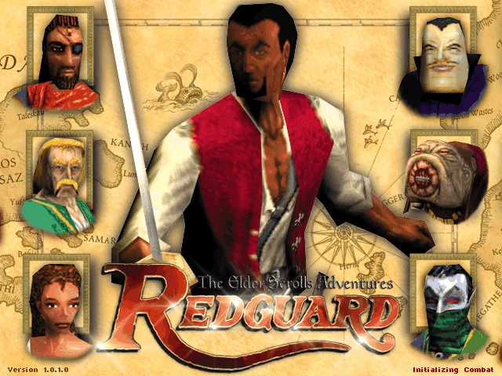
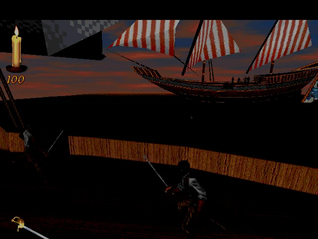

# The Elder Scrolls Adventures: Redguard (1998)

| Field | Value |
| :--- | :--- |
| **Title** | *The Elder Scrolls Adventures: Redguard* (Version 1.0.1.0) |
| **Developer / Publisher** | Bethesda Softworks |
| **Release Year** | 1998 |
| **Platform** | DOS/32 (`RGFX.EXE`, DOS/4GW — Glide 2.x pass-through via `GLIDE2X.OVL`) |
| **Glide API** | Glide 2.x (`2.56` Voodoo2 / `2.48` SST-1) |
| **Recommended Profile** | `Voodoo2` (`api_version = 2.56`) — supports native `800×600` |
| **Backends Verified** | Vulkan (Pass) · OpenGL ES (Pass) · Software (Pass) |
| **Presets** | [`glide-ng.ini`](./glide-ng.ini) · [`glide-ng.hq.ini`](./glide-ng.hq.ini) · [`glide-ng.voodoo1.ini`](./glide-ng.voodoo1.ini) · [`glide-ng.software.ini`](./glide-ng.software.ini) |

---

## 1. Overview & Supported Editions

*The Elder Scrolls Adventures: Redguard* is a DOS-only XnGine action-adventure game shipped on two CD-ROMs (Disc 1: Install CD with a Windows 95 InstallShield setup wizard; Disc 2: Play CD with Smacker `.SMK` cinematics and Redbook audio tracks). The installer lets you install either:

- **3dfx Hardware Acceleration (`RGFX.EXE` + `fxart/`)**: 16-bit/24-bit color Glide 2.x renderer with bilinear texture filtering, Gouraud lighting, smooth W-fog horizon haze, and native `640×480` or `800×600` support.
- **Software Renderer (`RG.EXE` + `3dart/`)**: 8-bit palettized SVGA DOS software renderer (no horizon fog, nearest-neighbor textures, dark 256-color shading).

> **Unmodified Retail `RGFX.EXE` Works Out of the Box**: Legacy Windows XP community patches (`XP3DFX_fix` / `dgVoodoo` wrappers) are **not needed** under DOSBox + `glide-ng`. The original unmodified retail `RGFX.EXE` runs cleanly with `glide-ng`'s clean-room GPL-3.0 `build/dos/glide2x.ovl`.
>
> **Save Game Compatibility**: Per Bethesda's `ReadMe.TXT`, save games are not interchangeable between the 3dfx (`RGFX.EXE`) and Software (`RG.EXE`) editions.

---

## 2. Installation & Launch Setup

### Mandatory DOSBox Settings

1. **Free Disk Space (`-freesize 512`)**: *Redguard* validates free disk space on `C:` at startup and aborts with `Critical Disk Error, RedGuard can not run.` under DOSBox's default 250 MB virtual free space. Mount the parent folder with `-freesize 512` (or higher) and run from `C:\REDGUARD`.
2. **DPMI Memory (`memsize = 63`)**: `SYSTEM.INI` allocates `heap_kbytes=22000` plus `texture_kbytes=12000`; set `[dosbox] memsize = 63`.
3. **Play CD on `D:`**: `SYSTEM.INI` configures `animation_drive=d:\`. Mount Disc 2 (`Redguard.cue` / `redguard.bin`) as `D:` for `INTRO.SMK`, story cutscenes, and Redbook CD audio. On case-sensitive Linux filesystems, verify that the `FILE "..."` entry inside `Redguard.cue` matches the exact filename casing of `redguard.bin`.
4. **Clean-Room `GLIDE2X.OVL`**: `RGFX.EXE` imports the full 130-symbol Glide 2.4x loader table via DOS/4GW `LINEXE_LOADMODULE`. Put `glide-ng`'s `build/dos/glide2x.ovl` on DOS `PATH` (or inside `REDGUARD\`).
5. **Sound Setup (`sound/DIG.INI` & `sound/MDI.INI`)**: Run `sound\SETSOUND.EXE` inside DOSBox (or configure Sound Blaster at `220h / IRQ 7 / DMA 1` + MPU-401 at `330h`) for Miles Sound System v4.0d audio.

### Upgrading to Native `800×600` (Voodoo2)

By default, `SYSTEM.INI` launches at `640×480` (`[3dfx] resolution=7`). With the `Voodoo2` profile (`glide-ng.ini` or `glide-ng.hq.ini`), edit the bottom of `REDGUARD\SYSTEM.INI` to unlock crisp native `800×600`:

```ini
[3dfx]
resolution=8
```

(Keep `resolution=7` when using `glide-ng.voodoo1.ini`.)

### Example `dosbox-svn.conf`

```ini
[sdl]
output=opengl
windowresolution=original

[dosbox]
memsize=63

[cpu]
core=dynamic
cputype=auto
cycles=max

[glide]
glide=true
lfb=full
splash=false

[autoexec]
mount c /path/to/ESA-Redguard -freesize 512
imgmount d /path/to/ESA-Redguard/Redguard.cue -t iso
mount e /path/to/glide-ng/build/dos
set path=e:\;%path%
c:
cd redguard
rgfx.exe
```

Launch with:

```bash
LD_LIBRARY_PATH=/path/to/glide-ng/build/lib \
GLIDE_NG_CONFIG=/path/to/docs/catalog/games/redguard/glide-ng.hq.ini \
SDL12COMPAT_OPENGL_SCALING=0 \
dosbox -conf dosbox-svn.conf
```

---

## 3. Flavour Comparison: 3dfx Glide vs. DOS Software

Side-by-side testing on the opening sunset ship-deck duel shows a dramatic generational leap from Software (`RG.EXE`) to 3dfx Glide (`RGFX.EXE`):

| Aspect | DOS Software (`RG.EXE`) | 3dfx Glide (`RGFX.EXE` + `glide-ng`) |
| :--- | :--- | :--- |
| **Color & Lighting** | 8-bit 256-color palette (`colour_bits=8`); dark shadows crush deck planks and character details to near-black with coarse banding | Smooth 16-bit/24-bit Gouraud lighting across Cyrus's red vest, wood grain, and warm twilight deck |
| **Atmospheric Fog** | **None** — distant ocean ends in a harsh black horizon cut against the sky | Smooth 3dfx hardware W-fog blends the distant sea and Imperial warship softly into the pink sunset haze |
| **Textures & Edges** | Blocky nearest-neighbor texels (`3dart/`); stepped rigging and awning edges | Bilinear-filtered `fxart/` textures, native `800×600` (`resolution=8`), and crisp `4× MSAA` (`glide-ng.hq.ini`) |
| **Tonal Accuracy** | Baseline 8-bit VGA palette | Matches DOSBox-X SST-1 register-level hardware emulation at linear `gamma = 1.0` |

**Recommendation**: Always play the **3dfx Glide (`RGFX.EXE`)** edition, ideally at native `800×600` with [`glide-ng.hq.ini`](./glide-ng.hq.ini) (`Voodoo2`, `msaa = 4`).

---

## 4. Controls & Gameplay Quirks

- **Skipping `INTRO.SMK`**: `MENU.INI` defines three chapter keyframes (`movie_keys[0] = 1508,4502,5801`). Press **`Esc`** four times to advance past all three chapters into the opening ship-deck sword duel.
- **Pause / Save Book Menu**: Press **`Esc`** in-game to open the parchment book (`SAVE`, `LOAD`, `NEW`, `OPTIONS`, `MOVIES`, `CONTINUE`, `QUIT`). *Redguard* snapshots the live 3D framebuffer via `grLfbReadRegion` to display the miniature scene preview inside the book — verified working across Vulkan, OpenGL ES, and Software Reference even with `msaa = 4`.
- **Interlaced Smacker Cutscenes**: `SYSTEM.INI` defaults to `smk_interlace=1`, intentionally drawing every second horizontal scanline during `.SMK` playback; set `smk_interlace=0` for solid scanline-doubled FMVs.
- **Core Controls**: Arrow keys move/turn, **`L-Shift`** skips dialogue / toggles walk (`Tab` locks walk mode), **`Space`** / **`Alt`** / **`Ctrl`** handle combat and actions, **`F7`** toggles Auto-Defend, **`F8`** cycles candle/numeric health HUD, **`H`** quick-heals, **`L`** opens the logbook.

---

## 5. Verification Gallery

| 3dfx Loading Splash (`640×480`, Vulkan) | DOS Software (`RG.EXE`, `640×480`) |
| :---: | :---: |
|  |  |

| 3dfx Native `800×600` + `4× MSAA` (Vulkan) | 3dfx `640×480` + `4× MSAA` (OpenGL ES) |
| :---: | :---: |
|  |  |

| In-Game Pause Book (`grLfbReadRegion` Thumbnail under `4× MSAA`) |
| :---: |
|  |
