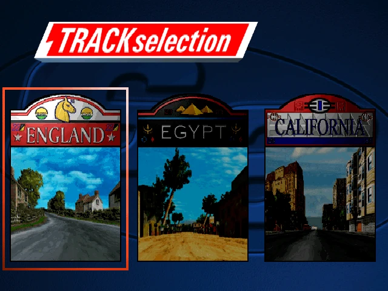
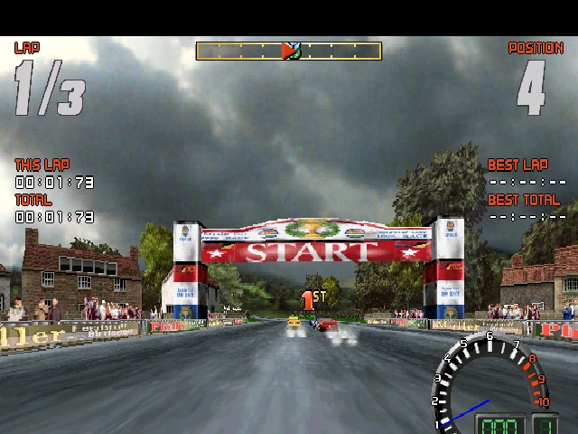
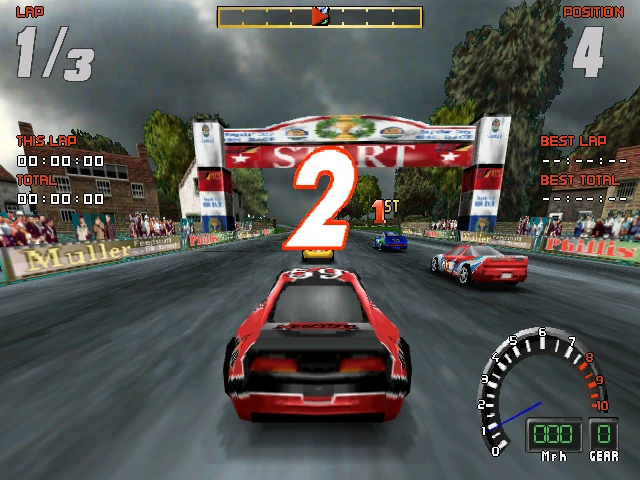
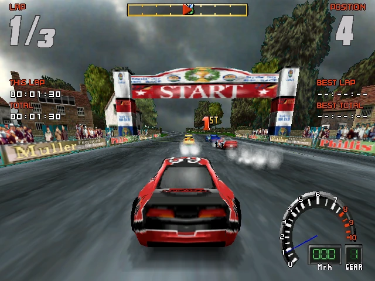
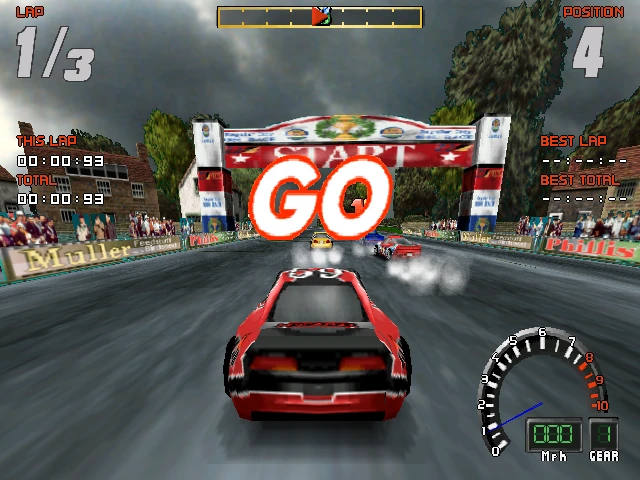
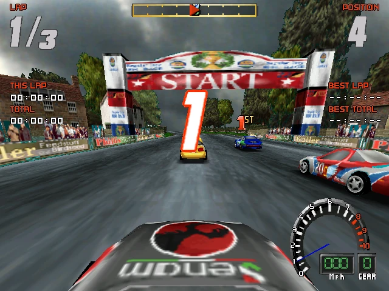
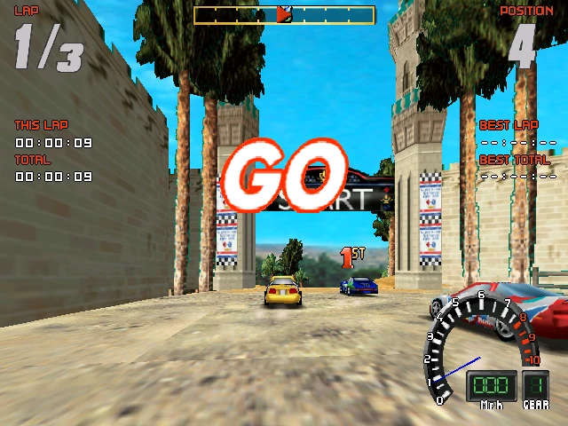
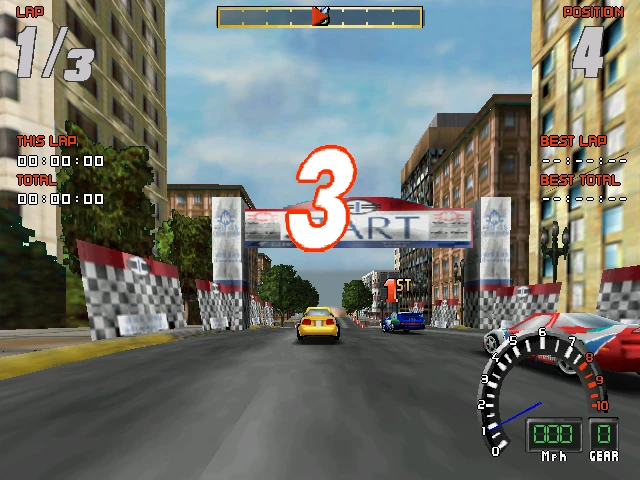

# Screamer 2 (1996 — 3dfx DOS)

| Field | Value |
| :--- | :--- |
| **Category** | Commercial Game |
| **Year** | 1996 |
| **Platform(s)** | `DOS/32 (GLIDE2X.OVL via DOSBox Glide pass-through)` |
| **Glide API & Version** | Glide 2.x (`2.56` on Voodoo2 / `2.48` on Voodoo Graphics) |
| **Recommended Card Profile** | `Voodoo2` (default) · `VoodooGraphics` (`SST-1`, also verified) |
| **Verified Backends** | Vulkan · OpenGL ES · Software (AVX2 / AVX-512 / Scalar) |
| **Preset File(s)** | [`glide-ng.ini`](./glide-ng.ini) (Voodoo2) · [`glide-ng.hq.ini`](./glide-ng.hq.ini) (`4× MSAA`) · [`glide-ng.voodoo1.ini`](./glide-ng.voodoo1.ini) (Voodoo1) · [`glide-ng.software.ini`](./glide-ng.software.ini) (CPU Software) |
| **Status** | Verified |

---

## Overview

Milestone / Virgin Interactive's *Screamer 2* (*Bleifuss 2* in Germany, `1996`) is a DOS/4GW arcade rally racer featuring multi-surface stages across **England**, **Egypt**, **California**, **Finland**, **Colossus**, and **Switzerland**, three-camera perspectives (bumper, hood, third-person chase), dynamic tire-smoke effects, spinning 3D menus, and Red Book CD audio.

Two distinct official 3dfx DOS patches exist:
- **`s23dfx.exe`** (`1,302,978` B) — the original Voodoo Graphics (SST-1) patch. It is **statically linked** against Glide and probes raw PCI hardware directly, so it **cannot** use a `GLIDE2X.OVL` Glide wrapper.
- **`s2_3dfx.exe`** (`1,055,262` B) — the later **Voodoo2 / Rush dynamic patch**. It dynamically loads **`GLIDE2X.OVL`** at **`640×480`**, upgrades the cropped `640×400` software renderer to full-height bilinear-filtered 3D, renders crisp translucent smoke clouds and skyboxes, and runs cleanly through **`glide-ng`** across Vulkan, OpenGL ES, and Software.

---

## Editions, Patches & Executables

| Executable / Package | Renderer | Works with `glide-ng`? | Technical Notes |
| :--- | :--- | :---: | :--- |
| **`s2_3dfx.exe` (`1,055,262` B)** | Glide 2.x (`GLIDE2X.OVL`) | **Yes (Recommended)** | Dynamic DOS/4GW 3dfx patch for Voodoo2 and later (`S2_3DFX.EXE`). Pair with `glide-ng`'s clean-room **`GLIDE2X.OVL`** (`build_release/dos/glide2x.ovl`). |
| **`s23dfx.exe` (`1,302,978` B)** | Statically linked SST-1 Glide | No | Original Voodoo1-only executable with embedded PCI/MMIO driver code. Requires register-level Voodoo emulation (`voodoo_card = software` in DOSBox-X or 86Box / PCem). |
| **`START65H.EXE` / `START65L.EXE`** | VESA SVGA `640×400` / `320×200` (16-bit) | Software fallback | Built-in 65K-color DOS software renderer (`v1.11` update available via `S2_65kh.exe` / `S2_65kl.exe`). Point-sampled textures with cropped top/bottom HUD bands. |
| **`STARTH.EXE` / `STARTL.EXE`** | VESA SVGA 8-bit (256-color) | Software fallback | Built-in paletted software renderer (`v1.11` update via `S2_256h.exe` / `S2_256l.exe`). |
| **`SETUP.EXE`** | DOS HMI Sound Configurator | Setup tool | Writes `CONFIG\SETUP.CFG` (`160` B). Contains a vintage CPU/VRAM calibration routine that divides by zero (`DOS/4GW error 2001`) when run at `cycles = max`; see notes below. |

---

## Recommended DOSBox Configurations

Keep the DOSBox configuration minimal — only non-default overrides are shown below.

> **Important Configuration Notes:**
> 1. **Use `s2_3dfx.exe` (dynamic `GLIDE2X.OVL`), *not* `s23dfx.exe`:** Copy **`s2_3dfx.exe`** (`1,055,262` B) and `glide-ng`'s clean-room **`GLIDE2X.OVL`** directly into the game directory.
> 2. **Disable EMS (`ems = false`):** With EMS enabled, *Screamer 2* can lock on a black screen under DOS/4GW. Keep `ems = false` and `xms = true` (`memsize = 31` or `63`).
> 3. **Required `SCREAMER.CFG` and `CONFIG\SETUP.CFG`:** Before running `S2_3DFX.EXE`, verify that `SCREAMER.CFG` lists the mounted path tokens (`C:` / `C:` / `C:` for a full install mounted directly at `C:`) and that `CONFIG\SETUP.CFG` (`160` bytes) exists (`S2_3DFX.EXE` exits with `Run SETUP before.` if absent).
> 4. **Mount the `.cue`/`.bin` image for CD Audio:** On case-sensitive Linux filesystems, ensure the filename inside `SCREAM2.cue` matches exact file casing (e.g., symlink `SCREAM2.BIN -> SCREAM2.bin`).
> 5. **`SETUP.EXE` hardware benchmark note:** On fast emulators (`cycles = max`), `SETUP.EXE`'s VGA timing benchmark hits a divide-by-zero (`exception 00h`). Use the audio setup file generated by a calibrated session (or a pre-created `CONFIG\SETUP.CFG`).

### Option A: Patched DOSBox-SVN (Glide Pass-Through → `glide-ng`) *(Recommended)*

```ini
# dosbox-svn.conf (minimal overrides)
[sdl]
# Avoids SDL_UpdateRects SIGSEGV under sdl12-compat on modern Linux
output = opengl

[dosbox]
memsize = 31

[dos]
ems = false
xms = true

[cpu]
cycles = max

[glide]
glide = true
```

```bash
GLIDE_NG_CONFIG=/path/to/glide-ng.ini \
  dosbox -conf dosbox-svn.conf \
  -c "mount C /path/to/screamer2/game" \
  -c "imgmount D /path/to/screamer2/SCREAM2.cue -t iso" \
  -c "C:" \
  -c "S2_3DFX.EXE"
```

### Option B: DOSBox-X (Glide Pass-Through → `glide-ng`)

```ini
# dosbox-x-pass.conf (minimal overrides)
[dosbox]
memsize = 31

[dos]
ems = false
xms = true

[cpu]
cycles = max

[voodoo]
glide = true
lfb = full
```

```bash
GLIDE_NG_CONFIG=/path/to/glide-ng.ini \
  dosbox-x -conf dosbox-x-pass.conf -nopromptfolder \
  -c "mount C /path/to/screamer2/game" \
  -c "imgmount D /path/to/screamer2/SCREAM2.cue -t iso" \
  -c "C:" \
  -c "S2_3DFX.EXE"
```

### Option C: CPU Software Fallback (`glide-ng.software.ini`)

```bash
GLIDE_NG_CONFIG=/path/to/glide-ng.software.ini \
  dosbox -conf dosbox-svn.conf \
  -c "mount C /path/to/screamer2/game" \
  -c "imgmount D /path/to/screamer2/SCREAM2.cue -t iso" \
  -c "C:" \
  -c "S2_3DFX.EXE"
```

### Reference Comparison: DOSBox-X Software Voodoo (No `glide-ng`)

```ini
# dosbox-x-sw.conf
[dosbox]
memsize = 31

[dos]
ems = false
xms = true

[cpu]
cycles = max

[voodoo]
voodoo_card = software
glide = false
```

Launch **`s23dfx.exe`** (the statically linked SST-1 build) under `voodoo_card = software` to compare against register-level Voodoo emulation.

---

## Visual Progression Gallery

Captures below show *Screamer 2* (`s2_3dfx.exe`, `640×480` Arcade mode) and native software `START65H.EXE` (`640×400`) under patched DOSBox-SVN:

| | |
| :---: | :---: |
| <br>**1. Track Selection (`Vulkan`, `640×480`)**<br>Crisp stage previews for England, Egypt, and California over the shaded `S2` backdrop. | <br>**2. Native DOS SVGA Software (`START65H.EXE`, `640×400`)**<br>Built-in 16-bit software renderer (`glide = false`): visible top/bottom black borders clipping the tachometer readout, pixel-staircased lines, and unfiltered asphalt/trees. |
| <br>**3. England — 3dfx Glide (`Vulkan 4× MSAA`, `640×480`)**<br>Full-frame `640×480` bilinear filtering with anti-aliased `START` gantry, rival chassis silhouettes, soft rain-cloud skybox, translucent car shadow, and crisp HUD telemetry. | <br>**4. England — 3dfx Glide (`OpenGL ES 3.2`, `640×480`)**<br>Matches Vulkan across skybox lighting, track sheen, alpha-blended launch smoke puffs, rival decals, gantry banners, and cockpit gauge overlay. |
| <br>**5. England — 3dfx Glide (`CPU Software AVX2`, `640×480`)**<br>Pure-CPU Glide rasterizer delivering identical frame colors, gamma (`0.9`), foliage cutouts, billboard text, and chase-camera car shading. | <br>**6. England — Hood Camera (`F3`, `Vulkan`, `640×480`)**<br>Curved specular shading across the #59 Condor hood emblem during the starting countdown. |
| <br>**7. Egypt — Desert Stage (`Vulkan`, `640×480`)**<br>Minarets, stone walls, blue desert sky, dynamic chromakey palm trunks, and bright sandy track road. | <br>**8. California — City Stage (`Vulkan`, `640×480`)**<br>Urban multi-story buildings, streetlights, checkered track barriers, foliage, and distant straightaway horizon. |

---

## Visual Quality & Performance Tuning

### Recommended Settings & Backends
* **`glide-ng.hq.ini` (`4× MSAA`, `no_dither_sub = true`) is recommended:** Smooths the sharp angled road edges, overhead `START` gantries, and opponent car bodies cleanly with no HUD or billboard artifacts.
* **`Voodoo2` (`2.56`) or `VoodooGraphics` (`2.48`):** `s2_3dfx.exe` targets Glide 2.x dynamically and runs cleanly with zero warnings under both `Voodoo2` (`glide-ng.ini`) and `VoodooGraphics` (`glide-ng.voodoo1.ini`).
* **Native gamma (`0.9`):** The game explicitly applies `grGammaCorrectionValue(0.9)` on boot; leave `[display] gamma` unset in `glide-ng.ini` so the title controls brightness natively.

---

## Quirks, Known Issues & Controls

### Rendering & Hardware Notes
* **Thin teal/cyan edge on Egypt palm trunks:** *Screamer 2* encodes transparent cutout textures in `RGB_565` / `P_8` with bilinear filtering (`GR_TEXTUREFILTER_BILINEAR`) and hardware chromakey (`grChromakeyMode(GR_CHROMAKEY_ENABLE)`). Because authentic 3dfx TMUs filter texels *before* testing `grChromakeyValue`, a faint 1-pixel fringe of blended border color can show along high-contrast billboard silhouettes (such as the desert palm trunks in Egypt). That matches real Voodoo 1/2/3 silicon behavior.
* **Classic late-driver interlacing glitch avoided:** On real late-era Voodoo2/3 reference Windows drivers, an outdated `GLIDE2X.OVL` caused vertical interlacing corruption in *Screamer 2*. `glide-ng`'s clean-room `GLIDE2X.OVL` is unaffected.
* **Startup splash:** Uncomment `no_splash = true` in `glide-ng.ini` (or pass `FX_GLIDE_NO_SPLASH=1` / `GLIDE_NG_NO_SPLASH=1`) to skip the one-shot startup splash animation.

### Useful Controls

| Key | Action |
| :--- | :--- |
| **`Up` / `Down`** | Accelerate / brake (`Enter` confirms menu screens) |
| **`Left` / `Right`** | Steer / cycle teams and tracks |
| **`F1`–`F4`** | Cycle camera view (bumper, inside, `F3` hood, `F4` chase) |
| **`P` / `Esc`** | Pause / exit race or menu |
