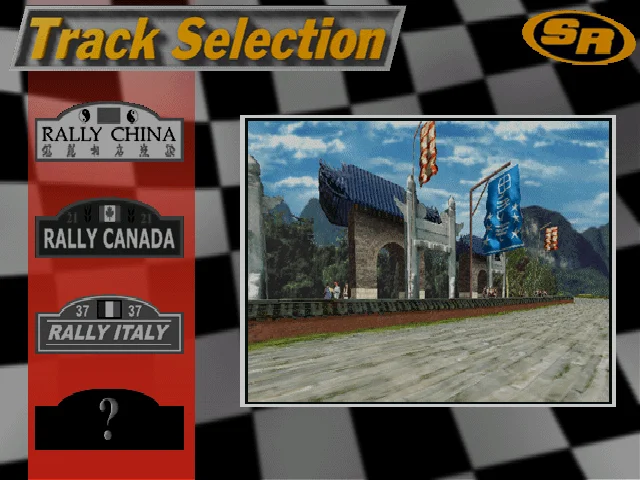
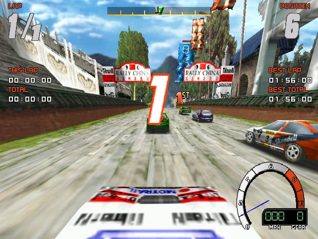
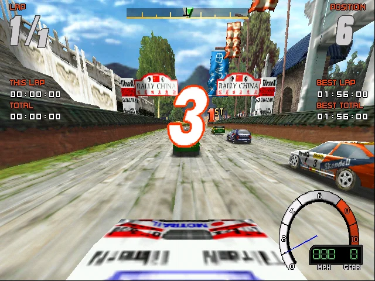
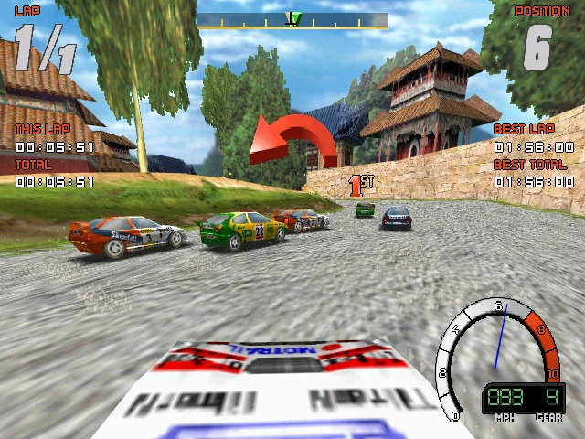
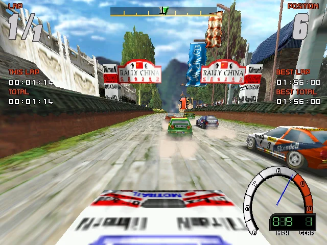

# Screamer Rally (1997 — 3dfx DOS)

| Field | Value |
| :--- | :--- |
| **Category** | Commercial Game |
| **Year** | 1997 |
| **Platform(s)** | `DOS/32 (GLIDE2X.OVL via DOSBox Glide pass-through)` |
| **Glide API & Version** | Glide 2.x (`2.56` on Voodoo2 / `2.48` on Voodoo Graphics) |
| **Recommended Card Profile** | `Voodoo2` (default) · `VoodooGraphics` (`SST-1`) |
| **Verified Backends** | Vulkan · OpenGL ES · Software (AVX2 / AVX-512 / Scalar) |
| **Preset File(s)** | [`glide-ng.ini`](./glide-ng.ini) (Voodoo2) · [`glide-ng.hq.ini`](./glide-ng.hq.ini) (`4× MSAA`) · [`glide-ng.voodoo1.ini`](./glide-ng.voodoo1.ini) (Voodoo1) · [`glide-ng.software.ini`](./glide-ng.software.ini) (CPU Software) |
| **Status** | Verified |

---

## Overview

Milestone / Virgin Interactive's *Screamer Rally* (*Bleifuss Rally* in Germany, `1997`) is a DOS/4GW arcade rally racer built directly upon the engine of [*Screamer 2*](../screamer-2/README.md). The game features seven courses (**China**, **Canada**, **Italy**, **Arizona**, **Sweden**, **Wales**, plus a bonus **Stadium** arena), four starting rally cars (plus one unlockable vehicle), garage tuning options, saved replay playback (`REPLAYS\*.RPL`), Arcade / Championship / Time Attack / LAN multiplayer modes, and Red Book CD audio.

Unlike *Screamer 2*'s original static SST-1 patch, both the retail 3dfx executable (**`STRT3FX.EXE`**) and the official April 1998 Voodoo2 update (**`SR3DFX2.EXE`**) dynamically load **`GLIDE2X.OVL`** and render at **`640×480`** using painter's-algorithm sorted 3D polygons (`Aux=0`, 2 color buffers), CPU LFB 2D menus/HUD overlays, bilinear texture filtering with chromakey cutouts, and native `grGammaCorrectionValue(0.9)` RAMDAC gamma correction.

---

## Editions, Patches & Executables

| Executable / Package | Renderer | Works with `glide-ng`? | Technical Notes |
| :--- | :--- | :---: | :--- |
| **`SR3DFX2.EXE` (`1,044,502` B)** | Glide 2.x (`GLIDE2X.OVL`) | **Yes (Recommended)** | Official April 1998 Voodoo2 update. Clamps `grTexMaxAddress(GR_TMU0)` to `0x1ff000` (~2 MB) to prevent TMU boundary corruption on >2 MB TMU setups, removes four stale post-`grLfbUnlock()` LFB writes, and zeroes MSCDEX request buffers. Pair with `glide-ng`'s clean-room **`GLIDE2X.OVL`** (`build_release/dos/glide2x.ovl`). |
| **`STRT3FX.EXE` (`1,044,502` B)** | Glide 2.x (`GLIDE2X.OVL`) | Yes *(Prefer `SR3DFX2.EXE`)* | Retail 1997 dynamic `GLIDE2X.OVL` executable. Does not gate on `grSstQueryHardware` board IDs and runs through `glide-ng`, but lacks the 2 MB TMU0 address clamp and performs four extra LFB blits immediately after `grLfbUnlock()`. |
| **`START65H.EXE` (`1,145,058` B) / `START65L.EXE` (`1,149,630` B)** | VESA SVGA `640×400` / `320×200` (16-bit) | Software fallback | Built-in 65K-color DOS software renderer (`glide = false`). Point-sampled textures with cropped top/bottom HUD bands. |
| **`STARTH.EXE` (`1,045,098` B) / `STARTL.EXE` (`1,049,186` B)** | VESA SVGA 8-bit (256-color) | Software fallback | Built-in paletted software renderer installed when 256-color assets are chosen in `INSTALL.BAT`. |
| **`STRT3DBH.EXE` (`1,045,418` B) / `STRT3DBL.EXE` (`1,044,870` B)** | Creative 3D Blaster (Rendition Vérité CGL) | No | Uses `VRIT*.CGL` under `HOTCGL\`; not Glide. |
| **`STRTMSI.EXE` (`1,339,982` B)** | Matrox Mystique (MSI) | No | Proprietary Matrox Simple Interface build; not Glide. |
| **`SETUP.BAT` (`861` B) / `ST.EXE` (`297,736` B)** | Sound & 3D Card Configurator | Setup tool | Writes `CONFIG\SETUP.CFG` (`160` B), `CONFIG\CARD3D.CFG`, and `SR.BAT`. `SETUP.BAT` probes for hardware using bundled static OEM OVLs and overwrites `GLIDE2X.OVL`; `ST.EXE` divides by zero when run at `cycles = max`. See notes below. |

---

## Recommended DOSBox Configurations

Keep the DOSBox configuration minimal — only non-default overrides are shown below.

> **Important Configuration Notes:**
> 1. **Delete `SR\GLIDE2X.OVL` after running `INSTALL.BAT` / `SETUP.BAT`:** `SETUP.BAT` copies bundled static SST-1/Rush OEM drivers (`HOTCGL\VRUSH.OVL` `395,715` B and `HOTCGL\VOODOO.OVL` `348,791` B) onto `SR\GLIDE2X.OVL` while running `CHK3DFX.EXE`. Under Glide pass-through, any leftover `SR\GLIDE2X.OVL` in the game directory shadows pass-through OVLs on `PATH`. Either delete `SR\GLIDE2X.OVL` and copy `glide-ng`'s clean-room `GLIDE2X.OVL` (or mount it on `PATH`), or replace `HOTCGL\VRUSH.OVL` before running `SETUP.BAT`.
> 2. **Cap CPU cycles during `INSTALL.BAT` / `ST.EXE` (`cycles fixed 75000`):** At `cycles = max`, `ST.EXE`'s startup VRAM bandwidth calibration completes faster than a single 18.2 Hz BIOS timer tick (`54.9 ms`) and crashes with `DOS/4GW error (2001): exception 00h` (divide by zero). Run `INSTALL.BAT` and `ST.EXE` under fixed cycles (`10000`–`75000`), then restore `cycles = max` for gameplay.
> 3. **Launch `SR3DFX2.EXE` (recommended):** Place the April 1998 `SR3DFX2.EXE` update inside `SR\` and run it directly (or update `SR.BAT` to call `SR3DFX2.EXE`).
> 4. **Disable EMS (`ems = false`) & mount CD audio:** Keep `ems = false`, `xms = true`, and `memsize = 32` (or `31`), and mount the `.cue`/`.img` (or `.cue`/`.bin`) image for Red Book CD audio. Verify `SCREAMER.CFG` and `CONFIG\SETUP.CFG` (`160` B) exist (`Run SETUP before.` if absent).

### Option A: Patched DOSBox-SVN (Glide Pass-Through → `glide-ng`) *(Recommended)*

```ini
# dosbox-svn.conf (minimal overrides)
[sdl]
# Avoids SDL_UpdateRects SIGSEGV under sdl12-compat on modern Linux
output = opengl

[dosbox]
memsize = 31

[dos]
ems = false
xms = true

[cpu]
cycles = max

[glide]
glide = true
```

```bash
GLIDE_NG_CONFIG=/path/to/glide-ng.ini \
  dosbox -conf dosbox-svn.conf \
  -c "mount C /path/to/screamer-rally" \
  -c "imgmount D /path/to/srally.cue -t iso" \
  -c "C:" \
  -c "cd SR" \
  -c "SR3DFX2.EXE"
```

### Option B: DOSBox-X (Glide Pass-Through → `glide-ng`)

```ini
# dosbox-x-pass.conf (minimal overrides)
[dosbox]
memsize = 32

[dos]
ems = false
xms = true

[cpu]
cycles = max

[voodoo]
glide = true
lfb = full
```

```bash
GLIDE_NG_CONFIG=/path/to/glide-ng.ini \
  dosbox-x -conf dosbox-x-pass.conf -nopromptfolder \
  -c "mount C /path/to/screamer-rally" \
  -c "imgmount D /path/to/srally.cue -t iso" \
  -c "C:" \
  -c "cd SR" \
  -c "SR3DFX2.EXE"
```

*(Note: Running `ST.EXE` inside DOSBox-X requires `-c "cycles fixed 75000"` during setup to avoid the `exception 00h` divide-by-zero described above.)*

### Option C: CPU Software Fallback (`glide-ng.software.ini`)

```bash
GLIDE_NG_CONFIG=/path/to/glide-ng.software.ini \
  dosbox -conf dosbox-svn.conf \
  -c "mount C /path/to/screamer-rally" \
  -c "imgmount D /path/to/srally.cue -t iso" \
  -c "C:" \
  -c "cd SR" \
  -c "SR3DFX2.EXE"
```

### Reference Comparison: DOSBox-X Software Voodoo (No `glide-ng`)

```ini
# dosbox-x-sw.conf
[dosbox]
memsize = 32

[dos]
ems = false
xms = true

[cpu]
cycles = max

[voodoo]
voodoo_card = software
voodoo_maxmem = true
glide = false
lfb = full_noaux
```

Supply the stock `HOTCGL\VOODOO.OVL` (copied to `SR\GLIDE2X.OVL`) and run `SR3DFX2.EXE` under `voodoo_card = software` to establish an unmodified register-level software Voodoo baseline (especially useful because `SR3DFX2.EXE` clamps `GR_TMU0` for `voodoo_maxmem = true`).

---

## Visual Progression Gallery

Captures below show *Screamer Rally* (`SR3DFX2.EXE` / `STRT3FX.EXE`, `640×480` Arcade mode) across `glide-ng` backends, DOSBox-X software Voodoo emulation, and native DOS SVGA `START65H.EXE` (`640×400`):

| | |
| :---: | :---: |
| <br>**1. Track Selection (`Vulkan 4× MSAA`, `640×480`)**<br>Clean CPU LFB stage cards for Rally China, Rally Canada, and Rally Italy over the checkered backdrop. | <br>**2. Native DOS SVGA Software (`START65H.EXE`, `640×400`)**<br>Built-in 16-bit software renderer (`glide = false`): point-sampled road, hood, and stone wall texels at `640×400` without bilinear filtering. |
| <br>**3. China Grid — 3dfx Glide (`Vulkan 4× MSAA`, `640×480`)**<br>Full-height `640×480` bilinear filtering with anti-aliased starting-pack chassis, overhead `RALLY CHINA` banners, skybox gradients, and crisp 2D CPU LFB gauge telemetry. | <br>**4. China Grid — 3dfx Glide (`OpenGL ES 3.2`, `640×480`)**<br>Matches Vulkan and Software across foliage chromakey cutouts, waving track banners, car liveries, tachometer needle, and translucent dust clouds. |
| <br>**5. China Grid — 3dfx Glide (`CPU Software AVX2`, `640×480`)**<br>Pure-CPU Glide reference rasterizer delivering identical geometry, native `0.9` gamma brightness, banner cutouts, and LFB HUD overlays. | <br>**6. Reference DOSBox-X Software Voodoo (`voodoo_card = software`, `640×480`)**<br>Unmodified register-level Voodoo emulation confirms color, chromakey, filtering, and HUD parity with `glide-ng`. |
| <br>**7. China Uphill Hairpin (`Vulkan 4× MSAA`, `640×480`)**<br>Mid-race five-car pack climbing past spectator banks and pagodas with directional turn indicator, translucent gravel dust, and zero MSAA seams. | <br>**8. China Race Launch (`Vulkan 1×`, `640×480`)**<br>Authentic `1×` point-presented Glide output capturing tire smoke plumes at race start against rival chassis silhouettes. |

---

## Visual Quality & Performance Tuning

### Recommended Settings & Backends
* **`glide-ng.hq.ini` (`4× MSAA`, `presentation_filter = linear`, `no_dither_sub = true`) is recommended:** Smooths road shoulders, guardrails, checkpoints, and chassis silhouettes cleanly across races without disturbing 2D LFB menu overlays.
* **`Voodoo2` (`2.56`) or `VoodooGraphics` (`2.48`):** Both `SR3DFX2.EXE` and `STRT3FX.EXE` dynamically resolve `GLIDE2X.OVL` without blocking on board revision IDs and work cleanly under both presets. Cross-backend pixel parity is verified between `glide-ng` CPU Software and Vulkan (`MAE 0.13`, `37.05 dB PSNR` on matched starting-grid frames) as well as DOSBox-X `voodoo_card = software` and OpenGLide (`22.7–26.8 dB` across dynamic flag frames).
* **Native gamma (`0.9`):** The executable applies `grGammaCorrectionValue(0.9)` shortly after window creation (`grSstWinOpen`). Leave `[display] gamma` unset in `glide-ng.ini` so the title controls RAMDAC gamma natively.

---

## Quirks, Known Issues & Controls

### Rendering & Hardware Notes
* **`SR3DFX2.EXE` vs. `STRT3FX.EXE` technical differences:** Both executables are identical in padded disk size (`1,044,502` B) and use the same `GLIDE2X.OVL` thunk table (neither rejects Voodoo2 in `grSstQueryHardware`). `SR3DFX2.EXE` is a clean April 1998 recompile (`+32` bytes net code) that clamps `grTexMaxAddress(GR_TMU0)` to `0x1ff000` (fixing 2 MB TMU boundary crashes on Voodoo2+ hardware), removes four stale LFB blits issued immediately after `grLfbUnlock()`, and clears a 1 KB MSCDEX request structure before CD queries. Use **`SR3DFX2.EXE`** whenever possible.
* **`SETUP.BAT` `GLIDE2X.OVL` overwrite:** `SETUP.BAT` writes static hardware `HOTCGL\VRUSH.OVL` or `HOTCGL\VOODOO.OVL` into `SR\GLIDE2X.OVL` while probing 3dfx hardware with `CHK3DFX.EXE`. Remove `SR\GLIDE2X.OVL` (or replace it with `glide-ng`'s `build_release/dos/glide2x.ovl`) before launching the game under Glide pass-through.
* **`ST.EXE` divide-by-zero on fast CPUs:** `ST.EXE` triggers `DOS/4GW error (2001): exception 00h` if run under `cycles = max`; temporarily switch to fixed cycles (`cycles fixed 75000`) while configuring audio or controllers.
* **Startup splash:** Uncomment `no_splash = true` in `glide-ng.ini` (or pass `FX_GLIDE_NO_SPLASH=1` / `GLIDE_NG_NO_SPLASH=1`) to skip the one-shot startup splash animation.

### Useful Controls

Keyboard driving and controller bindings can be customized in `ST.EXE` (`CONFIG\CONTROLS.CFG`) or the in-game Options menu. Default keyboard controls during menus, racing, and replay playback:

| Key | Action |
| :--- | :--- |
| **`Up` / `Down`** | Accelerate / brake (`Enter` confirms menu selections) |
| **`Left` / `Right`** | Steer / cycle cars and stages |
| **`Right Shift` / `Right Ctrl`** | Shift gear up / down *(Manual transmission)* |
| **`F1`–`F4`** | Cycle camera view (bumper, dashboard, close external, chase) |
| **`F9`** | Trackside / TV camera *(Replay mode)* |
| **`F11`** | Cycle viewed car *(Replay mode)* |
| **`M`** | Toggle rear-view mirror *(in-race)* |
| **`P` / `Esc`** | Pause / exit race or menu |
