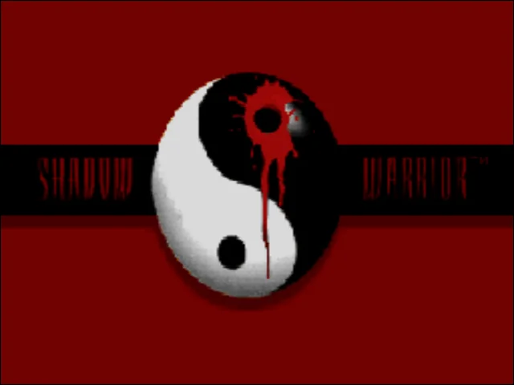
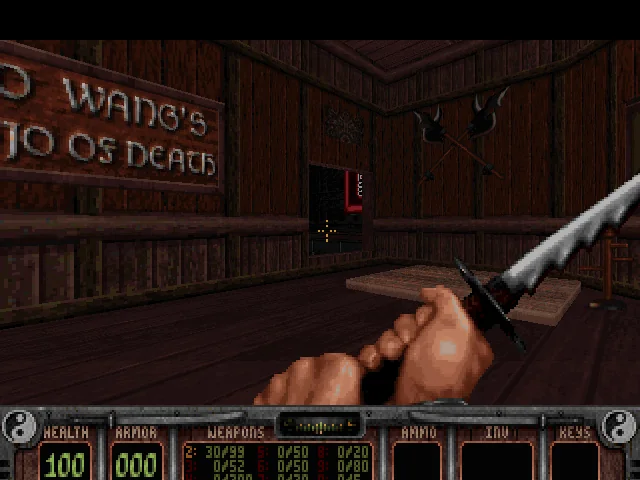
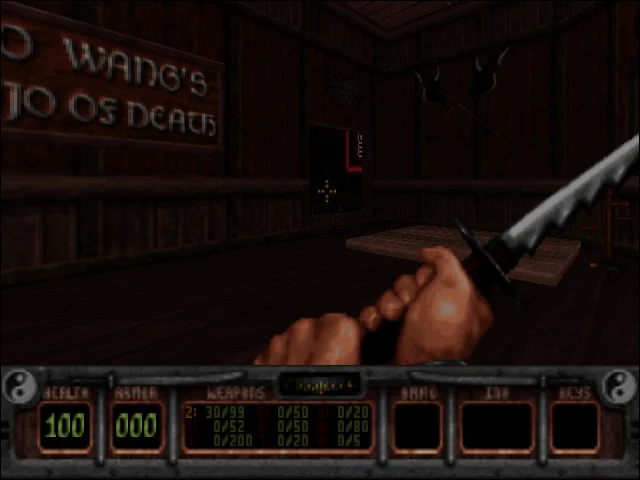
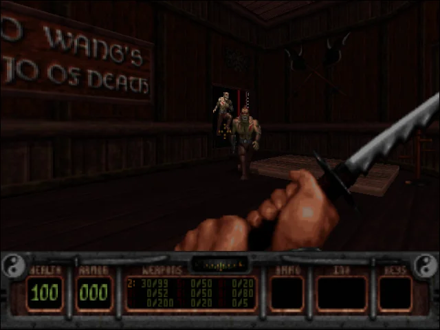
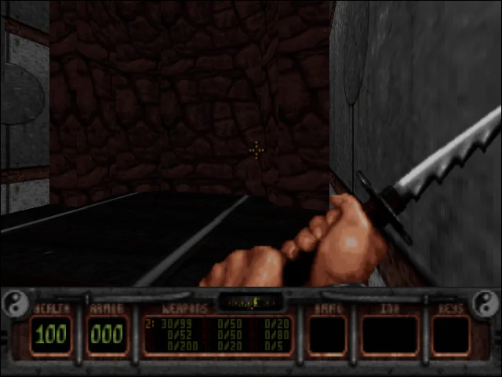
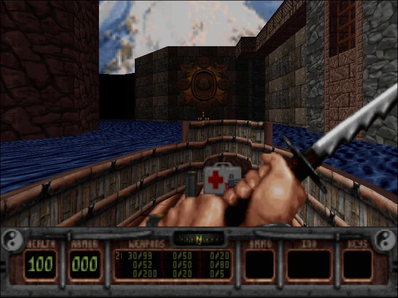

# Shadow Warrior (1997 — 3dfx DOS)

| Field | Value |
| :--- | :--- |
| **Category** | Commercial Game |
| **Year** | 1997 (3dfx patch v1.1: January 1998) |
| **Platform(s)** | `DOS/32 (GLIDE2X.OVL via DOSBox Glide pass-through)` |
| **Glide API & Version** | Glide 2.x (`2.56` on Voodoo2 / `2.48` on Voodoo Graphics) |
| **Recommended Card Profile** | `Voodoo2` (default, supports `800×600`) · `VoodooGraphics` (authentic SST-1) |
| **Verified Backends** | Vulkan · OpenGL ES · Software (AVX2 / AVX-512 / Scalar) |
| **Preset File(s)** | [`glide-ng.ini`](./glide-ng.ini) (Voodoo2) · [`glide-ng.voodoo1.ini`](./glide-ng.voodoo1.ini) (SST-1) · [`glide-ng.software.ini`](./glide-ng.software.ini) (CPU Software) |
| **Status** | Verified |

---

## Overview

3D Realms' 1997 Build Engine shooter *Shadow Warrior* received an official 3dfx DOS patch (**`SW3DFX11.EXE`**, `v1.1`, January 1998) built on Scott Alden's 3dfx Build Engine driver — the same Glide 2.x rendering core used by *Blood* (1997). **`SW3DFX.EXE`** loads **`GLIDE2X.OVL`** dynamically at **`512×384`**, **`640×480`**, or **`800×600`** (`F5` cycles resolutions in-game).

First-time startup pre-converts game tile sets into `TX3DFX\*.3DF` (and animated intro movies into `ANIM*\`). Compared with native `VESA 2.0` DOS software (`SW.EXE`), `SW3DFX.EXE` delivers smooth bilinear-filtered wooden walls, stone masonry, shimmering water surfaces, dynamic intensity-based fire and smoke transparency, crisp katana/UI shading, and authentic dynamic red/fog pain tinting (`grFogColorValue` + `grTexDownloadTable`).

---

## Editions, Patches & Executables

| Executable / Patch | Renderer | Works with `glide-ng`? | Technical Notes |
| :--- | :--- | :---: | :--- |
| **`SW3DFX.EXE` (v1.2 / 3dfx Patch v1.1, `SW3DFX11.EXE`)** | Glide 2.x (`GLIDE2X.OVL`) | **Yes (Recommended)** | Official Jan 1998 3dfx patch (`2,518,858` B). Supports `512×384`, `640×480`, and **`800×600`**, `F5` live resolution toggle, save/load (`GAME#.SA2`), and its own `SET3DFX.EXE` / `SW3DFX.CF2` config. Pair with `glide-ng`'s clean-room `build/dos/glide2x.ovl`. |
| **`SW.EXE` (Retail v1.2)** | DOS CPU Software (`VESA 2.0`) | No (No 3dfx) | Non-accelerated fallback (`2,323,389` B). Crisp unfiltered 8-bit paletted pixels and voxels (`3D sprites`). |

---

## Recommended DOSBox Configurations

Keep the DOSBox configuration minimal — only non-default overrides are shown below.

> **Important Build Engine 3dfx Notes:**
> 1. Set **`[dosbox] memsize = 63`** (the 3dfx patch requires ≥ 32 MB RAM and benefits from 63 MB to avoid disk thrashing).
> 2. Run **`SET3DFX.EXE`** once to create **`SW3DFX.CF2`** (`ScreenWidth = 640`, `ScreenHeight = 480`, or `800×600`, plus Sound Blaster 16). Keep **`3D sprites` (voxels) disabled** inside regular `SW.EXE` options before launching `SW3DFX.EXE`.
> 3. Place `glide-ng`'s clean-room HLE pass-through **`GLIDE2X.OVL`** (`build/dos/glide2x.ovl`) inside the game directory alongside `SW3DFX.EXE`.
> 4. **Keep `msaa = 1` (and `aa = none` on Software).** Do **not** enable `4× MSAA` or `2×2 SSAA` — see the *Visual Quality & Performance Tuning* note below.

### Option A: Patched DOSBox-SVN (Glide Pass-Through → `glide-ng`) *(Recommended)*

```ini
# dosbox-svn.conf (minimal overrides)
[dosbox]
memsize = 63

[sdl]
# Avoids SDL_UpdateRects SIGSEGV under sdl12-compat on modern Linux
output = opengl

[cpu]
cycles = max

[glide]
glide = true
```

```bash
GLIDE_NG_CONFIG=/path/to/glide-ng.ini \
  dosbox -conf dosbox-svn.conf \
  -c "mount C /path/to/shadow_warrior/game -freesize 512" \
  -c "imgmount D /path/to/sw.cue -t iso" \
  -c "C:" \
  -c "SW3DFX.EXE"
```

### Option B: DOSBox-X (Glide Pass-Through → `glide-ng`)

```ini
# dosbox-x-pass.conf (minimal overrides)
[dosbox]
memsize = 63

[cpu]
cycles = max

[voodoo]
glide = true
lfb = full
```

```bash
GLIDE_NG_CONFIG=/path/to/glide-ng.ini \
  dosbox-x -conf dosbox-x-pass.conf -nopromptfolder \
  -c "mount C /path/to/shadow_warrior/game -freesize 512" \
  -c "imgmount D /path/to/sw.cue -t iso" \
  -c "C:" \
  -c "SW3DFX.EXE"
```

### Option C: CPU Software Fallback (`glide-ng.software.ini`)

```bash
GLIDE_NG_CONFIG=/path/to/glide-ng.software.ini \
  dosbox -conf dosbox-svn.conf \
  -c "mount C /path/to/shadow_warrior/game -freesize 512" \
  -c "imgmount D /path/to/sw.cue -t iso" \
  -c "C:" \
  -c "SW3DFX.EXE"
```

### Reference Comparison: DOSBox-X Software Voodoo (No `glide-ng`)

```ini
# dosbox-x-sw.conf
[dosbox]
memsize = 63

[cpu]
cycles = max

[voodoo]
voodoo_card = software
glide = false
```

Replace the pass-through `GLIDE2X.OVL` with a real SST-1 **Glide 2.43** `GLIDE2X.OVL`.

---

## Visual Progression Gallery

All captures below compare native *Shadow Warrior* (`v1.2`, 3dfx patch `v1.1`) under patched DOSBox-SVN at `640×480` and **`800×600`**:

| | |
| :---: | :---: |
| <br>**1. Title Screen (`640×480` · Glide 2.x)**<br>Opening blood-splattered *Shadow Warrior* Yin-Yang emblem rendered over the crimson ribbon banner. | <br>**2. Native DOS Software (`SW.EXE`, `640×480` VESA 2.0)**<br>Seppuku Station (`L01`) dojo showing crisp unfiltered 8-bit wooden planking, katana blade, tatami mat, and blocky perspective wall signage. |
| <br>**3. 3dfx Glide (`SW3DFX.EXE`, Vulkan `1×`, `640×480`)**<br>Same starting view with bilinear-filtered wood walls, darkened wood beams, crisp bottom metal status bar, and translucent blade sheen. | <br>**4. 3dfx Glide (`OpenGL ES 1×`, `640×480`)**<br>Coolie/Ninja sprites emerging through the dojo threshold with identical dark room lighting, zero dropped floor/ceiling scanlines, and smooth text. |
| <br>**5. `Zilla Construction` (`L02` · Vulkan `1×`, `640×480`)**<br>Subterranean stone elevator shaft with dark steel tracks and smooth bilinear-filtered concrete walls. | <br>**6. `Rising Son` (`L05` · Native `800×600`, Vulkan `1×`)**<br>Outdoor wooden moat boat at `800×600` (`Voodoo2` profile) framing textured blue water, carved dragon gate, stone fortress lattice, snow-capped mountain skybox, and medkit pickup. |

---

## Visual Quality & Performance Tuning

### Anti-Aliasing, Resolution & Gamma
* **Keep `msaa = 1` (and avoid `aa = ssaa` on CPU Software):** Like *Blood*, `SW3DFX.EXE` does **not** call `grBufferClear()` during active gameplay and submits horizontal floor/ceiling/sprite spans as **`1`-pixel-tall right triangles** relying on `1×` top-left fill coverage. Enabling `4× MSAA` (Vulkan / OpenGL ES) or `2×2 SSAA` (Software) causes partial-pixel hypotenuse coverage to leave prior frame subsamples ghosted across moving sprites, brass casings, weapons, and the HUD status bar. All bundled presets keep `msaa = 1`.
* **Native `800×600` (Recommended sharpness upgrade):** Because `MSAA`/`SSAA` cannot be safely forced on 3dfx Build Engine spans, bumping **`SW3DFX.CF2`** to `ScreenWidth = 800`, `ScreenHeight = 600` (or tapping **`F5`** in-game) gives a clean **+56% pixel density upgrade** with `0` ghosting!
* **Default brightness vs `BUILD_GAMMA`:** Running `SW3DFX.EXE` with default settings provides rich warm indoor visibility closely matching `SW.EXE`. If interiors look dark on a calibrated display, set `SET BUILD_GAMMA=1.3` (or `1.0` for darker mood) inside your launch script.
* **Live filtering toggle:** Press **`Alt+B`** (bilinear smooth) or **`Alt+P`** (pixelated point-sampled) in-game.

### Performance Notes
* **Heavy palette/fog state stream:** Every 3dfx frame swaps 256-entry `P_8` shade palettes (`grTexDownloadTable`), distance fog colors (`grFogColorValue`), and texture binds across hundreds of sector spans — no mid-frame LFB locks are needed in 3D view.
* **First-run texture caching:** On first boot, `SW3DFX.EXE` converts tiles on disk into **`TX3DFX\*.3DF`** and intro movies into **`ANIM*\`**. Subsequent launches load directly from the cached `.3DF` files. Wait until conversion finishes before closing DOSBox; if interrupted mid-write, delete **`TX3DFX\`** and restart so it rebuilds cleanly.

---

## Quirks, Known Issues & Controls

### Installation & Engine Notes
* **Extract the full patch before exiting DOSBox:** `SW3DFX11.EXE` (`v1.1` self-extractor) takes several seconds to decompress the full **`2,518,858`-byte `SW3DFX.EXE`**. Wait until the installer prompts `Strike any key when ready...` before shutting down DOSBox.
* **Separate save/config files:** Software `SW.EXE` uses `SW.CFG` / standard save slots; `SW3DFX.EXE` uses **`SW3DFX.CF2`** and separate **`GAME#.SA2`** save files.
* **CD audio & verification:** Mount the full `sw.cue`/`.img` (or a disc containing track #2) as **`D:`** (`-t iso`). If upgrading a UK Restricted `v1.2` disc, run `SW12UK.EXE` before applying `SW3DFX11.EXE`.
* **No `3D sprites` (voxels):** Disable `3D sprites` in the software game menu before using `SW3DFX.EXE`, or enemy/pickup sprites may become hidden.
* **Startup splash:** Uncomment `no_splash = true` in `glide-ng.ini` (or pass `FX_GLIDE_NO_SPLASH=1`) to skip the one-shot startup splash on launch.

### Useful Controls

| Key | Action |
| :--- | :--- |
| **`Alt+B` / `Alt+P`** | Toggle bilinear filtering ON (`blurry`) / OFF (`pixelated`) |
| **`F5`** | Cycle 3dfx resolution (`512×384` / `640×480` / `800×600`) |
| **`F12`** | Save in-game `.tga` screenshot (`swcpXXXX.tga`) |
| **`+` / `-`** | Increase / decrease screen size (hides bottom status bar for higher FPS) |
| **Arrow keys** | Move / turn (`Space` / `E` = use / open door) |
| **`Ctrl` / Mouse 1** | Attack (`1`–`0` switches weapons) |
| **`Esc`** | Main menu / pause |
