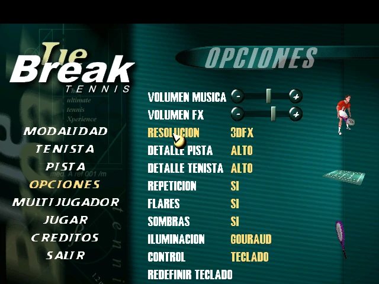
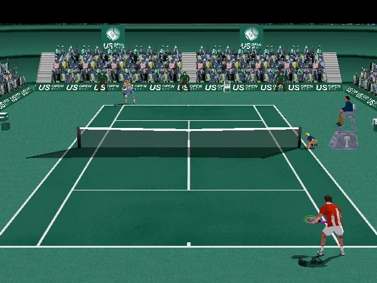
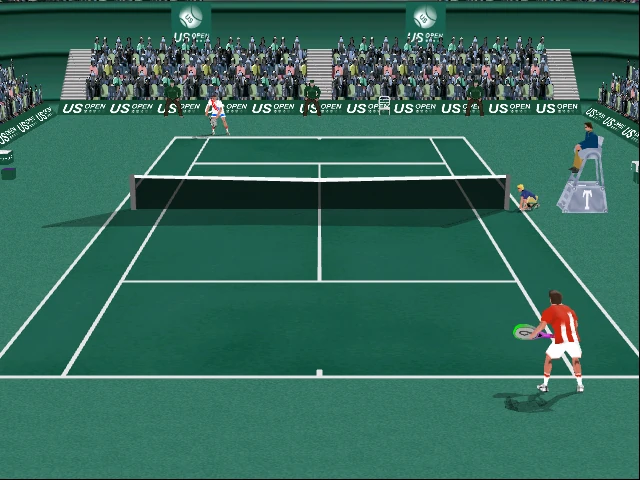
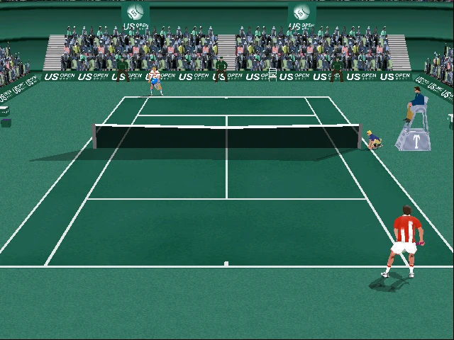
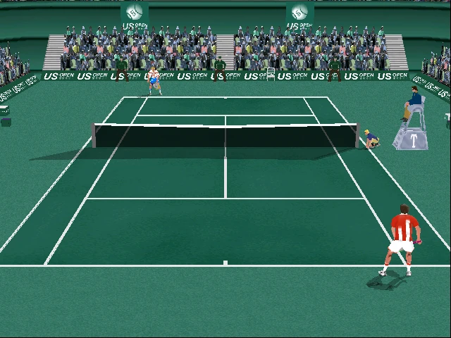
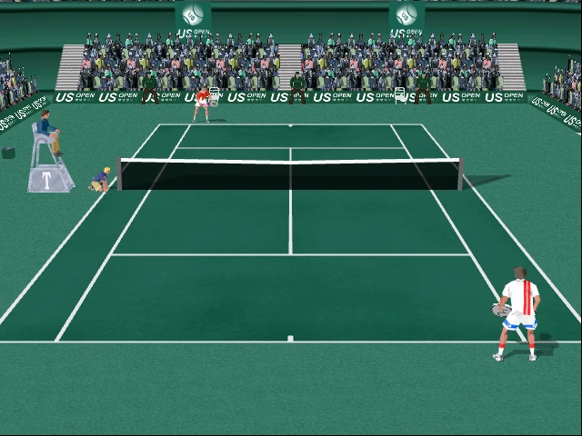

# Tie Break Tennis (1998 — 3dfx DOS)

| Field | Value |
| :--- | :--- |
| **Category** | Commercial Game |
| **Year** | 1998 |
| **Platform(s)** | `DOS/32 (GLIDE2X.OVL via DOSBox Glide pass-through)` |
| **Glide API & Version** | Glide 2.x (`2.56` on Voodoo2 / `2.48` on Voodoo Graphics) |
| **Recommended Card Profile** | `Voodoo2` (default) · `VoodooGraphics` (authentic SST-1) |
| **Verified Backends** | Vulkan · OpenGL ES · Software (AVX2 / AVX-512 / Scalar) |
| **Preset File(s)** | [`glide-ng.ini`](./glide-ng.ini) (Voodoo2) · [`glide-ng.hq.ini`](./glide-ng.hq.ini) (`4× MSAA`) · [`glide-ng.voodoo1.ini`](./glide-ng.voodoo1.ini) (SST-1) · [`glide-ng.software.ini`](./glide-ng.software.ini) (CPU Software) |
| **Status** | Verified |

---

## Overview

Hammer Technologies / Dinamic Multimedia's 1998 3D tennis simulator *Tie Break Tennis* features a unified DOS/4GW binary (`TENNIS.EXE`, `887,810` B) supporting both VESA 2.0 software resolutions (`320×200`, `320×240`, `640×400`, `640×480`, `800×600`, `1024×768`) and dynamic **3dfx Glide 2.x (`GLIDE2X.OVL`)** acceleration at **`640×480`**.

Inside the main menu (`OPCIONES`), `TENNIS.EXE` checks `grSstQueryBoards()` at boot and exposes **`3DFX`** right inside the **`RESOLUCION`** cycle (on both `VoodooGraphics` SST-1 and `Voodoo2` CVG profiles). Enabling `3DFX` unlocks smooth bilinear-filtered hardcourt/clay/grass stadiums, translucent cast net and player shadows, textured Gouraud-shaded players, full-height `640×480` camera framing (eliminating the letterboxed top sky bar visible in `640×480` SVGA software), and real-time lens flares.

---

## Editions, Patches & Executables

| Executable / Package | Renderer | Works with `glide-ng`? | Technical Notes |
| :--- | :--- | :---: | :--- |
| **`TENNIS.EXE` (`DATA\PACKET.000` ARJ archive)** | Glide 2.x (`GLIDE2X.OVL`) & VESA 2.0 SW | **Yes (Recommended)** | Single unified executable (`887,810` B). Click **`OPCIONES`** → left-click the **`RESOLUCION`** label (`5` clicks from default `640x480`: `800x600` → `1024x768` → `320x240` → `640x400` → **`3DFX`**). Pair with `glide-ng`'s clean-room `build/dos/glide2x.ovl`. |
| **`SETUP.EXE`** | DOS VESA VGA | Setup tool | Sound card and volume utility (`236,808` B) configuring Sound Blaster compatible audio (`Configurar Tarjeta → Salir y Salvar`). |
| **`DATA\PACKET.004` / `PACKET.005`** | Mirror multi-edition ARJ packs | **Yes** | Alternate packed builds (`887,890` B / `887,778` B) with dynamic `GLIDE2X.OVL` support. |

---

## Recommended DOSBox Configurations

Keep the DOSBox configuration minimal — only non-default overrides are shown below.

> **Important Configuration Notes:**
> 1. **Replacing bundled `GLIDE2X.OVL`:** `PACKET.000` extracts a legacy `383,011`-byte SST-1 `GLIDE2X.OVL` (Glide 2.43). Always replace it with `glide-ng`'s clean-room HLE pass-through **`GLIDE2X.OVL`** (`build/dos/glide2x.ovl`).
> 2. **In-game `3DFX` activation:** `TENNIS.EXE` defaults to `640x480` software on first boot. Inside the main menu click **`OPCIONES`**, then click the **`RESOLUCION`** label (not the right-hand value text!) repeatedly until **`3DFX`** appears (`640x480` → `800x600` → `1024x768` → `320x240` → `640x400` → **`3DFX`**).
> 3. **Duplicate `grSstWinOpen` suppression:** `TENNIS.EXE` calls `grSstWinOpen()` a second time when entering the court after the first match open. Keeping **`ignore_reopen = true`** inside `[glide]` prevents unnecessary surface teardown.
> 4. **Mount the disc image as `D:`** so the CD-ROM / audio check succeeds cleanly (`DATA/PACKET.000` is a standard single-volume ARJ archive unpackable directly with `7z x` or `DOSINST.EXE`).

### Option A: Patched DOSBox-SVN (Glide Pass-Through → `glide-ng`) *(Recommended)*

```ini
# dosbox-svn.conf (minimal overrides)
[dosbox]
memsize = 63

[sdl]
# Avoids SDL_UpdateRects SIGSEGV under sdl12-compat on modern Linux
output = opengl

[cpu]
cycles = max

[glide]
glide = true
```

```bash
GLIDE_NG_CONFIG=/path/to/glide-ng.ini \
  dosbox -conf dosbox-svn.conf \
  -c "mount C /path/to/tiebreak/game -freesize 512" \
  -c "imgmount D /path/to/tiebreak.iso -t iso" \
  -c "C:" \
  -c "TENNIS.EXE"
```

### Option B: DOSBox-X (Glide Pass-Through → `glide-ng`)

```ini
# dosbox-x-pass.conf (minimal overrides)
[dosbox]
memsize = 63

[cpu]
cycles = max

[voodoo]
glide = true
lfb = full
```

```bash
GLIDE_NG_CONFIG=/path/to/glide-ng.ini \
  dosbox-x -conf dosbox-x-pass.conf -nopromptfolder \
  -c "mount C /path/to/tiebreak/game -freesize 512" \
  -c "imgmount D /path/to/tiebreak.iso -t iso" \
  -c "C:" \
  -c "TENNIS.EXE"
```

### Option C: CPU Software Fallback (`glide-ng.software.ini`)

```bash
GLIDE_NG_CONFIG=/path/to/glide-ng.software.ini \
  dosbox -conf dosbox-svn.conf \
  -c "mount C /path/to/tiebreak/game -freesize 512" \
  -c "imgmount D /path/to/tiebreak.iso -t iso" \
  -c "C:" \
  -c "TENNIS.EXE"
```

### Reference Comparison: DOSBox-X Software Voodoo (No `glide-ng`)

```ini
# dosbox-x-sw.conf
[dosbox]
memsize = 63

[cpu]
cycles = max

[voodoo]
voodoo_card = software
glide = false
```

Replace the pass-through `GLIDE2X.OVL` with the disc's original SST-1 **Glide 2.43** `GLIDE2X.OVL`.

---

## Visual Progression Gallery

All captures below show *Tie Break Tennis* (`TENNIS.EXE`, US Open hardcourt arena) under patched DOSBox-SVN at **`640×480`**:

| | |
| :---: | :---: |
| <br>**1. `OPCIONES` Menu (`RESOLUCION: 3DFX`)**<br>Click the left-side **`RESOLUCION`** text label 5 times from default `640x480` to select **`3DFX`**. | <br>**2. Native DOS SVGA Software (`640×480`)**<br>Built-in CPU renderer showing the dark letterbox bar above the back wall, sharp unfiltered lines, and solid pixel aliasing. |
| <br>**3. 3dfx Glide (`Vulkan 4× MSAA`, `640×480`)**<br>Full-frame court camera with smooth bilinear-filtered acrylic green texture, translucent net fabric, feathered ground shadows, and anti-aliased sidelines. | <br>**4. 3dfx Glide (`OpenGL ES 1×`, `640×480`)**<br>Matches Vulkan framing, umpire chair, ball boy, bleachers, and `US OPEN` arena banners identically. |
| <br>**5. 3dfx Glide (`CPU Software AVX2`, `640×480`)**<br>Pure-CPU Glide reference rasterizer confirming identical crowd lighting, translucent shadows, and `US OPEN` text crispness. | <br>**6. Opposite-End Camera (`F2` · `Vulkan 4× MSAA`)**<br>Switch view behind the far-side baseline looking across the umpire chair and shaded court perimeter. |

---

## Visual Quality & Performance Tuning

### Recommended Settings & Backends
* **`glide-ng.hq.ini` (`4× MSAA`, `no_dither_sub = true`) is recommended:** Smooths the high-contrast diagonal white court sidelines, net tape, and `US OPEN` perimeter boards without introducing border seams or halo artifacts on either player cutouts or shadows.
* **Both `Voodoo2` and `VoodooGraphics` pass detection:** `TENNIS.EXE` exposes `3DFX` in `OPCIONES` identically on both SST-1 (`VoodooGraphics`) and CVG (`Voodoo2`) card profiles.
* **Linear gamma (`gamma = 1.0`):** Preserves authentic stadium lighting (`TENIS.INI` already controls `[ILUMINACION]` dynamic player range `MIN = 0.7`, `MAX = 1.8`).

---

## Quirks, Known Issues & Controls

### Installation & Engine Notes
* **Click the option *label*, not its value:** In the 2D menu (`OPCIONES`, `MODALIDAD`, `PISTA`), mouse hits register over the **left-hand text label** (`RESOLUCION`), not over the yellow right-hand value (`640x480`). Right-clicking opens the **`SALIR`** confirmation modal (`Esta seguro? SI / NO`).
* **Intro video delay:** The opening 3D *Tie Break* animation plays through DOSBox VGA; press **`Space`** / **`Esc`** sparingly to skip without accidentally triggering `SALIR`.
* **No manual re-open flicker:** Keep **`ignore_reopen = true`** in `glide-ng.ini` because `TENNIS.EXE` calls `grSstWinOpen()` twice on match startup.
* **Startup splash:** Uncomment `no_splash = true` in `glide-ng.ini` (or pass `FX_GLIDE_NO_SPLASH=1` / `GLIDE_NG_NO_SPLASH=1`) to skip the one-shot startup splash animation.

### Useful Controls

| Key | Action |
| :--- | :--- |
| **Arrow keys** | Move player / aim shot |
| **`Space` / `Ctrl` / `Alt`** | Serve / topspin / lob / drop shot |
| **`F1`–`F6`** | Cycle stadium camera angles (`F2` = reverse baseline) |
| **`P`** | Pause match |
| **`Esc`** | Return to menu / confirm exit (`SALIR`) |
