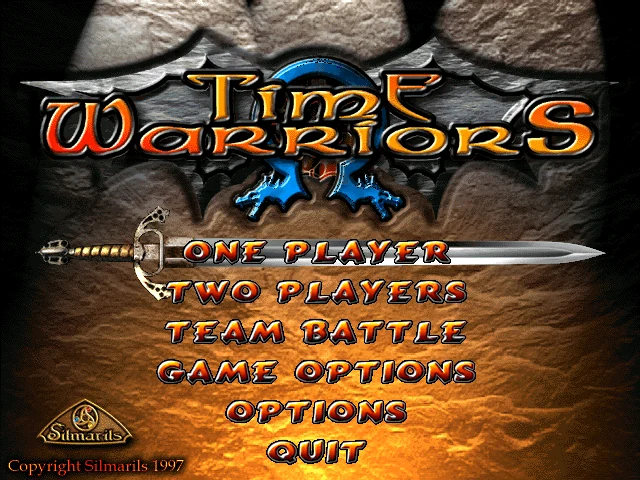
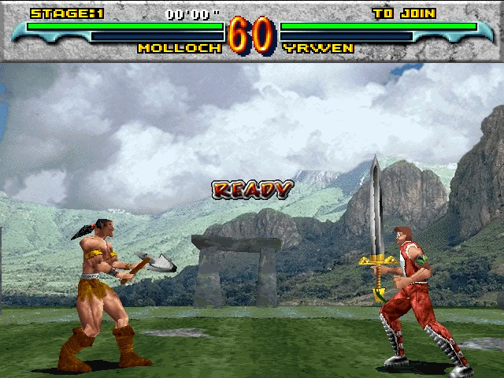
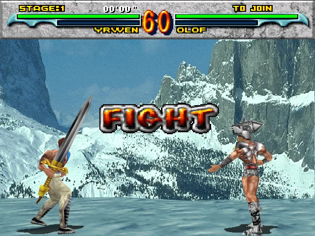
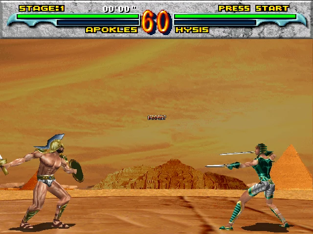
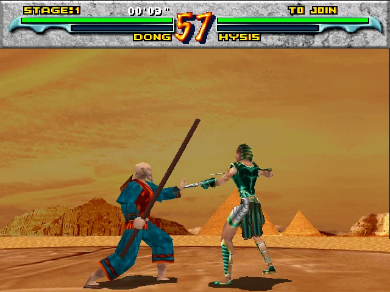

# Time Warriors (1997 — Win32 3dfx Glide 2.11)

| Field | Value |
| :--- | :--- |
| **Category** | Commercial Game |
| **Year** | 1997 |
| **Platform(s)** | `Win32 / Wine (glide.dll)` |
| **Glide API & Version** | **Glide 2.11** (`2.11`, pre-2.3 SST-1 ABI) |
| **Recommended Card Profile** | `VoodooGraphics` (`2.11`) |
| **Verified Backends** | Vulkan · OpenGL 3.3 Core (WGL) · Software (AVX2 / AVX-512 / Scalar) |
| **Preset File(s)** | [`glide-ng.ini`](./glide-ng.ini) (`1×` nearest) · [`glide-ng.hq.ini`](./glide-ng.hq.ini) (4× MSAA + Linear) · [`glide-ng.software.ini`](./glide-ng.software.ini) (CPU Software) |
| **Status** | Verified |

---

## Overview

*Time Warriors* (Silmarils, 1997) is a 3D weapon-based arena fighting game where eight warriors from different historical eras battle inside open-air arenas spanning pyramids, glaciers, temples, and stone circles. The retail CD ships a dedicated **3dfx Glide 2.11 (`glide.dll`)** Win32 executable (`_ST_3DFX.EXE`) alongside a native DirectDraw software build (`_START.EXE`), an MS-DOS software build (`START.EXE`), a Matrox Mystique `MSI95` build (`_ST_MYST.EXE`), and an ATI 3D Rage `ATI3DCIF` build (`_ST_RAGE.EXE`).

Using `_ST_3DFX.EXE` via `glide-ng`'s `glide.dll`, **full bilinear texture filtering**, **Gouraud-shaded textured fighters**, **alpha-blended translucent ground shadows**, **crisp `16-bit` RGB565 `.FLC` intro animations and 2D menu overlays**, and **`4× MSAA`** smooth weapon and silhouette edges (replacing the jagged nearest-neighbor software rasterizer in `_START.EXE`) all run natively at `640×480`.

---

## Editions, Patches & Executables

| Binary | Graphics API | Works with `glide-ng`? | Technical Notes |
| :--- | :--- | :---: | :--- |
| **`_ST_3DFX.EXE`** *(987,136 B, Jun 1997)* | **Glide 2.11 (`glide.dll`)** | **Yes (Recommended)** | Dedicated Win32 3dfx Voodoo Graphics build. Links `glide.dll` directly (pre-2.3 SST-1 `grSstOpen`, `grLfbBegin`/`grLfbEnd`, `grLfbGetWritePtr`, `grSstStatus`). |
| **`_START.EXE`** *(933,888 B, Jun 1997)* | DirectDraw Software | No *(Comparison baseline)* | Native Win32 CPU software rasterizer (`8-bit` / nearest-neighbor textures, banded dithering, stair-stepped polygon edges). |
| **`START.EXE`** *(836,331 B, Jul 1997)* | MS-DOS Software | No | DOS/4GW VGA/VESA software edition (`INSTALL.BAT`); no 3dfx support. |
| **`_ST_MYST.EXE`** *(983,040 B)* | Matrox Mystique (`MSI95.dll`) | No | Proprietary Matrox Mystique acceleration build. |
| **`_ST_RAGE.EXE`** *(991,232 B)* | ATI 3D Rage (`ATI3DCIF.dll`) | No | Proprietary ATI 3D CIF acceleration build. |

---

## Recommended Launch Configurations (Wine32 / Windows)

Stage the disc contents into a local `game/` directory (do **not** keep the retail disc's `GLIDE.DLL` or `SST1INIT.DLL`), write `_start.cdp` containing `D:\` (pointing to your mounted disc drive), drop `glide-ng`'s 32-bit **`glide.dll`** beside `_ST_3DFX.EXE`, and expose a separate symlink directory (`cd_drive/` with `.windows-label` = `TIMEWAR`) as Wine's `D:` **`cdrom`** drive.

### One-Time Wine Prefix Setup

```bash
WINEARCH=win32 WINEPREFIX=/path/to/prefix wineboot -u
WINEARCH=win32 WINEPREFIX=/path/to/prefix wine reg add \
  'HKCU\Software\Wine' /v Version /t REG_SZ /d win98 /f

ln -sfn /path/to/cd_drive /path/to/prefix/dosdevices/d:
WINEARCH=win32 WINEPREFIX=/path/to/prefix wine reg add \
  'HKLM\Software\Wine\Drives' /v 'd:' /t REG_SZ /d cdrom /f

printf 'D:\\\n' > /path/to/game/_start.cdp
```

### Option A: Standard Glide 2.11 (`glide-ng.ini` — Vulkan `1×`, `nearest` Scaling)

```bash
WINEARCH=win32 WINEPREFIX=/path/to/prefix \
WINEDLLOVERRIDES="glide=n" \
GLIDE_NG_CONFIG=/path/to/glide-ng.ini \
  wine explorer /desktop=TimeWarriors,640x480 ./_ST_3DFX.EXE
```

Add `GLIDE_NG_BACKEND=opengl_es` to use the Win32 WGL OpenGL 3.3 Core backend without editing the preset.

### Option B: Best Visuals (`glide-ng.hq.ini` — Vulkan `4× MSAA` + Linear) *(Recommended)*

```bash
WINEARCH=win32 WINEPREFIX=/path/to/prefix \
WINEDLLOVERRIDES="glide=n" \
GLIDE_NG_CONFIG=/path/to/glide-ng.hq.ini \
  wine explorer /desktop=TimeWarriors,640x480 ./_ST_3DFX.EXE
```

### Option C: CPU Software Rasterizer (`glide-ng.software.ini` — AVX2 / AVX-512)

```bash
WINEARCH=win32 WINEPREFIX=/path/to/prefix \
WINEDLLOVERRIDES="glide=n" \
GLIDE_NG_CONFIG=/path/to/glide-ng.software.ini \
  wine explorer /desktop=TimeWarriors,640x480 ./_ST_3DFX.EXE
```

*(Pass `GLIDE_NG_FULLSCREEN=0` when launching inside `explorer /desktop=TimeWarriors,640x480` so the surface stays bounded inside the virtual desktop window. On CPU-only Vulkan adapters on high-core-count systems, cap `LP_NUM_THREADS=4` to avoid 32-bit virtual address exhaustion.)*

---

## Visual Progression Gallery

All screenshots captured at native `640×480` using unmodified retail disc assets (`_ST_3DFX.EXE` via `glide.dll` and `_START.EXE` DirectDraw baseline):

| | |
| :---: | :---: |
| <br>**1. Main Menu (`640×480`, Glide 2.11)**<br>Metallic stone-and-flame title backdrop written via `grLfbBegin` / `grLfbGetWritePtr` with RGB565 pixel bypass and sword cursor highlight. | <br>**2. Player Select (`640×480`, Glide 2.11)**<br>Eight historical fighters carousel (*Yrwen* highlighted) with textured marble border chrome, colorized active portrait, and countdown timer. |
| <br>**3. Native Software Renderer (`_START.EXE`, `640×480`)**<br>Unfiltered nearest-neighbor grass textures, coarse color dithering/banding across sky clouds, opaque blocky edge shadows, and stair-stepped silhouette blades. | <br>**4. Glide 2.11 — Vulkan `4× MSAA` HQ ([`glide-ng.hq.ini`](./glide-ng.hq.ini))**<br>Best overall visuals (*Yrwen vs. Olof*, glacier peak): silky bilinear ice terrain, smooth `4× MSAA` broadsword and armor edges, high-color skybox backdrop, translucent floor shadows, and crisp top HUD health bars. |
| <br>**5. Glide 2.11 — OpenGL 3.3 Core / WGL `1×`**<br>*Apokles vs. Hysis* in the desert arena: smooth bilinear sandstone, glowing metallic skybox reflection, crisp fighter textures, and matching translucent shadow ellipses. | <br>**6. Glide 2.11 — CPU Software AVX2 `1×` ([`glide-ng.software.ini`](./glide-ng.software.ini))**<br>*Dong vs. Hysis* in the desert arena: matches both GPU backends identically across bilinear floor filtering, character shading, translucent drop shadows, and LFB HUD bars. |

---

## Visual Quality & Performance Tuning

### Flavour Comparison: Glide 2.11 (`_ST_3DFX.EXE`) vs. DirectDraw Software (`_START.EXE`)
* **`_ST_3DFX.EXE` via `glide-ng` + [`glide-ng.hq.ini`](./glide-ng.hq.ini) is a huge upgrade over `_START.EXE`.** The software build uses nearest-neighbor 8-bit/dithered rasterization, leaving blocky stone/grass floors, jagged weapon blades, and harsh banding across sky gradients.
* Under **Glide 2.11**, bilinear texture filtering smooths both the arena floor and low-resolution fighter limb textures, full **`16-bit` shading** delivers crisp metallic highlights on weapons and armor, translucent **alpha-blended character shadows** track smoothly across uneven ground without z-fighting, and **`4× MSAA`** eliminates diagonal edge stair-stepping on swords, spears, and shields.
* **All three `glide-ng` backends** (**Vulkan `4× MSAA`**, **OpenGL 3.3 Core / WGL**, and **CPU Software AVX2**) render with full color, shadow, lighting, skybox, and LFB `.FLC` intro parity.

---

## Quirks, Known Issues & Controls

### Installation & Compatibility Notes
* **Delete / exclude the retail `GLIDE.DLL` and `SST1INIT.DLL`:** The original disc includes `1997-01-23` `GLIDE.DLL` (`263,168 B`) and `SST1INIT.DLL` (`132,096 B`). Replace `GLIDE.DLL` with `glide-ng`'s `glide.dll` (`WINEDLLOVERRIDES="glide=n"`), and remove `SST1INIT.DLL`.
* **Suppressing the `"Game directory not found!"` prompt:** Create `_start.cdp` containing `D:\` inside the game directory (normally written by `_SETUP.EXE`).
* **Audio CD warning under Wine without physical Redbook disc:** Because Wine cannot read digital audio tracks from an extracted folder mount, `_ST_3DFX.EXE` displays one startup modal (`"Audio CD driver initialisation has failed! Do you want to continue anyway?"`). Click **`OK`** to continue into gameplay (DirectSound SFX remain active).
* **Intro `.FLC` animations (`OKLOGOSI.FLC` / `OKR3LOGO.FLC`):** Press **`Enter`** / **`Space`** to advance once the opening animation plays — avoid hammering **`Esc`**, which exits the application from certain intro screens.
* **Keep `api_version = 2.11` / `card_model = VoodooGraphics`:** `_ST_3DFX.EXE` relies on early pre-2.3 SST-1 Glide 2.11 behavior (`2 MB` TMU0, linear `gamma = 1.0` set explicitly by the game).

### Useful Controls

| Key / Input | Action |
| :--- | :--- |
| **`Arrow keys`** | Move fighter / navigate menus |
| **`Enter` / `Space`** | Confirm menu item / start game |
| **`Esc`** | Pause / back / quit to desktop |
| **`A` / `Z` / `X` / `C` / `Ctrl`** | Attack, kick, guard, jump *(rebindable in `OPTIONS`)* |
